# 🗺️ RKF Bank — Atlas de fluxos

Como cada parte do RKF Bank se conecta, do clique na tela até a linha no banco. **Tudo aqui abre e fecha com um
clique**: comece pela sua missão e vá abrindo só o que interessa. Os diagramas são **código**
([Mermaid](https://mermaid.js.org/)): o GitHub desenha sozinho e eles mudam no mesmo PR que o código. A organização
segue o **modelo C4** (contexto → containers → componentes), o padrão de mercado para documentar arquitetura em
níveis de zoom.

Legenda das cores: 🟦 o que é nosso · 🟩 banco de dados · 🟧 serviço de terceiros · ⬜ pessoas.
Contrato da API em vigor: **3.0** (só as rotas canônicas; todo erro com `codigo`).

---

## 🧭 Escolha a sua missão

| Missão | Roteiro | Tempo |
|---|---|:-:|
| 👀 **Entender o banco** (visitante, recrutador, curioso) | [🌍 1. Em uma imagem](#-1-o-rkf-bank-em-uma-imagem) → [📱 2. As telas](#-2-as-telas-e-o-que-cada-uma-chama) → [🎯 3. Siga a requisição](#-3-siga-a-requisição-um-passo-de-cada-vez) | 5 min |
| 🧑‍💻 **Mexer no código** (time, quem está chegando) | [🧱 4. Containers](#-4-containers-o-que-roda-onde) → [🧩 5. Camadas](#-5-camadas-do-backend-quem-chama-quem) → [🔎 6. Da tela à tabela](#-6-rastreabilidade-da-tela-à-tabela) → [🔐 7. Sessão](#-7-sessão-login-cookie-e-proxy) | 15 min |
| 🧪 **Testar ponta a ponta** | [🧪 8. O roteiro E2E](#-8-o-roteiro-e2e-cadastro--contas--dinheiro) → [🎚️ 9. Qual perfil subir?](#️-9-qual-perfil-subir) | 15 min |
| 🤝 **Entregar uma feature** | [🚚 10. Como o time trabalha](#-10-como-o-time-trabalha) | 3 min |

---

## 🌍 1. O RKF Bank em uma imagem

**C4 nível 1 (contexto):** quem usa o sistema e com quem ele conversa. Nada de tecnologia ainda.

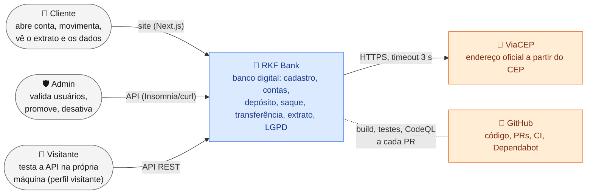

<details>
<summary>🤔 <b>Adivinhe antes de abrir:</b> por que o admin não tem tela?</summary>
<br/>

Decisão do time: a gestão de usuários é rara e sensível, então fica na API (`/admin/usuarios`), coberta por testes e
pela pasta 05 da coleção do Insomnia. Uma tela seria mais superfície de ataque para pouco uso. Se o produto pedir,
o contrato já está pronto ([seção 3.4](backend/README_CONTRATO_API.md#34-gestão-de-usuários-admin)).

</details>

---

## 📱 2. As telas e o que cada uma chama

<details open>
<summary><b>Mapa de navegação</b> com a rota da API de cada tela (🔒 = precisa estar logado)</summary>
<br/>

O `proxy.ts` do Next manda quem não está logado para o login, e volta para a mesma tela depois.

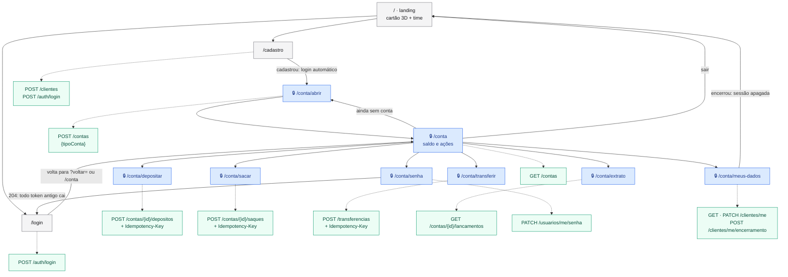

</details>

---

## 🎯 3. Siga a requisição, um passo de cada vez

Uma transferência de **R$ 25,00** da conta ORIGEM para a DESTINO. Abra cada passo para ver o próximo, como um jogo.
Antes de abrir, tente adivinhar **quem** responde e **o quê**.

<details>
<summary>1️⃣ <b>O clique.</b> A pessoa aperta "Transferir" na tela. O que sai do navegador?</summary>
<br/>

O hook [`use-movimentacao.ts`](frontend/components/movimentacao/use-movimentacao.ts) gera uma `Idempotency-Key`
(`crypto.randomUUID()`) e chama `contasApi.transferir`, que faz `POST /api/transferencias` **sem token**: o token
está num cookie `httpOnly` que o JavaScript nem consegue ler.

<details>
<summary>2️⃣ <b>O proxy do Next.</b> Quem coloca o token na chamada?</summary>
<br/>

O [`proxy.ts`](frontend/proxy.ts) lê o cookie, troca por `Authorization: Bearer <token>` e repassa para
`http://localhost:8080/transferencias`. Assim um script injetado na página (XSS) não rouba o token.

<details>
<summary>3️⃣ <b>A borda do Spring.</b> O que acontece antes de qualquer controller?</summary>
<br/>

- [`FiltroLogRequisicao`](backend/src/main/java/com/br/rkfbank/config/FiltroLogRequisicao.java) dá um `X-Request-Id` e
  vai registrar método, rota, status e tempo.
- O Spring Security confere a assinatura e a validade do JWT; o
  [`ConversorTokenUsuario`](backend/src/main/java/com/br/rkfbank/security/ConversorTokenUsuario.java) confere no banco
  se o usuário ainda existe, está ativo, tem o mesmo perfil e a mesma versão de senha.
- Falhou? `401` com `codigo` `TOKEN_INVALIDO` ou `ACESSO_ALTERADO`, e a tela manda para o login.

<details>
<summary>4️⃣ <b>O controller.</b> Ele decide se tem saldo?</summary>
<br/>

**Não.** O [`ContaController`](backend/src/main/java/com/br/rkfbank/controllers/ContaController.java) só traduz HTTP:
o `@Valid` confere o formato do `TransferenciaRequestDto` (`400` `CAMPOS_INVALIDOS` com a lista de `campos`), ele lê
quem está logado (`UsuarioLogado`) e passa tudo para o `IdempotenciaService`.

<details>
<summary>5️⃣ <b>A idempotência.</b> E se a rede caiu e a pessoa clicou de novo?</summary>
<br/>

O [`IdempotenciaService`](backend/src/main/java/com/br/rkfbank/services/IdempotenciaService.java) procura a chave:
mesma chave e mesmo corpo → `204` com `Idempotency-Replayed: true` e **nada se move de novo**; mesma chave com outro
corpo → `422` `IDEMPOTENCIA_CHAVE_REUSADA`; chave nova → segue.

<details>
<summary>6️⃣ <b>A regra de negócio.</b> Em que ordem o service pergunta?</summary>
<br/>

No [`ContaService.transferir`](backend/src/main/java/com/br/rkfbank/services/ContaService.java): mesma conta? (`422`
`MESMA_CONTA`) → a origem é sua? (`403` `CONTA_DE_OUTRO_CLIENTE`) → as duas existem e estão ativas? (`404`/`422`) →
tem saldo? (`422` `SALDO_INSUFICIENTE`). Cada recusa é uma exceção com um
[`CodigoErroEnum`](backend/src/main/java/com/br/rkfbank/exceptions/CodigoErroEnum.java), que já traz a mensagem.

<details>
<summary>7️⃣ <b>O banco.</b> Como o dinheiro não fica "no meio do caminho"?</summary>
<br/>

Tudo roda numa transação só (`@Transactional`): débito, crédito, o lançamento no extrato e a chave de idempotência.
No commit, o Hibernate faz `UPDATE ... WHERE versao = ?` nas duas contas (`@Version`, lock otimista): se outra
operação mexeu antes, **rollback** e `409` `CONCORRENCIA`. Senão, `204 No Content`.

<details>
<summary>8️⃣ <b>A volta.</b> O que a pessoa vê?</summary>
<br/>

O proxy devolve o `204`, a tela mostra o comprovante e recarrega o saldo com `GET /contas`. No log do backend, todas
as linhas dessa requisição têm o mesmo `X-Request-Id`. 🏁 **Fim da trilha!** Agora veja a mesma história em diagrama:
abra a **árvore de decisão** e a **sequência** logo abaixo.

</details>
</details>
</details>
</details>
</details>
</details>
</details>
</details>

<details>
<summary>🌳 <b>A árvore de decisão da transferência</b> (a primeira pergunta que falhar decide a resposta)</summary>
<br/>

O barato e o que não revela informação vem primeiro (quem é você? o pedido está bem escrito?); o que depende do banco
vem depois. Nada é movimentado em nenhum dos ramos de erro.

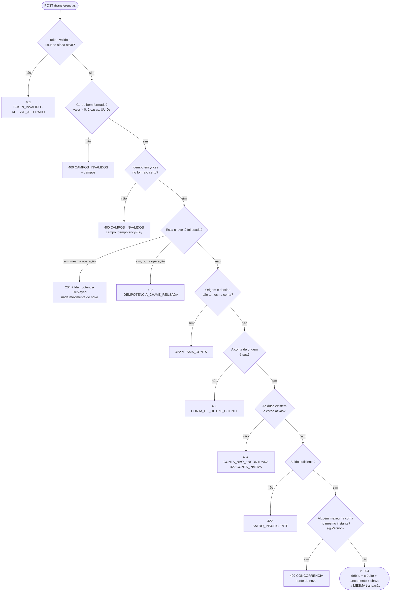

</details>

<details>
<summary>🔬 <b>A sequência por dentro do backend</b> (idempotência + lock otimista)</summary>
<br/>

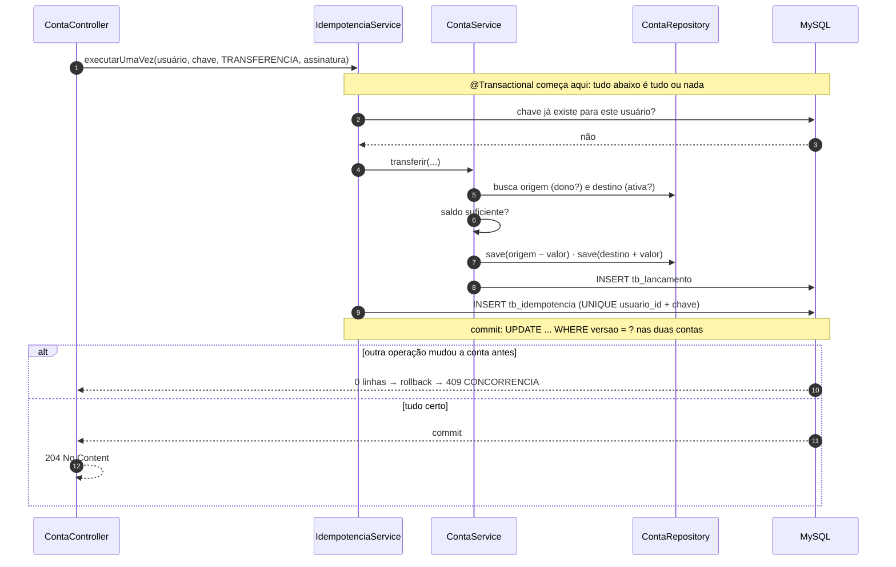

</details>

---

## 🧱 4. Containers: o que roda onde

<details>
<summary><b>C4 nível 2.</b> Cada caixa roda separada. O navegador <b>nunca</b> fala direto com o backend e <b>nunca</b> vê o token.</summary>
<br/>

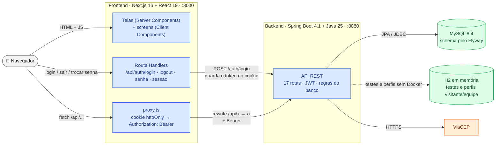

</details>

---

## 🧩 5. Camadas do backend: quem chama quem

<details open>
<summary><b>C4 nível 3.</b> A seta só desce: controller não fala com repository, repository não conhece HTTP.</summary>
<br/>

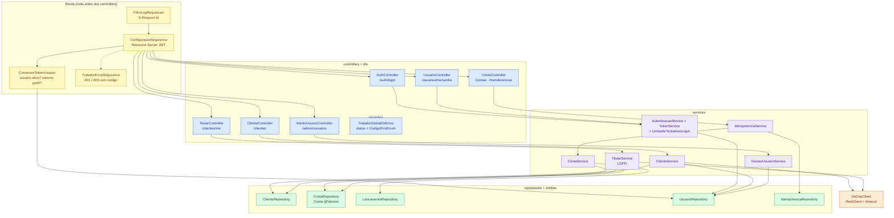

</details>

<details>
<summary>📚 <b>O papel de cada camada</b> (e o que acontece se você pular uma)</summary>
<br/>

| Camada | Faz | Se pular... |
|---|---|---|
| **Controller** | rota, `@Valid`, quem está logado, status de sucesso | regra de negócio espalhada pelo HTTP, impossível testar sem servidor |
| **DTO** (`record`) | formato de entrada e saída, validação de formato | a entidade JPA vaza (senha, `versao`), e mudar o banco quebra o front |
| **Service** | regra (dono, saldo, ativa, LGPD) e a transação | débito sem crédito se algo falhar no meio |
| **Mapeamento** (`paraResponse`) | entidade → DTO, só os campos que a tela usa | dado pessoal a mais na resposta (LGPD) |
| **Repository** | consulta ao banco (Spring Data) | SQL solto no service, difícil de trocar e testar |
| **Exceção + `CodigoErroEnum`** | o service diz **qual** erro; o enum guarda código e mensagem | texto de erro repetido e o front comparando frases |
| **Tratador de erros** | escolhe o status e monta o JSON padrão | cada rota com um formato de erro diferente |

</details>

---

## 🔎 6. Rastreabilidade: da tela à tabela

Para achar rápido **onde mexer**. Clique no nome para abrir o arquivo; a última coluna diz onde mora a decisão.

| Tela | Hook | Rota | Controller | Service | Tabelas | Regra principal |
|---|---|---|---|---|---|---|
| `/cadastro` | [`use-cadastro-form`](frontend/components/cadastro/use-cadastro-form.ts) | `POST /clientes` | [`ClienteController`](backend/src/main/java/com/br/rkfbank/controllers/ClienteController.java) | [`ClienteService`](backend/src/main/java/com/br/rkfbank/services/ClienteService.java) + ViaCEP | `tb_endereco`, `tb_cliente`, `tb_usuario` | CPF/CEP higienizados; CPF e e-mail únicos (`409`), CEP existe (`422`) |
| `/login` | [`use-login`](frontend/components/login/use-login.ts) | `POST /auth/login` | [`AuthController`](backend/src/main/java/com/br/rkfbank/controllers/AuthController.java) | [`AutenticacaoService`](backend/src/main/java/com/br/rkfbank/services/AutenticacaoService.java) | `tb_usuario` | mesma resposta para CPF inexistente e senha errada; 5 erros → `429` |
| `/conta/abrir` | [`use-abrir-conta`](frontend/components/abrir-conta/use-abrir-conta.ts) | `POST /contas` | [`ContaController`](backend/src/main/java/com/br/rkfbank/controllers/ContaController.java) | [`ContaService.abrir`](backend/src/main/java/com/br/rkfbank/services/ContaService.java) | `tb_conta` | dono vem do token; agência `0001` e número com DV gerados |
| `/conta` | [`use-conta`](frontend/components/conta/use-conta.ts) | `GET /contas` | `ContaController` | `ContaService.listarTodas` | `tb_conta` | cliente vê só as dele; admin vê todas (o front filtra pelo `clienteId`) |
| `/conta/depositar` · `/sacar` | [`use-movimentacao`](frontend/components/movimentacao/use-movimentacao.ts) | `POST /contas/{id}/depositos` · `/saques` | `ContaController` | [`IdempotenciaService`](backend/src/main/java/com/br/rkfbank/services/IdempotenciaService.java) → `ContaService` | `tb_conta`, `tb_lancamento`, `tb_idempotencia` | dono (`403`), ativa (`422`), saldo (`422`), uma vez por chave |
| `/conta/transferir` | `use-movimentacao` | `POST /transferencias` | `ContaController` | `IdempotenciaService` → `ContaService.transferir` | idem | [siga a requisição](#-3-siga-a-requisição-um-passo-de-cada-vez) |
| `/conta/extrato` | [`use-extrato`](frontend/components/extrato/use-extrato.ts) | `GET /contas/{id}/lancamentos` | `ContaController` | `ContaService.listarLancamentos` | `tb_lancamento` | dono (`403`); mais novo primeiro |
| `/conta/senha` | [`use-trocar-senha`](frontend/components/trocar-senha/use-trocar-senha.ts) | `PATCH /usuarios/me/senha` | [`UsuarioController`](backend/src/main/java/com/br/rkfbank/controllers/UsuarioController.java) | `AutenticacaoService.trocarSenha` | `tb_usuario` | pede a atual (`SENHA_ATUAL_INCORRETA`); derruba todos os tokens |
| `/conta/meus-dados` | [`use-meus-dados`](frontend/components/meus-dados/use-meus-dados.ts) · [`use-encerrar-cadastro`](frontend/components/meus-dados/use-encerrar-cadastro.ts) | `GET`/`PATCH /clientes/me` · `POST /clientes/me/encerramento` | [`TitularController`](backend/src/main/java/com/br/rkfbank/controllers/TitularController.java) | [`TitularService`](backend/src/main/java/com/br/rkfbank/services/TitularService.java) | `tb_cliente`, `tb_endereco`, `tb_conta`, `tb_usuario` | só o próprio cadastro; encerrar exige senha e saldo zero |
| — (admin) | — | `/admin/usuarios/**` | [`AdminUsuarioController`](backend/src/main/java/com/br/rkfbank/controllers/AdminUsuarioController.java) | [`GestaoUsuarioService`](backend/src/main/java/com/br/rkfbank/services/GestaoUsuarioService.java) | `tb_usuario` | ninguém mexe em si mesmo (`PROPRIO_ACESSO`) |

---

## 🔐 7. Sessão: login, cookie e proxy

<details>
<summary><b>Por que tanta volta?</b> Porque o token num cookie <code>httpOnly</code> não pode ser lido por JavaScript (abra para ver o caminho)</summary>
<br/>

Um script injetado na página (XSS) não consegue roubar o token: quem coloca o token na chamada é o servidor do Next.

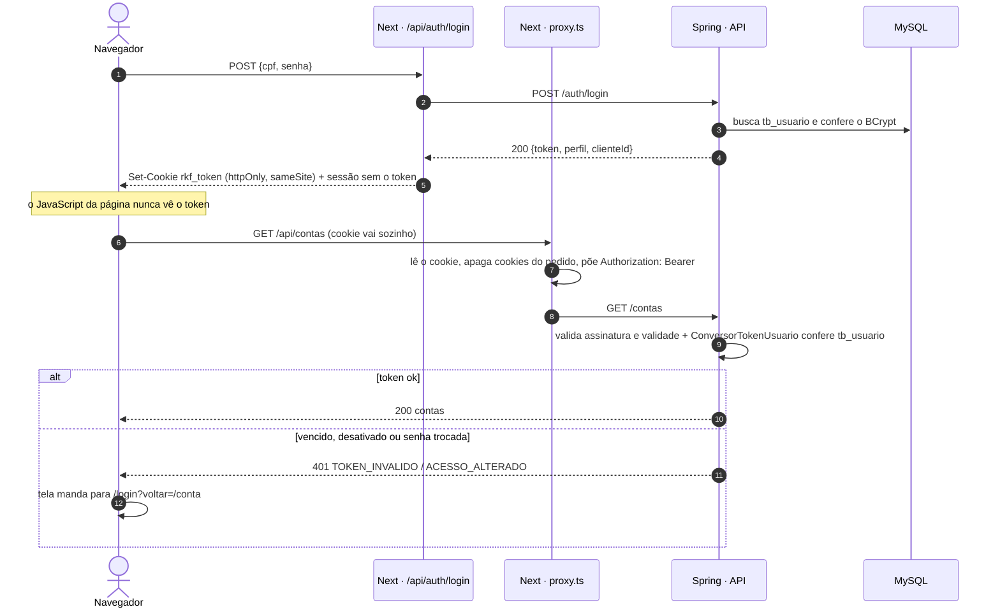

</details>

---

## 🧪 8. O roteiro E2E: cadastro → contas → dinheiro

O mesmo roteiro existe em três formatos, **com os mesmos passos e payloads**: a pasta
**"02 · Fluxo E2E"** da [coleção do Insomnia](backend/insomnia/rkfbank.insomnia.json), o
[fluxo com `curl` do README](README.md#-api-rest) e o [guia de testes](backend/README_TESTES_E2E.md).

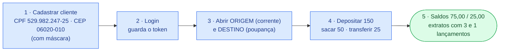

<details>
<summary>✅ <b>Checklist do roteiro</b> (o que conferir em cada passo)</summary>
<br/>

- [ ] **Cadastro `201`:** CPF, telefone e CEP mandados com máscara voltam formatados; a cidade é **Osasco** (veio do ViaCEP); a senha não aparece na resposta.
- [ ] **Login `200`:** `token`, `expiraEmSegundos`, `perfil: CLIENTE` e o `clienteId`.
- [ ] **Duas contas `201`:** agência `0001`, número de 8 dígitos, saldo `0.00`, `tipoConta` certo.
- [ ] **Depósito, saque e transferência `204`:** sem corpo; cada um com uma `Idempotency-Key` nova.
- [ ] **Saldos:** ORIGEM `75.00`, DESTINO `25.00`.
- [ ] **Extratos:** ORIGEM com 3 lançamentos (transferência, saque, depósito), DESTINO com 1 (a transferência).
- [ ] **Bônus:** repita a transferência com a **mesma** chave → `204` + `Idempotency-Replayed: true` e o saldo não muda.

Tudo de uma vez pelo terminal: `node scripts/rodar-colecao-insomnia.mjs` (o roteiro e os erros esperados).

</details>

---

## 🎚️ 9. Qual perfil subir?

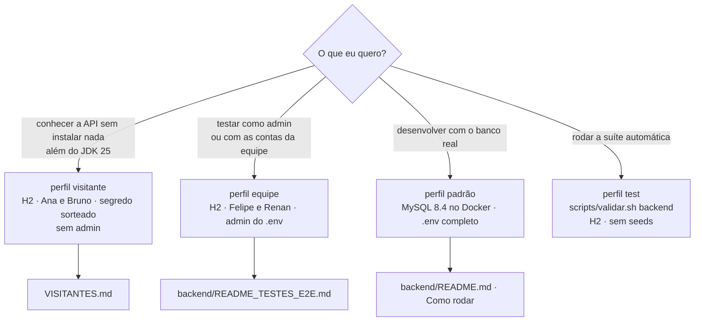

<details>
<summary>⌨️ <b>O comando de cada perfil</b></summary>
<br/>

```bash
./mvnw spring-boot:run -Dspring-boot.run.profiles=visitante   # H2, sem Docker e sem .env
./mvnw spring-boot:run -Dspring-boot.run.profiles=equipe      # H2 + segredos do .env
docker compose up -d && ./mvnw spring-boot:run                # MySQL real
scripts/validar.sh backend                                    # a suíte inteira
```

</details>

---

## 🚚 10. Como o time trabalha

<details>
<summary><b>Do item no checklist até a <code>main</code></b> (as skills do Claude Code automatizam os passos repetitivos)</summary>
<br/>

```mermaid
flowchart LR
    classDef plano fill:#fef9c3,stroke:#ca8a04,color:#713f12
    classDef faz fill:#dbeafe,stroke:#2563eb,color:#1e3a8a
    classDef valida fill:#dcfce7,stroke:#16a34a,color:#14532d
    classDef entrega fill:#ede9fe,stroke:#7c3aed,color:#4c1d95

    CK["planing/checklist-features.md<br/>débitos · decisões · recados"]:::plano --> BR["branch nova da origin/develop<br/>feature/ fix/ docs/ chore/"]:::faz
    BR --> IMP["/implementar-feature · /nova-tela<br/>/explicar-codigo"]:::faz
    IMP --> VAL["scripts/validar.sh<br/>/revisar-migracao · /verificar-contrato<br/>/varrer-vulnerabilidades · /testar-e2e"]:::valida
    VAL --> ENT["/entregar<br/>commits semânticos + PR"]:::entrega
    ENT --> CI["GitHub Actions<br/>Backend CI · CodeQL · Dependency Review"]:::valida
    CI --> REV["revisão do outro dev"]:::entrega
    REV --> DEV["develop"]:::entrega
    DEV -->|"reunião semanal<br/>/notas-de-versao"| MAIN["main"]:::entrega
    ENT -.->|"/recado"| CK
```

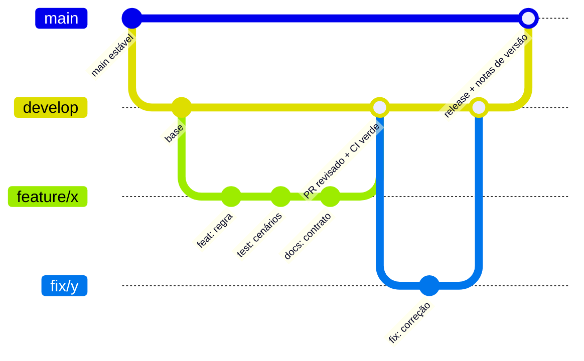

</details>

---

## 🗂️ Outros diagramas do projeto

| Diagrama | Onde |
|---|---|
| Jornada do cliente e saldo a cada lançamento | [README → A experiência](README.md#-a-experiência) |
| Os portões de segurança do JWT e o laboratório "tente quebrar o banco" | [README → Segurança e LGPD](README.md#-segurança-e-lgpd) |
| Cada camada ponto a ponto e a transferência do clique ao banco | [README → Arquitetura](README.md#-arquitetura) |
| Modelo de dados (ER) e linha do tempo das migrações | [README → Arquitetura](README.md#-arquitetura) |
| Ciclo de vida de um usuário (promover, rebaixar, desativar) | [Guia de testes → administração](backend/README_TESTES_E2E.md) |

<div align="center"><a href="#️-rkf-bank--atlas-de-fluxos">⬆️ voltar ao topo</a></div>
