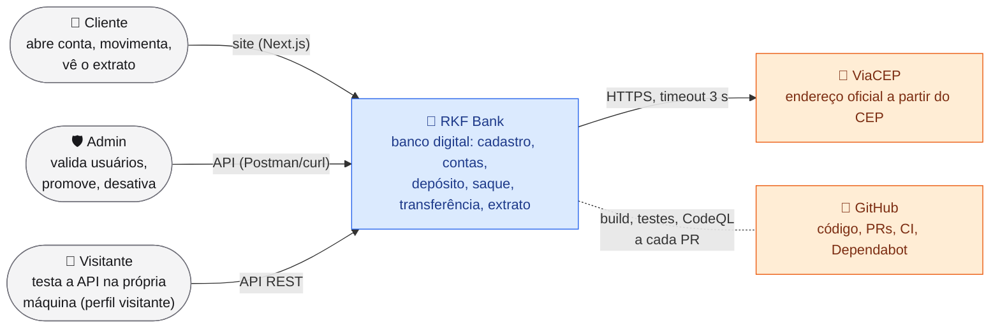
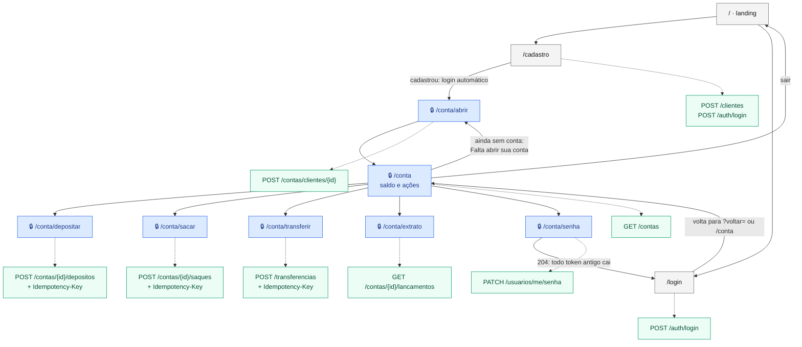
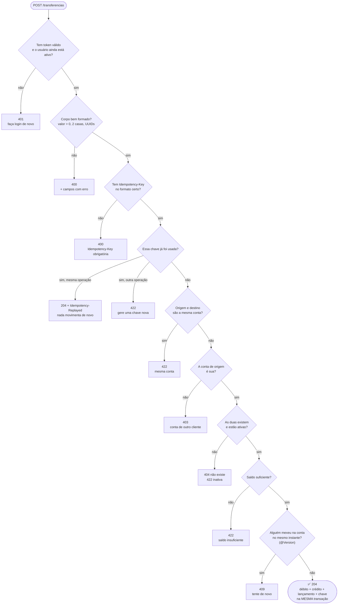
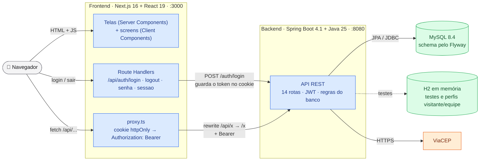
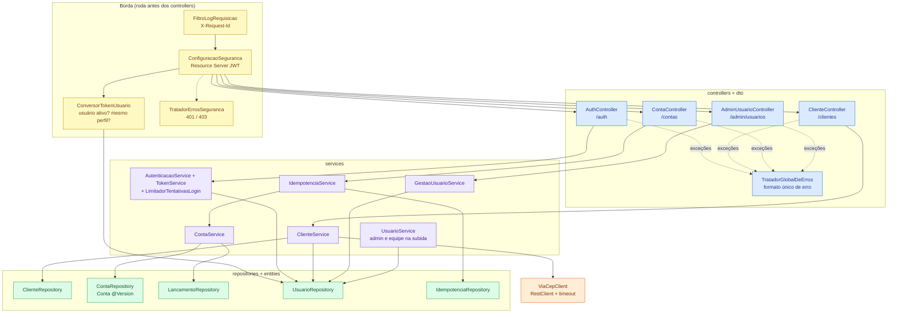
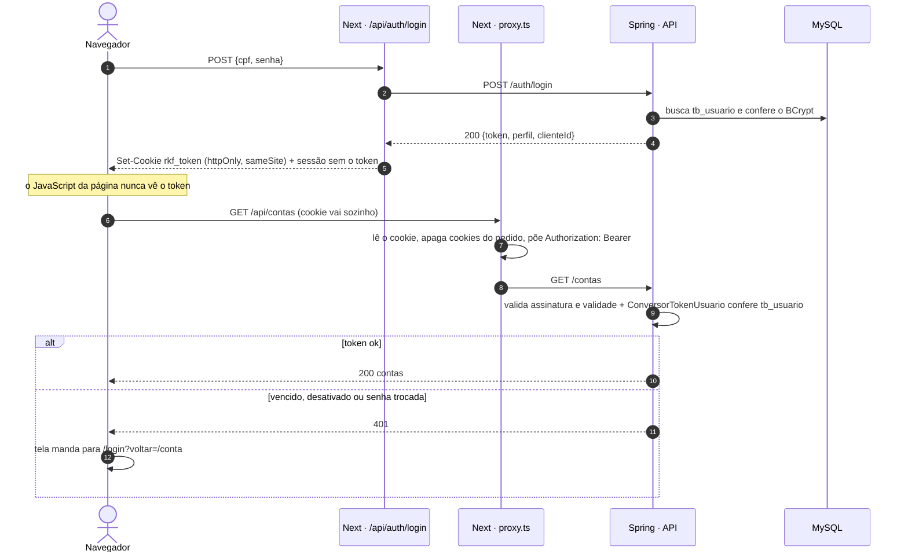
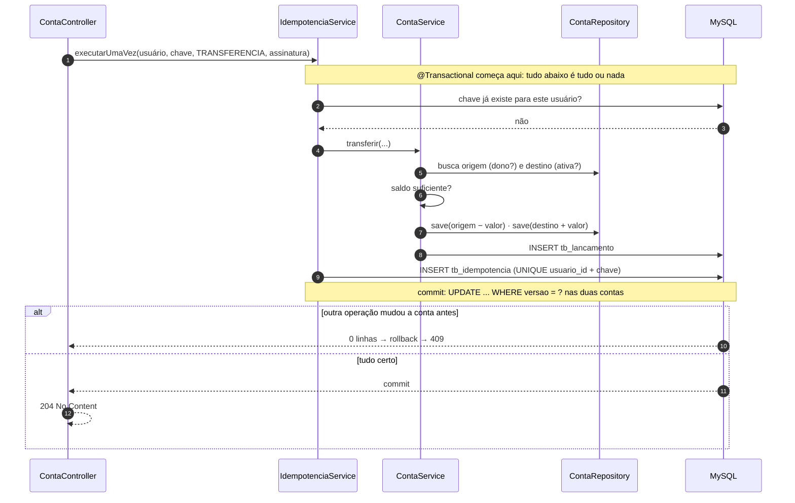
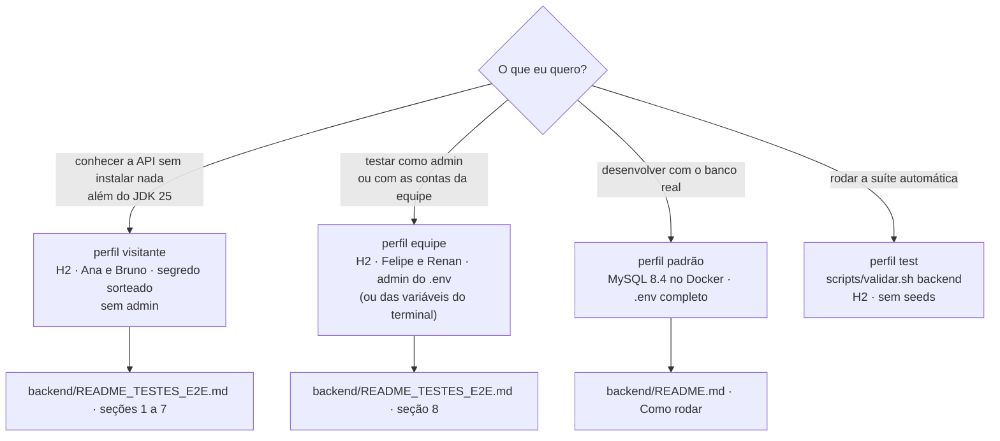
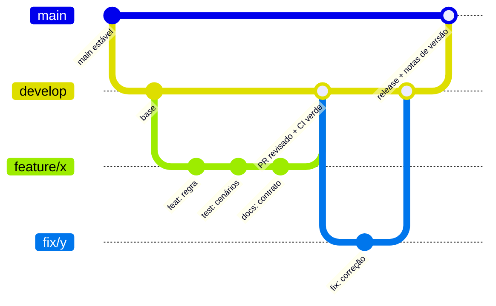

# 🗺️ RKF Bank — Atlas de fluxos

Como cada parte do RKF Bank se conecta, do clique na tela até a linha no banco. Os diagramas são **código**
([Mermaid](https://mermaid.js.org/)): o GitHub desenha sozinho, eles mudam no mesmo PR que o código e passam por revisão
como qualquer arquivo. A organização segue o **modelo C4** (contexto → containers → componentes), o padrão de mercado
para documentar arquitetura em níveis de zoom.

| Sou... | Comece por |
|---|---|
| 👀 visitante, recrutador(a), curioso(a) | [1. O RKF Bank em uma imagem](#1-o-rkf-bank-em-uma-imagem) → [2. As telas](#2-as-telas-e-o-que-cada-uma-chama) → [3. Uma transferência por dentro](#3-uma-transferência-por-dentro-árvore-de-decisão) |
| 🧑‍💻 do time (ou chegando nele) | [4. Containers](#4-containers-o-que-roda-onde) → [5. Componentes](#5-componentes-do-backend) → [6. Rastreabilidade](#6-rastreabilidade-da-tela-à-tabela) → [7. Sessão](#7-sessão-login-cookie-e-proxy) → [8. Transferência](#8-transferência-ponta-a-ponta) → [10. Como o time trabalha](#10-como-o-time-trabalha) |
| 🧪 vou testar | [9. Qual perfil subir?](#9-qual-perfil-subir) e o [guia de testes](backend/README_TESTES_E2E.md) |

Legenda das cores: 🟦 o que é nosso · 🟩 banco de dados · 🟧 serviço de terceiros · ⬜ pessoas.

---

## 1. O RKF Bank em uma imagem

**C4 nível 1 (contexto):** quem usa o sistema e com quem ele conversa. Nada de tecnologia ainda.

---

## 2. As telas e o que cada uma chama

Mapa de navegação do site, com a rota da API que cada tela usa. 🔒 = precisa estar logado (o `proxy.ts` do Next manda
para o login, e volta para a mesma tela depois).

O admin não tem tela (decisão do time): usa `GET/PATCH /admin/usuarios` pelo Postman ou curl
([guia de testes, seção 8](backend/README_TESTES_E2E.md)).

---

## 3. Uma transferência por dentro (árvore de decisão)

Toda transferência passa por estas perguntas, **nesta ordem**. A primeira que falhar decide a resposta, e nada é
movimentado. Por que nessa ordem: o barato e o que não revela informação vem primeiro (quem é você? o pedido está bem
escrito?), o que depende do banco vem depois.

---

## 4. Containers: o que roda onde

**C4 nível 2.** Cada caixa é algo que roda separado (um processo, um banco). O navegador **nunca** fala direto com o
backend e **nunca** vê o token.

---

## 5. Componentes do backend

**C4 nível 3.** As camadas do Spring e quem pode chamar quem. A seta só desce: controller não fala com repository,
repository não conhece HTTP. O porquê de cada camada está no [guia de testes, seção 9](backend/README_TESTES_E2E.md).

---

## 6. Rastreabilidade: da tela à tabela

Para achar rápido **onde mexer**. Cada linha é um caminho completo; a coluna "regra" diz onde mora a decisão.

| Tela | Hook (frontend) | `lib/api` | Rota | Controller | Service | Tabelas | Regra principal |
|---|---|---|---|---|---|---|---|
| `/cadastro` | `use-cadastro-form` | `clientesApi.cadastrar` → `authApi.login` | `POST /clientes` | `ClienteController.cadastrar` | `ClienteService.cadastrar` (+ ViaCEP) | `tb_endereco`, `tb_cliente`, `tb_usuario` | CPF e e-mail únicos (409), CEP existe (422) |
| `/login` | `use-login` | `authApi.login` (Route Handler do Next) | `POST /auth/login` | `AuthController.login` | `AutenticacaoService.login` + `TokenService` | `tb_usuario` | mesma resposta para CPF inexistente e senha errada; 5 erros → 429 |
| `/conta/abrir` | `use-abrir-conta` | `contasApi.abrir` | `POST /contas/clientes/{id}` | `ContaController.abrir` | `ContaService.abrir` | `tb_conta` | só no próprio cadastro (403); número com DV gerado |
| `/conta` | `use-conta` | `contasApi.minhas` | `GET /contas` | `ContaController.listar` | `ContaService.listarTodas` | `tb_conta` | cliente vê só as dele; admin vê todas |
| `/conta/depositar` · `/sacar` | `use-movimentacao` | `contasApi.depositar` · `sacar` | `POST /contas/{id}/depositos` · `/saque` | `ContaController.depositar` · `sacar` | `IdempotenciaService` → `ContaService` | `tb_conta`, `tb_lancamento`, `tb_idempotencia` | dono (403), ativa (422), saldo (422), uma vez por chave |
| `/conta/transferir` | `use-movimentacao` | `contasApi.transferir` | `POST /transferencias` | `ContaController.transferir` | `IdempotenciaService` → `ContaService.transferir` | idem | [árvore da seção 3](#3-uma-transferência-por-dentro-árvore-de-decisão) |
| `/conta/extrato` | `use-extrato` | `contasApi.extrato` | `GET /contas/{id}/lancamentos` | `ContaController.extrato` | `ContaService.listarLancamentos` | `tb_lancamento` | dono (403); mais novo primeiro |
| `/conta/senha` | `use-trocar-senha` | `authApi.trocarSenha` (Route Handler) | `PATCH /usuarios/me/senha` | `AuthController.trocarSenha` | `AutenticacaoService.trocarSenha` | `tb_usuario` | pede a atual; derruba todos os tokens |
| — (admin) | — | — | `/admin/usuarios/**` | `AdminUsuarioController` | `GestaoUsuarioService` | `tb_usuario` | ninguém mexe em si mesmo (422) |

---

## 7. Sessão: login, cookie e proxy

Por que tanta volta: o token num **cookie `httpOnly`** não pode ser lido por JavaScript, então um script injetado na
página (XSS) não consegue roubá-lo. Quem coloca o token na chamada é o servidor do Next.

---

## 8. Transferência ponta a ponta

O caminho feliz por dentro do backend, com as duas proteções que um banco precisa: **não repetir** (idempotência) e
**não sobrescrever** (lock otimista), tudo numa transação só.

---

## 9. Qual perfil subir?

---

## 10. Como o time trabalha

Do item no checklist até a `main`. As *skills* do Claude Code (`.claude/skills/`) automatizam os passos repetitivos;
os scripts determinísticos rodam antes de qualquer IA.

```mermaid
flowchart LR
    classDef plano fill:#fef9c3,stroke:#ca8a04,color:#713f12
    classDef faz fill:#dbeafe,stroke:#2563eb,color:#1e3a8a
    classDef valida fill:#dcfce7,stroke:#16a34a,color:#14532d
    classDef entrega fill:#ede9fe,stroke:#7c3aed,color:#4c1d95

    CK["planing/checklist-features.md<br/>débitos · decisões · recados"]:::plano --> BR["branch nova da origin/develop<br/>feature/ fix/ docs/ chore/"]:::faz
    BR --> IMP["/implementar-feature · /nova-tela<br/>/explicar-codigo"]:::faz
    IMP --> VAL["scripts/validar.sh<br/>/revisar-migracao · /verificar-contrato<br/>/varrer-vulnerabilidades · /testar-e2e"]:::valida
    VAL --> ENT["/entregar<br/>commits semânticos + PR"]:::entrega
    ENT --> CI["GitHub Actions<br/>Backend CI · CodeQL · Dependency Review"]:::valida
    CI --> REV["revisão do outro dev"]:::entrega
    REV --> DEV["develop"]:::entrega
    DEV -->|"/notas-de-versao"| MAIN["main"]:::entrega
    ENT -.->|"/recado"| CK
```

---

## Outros diagramas do projeto

| Diagrama | Onde |
|---|---|
| Jornada do cliente (do cadastro ao extrato) e saldo a cada lançamento | [README → A experiência](README.md#-a-experiência) |
| Os portões de segurança do JWT e o ataque de força bruta | [README → Segurança e LGPD](README.md#-segurança-e-lgpd) |
| Arquitetura resumida e animação da transferência | [README → Arquitetura](README.md#-arquitetura) |
| Modelo de dados (ER) e linha do tempo das migrações | [README → Arquitetura](README.md#-arquitetura) |
| Caminho de uma requisição autenticada (sequência) | [Guia de testes → seção 3.3](backend/README_TESTES_E2E.md) |
| Onde cada cenário de teste é barrado (camadas) | [Guia de testes → seção 9](backend/README_TESTES_E2E.md) |
| Ciclo de vida de um usuário (promover, rebaixar, desativar) | [Guia de testes → seção 8.1](backend/README_TESTES_E2E.md) |
