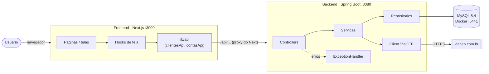
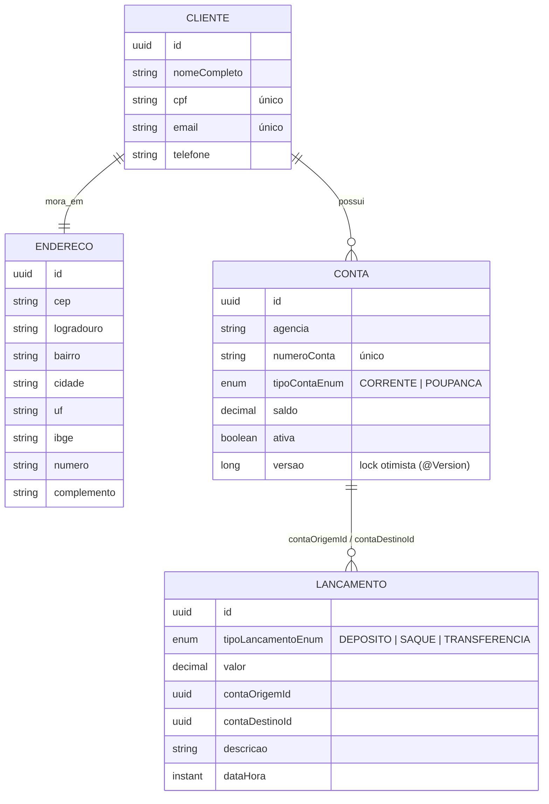
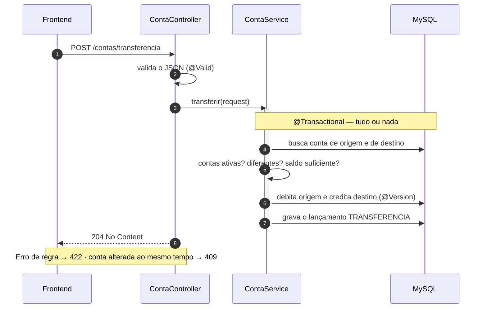
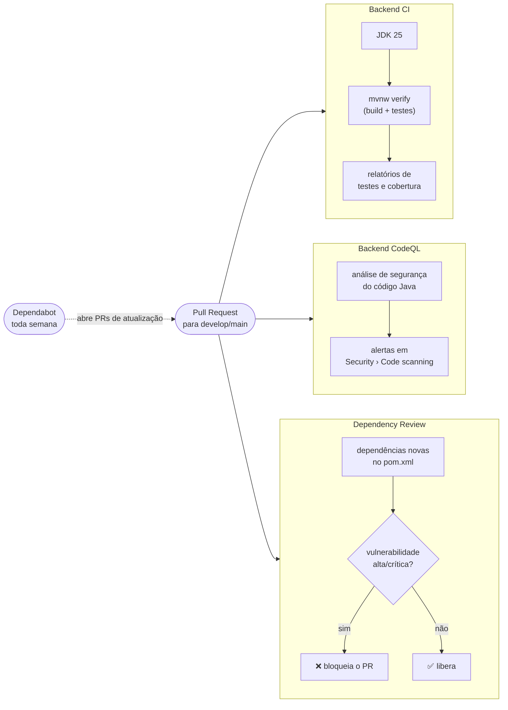
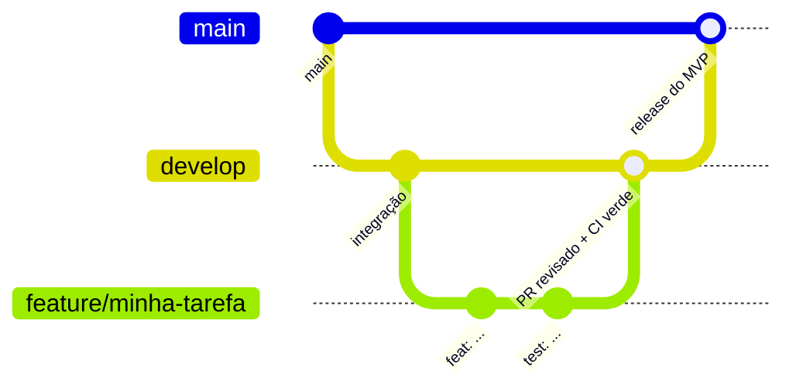

<div align="center">

# 🏦 RKF Bank

**Banco digital de estudo, construído ponta a ponta por um time pequeno — com processo de time de verdade.**

[](https://github.com/k3vinrich4rd/rkf_bank/actions/workflows/backend-ci.yml)
[](https://github.com/k3vinrich4rd/rkf_bank/actions/workflows/backend-codeql.yml)
[](https://github.com/k3vinrich4rd/rkf_bank/commits/develop)
[](https://github.com/k3vinrich4rd/rkf_bank/pulls)

[](https://openjdk.org/projects/jdk/25/)
[](https://spring.io/projects/spring-boot)
[](https://dev.mysql.com/doc/refman/8.4/en/)
[](https://nextjs.org/)
[](https://react.dev/)
[](https://www.typescriptlang.org/)
[](planing/roadmap.md)

[Sobre](#-sobre-o-projeto) ·
[Funcionalidades](#-funcionalidades) ·
[Tecnologias](#%EF%B8%8F-tecnologias) ·
[Arquitetura](#%EF%B8%8F-arquitetura) ·
[API](#-api-rest) ·
[Rodando](#-rodando-o-projeto) ·
[Testes](#-testes-e-qualidade) ·
[CI/CD](#%EF%B8%8F-github-actions-cicd) ·
[Como trabalhamos](#-como-trabalhamos) ·
[Roadmap](#%EF%B8%8F-roadmap) ·
[Time](#-time)

</div>


## 🧭 Sobre o projeto

O **RKF Bank** é uma aplicação bancária completa (**API REST + site**) criada para praticar, na vida real,
o que um time de engenharia faz no dia a dia: combinar um **contrato de API**, trabalhar com **Git Flow e
Pull Requests**, registrar **decisões**, escrever **testes automatizados**, rodar **CI no GitHub Actions** e
entregar um **MVP com prazo**.

> *Conhecimento não tem teto. Código não tem limite. Só tem próximo nível.*

**Meta atual:** 🚀 MVP no ar até **31/10/2026** — acompanhe no [roadmap](planing/roadmap.md).


## ✨ Funcionalidades

| Funcionalidade | Backend | Frontend |
|---|:---:|:---:|
| Landing page institucional (hero, recursos, segurança, FAQ) | — | ✅ |
| Cadastro de cliente com endereço automático pelo CEP (ViaCEP) | ✅ | ✅ |
| Listagem de clientes (completa ou paginada) | ✅ | — |
| Abertura de conta corrente ou poupança | ✅ | ⏳ |
| Listagem de contas (completa ou paginada) | ✅ | — |
| Depósito e saque | ✅ | ⏳ |
| Transferência entre contas | ✅ | ⏳ |
| Extrato da conta | ✅ | ⏳ |
| Tela de saldo da conta | ⏳ | ⏳ |
| Login | ⏳ | 🟡 |

✅ pronto · 🟡 parcial · ⏳ a fazer

<details>
<summary><b>🔎 Ver as regras de negócio que o backend garante</b></summary>
<br/>

- CPF (com dígito verificador validado por `@CpfValido`) e e-mail **não se repetem**.
- O **CEP precisa existir** no ViaCEP — logradouro, bairro, cidade, UF e IBGE são preenchidos automaticamente.
- Toda conta pertence a um cliente e **começa com saldo zero e ativa**. Um cliente pode ter várias contas.
- O **número da conta não se repete**.
- Só **conta ativa** movimenta e tem extrato.
- Todo valor precisa ser **maior que zero**, com até 2 casas decimais.
- Saque e transferência exigem **saldo suficiente**.
- Não dá para **transferir para a mesma conta**.
- Débito e crédito da transferência acontecem **na mesma transação** (tudo ou nada).
- Operações simultâneas na mesma conta **não se sobrescrevem** (lock otimista com `@Version`).

</details>

<details>
<summary><b>⭐ Ver os destaques técnicos</b></summary>
<br/>

- **Dinheiro tratado com cuidado:** `BigDecimal`, `@Transactional` e lock otimista contra concorrência.
- **Contrato de API primeiro:** frontend e backend trabalham em paralelo a partir do mesmo documento.
- **Arquitetura em camadas:** Controller → Service → Repository, com DTOs (`record`) e erros padronizados.
- **Integração externa resiliente:** consulta ao ViaCEP com *timeout* de 3s e erros traduzidos para `422`/`503`.
- **Erros previsíveis:** um único `@RestControllerAdvice` devolve sempre o mesmo formato, com o campo inválido.
- **Testes automatizados** em todas as camadas do backend, com relatório de cobertura (JaCoCo).
- **LGPD no frontend:** CPF, e-mail e telefone são mascarados nos logs.
- **Esteira no GitHub Actions:** build, testes, análise de segurança e revisão de dependências em todo PR.

</details>


## 🛠️ Tecnologias

<details open>
<summary><b>☕ Backend</b></summary>
<br/>

| Tecnologia | Versão | Para que usamos |
|---|---|---|
| [Java](https://openjdk.org/projects/jdk/25/) | 25 (LTS) | linguagem do backend |
| [Spring Boot](https://spring.io/projects/spring-boot) | 4.1.1 | base da aplicação |
| Spring Web MVC | — | controllers REST |
| [Spring Data JPA](https://spring.io/projects/spring-data-jpa) + Hibernate | — | acesso ao banco e repositórios |
| [Jakarta Validation](https://beanvalidation.org/) | — | validação dos DTOs + validador customizado de CPF |
| `RestClient` (Spring) | — | integração com o [ViaCEP](https://viacep.com.br/) |
| [MySQL](https://dev.mysql.com/doc/refman/8.4/en/) | 8.4 | banco de dados (via Docker Compose) |
| [H2](https://www.h2database.com/) | — | banco em memória para os testes |
| [JUnit 5](https://junit.org/junit5/) + [Mockito](https://site.mockito.org/) | — | testes automatizados |
| [JaCoCo](https://www.jacoco.org/jacoco/) | 0.8.14 | relatório de cobertura de testes |
| [Maven Wrapper](https://maven.apache.org/wrapper/) | Maven 3.9 | build sem precisar instalar o Maven |
| Spring DevTools | — | reinício automático em desenvolvimento |

</details>

<details>
<summary><b>⚛️ Frontend</b></summary>
<br/>

| Tecnologia | Versão | Para que usamos |
|---|---|---|
| [Next.js](https://nextjs.org/) (App Router) | 16 | framework do site e proxy `/api` para o backend |
| [React](https://react.dev/) | 19 | interface |
| [TypeScript](https://www.typescriptlang.org/) | 5 | tipagem, espelhando o contrato da API |
| [Tailwind CSS](https://tailwindcss.com/) | 4 | estilos |
| [shadcn/ui](https://ui.shadcn.com/) + [Radix UI](https://www.radix-ui.com/) | — | componentes acessíveis |
| [Lucide](https://lucide.dev/) | — | ícones |
| [ESLint](https://eslint.org/) | 9 | padrão de código |
| [pnpm](https://pnpm.io/) | 10 | gerenciador de pacotes |

</details>

<details>
<summary><b>🧰 Infra, qualidade e processo</b></summary>
<br/>

| Ferramenta | Para que usamos |
|---|---|
| [Docker Compose](https://docs.docker.com/compose/) | sobe o MySQL local com *healthcheck* |
| [GitHub Actions](https://docs.github.com/actions) | CI do backend, CodeQL e revisão de dependências |
| [CodeQL](https://codeql.github.com/) | análise de segurança do código Java |
| [Dependabot](https://docs.github.com/code-security/dependabot) | PRs automáticos de atualização (Maven e Actions) |
| [Conventional Commits](https://www.conventionalcommits.org/pt-br) | padrão das mensagens de commit |
| Git Flow simplificado | `feature/*` → `develop` → `main` |

</details>


## 🏗️ Arquitetura



- O **navegador nunca fala direto com o backend**: ele chama `/api/...` no próprio Next, que repassa para
  `http://localhost:8080` (veja [`frontend/next.config.ts`](frontend/next.config.ts)).
- A **fronteira entre os dois lados** é o [contrato de API](backend/README_CONTRATO_API.md). Mudou um endpoint?
  Muda o contrato **no mesmo PR**.

<details>
<summary><b>📦 Ver as camadas do backend</b></summary>
<br/>

| Pacote | Responsabilidade |
|---|---|
| [`controllers`](backend/src/main/java/com/br/rkfbank/controllers) | recebe a requisição HTTP e devolve o status |
| [`services`](backend/src/main/java/com/br/rkfbank/services) | regras de negócio e transações |
| [`repositories`](backend/src/main/java/com/br/rkfbank/repositories) | acesso ao banco (Spring Data JPA) |
| [`entities`](backend/src/main/java/com/br/rkfbank/entities) | modelo persistido (`Cliente`, `Endereco`, `Conta`, `Lancamento`) |
| [`dto`](backend/src/main/java/com/br/rkfbank/dto) | formato de entrada e saída da API |
| [`clients/viacep`](backend/src/main/java/com/br/rkfbank/clients/viacep) | integração com o ViaCEP |
| [`controllers/handlers`](backend/src/main/java/com/br/rkfbank/controllers/handlers) | padroniza as respostas de erro |
| [`validation`](backend/src/main/java/com/br/rkfbank/validation) | validações customizadas (`@CpfValido`) |
| [`exceptions`](backend/src/main/java/com/br/rkfbank/exceptions) | exceções de negócio que viram status HTTP |

Mais detalhes em [backend/README_IMPLEMENTACAO.md](backend/README_IMPLEMENTACAO.md).

</details>

<details>
<summary><b>🗃️ Ver o modelo de dados</b></summary>
<br/>



</details>

<details>
<summary><b>🔁 Ver o fluxo de uma transferência</b></summary>
<br/>



</details>


## 🔌 API REST

Base URL: `http://localhost:8080` · JSON · IDs em UUID · dinheiro com 2 casas (`150.00`) · datas em ISO-8601 UTC.
O contrato completo está em [backend/README_CONTRATO_API.md](backend/README_CONTRATO_API.md).

| Método | Rota | O que faz | Sucesso |
|---|---|---|---|
| `POST` | `/clientes` | cadastra cliente | `201` |
| `GET` | `/clientes` | lista clientes (`?paginado=true&page=0&size=10`) | `200` |
| `POST` | `/contas/clientes/{clienteId}` | abre conta para o cliente | `201` |
| `GET` | `/contas` | lista contas (`?paginado=true&page=0&size=10`) | `200` |
| `POST` | `/contas/{contaId}/deposito` | deposita | `204` |
| `POST` | `/contas/{contaId}/saque` | saca | `204` |
| `POST` | `/contas/transferencia` | transfere entre contas | `204` |
| `GET` | `/contas/{contaId}/lancamentos` | extrato (mais recente primeiro) | `200` |

<details>
<summary><b>👤 <code>POST /clientes</code> — cadastrar cliente</b></summary>
<br/>

```json
{
  "nomeCompleto": "Joao Silva",
  "cpf": "52998224725",
  "email": "joao.silva@rkfbank.com",
  "telefone": "11999998888",
  "cep": "01001000",
  "numero": "123",
  "complemento": "Apto 45"
}
```

Resposta `201` — o endereço vem do ViaCEP e CPF, telefone e CEP voltam formatados:

```json
{
  "id": "1a89861c-70a0-4b7c-947a-d16cdfe2dd08",
  "nomeCompleto": "Joao Silva",
  "cpf": "529.982.247-25",
  "email": "joao.silva@rkfbank.com",
  "telefone": "(11) 99999-8888",
  "endereco": {
    "cep": "01001-000",
    "logradouro": "Praça da Sé",
    "bairro": "Sé",
    "cidade": "São Paulo",
    "uf": "SP",
    "ibge": "3550308",
    "numero": "123",
    "complemento": "Apto 45"
  }
}
```

</details>

<details>
<summary><b>💳 <code>POST /contas/clientes/{clienteId}</code> — abrir conta</b></summary>
<br/>

```json
{
  "agencia": "0001",
  "numeroConta": "12345678",
  "tipoContaEnum": "CORRENTE"
}
```

Resposta `201`:

```json
{
  "id": "407d727e-4e43-4c93-b01c-331cbaba42fb",
  "clienteId": "1a89861c-70a0-4b7c-947a-d16cdfe2dd08",
  "agencia": "0001",
  "numeroConta": "12345678",
  "tipoContaEnum": "CORRENTE",
  "saldo": 0.00,
  "ativa": true
}
```

</details>

<details>
<summary><b>💰 <code>POST /contas/{contaId}/deposito</code> e <code>/saque</code> — movimentar</b></summary>
<br/>

```json
{
  "valor": 150.00,
  "descricao": "Deposito inicial"
}
```

Resposta `204` sem corpo. O saque exige saldo suficiente.

</details>

<details>
<summary><b>🔀 <code>POST /contas/transferencia</code> — transferir</b></summary>
<br/>

```json
{
  "contaOrigemId": "407d727e-4e43-4c93-b01c-331cbaba42fb",
  "contaDestinoId": "566dd28f-b08f-41e4-ac55-cc69ecfea4cd",
  "valor": 50.00,
  "descricao": "Transferencia aluguel"
}
```

Resposta `204` sem corpo.

</details>

<details>
<summary><b>📄 <code>GET /contas/{contaId}/lancamentos</code> — extrato</b></summary>
<br/>

```json
[
  {
    "id": "59798941-269a-406c-8783-9be456bf1f5c",
    "tipoLancamento": "TRANSFERENCIA",
    "valor": 50.00,
    "contaOrigemId": "407d727e-4e43-4c93-b01c-331cbaba42fb",
    "contaDestinoId": "566dd28f-b08f-41e4-ac55-cc69ecfea4cd",
    "descricao": "Transferencia aluguel",
    "dataHora": "2026-10-12T11:19:53.038985Z"
  }
]
```

O `valor` é sempre positivo: se a conta da tela é o `contaDestinoId`, é entrada; senão, saída.

</details>

<details>
<summary><b>⚠️ Formato de erro e status HTTP</b></summary>
<br/>

```json
{
  "timestamp": "2026-10-12T11:19:54.090042Z",
  "status": 400,
  "error": "Bad Request",
  "message": "Requisicao invalida",
  "path": "/clientes",
  "campos": [
    { "campo": "cpf", "mensagem": "cpf inválido" }
  ]
}
```

| Status | Quando |
|---|---|
| `400` | dados inválidos, JSON mal formado ou parâmetro inválido |
| `404` | cliente ou conta não encontrado |
| `409` | CPF, e-mail ou número de conta repetido, ou conta alterada ao mesmo tempo |
| `422` | regra de negócio: CEP inexistente, saldo insuficiente, mesma conta na transferência |
| `503` | ViaCEP fora do ar |

</details>

<details>
<summary><b>🧪 Testar o fluxo completo com <code>curl</code></b></summary>
<br/>

```bash
API=http://localhost:8080

# 1. cliente
curl -X POST $API/clientes -H "Content-Type: application/json" -d '{
  "nomeCompleto":"Joao Silva","cpf":"52998224725","email":"joao@rkfbank.com",
  "telefone":"11999998888","cep":"01001000","numero":"123"}'

# 2. conta (use o id do cliente)
curl -X POST $API/contas/clientes/$CLIENTE_ID -H "Content-Type: application/json" \
  -d '{"agencia":"0001","numeroConta":"12345678","tipoContaEnum":"CORRENTE"}'

# 3. movimentações (use o id da conta)
curl -X POST $API/contas/$CONTA_ID/deposito -H "Content-Type: application/json" -d '{"valor":150.00}'
curl -X POST $API/contas/$CONTA_ID/saque    -H "Content-Type: application/json" -d '{"valor":20.00}'

# 4. extrato
curl $API/contas/$CONTA_ID/lancamentos
```

CPFs válidos para teste: `52998224725`, `16899535009`, `39053344705`, `11144477735`.
Roteiro completo para Postman/Insomnia: [backend/README_TESTES_E2E.md](backend/README_TESTES_E2E.md).

</details>


## 🚀 Rodando o projeto

### Pré-requisitos

| Ferramenta | Versão | Para quê |
|---|---|---|
| [JDK](https://adoptium.net/temurin/releases/?version=25) | **25** (o Maven Enforcer bloqueia outras versões) | backend |
| [Docker Desktop](https://www.docker.com/products/docker-desktop/) | recente | banco MySQL |
| [Node.js](https://nodejs.org/) | 20 ou superior | frontend |
| [pnpm](https://pnpm.io/installation) | 10 (`corepack enable` já resolve) | frontend |

> O Maven **não** precisa ser instalado: o projeto usa o Maven Wrapper (`mvnw` / `mvnw.cmd`).

<details open>
<summary><b>1️⃣ Banco de dados (MySQL no Docker)</b></summary>
<br/>

Na **raiz** do repositório:

```bash
cp .env.example .env          # PowerShell: Copy-Item .env.example .env
docker compose up -d          # sobe o MySQL na porta 5441
docker compose ps             # espere o status "healthy"
```

</details>

<details open>
<summary><b>2️⃣ Backend (porta 8080)</b></summary>
<br/>

O Spring **não lê o arquivo `.env` sozinho** — as variáveis precisam estar no ambiente do terminal.

```bash
# Git Bash / Linux / macOS
set -a && source .env && set +a
./mvnw spring-boot:run
```

```powershell
# PowerShell
Get-Content .env | Where-Object { $_ -match '^\s*[^#].*=' } | ForEach-Object {
  $nome, $valor = $_ -split '=', 2; Set-Item "env:$nome" $valor
}
.\mvnw.cmd spring-boot:run
```

Teste rápido: `curl http://localhost:8080/clientes` deve responder `[]`.

> No IntelliJ, dá para usar o plugin **EnvFile** apontando para o `.env`.

</details>

<details open>
<summary><b>3️⃣ Frontend (porta 3000)</b></summary>
<br/>

```bash
cd frontend
cp .env.example .env.local    # PowerShell: Copy-Item .env.example .env.local
pnpm install
pnpm dev
```

Abra <http://localhost:3000>. O cadastro fica em <http://localhost:3000/cadastro>.

</details>

<details>
<summary><b>🧯 Problemas comuns</b></summary>
<br/>

| Sintoma | Causa provável | Solução |
|---|---|---|
| `Rule 0: RequireJavaVersion failed` | JDK diferente do 25 | instale o JDK 25 e aponte o `JAVA_HOME` para ele |
| `Access denied for user 'rkfbank'` | variáveis do `.env` não carregadas | rode o `source .env` (ou o script do PowerShell) antes do `mvnw` |
| `Communications link failure` | MySQL desligado ou ainda subindo | `docker compose ps` e espere o `healthy` |
| Cadastro devolve `503` | ViaCEP fora do ar ou sem internet | tente de novo em alguns segundos |
| Frontend não acha a API | backend parado ou `.env.local` errado | confira se a API responde em `:8080` |

</details>


## 🧪 Testes e qualidade

```bash
# testes do backend + relatório de cobertura (usa o H2, não precisa do MySQL)
SPRING_PROFILES_ACTIVE=test ./mvnw verify
```

O relatório do JaCoCo fica em `target/site/jacoco/index.html` — abra no navegador.

<details>
<summary><b>📋 Ver o que é testado no backend</b></summary>
<br/>

| Suíte | O que cobre |
|---|---|
| `ClienteServiceTest` | cadastro, CPF/e-mail duplicado, integração com ViaCEP |
| `ContaServiceTest` | abertura de conta, depósito, saque, transferência, saldo e extrato |
| `ClienteControllerTest` / `ContaControllerTest` | status HTTP de cada rota e limites da paginação |
| `ControllerExceptionHandlerTest` | tradução de cada exceção para o formato de erro |
| `ClienteViaCepTest` | CEP encontrado, CEP inexistente (`422`) e falha do ViaCEP (`503`) |
| `CpfValidoValidatorTest` | dígitos verificadores, CPFs inválidos e com máscara |
| `EntitiesAndEnumsTest` | entidades e enums |
| `RkfbankApplicationTests` | sobe o contexto completo do Spring |

</details>

```bash
# frontend
cd frontend
pnpm lint
pnpm typecheck
pnpm build
```


## ⚙️ GitHub Actions (CI/CD)

Todo PR para `develop` ou `main` passa por uma esteira automática. PR com check vermelho não entra.



| Workflow | Arquivo | Quando roda | O que faz |
|---|---|---|---|
| **Backend CI** | [`backend-ci.yml`](.github/workflows/backend-ci.yml) | push/PR no backend | compila com JDK 25, roda os testes e publica os relatórios do JaCoCo e do Surefire |
| **Backend CodeQL** | [`backend-codeql.yml`](.github/workflows/backend-codeql.yml) | push/PR no backend e toda segunda | procura vulnerabilidades no código Java (SQL injection, dados sensíveis em log etc.) |
| **Backend Dependency Review** | [`backend-dependency-review.yml`](.github/workflows/backend-dependency-review.yml) | PR que muda o `pom.xml` | bloqueia dependência com vulnerabilidade alta/crítica ou licença AGPL |
| **Dependabot** | [`dependabot.yml`](.github/dependabot.yml) | toda semana (Maven) e todo mês (Actions) | abre PRs para a `develop` atualizando dependências |

<details>
<summary><b>🧑‍🎓 Primeira vez com GitHub Actions? Leia aqui</b></summary>
<br/>

- Um **workflow** é um arquivo `.yml` em `.github/workflows/`. O GitHub lê esse arquivo e executa os passos
  numa máquina virtual sempre que o evento configurado em `on:` acontece (push, PR, horário…).
- Os workflows do backend só rodam quando arquivos do backend mudam (filtro `paths:`), então um PR só de
  frontend não gasta minutos à toa.
- O resultado aparece na aba **Actions** do repositório e no final de cada PR, como *checks* ✅ ou ❌.
- Clique num check que falhou para ver o log do passo que quebrou. Os relatórios de testes e cobertura ficam em
  **Artifacts**, no resumo da execução.
- Para exigir CI verde antes do merge: **Settings › Branches › Add rule** em `develop` e `main`,
  marcando *Require status checks to pass*.

</details>


## 🤝 Como trabalhamos



- **Branches:** `main` é o que está no ar, `develop` é a integração. Cada tarefa vira uma branch
  `feature/...`, `fix/...` ou `docs/...` saindo da `develop`.
- **Commits:** [Conventional Commits](https://www.conventionalcommits.org/pt-br) — `feat:`, `fix:`, `docs:`,
  `refactor:`, `test:`, `build:`, `ci:`, `chore:`.
- **Pull Requests:** todo código entra por PR, com descrição, revisão do outro dev e CI verde.
- **Contrato primeiro:** endpoint novo é combinado no [contrato](backend/README_CONTRATO_API.md) antes de virar código.
- **Decisões:** escolhas importantes ficam em [planing/decisoes.md](planing/decisoes.md).

O passo a passo completo está no [CONTRIBUTING.md](CONTRIBUTING.md).


## 🗺️ Roadmap

<details open>
<summary><b>🚀 MVP — até 31/10/2026</b></summary>
<br/>

- [x] Backend compilando e rodando
- [x] Backend: cadastro de cliente + ViaCEP
- [x] Backend: abertura de conta
- [x] Backend: depósito, saque, transferência e extrato
- [x] Frontend: landing page e tela de cadastro
- [x] CI do backend no GitHub Actions
- [ ] Backend: `GET /contas/{id}` e `GET /clientes/{id}/contas`
- [ ] Frontend: telas de conta, movimentações e extrato
- [ ] Testes do Fellipe (PO & QA) e correções
- [ ] Deploy

</details>

<details>
<summary><b>🔭 Depois do MVP</b></summary>
<br/>

- [ ] Login com Spring Security + JWT (senha com BCrypt)
- [ ] Migrations com Flyway no lugar do `ddl-auto=update`
- [ ] Documentação viva com Swagger UI (springdoc-openapi)
- [ ] Testes de integração com Testcontainers + MySQL
- [ ] CI do frontend (`lint`, `typecheck`, `build`)
- [ ] Pix e cartão

</details>

O planejamento detalhado está em [planing/roadmap.md](planing/roadmap.md).


## 🗂️ Estrutura do repositório

<details>
<summary><b>Ver a árvore de pastas</b></summary>
<br/>

```text
rkf_bank/
├── .github/
│   ├── workflows/               # GitHub Actions (CI, CodeQL, Dependency Review)
│   └── dependabot.yml           # atualização automática de dependências
├── backend/
│   ├── src/main/java/...        # aplicação Spring Boot
│   ├── src/main/resources/      # application.properties (MySQL) e application-test.properties (H2)
│   ├── src/test/java/...        # testes unitários
│   └── README*.md               # contrato da API, arquitetura e roteiros de teste
├── frontend/                    # aplicação Next.js (package.json próprio)
│   ├── app/                     # rotas: /, /cadastro, /login
│   ├── components/              # marketing, cadastro, ui, logs
│   └── lib/                     # api, logger (com máscara LGPD), formatação e máscaras
├── planing/                     # roadmap, decisões, recados e débitos técnicos do time
├── pom.xml                      # build do backend
├── mvnw, mvnw.cmd, .mvn/        # Maven Wrapper
├── docker-compose.yml           # MySQL local
├── .env.example                 # variáveis do banco (copie para .env)
└── CONTRIBUTING.md              # como trabalhamos: branches, commits, PRs e revisão
```

</details>

## 📚 Documentação

| Área | Documento | O que tem |
|---|---|---|
| Time | [CONTRIBUTING.md](CONTRIBUTING.md) | branches, commits, Pull Requests e revisão |
| API | [Contrato da API](backend/README_CONTRATO_API.md) | rotas, exemplos de JSON, regras e erros |
| Backend | [backend/README.md](backend/README.md) | como rodar, testes, banco de dados e problemas comuns |
| Backend | [Arquitetura e implementação](backend/README_IMPLEMENTACAO.md) | camadas e trechos reais de cada uma |
| Backend | [Testes manuais](backend/README_TESTES_E2E.md) | roteiro completo para Postman/Insomnia |
| Frontend | [frontend/README.md](frontend/README.md) | como rodar e estrutura do frontend |
| Frontend | [Logs](frontend/lib/logger/README.md) | como registrar logs com dados mascarados |
| Planejamento | [planing/](planing/README.md) | roadmap, decisões e recados |
| Planejamento | [Débitos técnicos](planing/debitos-tecnicos.md) | o que funciona hoje, mas precisa melhorar |


## 👥 Time

| Papel | Pessoa | GitHub |
|---|---|---|
| Backend | Kevin Richard | [@k3vinrich4rd](https://github.com/k3vinrich4rd) |
| Frontend | Renan Barros | [@renanbarrostech-cmd](https://github.com/renanbarrostech-cmd) |
| PO & QA | Fellipe | nosso primeiro "cliente" — valida o MVP |

<details>
<summary><b>📊 Métricas de desenvolvimento</b></summary>
<br/>

<div align="center">


</div>

</details>

---

<div align="center">
  <small>RKF Bank — projeto colaborativo de estudo em engenharia de software.</small>
  <br/>
  <a href="#-rkf-bank">⬆️ voltar ao topo</a>
</div>
