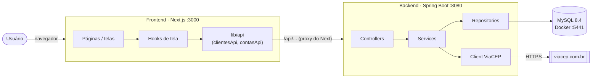

<div align="center">

# 🏦 RKF Bank

**Banco digital de estudo, construído ponta a ponta por um time pequeno — com processo de time de verdade.**


</div>


## 🧭 Sobre o projeto

O **RKF Bank** é uma aplicação bancária completa (API + site) criada para praticar, na vida real,
o que um time de engenharia faz no dia a dia: combinar um **contrato de API**, trabalhar em **branches e
Pull Requests**, registrar **decisões**, escrever **testes** e entregar um **MVP com prazo**.

> *Conhecimento não tem teto. Código não tem limite. Só tem próximo nível.*

**Meta atual:** 🚀 MVP no ar até **31/10/2026** — ver [roadmap](planing/roadmap.md).

### O que o MVP entrega

| Funcionalidade | Backend | Frontend |
|---|:---:|:---:|
| Landing page institucional | — | ✅ |
| Cadastro de cliente com endereço via CEP (ViaCEP) | ✅ | ✅ |
| Abertura de conta (corrente ou poupança) | ✅ | ⏳ |
| Depósito, saque e transferência | ✅ | ⏳ |
| Extrato da conta | ✅ | ⏳ |
| Tela de saldo da conta | ⏳ (falta `GET /contas/{id}`) | ⏳ |
| Login | ⏳ (pós-MVP / a decidir) | 🟡 placeholder |

✅ pronto · 🟡 parcial · ⏳ a fazer

### ⭐ Destaques técnicos

- **Dinheiro tratado com cuidado:** `BigDecimal`, transações (tudo ou nada) e proteção contra operações
  simultâneas na mesma conta (*lock* otimista).
- **Contrato de API primeiro:** frontend e backend trabalham em paralelo a partir do mesmo documento.
- **Arquitetura em camadas:** Controller → Service → Repository, com DTOs e erros padronizados.
- **Integração externa resiliente:** consulta de CEP com *timeout* e tratamento de falhas do ViaCEP.
- **Testes automatizados** em todas as camadas do backend, com relatório de cobertura (JaCoCo).
- **LGPD:** CPF, e-mail e telefone são mascarados nos logs.
- **Processo de time:** Git Flow, Conventional Commits, Pull Requests com revisão e decisões registradas.


## 🏗️ Arquitetura em 1 minuto



- O **navegador nunca fala direto com o backend**: ele chama `/api/...` no próprio Next, que repassa para
  `http://localhost:8080` (configurado em [`frontend/next.config.ts`](frontend/next.config.ts)).
- O **backend é um monólito em camadas** (Controller → Service → Repository). Detalhes em
  [backend/README_IMPLEMENTACAO.md](backend/README_IMPLEMENTACAO.md).
- A **fronteira entre os dois lados** é o [contrato de API](backend/README_CONTRATO_API.md). Mudou um endpoint?
  Muda o contrato **no mesmo PR**.


## 🚀 Rodando o projeto do zero

### Pré-requisitos

| Ferramenta | Versão | Para quê |
|---|---|---|
| [JDK](https://adoptium.net/) | **21** (exatamente — o Maven bloqueia outras versões) | backend |
| [Docker Desktop](https://www.docker.com/products/docker-desktop/) | recente | banco MySQL |
| [Node.js](https://nodejs.org/) | 20 ou superior | frontend |
| [pnpm](https://pnpm.io/installation) | 10 (`corepack enable` já resolve) | frontend |

> Maven **não** precisa ser instalado: o projeto usa o Maven Wrapper (`mvnw` / `mvnw.cmd`).

### 1. Banco de dados

Na **raiz** do repositório:

```bash
cp .env.example .env          # PowerShell: Copy-Item .env.example .env
docker compose up -d          # sobe o MySQL na porta 5441
docker compose ps             # espere o status "healthy"
```

### 2. Backend (porta 8080)

O Spring **não lê o arquivo `.env` sozinho** — as variáveis precisam estar no ambiente do terminal.
Ainda na raiz:

```powershell
# PowerShell: carrega o .env no terminal atual e sobe a API
Get-Content .env | Where-Object { $_ -match '^\s*[^#].*=' } | ForEach-Object {
  $nome, $valor = $_ -split '=', 2; Set-Item "env:$nome" $valor
}
.\mvnw.cmd spring-boot:run
```

```bash
# Git Bash / Linux / macOS
set -a && source .env && set +a
./mvnw spring-boot:run
```

Teste rápido: `curl http://localhost:8080/clientes` deve responder `[]`.

> No IntelliJ, dá para usar o plugin **EnvFile** apontando para o `.env` em vez do script acima.

### 3. Frontend (porta 3000)

```bash
cd frontend
cp .env.example .env.local    # PowerShell: Copy-Item .env.example .env.local
pnpm install
pnpm dev
```

Abra <http://localhost:3000>. A tela de cadastro fica em <http://localhost:3000/cadastro>.

Algo deu errado? Veja a seção **Problemas comuns** em [backend/README.md](backend/README.md#-problemas-comuns)
e [frontend/README.md](frontend/README.md#-problemas-comuns).


## 🗂️ Estrutura do repositório

```text
rkf_bank/
├── backend/                     # código e docs do backend (Java/Spring)
│   ├── src/main/java/...        # aplicação
│   ├── src/test/java/...        # testes unitários
│   └── README*.md               # docs do backend
├── frontend/                    # aplicação Next.js (projeto independente, com package.json próprio)
├── planing/                     # roadmap, decisões, recados e débitos técnicos do time
├── pom.xml                      # build do backend (fica na raiz — ver planing/debitos-tecnicos.md)
├── mvnw, mvnw.cmd, .mvn/        # Maven Wrapper
├── docker-compose.yml           # MySQL local
├── .env.example                 # variáveis do banco (copie para .env)
└── CONTRIBUTING.md              # como trabalhamos: branches, commits, PRs, revisão
```


## 📚 Documentação

| Área | Documento | O que tem |
|---|---|---|
| Time | [CONTRIBUTING.md](CONTRIBUTING.md) | branches, commits, Pull Requests e revisão |
| API | [Contrato da API](backend/README_CONTRATO_API.md) | rotas, exemplos de JSON, regras e erros |
| Backend | [backend/README.md](backend/README.md) | como rodar, testes e banco de dados |
| Backend | [Arquitetura](backend/README_IMPLEMENTACAO.md) | camadas, decisões técnicas e como criar um endpoint |
| Backend | [Testes manuais](backend/README_TESTES_E2E.md) | roteiro completo para Postman/Insomnia |
| Frontend | [frontend/README.md](frontend/README.md) | como rodar, estrutura e como criar uma tela |
| Frontend | [Logs](frontend/lib/logger/README.md) | como registrar logs com dados mascarados |
| Planejamento | [planing/](planing/README.md) | roadmap, decisões e débitos técnicos |


## 👥 Time

| Papel | Pessoa | GitHub |
|---|---|---|
| Backend | Kevin Richard | [@k3vinrich4rd](https://github.com/k3vinrich4rd) |
| Frontend | Renan Barros | [@renanbarrostech-cmd](https://github.com/renanbarrostech-cmd) |
| PO & QA | Fellipe | nosso primeiro "cliente" — valida o MVP |


---

<div align="center">
  <small>RKF Bank — projeto colaborativo de estudo em engenharia de software.</small>
</div>
