<div align="center">

<!-- Os SVGs de assets/readme/ são gerados por scripts/gerar-svgs-readme.mjs (rode de novo quando mudar testes ou migrações). -->
<a href="#-conheça-o-rkf-bank"></a>

[](https://github.com/k3vinrich4rd/rkf_bank/actions/workflows/backend-ci.yml)
[](https://github.com/k3vinrich4rd/rkf_bank/actions/workflows/backend-codeql.yml)
[](https://github.com/k3vinrich4rd/rkf_bank/commits/develop)
[](https://github.com/k3vinrich4rd/rkf_bank/pulls?q=is%3Apr+is%3Aclosed)
[](planing/roadmap.md)
[](#-feito-em-osasco)

[](https://openjdk.org/projects/jdk/25/)
[](https://spring.io/projects/spring-boot)
[](https://docs.spring.io/spring-security/reference/)
[](backend/src/main/resources/db/migration)
[](https://dev.mysql.com/doc/refman/8.4/en/)
[](https://nextjs.org/)
[](#-qualidade-e-testes)

<!-- Botões gerados por scripts/gerar-svgs-readme.mjs. Cada um leva a uma seção. -->
<a href="#-conheça-o-rkf-bank"></a>
<a href="#-a-experiência"></a>
<a href="#-segurança-e-lgpd"></a>
<a href="#-api-rest"></a>
<br/>
<a href="#-rodando-o-projeto"></a>
<a href="#-qualidade-e-testes"></a>
<a href="#-roadmap"></a>
<a href="#-quem-faz-o-rkf-bank"></a>
<br/>
<a href="#-aventura-sua-primeira-semana-no-rkf-bank"></a>
<a href="#-feito-em-osasco"></a>


</div>


## 🏦 Conheça o RKF Bank

> **Mais que um banco, um parceiro para o seu amanhã.**
> O RKF Bank é um **banco digital full stack** (API REST + site) idealizado e construído por três amigos de **Osasco, SP** — **Kevin Richard**, **Renan Barros** e **Felipe Santana**, com processo de time de verdade: contrato de API, Git Flow, Pull Requests revisados, decisões registradas, testes automatizados, CI e um MVP com data marcada.

<table>
  <tr>
    <td align="center" width="25%"><h3>💳</h3><b>Conta em minutos</b><br/><sub>cadastro com CPF validado e endereço pelo CEP</sub></td>
    <td align="center" width="25%"><h3>💸</h3><b>Dinheiro em movimento</b><br/><sub>depósito, saque e transferência tudo-ou-nada</sub></td>
    <td align="center" width="25%"><h3>📜</h3><b>Extrato na hora</b><br/><sub>cada lançamento aparece assim que acontece</sub></td>
    <td align="center" width="25%"><h3>🔐</h3><b>Login seguro</b><br/><sub>CPF + senha, JWT e cookie <code>httpOnly</code></sub></td>
  </tr>
</table>

| Funcionalidade | Backend | Frontend |
|---|:---:|:---:|
| Landing page (benefícios, como funciona, cartão, segurança, FAQ) | — | ✅ |
| Cadastro com senha e endereço automático pelo CEP (ViaCEP) | ✅ | ✅ |
| Login com CPF + senha (JWT) e sessão em cookie `httpOnly` | ✅ | ✅ |
| Abertura de conta corrente ou poupança | ✅ | ✅ |
| Tela da conta com saldo | ✅ (via `GET /contas`) | ✅ |
| Depósito, saque e transferência | ✅ | ✅ |
| Extrato | ✅ | ✅ |
| Perfis `CLIENTE` e `ADMIN` + regra de dono da conta | ✅ | — |
| Logs rastreáveis por requisição (`X-Request-Id`) | ✅ | ✅ |
| `GET /contas/{id}` e `GET /clientes/{id}/contas` | ⏳ | — |
| Política de privacidade e aceite dos termos (LGPD) | ⏳ | ⏳ |

<sub>✅ pronto na <code>develop</code> · ⏳ a fazer antes do lançamento</sub>


## 🎮 Escolha a sua trilha

> Cada botão abre um caminho diferente pelo projeto. 👇 Eles abrem e fecham.

<details>
<summary></summary>
<br/>

| Você quer... | No RKF Bank |
|---|---|
| abrir uma conta sem fila | cadastro com nome, CPF, e-mail, telefone, CEP e senha; o endereço se completa sozinho |
| não pagar mensalidade | conta sem tarifa (o MVP não cobra nada) |
| mandar dinheiro para alguém | transferência entre contas RKF, debitada e creditada na mesma operação |
| saber para onde foi o dinheiro | extrato com entradas e saídas, do mais novo para o mais antigo |
| ter certeza de que é seguro | senha guardada só como hash, sessão que expira em 15 min e ninguém mexe na sua conta além de você |

**Jornada em 3 passos:** `Cadastre-se` → `Abra a conta` → `Movimente com liberdade`. Veja a [experiência completa](#-a-experiência).

</details>

<details>
<summary></summary>
<br/>

| Pergunta | Resposta rápida |
|---|---|
| O que é? | banco digital full stack com prazo de MVP (31/10/2026), feito por um time de três |
| Quem fez o quê? | os três idealizaram o banco juntos · **Kevin Richard**: backend Java/Spring · **Renan Barros**: frontend Next.js · **Felipe Santana**: PO & QA e primeiro cliente |
| Nível técnico? | transação atômica, lock otimista, Flyway, Spring Security + JWT (OAuth2 Resource Server), BCrypt, regra de dono, logs rastreáveis, **163 testes**, CI com CodeQL |
| Processo? | Git Flow (`feature/*` → `develop` → `main`), PR revisado, Conventional Commits, decisões e débitos documentados |
| Onde ver? | [segurança](#-segurança-e-lgpd) · [arquitetura](#-arquitetura) · [qualidade](#-qualidade-e-testes) · [roadmap](#-roadmap) |

</details>

<details>
<summary></summary>
<br/>

Sugestão de leitura, do mais simples ao mais interessante:

| Arquivo | Por que olhar |
|---|---|
| [`ContaService.java`](backend/src/main/java/com/br/rkfbank/services/ContaService.java) | transferência atômica, regra de dono (404 → 403 → 422) e validação de saldo |
| [`Conta.java`](backend/src/main/java/com/br/rkfbank/entities/Conta.java) | `@Version` para lock otimista |
| [`ConfiguracaoSeguranca.java`](backend/src/main/java/com/br/rkfbank/config/ConfiguracaoSeguranca.java) | `SecurityFilterChain`, JWT HS256 com algoritmo fixo, BCrypt |
| [`AuthService.java`](backend/src/main/java/com/br/rkfbank/services/AuthService.java) | login sem enumeração de CPF (mesma resposta e mesmo tempo) |
| [`db/migration/`](backend/src/main/resources/db/migration) | `V1` schema, `V2` migração de dados, `V3` usuários |
| [`FiltroLogRequisicao.java`](backend/src/main/java/com/br/rkfbank/config/FiltroLogRequisicao.java) | `X-Request-Id` em todas as linhas de log, com proteção contra log forjado |
| [`SegurancaIntegracaoTest.java`](backend/src/test/java/com/br/rkfbank/SegurancaIntegracaoTest.java) | ataques ao token (`alg: none`, payload adulterado) |
| [`planing/decisoes.md`](planing/decisoes.md) | por que cada escolha foi feita |

</details>

<details>
<summary></summary>
<br/>

1. Leia o [CONTRIBUTING.md](CONTRIBUTING.md) e o [CLAUDE.md](CLAUDE.md) (regras do time, também para agentes de IA).
2. Suba tudo: [rodando o projeto](#-rodando-o-projeto).
3. Branch nova **sempre** da `origin/develop` atualizada: `git switch -c feature/minha-tarefa origin/develop`.
4. Antes do PR: `scripts/validar.sh backend` (ou `frontend` / `tudo`).
5. **Felipe:** o roteiro de testes de aceite está em [README_TESTES_E2E.md](backend/README_TESTES_E2E.md) e o checklist em [CHECKLIST_TESTES_E2E.md](backend/CHECKLIST_TESTES_E2E.md).
6. Recados entre o time: [planing/recados.md](planing/recados.md).

</details>


## 🎮 Aventura: sua primeira semana no RKF Bank

> Você é o Felipe, primeiro cliente do RKF Bank. Faça as escolhas e veja o que a API responde. 👇 Clique para decidir.

**Segunda-feira.** Você abre o site para criar a conta. O seu CEP é de Osasco.

<details>
<summary>🅰️ Cadastrar com o CPF <code>111.111.111-11</code> (fácil de lembrar)</summary>
<br/>

❌ **`400 Bad Request`**: `cpf inválido`. O `@CpfValido` confere os dígitos verificadores, e CPF com todos os números iguais não passa. Volte e tente a outra opção. 🔁

</details>

<details>
<summary>🅱️ Cadastrar com o seu CPF de verdade, o CEP e uma senha de 8+ caracteres</summary>
<br/>

✅ **`201 Created`**: o endereço se completou sozinho pelo ViaCEP e a sua senha foi guardada só como hash BCrypt.

**Terça-feira.** Você entra com CPF e senha e abre uma conta corrente. Hora do primeiro dinheiro.

<details>
<summary>💵 Depositar R$ 150,00</summary>
<br/>

✅ **`204 No Content`**: saldo de **R$ 150,00**, e o extrato já mostra o depósito.

**Quarta-feira.** O aluguel vence e você precisa transferir **R$ 200,00** para o Renan.

<details>
<summary>💸 Transferir os R$ 200,00 mesmo assim</summary>
<br/>

❌ **`422 Unprocessable Entity`**: `Saldo insuficiente`. Nada foi debitado: a transferência é tudo ou nada. Volte e escolha a outra opção. 🔁

</details>

<details>
<summary>🤝 Transferir R$ 50,00 agora e o resto depois</summary>
<br/>

✅ **`204`**: saldo de **R$ 100,00**. Débito, crédito e lançamento foram gravados na mesma transação.

**Quinta-feira.** Bate a curiosidade: e se você olhasse o extrato da conta do Kevin?

<details>
<summary>🕵️ Trocar o id da conta na URL pelo da conta do Kevin</summary>
<br/>

❌ **`403 Forbidden`**: você está logado, mas a conta não é sua. A resposta não revela nem se o Kevin tem saldo.

</details>

<details>
<summary>⏰ Deixar o app aberto por 20 minutos e clicar em "Extrato"</summary>
<br/>

🔐 **`401 Unauthorized`**: o JWT vence em 15 minutos. O site leva você ao login e depois **volta para o extrato**.

**Sexta-feira.** 🏁 Você fechou a semana com R$ 100,00, um extrato certinho e nenhum dado pessoal nos logs. **Missão cumprida!** Agora é a vez do [roteiro E2E de verdade](backend/README_TESTES_E2E.md).

</details>

</details>

</details>

</details>


## 📱 A experiência

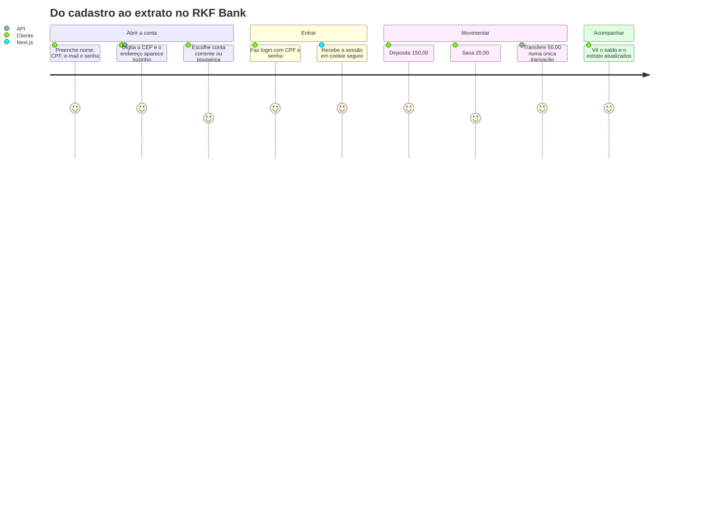

<div align="center">
  
</div>

<details>
<summary><b>📈 O saldo dessa semana em gráfico</b></summary>
<br/>

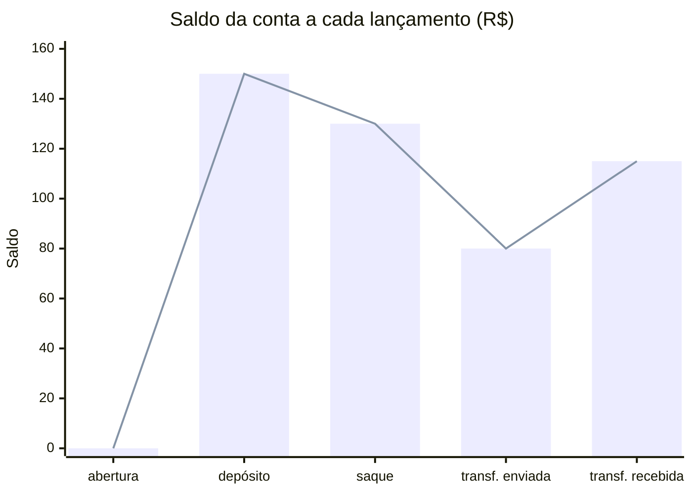

</details>

<details>
<summary><b>🖥️ As telas do site</b></summary>
<br/>

| Rota | Tela |
|---|---|
| `/` | landing page: benefícios, como funciona, cartão, segurança e dúvidas |
| `/cadastro` | cadastro com CEP automático e senha |
| `/login` | entrar com CPF e senha |
| `/conta/abrir` | abrir conta corrente ou poupança |
| `/conta` | saldo e atalhos |
| `/conta/depositar` · `/conta/sacar` · `/conta/transferir` | movimentações |
| `/conta/extrato` | extrato |

</details>

<details>
<summary><b>🔄 O ciclo de vida de uma conta</b></summary>
<br/>

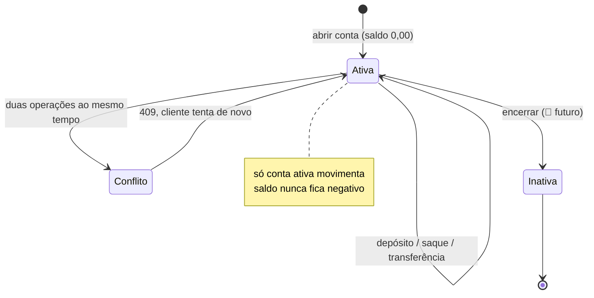

</details>

<details>
<summary><b>🎲 Simulador: e se eu tentar...?</b> (clique em cada cenário)</summary>
<br/>

<details><summary>💸 ...sacar mais do que tenho?</summary>

`422 Unprocessable Entity` com `Saldo insuficiente`. Nada é debitado e a tentativa fica no log com o `X-Request-Id`.

</details>
<details><summary>🕵️ ...ver o extrato da conta de outra pessoa?</summary>

`403 Forbidden`. A regra de dono fica no `ContaService`: o `clienteId` vem do token assinado, não do que você manda na URL. E a ordem 404 → 403 → 422 garante que ninguém descubra o saldo alheio pela mensagem de erro.

</details>
<details><summary>⏰ ...usar o app depois de 15 minutos parado?</summary>

O JWT expira e a API responde `401`. O site leva você ao login (`?expirou=1`) e depois **de volta para a tela onde estava**.

</details>
<details><summary>⚡ ...fazer duas transferências ao mesmo tempo da mesma conta?</summary>

Uma passa e a outra recebe `409 Conflict`: a `Conta` tem `@Version` (lock otimista). O saldo nunca é sobrescrito.

</details>
<details><summary>🔁 ...cadastrar o mesmo CPF ou e-mail duas vezes?</summary>

`409 Conflict`. E-mail é comparado sem diferenciar maiúsculas (`Joao@x.com` = `joao@x.com`, migração `V2`).

</details>
<details><summary>📮 ...cadastrar com o ViaCEP fora do ar?</summary>

Timeout de 3 s e `503 Service Unavailable` com mensagem clara, em vez de travar. CEP que não existe vira `422`.

</details>
<details><summary>🧪 ...adulterar o token (trocar o perfil para ADMIN)?</summary>

`401`. A assinatura HS256 não bate mais. Token com `alg: none` também é recusado (algoritmo fixo no `JwtDecoder`). Teste você mesmo: `node scripts/engenharia-reversa-jwt.mjs`.

</details>

</details>


## 🔐 Segurança e LGPD

<div align="center">
  
</div>

| Quem pode o quê | Rota |
|---|---|
| 🌍 qualquer pessoa | `POST /clientes` (cadastro) · `POST /auth/login` |
| 👤 cliente logado | só as **próprias** contas: abrir, listar, depositar, sacar, transferir (origem), extrato |
| 🛠️ `ADMIN` | `GET /clientes` e todas as contas em `GET /contas` (o primeiro admin nasce do `.env`) |

<details>
<summary><b>🔑 Como funciona o login, passo a passo</b></summary>
<br/>

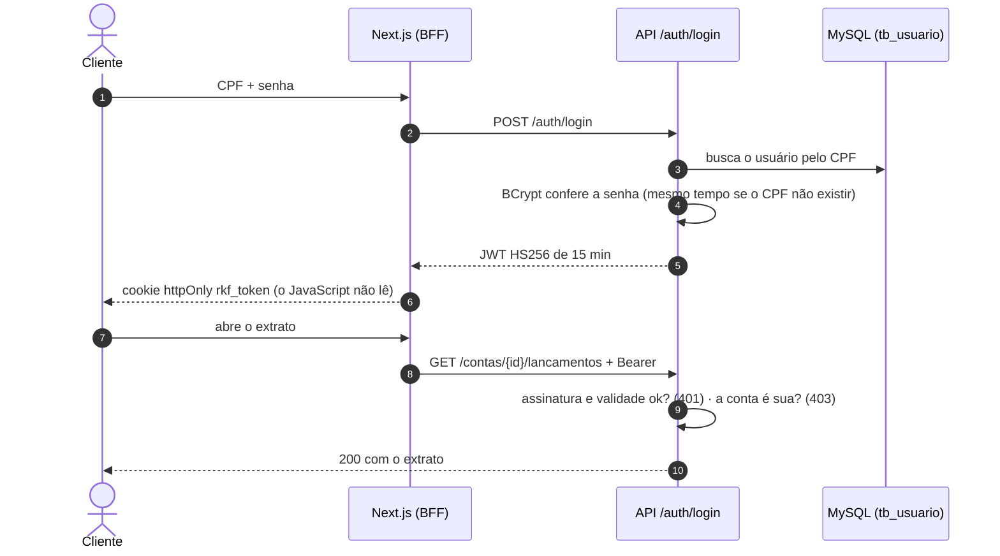

</details>

<details>
<summary><b>🛡️ Status da LGPD no backend (análise de 19/10/2026)</b></summary>
<br/>

**Já atende:**

- ✅ Senha só como hash BCrypt; nunca volta em resposta nem em log.
- ✅ Logs sem CPF, e-mail, telefone, senha ou token (até o `toString` dos DTOs esconde os dados).
- ✅ Autenticação em todas as rotas privadas e regra de dono (`403`).
- ✅ Dados de todos os clientes só para `ADMIN`.
- ✅ O `sub` do JWT é o id do usuário, não o CPF (o payload do JWT é só Base64).
- ✅ Frontend mascara CPF, e-mail e telefone nos logs; token fora do alcance do JavaScript.

**Falta antes de colocar no ar** (bloqueia o deploy, não o desenvolvimento):

- ⏳ Política de privacidade e termos de uso de verdade (o cadastro já cita os dois).
- ⏳ Registrar o aceite dos termos (versão + data) numa migração `V4`.
- ⏳ Encarregado e canal de contato do titular.

**Depois do MVP:** rota "meus dados" (`GET /clientes/me`), correção de dados, encerramento de conta com retenção e anonimização, limite de tentativas de login e auditoria.
Detalhes e prioridades em [planing/debitos-tecnicos.md](planing/debitos-tecnicos.md) e [planing/decisoes.md](planing/decisoes.md).

</details>


## 🔌 API REST

Base URL: `http://localhost:8080` · JSON · IDs em UUID · dinheiro com 2 casas (`150.00`) · datas ISO-8601 UTC · rotas privadas com `Authorization: Bearer <token>`.
Contrato completo (versão 2.0): [backend/README_CONTRATO_API.md](backend/README_CONTRATO_API.md).

| Método | Rota | O que faz | Quem pode | Sucesso |
|---|---|---|---|---|
| `POST` | `/clientes` | cadastra cliente (com senha) | público | `201` |
| `POST` | `/auth/login` | login com CPF + senha | público | `200` + token |
| `GET` | `/clientes` | lista clientes (`?paginado=true&page=0&size=10`) | `ADMIN` | `200` |
| `POST` | `/contas/clientes/{clienteId}` | abre conta | o próprio cliente | `201` |
| `GET` | `/contas` | lista contas | `ADMIN`: todas · `CLIENTE`: as dele | `200` |
| `POST` | `/contas/{contaId}/deposito` | deposita | dono da conta | `204` |
| `POST` | `/contas/{contaId}/saque` | saca | dono da conta | `204` |
| `POST` | `/contas/transferencia` | transfere | dono da conta de origem | `204` |
| `GET` | `/contas/{contaId}/lancamentos` | extrato (mais recente primeiro) | dono da conta | `200` |

<details>
<summary><b>👤 <code>POST /clientes</code> — cadastrar</b></summary>
<br/>

```json
{
  "nomeCompleto": "Joao Silva",
  "cpf": "52998224725",
  "email": "joao.silva@rkfbank.com",
  "telefone": "11999998888",
  "cep": "01001000",
  "numero": "123",
  "complemento": "Apto 45",
  "senha": "minha-senha-forte"
}
```

Resposta `201`: o cliente com o endereço completo vindo do ViaCEP. A senha **nunca** volta.

</details>

<details>
<summary><b>🔑 <code>POST /auth/login</code> — entrar</b></summary>
<br/>

```json
{ "cpf": "52998224725", "senha": "minha-senha-forte" }
```

```json
{
  "token": "eyJhbGciOiJIUzI1NiJ9...",
  "tipo": "Bearer",
  "expiraEmSegundos": 900,
  "clienteId": "1a89861c-70a0-4b7c-947a-d16cdfe2dd08",
  "perfil": "CLIENTE"
}
```

CPF sem cadastro e senha errada recebem **a mesma** resposta `401`, de propósito.

</details>

<details>
<summary><b>💳 Abrir conta, movimentar e ver o extrato</b></summary>
<br/>

```json
// POST /contas/clientes/{clienteId}
{ "agencia": "0001", "numeroConta": "12345678", "tipoContaEnum": "CORRENTE" }

// POST /contas/{contaId}/deposito  e  /saque
{ "valor": 150.00, "descricao": "Deposito inicial" }

// POST /contas/transferencia
{ "contaOrigemId": "407d727e-...", "contaDestinoId": "566dd28f-...", "valor": 50.00, "descricao": "Aluguel" }
```

Extrato (`GET /contas/{contaId}/lancamentos`):

```json
[
  {
    "id": "59798941-269a-406c-8783-9be456bf1f5c",
    "tipoLancamento": "TRANSFERENCIA",
    "valor": 50.00,
    "contaOrigemId": "407d727e-4e43-4c93-b01c-331cbaba42fb",
    "contaDestinoId": "566dd28f-b08f-41e4-ac55-cc69ecfea4cd",
    "descricao": "Aluguel",
    "dataHora": "2026-10-12T11:19:53.038985Z"
  }
]
```

O `valor` é sempre positivo: se a conta da tela é o `contaDestinoId`, é entrada; senão, saída.

</details>

<details>
<summary><b>⚠️ Formato de erro e status HTTP</b></summary>
<br/>

```json
{
  "timestamp": "2026-10-12T11:19:54.090042Z",
  "status": 400,
  "error": "Bad Request",
  "message": "Requisicao invalida",
  "path": "/clientes",
  "campos": [{ "campo": "cpf", "mensagem": "cpf inválido" }]
}
```

| Status | Quando |
|---|---|
| `400` | dados inválidos, JSON mal formado ou parâmetro inválido |
| `401` | sem token, token inválido ou vencido, ou CPF/senha errados no login |
| `403` | logado, mas sem permissão (conta de outro cliente, rota de `ADMIN`) |
| `404` | cliente ou conta não encontrado |
| `409` | CPF, e-mail ou número de conta repetido, ou conta alterada ao mesmo tempo |
| `422` | regra de negócio: CEP inexistente, saldo insuficiente, mesma conta na transferência |
| `503` | ViaCEP fora do ar |

</details>

<details>
<summary><b>🧪 Fluxo completo com <code>curl</code></b></summary>
<br/>

```bash
API=http://localhost:8080

# 1. cadastro (público)
curl -X POST $API/clientes -H "Content-Type: application/json" -d '{
  "nomeCompleto":"Joao Silva","cpf":"52998224725","email":"joao@rkfbank.com",
  "telefone":"11999998888","cep":"01001000","numero":"123","senha":"minha-senha-forte"}'

# 2. login: guarde o token e o clienteId
curl -X POST $API/auth/login -H "Content-Type: application/json" \
  -d '{"cpf":"52998224725","senha":"minha-senha-forte"}'
TOKEN=cole-o-token-aqui

# 3. conta (use o clienteId do login)
curl -X POST $API/contas/clientes/$CLIENTE_ID -H "Authorization: Bearer $TOKEN" \
  -H "Content-Type: application/json" -d '{"agencia":"0001","numeroConta":"12345678","tipoContaEnum":"CORRENTE"}'

# 4. movimentações e extrato (use o id da conta)
curl -X POST $API/contas/$CONTA_ID/deposito -H "Authorization: Bearer $TOKEN" -H "Content-Type: application/json" -d '{"valor":150.00}'
curl $API/contas/$CONTA_ID/lancamentos -H "Authorization: Bearer $TOKEN"
```

CPFs válidos para teste: `52998224725`, `16899535009`, `39053344705`, `11144477735`.
Ou rode tudo de uma vez com a API no ar: `node scripts/smoke-e2e.mjs`.

</details>


## 🧱 Arquitetura

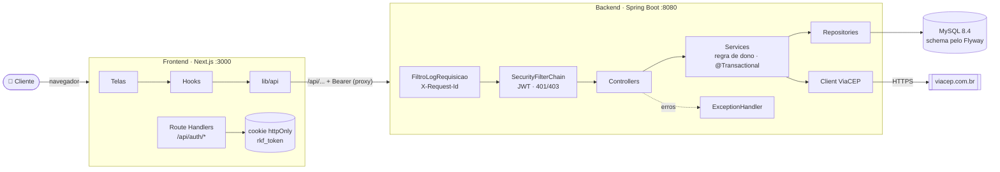

<div align="center">
  
</div>

<details>
<summary><b>🆚 Antes × depois: decisões que mudaram o projeto</b> (clique em cada uma)</summary>
<br/>

<details><summary>🗄️ Banco: <code>ddl-auto=update</code> → Flyway</summary>

| Antes | Depois |
|---|---|
| o Hibernate "adivinhava" o schema: FKs com nome aleatório e sem índice no extrato | `V1`, `V2` e `V3` versionados, revisados em PR e iguais em todo ambiente |
| renomear um campo criava uma coluna nova e deixava os dados na velha | `ALTER TABLE ... RENAME COLUMN` numa migração nova |

</details>
<details><summary>🔐 Acesso: qualquer um movimentava qualquer conta → JWT + regra de dono</summary>

| Antes | Depois |
|---|---|
| `POST /contas/{id}/saque` funcionava sem login, para qualquer id | sem token dá `401`; conta de outra pessoa dá `403` |
| `GET /clientes` mostrava o CPF de todo mundo | só o `ADMIN` lista clientes |

</details>
<details><summary>🍪 Token: <code>localStorage</code> → cookie <code>httpOnly</code></summary>

| Com `localStorage` (descartado) | Com cookie `httpOnly` |
|---|---|
| qualquer script da página (um XSS) leria o token | o Next grava o cookie e o JavaScript não alcança |

</details>
<details><summary>💰 Dinheiro: <code>double</code> → <code>BigDecimal</code></summary>

| Com `double` | Com `BigDecimal` |
|---|---|
| `0.1 + 0.2 = 0.30000000000000004` | `0.30` exato, e `DECIMAL(19,2)` no banco |

</details>

</details>

<details>
<summary><b>🗃️ Modelo de dados (migrações V1, V2 e V3)</b></summary>
<br/>

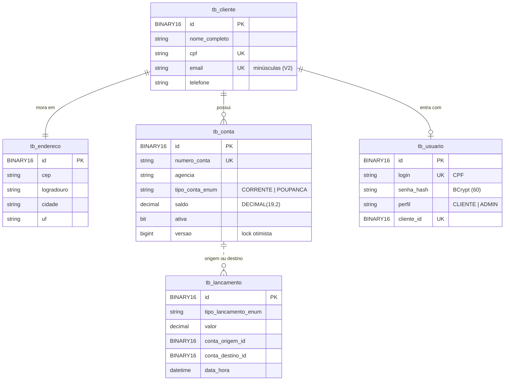

</details>

<details>
<summary><b>📦 Pacotes do backend</b></summary>
<br/>

| Pacote | Responsabilidade |
|---|---|
| [`config`](backend/src/main/java/com/br/rkfbank/config) | segurança (filter chain, JWT, erros 401/403), CORS, filtro de log, criação do admin |
| [`controllers`](backend/src/main/java/com/br/rkfbank/controllers) | HTTP: `AuthController`, `ClienteController`, `ContaController` |
| [`services`](backend/src/main/java/com/br/rkfbank/services) | regras de negócio, transações, login e token |
| [`security`](backend/src/main/java/com/br/rkfbank/security) | `UsuarioLogado`, montado a partir do JWT |
| [`repositories`](backend/src/main/java/com/br/rkfbank/repositories) | Spring Data JPA |
| [`entities`](backend/src/main/java/com/br/rkfbank/entities) | `Cliente`, `Endereco`, `Conta`, `Lancamento`, `Usuario` |
| [`dto`](backend/src/main/java/com/br/rkfbank/dto) | entrada e saída da API (`record`) |
| [`clients/viacep`](backend/src/main/java/com/br/rkfbank/clients/viacep) | integração com o ViaCEP |
| [`validation`](backend/src/main/java/com/br/rkfbank/validation) | `@CpfValido` |
| [`exceptions`](backend/src/main/java/com/br/rkfbank/exceptions) | exceções de negócio que viram status HTTP |

Mais detalhes em [backend/README_IMPLEMENTACAO.md](backend/README_IMPLEMENTACAO.md).

</details>

<details>
<summary><b>🧰 Stack completa</b></summary>
<br/>

<div align="center">

</div>

| Lado | Tecnologias |
|---|---|
| Backend | Java 25 · Spring Boot 4.1 · Spring Web MVC · Spring Data JPA (Hibernate 7) · Spring Security + OAuth2 Resource Server · Bean Validation · `RestClient` · Flyway · Log4j2 |
| Banco | MySQL 8.4 (Docker Compose) · H2 2.3.232 nos testes |
| Testes | JUnit 5 · Mockito · `@DataJpaTest` · `@SpringBootTest` · JaCoCo |
| Frontend | Next.js 16 (App Router) · React 19 · TypeScript 5 · Tailwind CSS 4 · shadcn/ui · Lucide · pnpm 10 |
| Esteira | GitHub Actions · CodeQL · Dependency Review · Dependabot · Conventional Commits |

</details>


## 🚀 Rodando o projeto

| Ferramenta | Versão |
|---|---|
| [JDK](https://adoptium.net/temurin/releases/?version=25) | **25** (o Maven Enforcer bloqueia outras) |
| [Docker Desktop](https://www.docker.com/products/docker-desktop/) | recente |
| [Node.js](https://nodejs.org/) + [pnpm](https://pnpm.io/installation) | 20+ e 10 (`corepack enable`) |

<details open>
<summary><b>1️⃣ Banco (MySQL no Docker)</b></summary>
<br/>

```bash
cp .env.example .env          # preencha senhas e gere o JWT_SEGREDO: openssl rand -base64 48
docker compose up -d          # MySQL na porta 5441
docker compose ps             # espere "healthy"
```

</details>

<details open>
<summary><b>2️⃣ Backend (porta 8080)</b></summary>
<br/>

O Spring **não lê o `.env` sozinho**: carregue as variáveis no terminal.

```bash
# Git Bash / Linux / macOS
set -a && source <(tr -d '\r' < .env) && set +a
./mvnw spring-boot:run
```

```powershell
# PowerShell
Get-Content .env | Where-Object { $_ -match '^\s*[^#].*=' } | ForEach-Object {
  $nome, $valor = $_ -split '=', 2; Set-Item "env:$nome" $valor
}
.\mvnw.cmd spring-boot:run
```

As tabelas nascem pelo **Flyway** na primeira subida. Se a API recusar com *Found non-empty schema(s)*, o seu MySQL é anterior ao Flyway: rode `docker compose down -v && docker compose up -d` uma vez (apaga os dados locais).

</details>

<details open>
<summary><b>3️⃣ Frontend (porta 3000)</b></summary>
<br/>

```bash
cd frontend
cp .env.example .env.local
pnpm install
pnpm dev
```

Abra <http://localhost:3000>, crie a conta em `/cadastro` e entre em `/login`.

</details>

<details>
<summary><b>🧯 Problemas comuns</b></summary>
<br/>

| Sintoma | Causa provável | Solução |
|---|---|---|
| `Rule 0: RequireJavaVersion failed` | JDK diferente do 25 | instale o JDK 25 e aponte o `JAVA_HOME` |
| `JWT_SEGREDO ausente ou curto` | `.env` sem segredo ou não carregado | gere com `openssl rand -base64 48` e carregue o `.env` |
| `Access denied for user` | variáveis do `.env` não carregadas | carregue o `.env` antes do `mvnw` |
| `Communications link failure` | MySQL desligado ou subindo | `docker compose ps` e espere o `healthy` |
| `Validate failed: Migration checksum mismatch` | uma migração já aplicada foi editada | nunca edite `V<n>__`; crie uma nova versão |
| Cadastro devolve `503` | ViaCEP fora do ar | tente de novo em alguns segundos |
| Volta para o login toda hora | token de 15 min venceu | esperado: ainda não há refresh token |

</details>


## 🧪 Qualidade e testes

<div align="center">
  
</div>

```bash
scripts/validar.sh backend          # testes em H2, resumo curto (sem Docker)
scripts/validar.sh frontend         # lint + typecheck + build
scripts/testar-no-mysql.sh          # testes de integração contra o MySQL do Docker
node scripts/smoke-e2e.mjs          # fluxo real contra a API no ar
node scripts/engenharia-reversa-jwt.mjs  # tenta forjar o JWT: tudo tem que dar 401
node scripts/varrer-cves.js         # vulnerabilidades conhecidas no Maven e no pnpm
```

<details>
<summary><b>📋 O que cada suíte cobre</b></summary>
<br/>

| Suíte | O que cobre |
|---|---|
| `ClienteServiceTest` | cadastro, CPF/e-mail duplicado, ViaCEP, senha em BCrypt |
| `ContaServiceTest` | abertura, depósito, saque, transferência, extrato e regra de dono (`403`) |
| `TokenServiceTest` / `AuthServiceTest` | JWT (claims, 15 min, adulteração, chave errada) e login sem enumeração |
| `UsuarioServiceTest` / `CriadorAdminTest` | primeiro `ADMIN` pelo `.env` |
| `SegurancaIntegracaoTest` | Spring inteiro com tokens reais: `401`, `403`, perfis, `alg: none` |
| `ClienteControllerTest` / `ContaControllerTest` | status de cada rota e limites da paginação |
| `ControllerExceptionHandlerTest` | cada exceção no formato de erro |
| `ClienteViaCepTest` | CEP encontrado, inexistente (`422`) e ViaCEP fora (`503`) |
| `CpfValidoValidatorTest` | dígitos verificadores e máscara |
| `FiltroLogRequisicaoTest` | `X-Request-Id` reaproveitado, gerado e rejeitado contra log forjado |
| `*RepositoryTest` | consultas, constraints, cascata, `@Version` e `tb_usuario` (`@DataJpaTest` com as migrações do Flyway) |

Relatório de cobertura: `target/site/jacoco/index.html`. Teste manual de aceite: [roteiro E2E](backend/README_TESTES_E2E.md) + [checklist](backend/CHECKLIST_TESTES_E2E.md).

</details>

<details>
<summary><b>⚙️ Esteira no GitHub Actions</b></summary>
<br/>

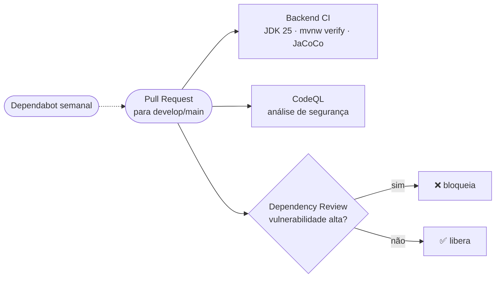

| Workflow | Arquivo | O que faz |
|---|---|---|
| Backend CI | [`backend-ci.yml`](.github/workflows/backend-ci.yml) | compila, testa e publica relatórios |
| Backend CodeQL | [`backend-codeql.yml`](.github/workflows/backend-codeql.yml) | procura vulnerabilidades no código Java |
| Dependency Review | [`backend-dependency-review.yml`](.github/workflows/backend-dependency-review.yml) | barra dependência vulnerável ou com licença AGPL |
| Dependabot | [`dependabot.yml`](.github/dependabot.yml) | PRs de atualização para a `develop` |

</details>

<details>
<summary><b>🔎 Logs rastreáveis</b></summary>
<br/>

```text
INFO  [http-nio-8080-exec-1] [e2e-transf-001] c.b.r.s.ContaService : Transferencia de 50.00 da conta 672e4ddf-... para 83af15fb-...
INFO  [http-nio-8080-exec-1] [e2e-transf-001] c.b.r.c.FiltroLogRequisicao : POST /contas/transferencia -> 204 (15 ms)
```

Cada requisição ganha um `X-Request-Id` que aparece em todas as linhas, até no SQL. CPF, e-mail, senha e token **nunca** entram no log. Configuração: [`log4j2-spring.xml`](backend/src/main/resources/log4j2-spring.xml).

</details>


## 🧭 Roadmap

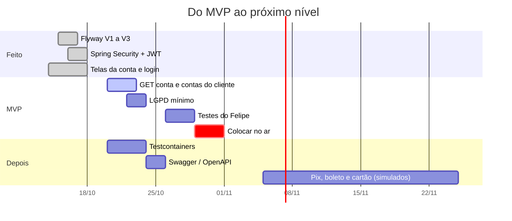

<details open>
<summary><b>🚀 MVP — até 31/10/2026</b></summary>
<br/>

- [x] Cadastro com ViaCEP, abertura de conta, depósito, saque, transferência e extrato
- [x] Logs rastreáveis, CI, CodeQL e Dependabot
- [x] Banco versionado com Flyway (V1, V2, V3)
- [x] Login com Spring Security + JWT, perfis e regra de dono
- [x] Frontend: landing, cadastro, login, conta, movimentações e extrato
- [ ] Backend: `GET /contas/{id}` e `GET /clientes/{id}/contas`
- [ ] LGPD mínimo: política de privacidade, aceite dos termos e encarregado
- [ ] Felipe testa tudo como primeiro cliente e os bugs são corrigidos
- [ ] Colocar no ar e atualizar este README com link e prints

</details>

<details>
<summary><b>🔭 Depois do MVP</b></summary>
<br/>

- [ ] Testes de integração com Testcontainers + MySQL e `MockMvc` ([checklist](planing/checklist-features.md))
- [ ] Swagger UI com o botão *Authorize* (springdoc-openapi)
- [ ] Refresh token, limite de tentativas de login e 2FA
- [ ] "Meus dados", editar perfil e encerrar conta (direitos do titular)
- [ ] CI do frontend
- [ ] Pix, boleto, QR Code e cartão virtual (simulados) — [funcionalidades futuras](planing/debitos-tecnicos.md#funcionalidades-futuras-)
- [ ] 🤖 Assistente do extrato com Spring AI (ideia)

</details>

Planejamento detalhado: [planing/roadmap.md](planing/roadmap.md) · [checklist de features](planing/checklist-features.md) · [decisões](planing/decisoes.md).


## 👥 Quem faz o RKF Bank

> Três amigos de Osasco tiveram a ideia juntos e dividiram o banco em três frentes: **API**, **site** e **produto**.

<div align="center">
  
</div>

<table>
  <tr>
    <td align="center" valign="top" width="33%">
      <a href="https://github.com/k3vinrich4rd"></a>
      <h3>Kevin Richard</h3>
      
      <p align="left"><sub>API REST em Java e Spring Boot, banco MySQL e Flyway, Spring Security e JWT, integração com o ViaCEP, logs e testes. Objetivo: o dinheiro de cada cliente sempre certo e nenhum dado pessoal vazando.</sub></p>
      <a href="mailto:kevinrichardve@gmail.com"></a>
      <a href="https://github.com/k3vinrich4rd"></a>
    </td>
    <td align="center" valign="top" width="33%">
      <h3>💡<br/>Felipe Santana</h3>
      
      <p align="left"><sub>Idealizou o RKF Bank com Kevin e Renan, define o que o produto precisa e é o <b>primeiro cliente</b>: tem acesso antes de todo mundo para os primeiros testes e valida o MVP pelo roteiro E2E antes do lançamento.</sub></p>
      
    </td>
    <td align="center" valign="top" width="33%">
      <a href="https://github.com/renanbarrostech-cmd"></a>
      <h3>Renan Barros</h3>
      
      <p align="left"><sub>Site em Next.js, React e TypeScript, identidade visual RKF, telas da conta, login com cookie <code>httpOnly</code> e logs com máscara. Objetivo: parecer e funcionar como um banco digital de verdade.</sub></p>
      <a href="mailto:renanbarros.tech@gmail.com"></a>
      <a href="https://github.com/renanbarrostech-cmd"></a>
    </td>
  </tr>
</table>

<div align="center">

Dúvida sobre a API ou o banco? **Kevin**. Telas e site? **Renan**. Produto, prioridade e testes de aceite? **Felipe**.
Bug ou sugestão? Abra uma [issue](https://github.com/k3vinrich4rd/rkf_bank/issues).

</div>

### 📍 Feito em Osasco

<div align="center">
  
</div>

O RKF Bank nasceu em **Osasco**, na Grande São Paulo, da ideia de três amigos que queriam aprender construindo algo de verdade. Arraste e dê zoom no mapa:

```geojson
{
  "type": "FeatureCollection",
  "features": [
    {
      "type": "Feature",
      "properties": {
        "title": "RKF Bank · Osasco, SP",
        "description": "Kevin, Renan e Felipe: o time inteiro é de Osasco",
        "marker-color": "#3B82F6",
        "marker-size": "large",
        "marker-symbol": "bank"
      },
      "geometry": { "type": "Point", "coordinates": [-46.7917, -23.5329] }
    }
  ]
}
```

<details>
<summary><b>🤝 Como o time trabalha</b></summary>
<br/>

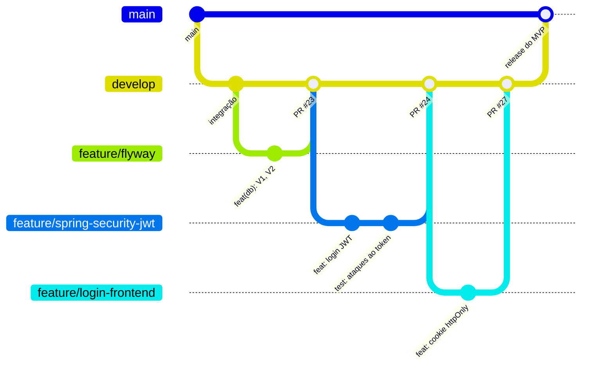

- **Branches:** `main` é o que vai ao ar, `develop` é a integração; toda tarefa sai da `origin/develop` atualizada.
- **Commits:** [Conventional Commits](https://www.conventionalcommits.org/pt-br) em português, validados por hook.
- **PRs:** revisão do outro dev + CI verde. **Contrato primeiro:** mudou rota, muda o [contrato](backend/README_CONTRATO_API.md) no mesmo PR.
- **IA no time:** o [CLAUDE.md](CLAUDE.md) e as skills em [`.claude/skills/`](.claude/skills) (`/implementar-feature`, `/entregar`, `/revisar-migracao`, `/testar-e2e`...) dão a qualquer agente o mesmo contexto e as mesmas regras do time.

Passo a passo completo: [CONTRIBUTING.md](CONTRIBUTING.md).

</details>


## 💬 Pergunte ao RKF

> Perguntas que um cliente, um recrutador ou um dev costumam fazer. Clique para abrir.

<details>
<summary><b>Por que a transferência nunca deixa o dinheiro "no meio do caminho"?</b></summary>
<br/>

Débito, crédito e lançamento do extrato acontecem dentro de um único `@Transactional`: ou os três são gravados, ou nenhum. E o `@Version` na `Conta` impede que duas operações simultâneas sobrescrevam o saldo (a segunda recebe `409`).

</details>

<details>
<summary><b>Por que o token fica num cookie e não no <code>localStorage</code>?</b></summary>
<br/>

Qualquer script que rode na página (um XSS, uma dependência comprometida) consegue ler o `localStorage`. Com cookie `httpOnly`, gravado pelo servidor do Next, o JavaScript não alcança o token. `SameSite=Lax` protege contra CSRF. Decisão registrada em [decisoes.md](planing/decisoes.md).

</details>

<details>
<summary><b>Por que Flyway em vez de deixar o Hibernate criar as tabelas?</b></summary>
<br/>

Com `ddl-auto=update` o Hibernate "adivinha" o schema, não remove nem renomeia nada e não deixa histórico. Com Flyway, cada mudança é um SQL versionado (`V1__`, `V2__`, `V3__`), revisado no PR e igual em todo ambiente; o Hibernate só **valida**. Migração aplicada nunca se edita: o checksum muda e a API não sobe.

</details>

<details>
<summary><b>O RKF Bank é um banco de verdade?</b></summary>
<br/>

Ainda não: é um projeto real de engenharia, com processo de time, mas sem autorização do Banco Central. Pix e boleto, quando vierem, serão **simulados** entre as contas do próprio RKF Bank, para aprender o domínio sem depender de terceiros.

</details>

### 🎯 Desafio relâmpago

**1. Um cliente logado tenta sacar da conta de outra pessoa. Qual status a API devolve?**

<details><summary>A) 401 Unauthorized</summary>

❌ **Quase.** `401` é para quem **não** está autenticado (sem token, token vencido ou adulterado).

</details>
<details><summary>B) 403 Forbidden</summary>

✅ **Isso!** Ele está autenticado, mas não é dono da conta. A regra fica no `ContaService`, com o `clienteId` vindo do token assinado.

</details>
<details><summary>C) 422 Unprocessable Entity</summary>

❌ **Ainda não.** `422` é regra de negócio (saldo insuficiente). Responder `422` aqui revelaria o saldo de outra pessoa.

</details>

**2. Alguém troca `"perfil":"CLIENTE"` por `"ADMIN"` no payload do JWT. O que acontece?**

<details><summary>A) Vira admin, o payload é só Base64</summary>

❌ **Não.** O payload é legível, mas a **assinatura** HS256 deixa de bater.

</details>
<details><summary>B) 401: assinatura inválida</summary>

✅ **Isso!** O `JwtDecoder` confere assinatura e algoritmo em toda requisição. Rode `node scripts/engenharia-reversa-jwt.mjs` para ver.

</details>

**3. Como a senha do cliente fica guardada no banco?**

<details><summary>A) Criptografada, para poder ser recuperada</summary>

❌ **Não.** Se dá para descriptografar, quem rouba a chave lê todas as senhas.

</details>
<details><summary>B) Como hash BCrypt com salt</summary>

✅ **Isso!** Hash de mão única, com salt embutido e lento de propósito contra força bruta. Nem o time consegue ver a sua senha.

</details>


## 📚 Documentação

| Área | Documento | O que tem |
|---|---|---|
| Time | [CONTRIBUTING.md](CONTRIBUTING.md) | branches, commits, PRs e revisão |
| Time e IA | [CLAUDE.md](CLAUDE.md) | regras do projeto para pessoas e agentes de IA |
| API | [Contrato da API (2.0)](backend/README_CONTRATO_API.md) | rotas, autenticação, JSON, regras e erros |
| Backend | [backend/README.md](backend/README.md) | como rodar, testes, banco, Flyway e problemas comuns |
| Backend | [Arquitetura e implementação](backend/README_IMPLEMENTACAO.md) | camadas e trechos reais |
| Backend | [Roteiro E2E](backend/README_TESTES_E2E.md) · [Checklist E2E](backend/CHECKLIST_TESTES_E2E.md) | testes de aceite do Felipe |
| Frontend | [frontend/README.md](frontend/README.md) · [Logs](frontend/lib/logger/README.md) | como rodar e logs com máscara |
| Planejamento | [planing/](planing/README.md) | roadmap, decisões, checklist de features, débitos e recados |

<br/>

<div align="center">

<a href="planing/roadmap.md"></a>

<sub>📍 RKF Banco Digital — idealizado e feito em Osasco, SP, por Kevin Richard, Renan Barros e Felipe Santana.</sub>
<br/>
<a href="#readme">⬆️ voltar ao topo</a>

</div>
