<div align="center">

<!-- Os SVGs de assets/readme/ são gerados por scripts/gerar-svgs-readme.mjs (rode de novo quando mudar testes ou migrações). -->
<a href="#-conheça-o-rkf-bank"></a>

[](https://github.com/k3vinrich4rd/rkf_bank/actions/workflows/backend-ci.yml)
[](https://github.com/k3vinrich4rd/rkf_bank/actions/workflows/backend-codeql.yml)
[](https://github.com/k3vinrich4rd/rkf_bank/commits/develop)
[](https://github.com/k3vinrich4rd/rkf_bank/pulls?q=is%3Apr+is%3Aclosed)
[](planing/roadmap.md)
[](#-feito-em-osasco)

[](https://openjdk.org/projects/jdk/25/)
[](https://spring.io/projects/spring-boot)
[](https://docs.spring.io/spring-security/reference/)
[](backend/src/main/resources/db/migration)
[](https://dev.mysql.com/doc/refman/8.4/en/)
[](https://nextjs.org/)
[](#-qualidade-e-testes)
[](#-skills-de-ia-do-time)

<!-- Botões gerados por scripts/gerar-svgs-readme.mjs. Cada um leva a uma seção. -->
<a href="#-conheça-o-rkf-bank"></a>
<a href="#-a-experiência"></a>
<a href="#-segurança-e-lgpd"></a>
<a href="#-api-rest"></a>
<br/>
<a href="#-rodando-o-projeto"></a>
<a href="#-qualidade-e-testes"></a>
<a href="#-roadmap"></a>
<a href="#-quem-faz-o-rkf-bank"></a>
<br/>
<a href="#-aventura-sua-primeira-semana-no-rkf-bank"></a>
<a href="#-feito-em-osasco"></a>
<a href="#-skills-de-ia-do-time"></a>

[](#-laboratório-de-arquitetura)


</div>


## 🏦 Conheça o RKF Bank

> **Mais que um banco, um parceiro para o seu amanhã.**
> O RKF Bank é um **banco digital full stack** (API REST + site) idealizado e construído por três amigos de **Osasco, SP** — **Kevin Richard**, **Renan Barros** e **Fellipe Santana**, com processo de time de verdade: contrato de API, Git Flow, Pull Requests revisados, decisões registradas, testes automatizados, CI e um MVP com data marcada.

<div align="center">
  
</div>

<table>
  <tr>
    <td align="center" width="25%"><h3>💳</h3><b>Conta em minutos</b><br/><sub>cadastro com CPF validado e endereço pelo CEP</sub></td>
    <td align="center" width="25%"><h3>💸</h3><b>Dinheiro em movimento</b><br/><sub>depósito, saque e transferência tudo-ou-nada</sub></td>
    <td align="center" width="25%"><h3>📜</h3><b>Extrato na hora</b><br/><sub>cada lançamento aparece assim que acontece</sub></td>
    <td align="center" width="25%"><h3>🔐</h3><b>Login seguro</b><br/><sub>CPF + senha, JWT e cookie <code>httpOnly</code></sub></td>
  </tr>
</table>

| Funcionalidade | Backend | Frontend |
|---|:---:|:---:|
| Landing page com o cartão RKF em 3D e a seção do time | — | ✅ |
| Cadastro com senha, CPF/CEP higienizados e endereço automático pelo CEP (ViaCEP) | ✅ | ✅ |
| Login com CPF + senha (JWT) e sessão em cookie `httpOnly` | ✅ | ✅ |
| Abertura de conta corrente ou poupança | ✅ | ✅ |
| Tela da conta com saldo | ✅ (via `GET /contas`) | ✅ |
| Depósito, saque e transferência (uma vez só, com `Idempotency-Key`) | ✅ | ✅ |
| Extrato | ✅ | ✅ |
| Trocar a própria senha | ✅ | ✅ |
| Meus dados (LGPD): ver, corrigir e encerrar o cadastro | ✅ | ✅ |
| Perfis `CLIENTE` e `ADMIN`, regra de dono da conta e gestão de usuários | ✅ | — |
| Erros com `codigo` estável e mensagem para exibir | ✅ | ✅ |
| Logs rastreáveis por requisição (`X-Request-Id`) | ✅ | ✅ |
| Sessão que se renova sozinha (*refresh token*) e logout de verdade | ✅ | ✅ |
| Várias contas por cliente (`GET /contas/{id}` e seletor de conta) | ✅ | ✅ |
| Política de privacidade e aceite dos termos (LGPD) | ✅ | ✅ |
| Encarregados LGPD (Kevin e Renan) na Política de Privacidade | ✅ | ✅ |
| Imagem Docker e perfil `prod` prontos para publicar | ✅ | — |
| Publicação (colocar no ar), por Kevin e Renan | ⏳ | ⏳ |

<sub>✅ pronto na <code>develop</code> · ⏳ a fazer antes do lançamento</sub>


## 🎮 Escolha a sua trilha

> Cada botão abre um caminho diferente pelo projeto. 👇 Eles abrem e fecham.

<details>
<summary></summary>
<br/>

| Você quer... | No RKF Bank |
|---|---|
| abrir uma conta sem fila | cadastro com nome, CPF, e-mail, telefone, CEP e senha; o endereço se completa sozinho |
| não pagar mensalidade | conta sem tarifa (o MVP não cobra nada) |
| mandar dinheiro para alguém | transferência entre contas RKF, debitada e creditada na mesma operação |
| saber para onde foi o dinheiro | extrato com entradas e saídas, do mais novo para o mais antigo |
| ter certeza de que é seguro | senha guardada só como hash, sessão que expira em 15 min e ninguém mexe na sua conta além de você |

**Jornada em 3 passos:** `Cadastre-se` → `Abra a conta` → `Movimente com liberdade`. Veja a [experiência completa](#-a-experiência).

</details>

<details>
<summary></summary>
<br/>

| Pergunta | Resposta rápida |
|---|---|
| O que é? | banco digital full stack com prazo de MVP (31/10/2026), feito por um time de três |
| Quem fez o quê? | os três são **idealizadores** do banco · **Kevin Richard**: idealizador e responsável pelo backend Java/Spring · **Renan Barros**: idealizador e responsável pelo frontend Next.js · **Fellipe Santana**: idealizador, PO & QA e primeiro cliente |
| Nível técnico? | transação atômica, lock otimista, Flyway, Spring Security + JWT (OAuth2 Resource Server), BCrypt, regra de dono, logs rastreáveis, **422 testes** (391 na API e 31 no site), threads virtuais, `equals`/`hashCode` de entidade JPA, **TDD** (domínio rico em `Conta`), CI com CodeQL |
| Processo? | Git Flow (`feature/*` → `develop` → `main`), PR revisado, Conventional Commits, decisões e débitos documentados |
| IA no processo? | **11 skills de IA do time** (Claude Code) que repetem o processo do time: implementar explicando, revisar migração, conferir contrato, varrer CVEs, testar ponta a ponta e entregar |
| Onde ver? | [segurança](#-segurança-e-lgpd) · [arquitetura](#-arquitetura) · [qualidade](#-qualidade-e-testes) · [skills](#-skills-de-ia-do-time) · [roadmap](#-roadmap) |

</details>

<details>
<summary></summary>
<br/>

Sugestão de leitura, do mais simples ao mais interessante:

| Arquivo | Por que olhar |
|---|---|
| [`ContaService.java`](backend/src/main/java/com/br/rkfbank/contas/ContaService.java) | transferência atômica, regra de dono (404 → 403 → 422) e validação de saldo |
| [`Conta.java`](backend/src/main/java/com/br/rkfbank/contas/Conta.java) | `@Version` para lock otimista |
| [`ConfiguracaoSeguranca.java`](backend/src/main/java/com/br/rkfbank/autenticacao/ConfiguracaoSeguranca.java) | `SecurityFilterChain`, JWT HS256 com algoritmo fixo, BCrypt |
| [`AutenticacaoService.java`](backend/src/main/java/com/br/rkfbank/autenticacao/AutenticacaoService.java) | login sem enumeração de CPF (mesma resposta e mesmo tempo) |
| [`db/migration/`](backend/src/main/resources/db/migration) | `V1` a `V16`: as tabelas (endereço, cliente, conta, lançamento, usuário) e cada evolução numa versão nova (idempotência, encerramento LGPD, aceite dos termos, limitador de login, senha temporária, refresh token) |
| [`db/seed/`](backend/src/main/resources/db/seed) | callbacks `afterMigrate`: `equipe/` (Fellipe e Renan, login só pelo `.env`) e `visitante/` (Ana e Bruno, contas públicas) |
| [`FiltroLogRequisicao.java`](backend/src/main/java/com/br/rkfbank/compartilhado/config/FiltroLogRequisicao.java) | `X-Request-Id` em todas as linhas de log, com proteção contra log forjado |
| [`SegurancaIntegracaoTest.java`](backend/src/test/java/com/br/rkfbank/SegurancaIntegracaoTest.java) | ataques ao token (`alg: none`, payload adulterado) |
| [`planing/decisoes.md`](planing/decisoes.md) | por que cada escolha foi feita |

</details>

<details>
<summary></summary>
<br/>

1. Leia o [CONTRIBUTING.md](CONTRIBUTING.md) e o [CLAUDE.md](CLAUDE.md) (regras do time, também para agentes de IA).
2. Suba tudo: [rodando o projeto](#-rodando-o-projeto).
3. Branch nova **sempre** da `origin/develop` atualizada: `git switch -c feature/minha-tarefa origin/develop`.
4. Antes do PR: `scripts/validar.sh backend` (ou `frontend` / `tudo`).
5. **Fellipe:** o roteiro de aceite completo, com os acessos da equipe, está no guia privado da equipe (fora do repositório); a conferência automática é `node scripts/rodar-colecao-insomnia.mjs` com a coleção da equipe (121 requisições, inclusive o ADMIN). A coleção pública tem só o fluxo do cliente (83): o perfil `visitante` não tem ADMIN de propósito.
6. Recados entre o time: [planing/recados.md](planing/recados.md).
7. Com o Claude Code, use as [skills do time](#-skills-de-ia-do-time): `/implementar-feature`, `/revisar-migracao`, `/testar-e2e`, `/entregar`...

</details>


## 🎮 Aventura: sua primeira semana no RKF Bank

> Você é o Fellipe, um dos idealizadores e o primeiro cliente do RKF Bank. Faça as escolhas e veja o que a API responde. 👇 Clique para decidir.

**Segunda-feira.** Você abre o site para criar a conta. O seu CEP é de Osasco.

<details>
<summary>🅰️ Cadastrar com o CPF <code>111.111.111-11</code> (fácil de lembrar)</summary>
<br/>

❌ **`400 Bad Request`**: `cpf inválido`. O `@CpfValido` confere os dígitos verificadores, e CPF com todos os números iguais não passa. Volte e tente a outra opção. 🔁

</details>

<details>
<summary>🅱️ Cadastrar com o seu CPF de verdade, o CEP e uma senha de 8+ caracteres</summary>
<br/>

✅ **`201 Created`**: o endereço se completou sozinho pelo ViaCEP e a sua senha foi guardada só como hash BCrypt.

**Terça-feira.** Você entra com CPF e senha e abre uma conta corrente. Hora do primeiro dinheiro.

<details>
<summary>💵 Depositar R$ 150,00</summary>
<br/>

✅ **`204 No Content`**: saldo de **R$ 150,00**, e o extrato já mostra o depósito.

**Quarta-feira.** O aluguel vence e você precisa transferir **R$ 200,00** para o Renan.

<details>
<summary>💸 Transferir os R$ 200,00 mesmo assim</summary>
<br/>

❌ **`422 Unprocessable Entity`**: `Saldo insuficiente`. Nada foi debitado: a transferência é tudo ou nada. Volte e escolha a outra opção. 🔁

</details>

<details>
<summary>🤝 Transferir R$ 50,00 agora e o resto depois</summary>
<br/>

✅ **`204`**: saldo de **R$ 100,00**. Débito, crédito e lançamento foram gravados na mesma transação.

**Quinta-feira.** Bate a curiosidade: e se você olhasse o extrato da conta do Kevin?

<details>
<summary>🕵️ Trocar o id da conta na URL pelo da conta do Kevin</summary>
<br/>

❌ **`403 Forbidden`**: você está logado, mas a conta não é sua. A resposta não revela nem se o Kevin tem saldo.

</details>

<details>
<summary>⏰ Deixar o app aberto por 20 minutos e clicar em "Extrato"</summary>
<br/>

🔐 **`401 Unauthorized`**: o JWT vence em 15 minutos. O site leva você ao login e depois **volta para o extrato**.

**Sexta-feira.** 🏁 Você fechou a semana com R$ 100,00, um extrato certinho e nenhum dado pessoal nos logs. **Missão cumprida!** Agora é a vez do [roteiro E2E de verdade](backend/README_TESTES_E2E.md).

<details>
<summary>🔥 <b>Fase bônus: o fim de semana</b> (desbloqueada! clique)</summary>
<br/>

**Sábado.** Você está no ônibus, manda **R$ 30,00** para o Renan e o 4G cai no meio. O app não sabe se deu certo.

<details>
<summary>📶 Apertar "Transferir" de novo quando o sinal voltar</summary>
<br/>

✅ **`204`** com o header **`Idempotency-Replayed: true`**: o banco reconheceu a mesma `Idempotency-Key` e **não debitou de novo**. Saldo: **R$ 70,00**, não R$ 40,00. A chave foi gravada na mesma transação do dinheiro da primeira tentativa.

</details>

<details>
<summary>✏️ Mudar o valor para R$ 35,00 e reenviar com a mesma chave</summary>
<br/>

❌ **`422`**: `Idempotency-Key ja usada em outra requisicao`. A chave pertence à operação de R$ 30,00; para outra operação, outra chave. O site faz isso sozinho: editou o campo, chave nova.

</details>

**Domingo.** Você desconfia que alguém viu você digitando a senha.

<details>
<summary>🔑 Trocar a senha pelo app</summary>
<br/>

✅ **`204`**: `PATCH /usuarios/me/senha` pediu a senha atual (um token roubado não basta) e gravou a nova. **Todo token emitido antes** caiu na hora: quem estivesse com o seu acesso recebe **`401`** na próxima chamada. Você entra de novo com a senha nova.

</details>

<details>
<summary>🎲 Errar a senha atual cinco vezes seguidas</summary>
<br/>

🧱 **`429 Too Many Requests`** com `Retry-After`: o mesmo freio do login. Quem tenta adivinhar a sua senha espera 15 minutos a cada 5 chutes.

</details>

**Segunda de novo.** O Kevin te promove a **ADMIN** para você aprovar o MVP.

<details>
<summary>🛡️ Continuar usando o app com o token de antes</summary>
<br/>

🔄 **`401`** `Seu acesso foi alterado ou desativado; faca login novamente`: o perfil no banco mudou e o token antigo dizia `CLIENTE`. Você entra de novo e o token novo já vem com `ADMIN`, abrindo `GET /clientes` e a gestão de usuários. 🏆 **Zerou o RKF Bank!**

</details>

</details>

</details>

</details>

</details>

</details>


## 📱 A experiência

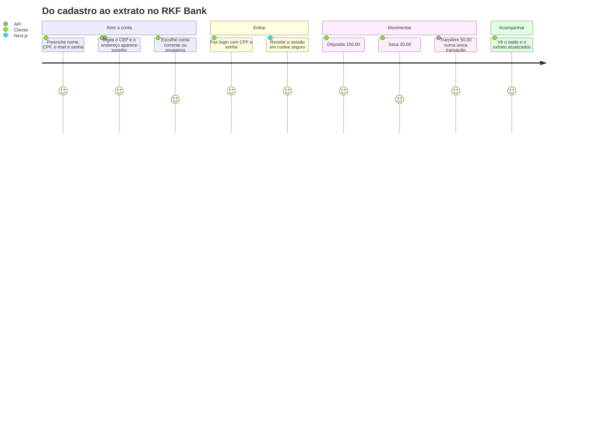

<div align="center">
  
</div>

<details>
<summary><b>📈 O saldo dessa semana em gráfico</b></summary>
<br/>

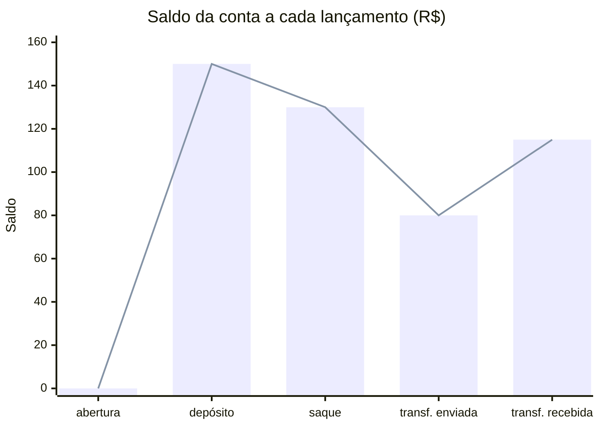

</details>

<details>
<summary><b>🖥️ As telas do site</b></summary>
<br/>

| Rota | Tela |
|---|---|
| `/` | landing page: benefícios, como funciona, cartão, segurança e dúvidas |
| `/cadastro` | cadastro com CEP automático e senha |
| `/login` | entrar com CPF e senha |
| `/conta/abrir` | abrir conta corrente ou poupança |
| `/conta` | saldo e atalhos |
| `/conta/depositar` · `/conta/sacar` · `/conta/transferir` | movimentações |
| `/conta/extrato` | extrato |
| `/conta/senha` | trocar a própria senha |
| `/conta/meus-dados` | meus dados (LGPD): ver, corrigir e encerrar o cadastro |
| `/termos` · `/privacidade` | Termos de Uso e Política de Privacidade |

</details>

<details>
<summary><b>🔄 O ciclo de vida de uma conta</b></summary>
<br/>

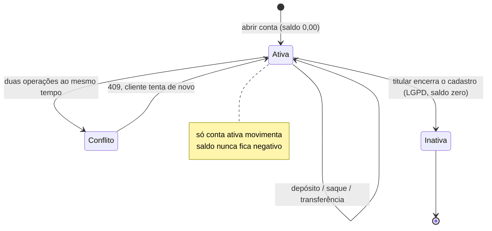

</details>

<details>
<summary><b>🎲 Simulador: e se eu tentar...?</b> (clique em cada cenário)</summary>
<br/>

<details><summary>💸 ...sacar mais do que tenho?</summary>

`422 Unprocessable Entity` com `Saldo insuficiente`. Nada é debitado e a tentativa fica no log com o `X-Request-Id`.

</details>
<details><summary>🕵️ ...ver o extrato da conta de outra pessoa?</summary>

`403 Forbidden`. A regra de dono fica no `ContaService`: o `clienteId` vem do token assinado, não do que você manda na URL. E a ordem 404 → 403 → 422 garante que ninguém descubra o saldo alheio pela mensagem de erro.

</details>
<details><summary>🗂️ ...listar as contas de alguém pelo id do cadastro (<code>GET /clientes/{id}/contas</code>)?</summary>

`403 Forbidden` (`PERFIL_SEM_PERMISSAO`), **mesmo com o seu próprio id**. Essa rota é do atendente (ADMIN), para o
suporte partir do cliente. Você vê as suas em `GET /contas`, que descobre quem você é pelo token. E o `403` vem antes
do `404`: quem não é ADMIN nem descobre se aquele id de cliente existe.

</details>
<details><summary>⏰ ...usar o app depois de 15 minutos parado?</summary>

Nada: o token de acesso vence em 15 minutos, mas o servidor do Next troca o par pelo **token de renovação** (7 dias,
uso único) antes de cada chamada, sem a pessoa perceber. Só depois de 7 dias sem usar, ou de sair, trocar a senha ou
tentar reusar um token de renovação já trocado, a sessão acaba e o site leva ao login (`?expirou=1`), voltando depois
para a tela onde você estava.

</details>
<details><summary>⚡ ...fazer duas transferências ao mesmo tempo da mesma conta?</summary>

Uma passa e a outra recebe `409 Conflict`: a `Conta` tem `@Version` (lock otimista). O saldo nunca é sobrescrito.

</details>
<details><summary>🔁 ...cadastrar o mesmo CPF ou e-mail duas vezes?</summary>

`409 Conflict`. E-mail é comparado sem diferenciar maiúsculas (`Joao@x.com` = `joao@x.com`: o `ClienteService` guarda tudo em minúsculas).

</details>
<details><summary>📮 ...cadastrar com o ViaCEP fora do ar?</summary>

Timeout de 3 s e `503 Service Unavailable` com mensagem clara, em vez de travar. CEP que não existe vira `422`.

</details>
<details><summary>🧪 ...adulterar o token (trocar o perfil para ADMIN)?</summary>

`401`. A assinatura HS256 não bate mais. Token com `alg: none` também é recusado (algoritmo fixo no `JwtDecoder`). Teste você mesmo: `node scripts/engenharia-reversa-jwt.mjs`.

</details>

</details>


## 🔐 Segurança e LGPD

<div align="center">
  
</div>

| Quem pode o quê | Rota |
|---|---|
| 🌍 qualquer pessoa | `POST /clientes` (cadastro) · `POST /auth/login` · `GET /actuator/health` |
| 👤 cliente logado | só as **próprias** contas: abrir, listar, depositar, sacar, transferir (origem), extrato |
| 🛠️ `ADMIN` | `GET /clientes`, todas as contas em `GET /contas` e a gestão de usuários em `/admin/usuarios` (promover, rebaixar, desativar, redefinir senha; vale na hora). O primeiro admin nasce do `.env` |

<details open>
<summary><b>🛡️ Spring Security por dentro: toda requisição passa por 4 portões</b></summary>
<br/>

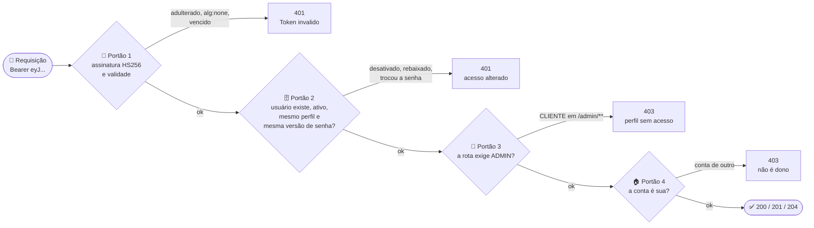

| Portão | Quem faz | Por que existe |
|---|---|---|
| 1 | `BearerTokenAuthenticationFilter` (OAuth2 Resource Server do Spring) | ninguém fabrica token sem o `JWT_SEGREDO` |
| 2 | `ConversorTokenUsuario` (nosso) | JWT é *stateless*: sem este portão, rebaixar ou desativar alguém só valeria quando o token vencesse |
| 3 | `AuthorizationFilter` + `SecurityFilterChain` | perfis `CLIENTE` e `ADMIN` |
| 4 | `ContaService` | o `clienteId` vem do **token assinado**, nunca da URL ou do corpo |

**E antes de tudo, no login:** 5 senhas erradas para o mesmo CPF em 15 min → **`429`** (nem a senha certa entra), e
CPF inexistente e senha errada dão a **mesma** resposta, no mesmo tempo.

<details>
<summary>🎛️ O que o admin muda e quando passa a valer (clique)</summary>
<br/>

| Ação | Rota | Token antigo da pessoa | Novo login |
|---|---|:-:|---|
| Promover a ADMIN | `PATCH /admin/usuarios/{id}/perfil` | ❌ `401` na hora | ✅ já vem como ADMIN |
| Rebaixar a CLIENTE | `PATCH /admin/usuarios/{id}/perfil` | ❌ `401` na hora | ✅ volta a CLIENTE |
| Desativar ("remover") | `PATCH /admin/usuarios/{id}/acesso` | ❌ `401` na hora | ❌ `CPF ou senha invalidos` |
| Redefinir a senha de quem esqueceu | `PATCH /admin/usuarios/{id}/senha` | ❌ `401` na hora | ✅ com a senha nova |
| Trocar a **própria** senha | `PATCH /usuarios/me/senha` (pede a atual) | ❌ `401` na hora | ✅ com a senha nova |

Ninguém mexe no **próprio** perfil ou acesso: o admin não se tranca para fora e sempre sobra um ADMIN ativo.

</details>

</details>

<details>
<summary><b>🔑 Como funciona o login, passo a passo</b></summary>
<br/>

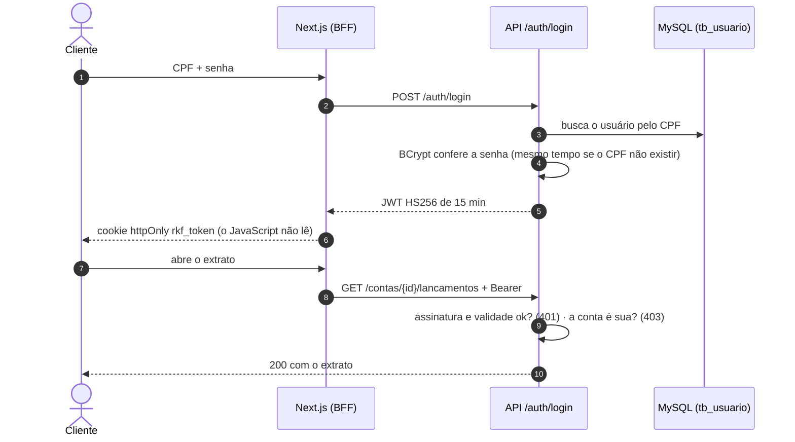

</details>

<details>
<summary><b>🧪 Laboratório: tente quebrar o banco (adivinhe a resposta antes de abrir)</b></summary>
<br/>

Suba o perfil `visitante` ([VISITANTES.md](VISITANTES.md)), entre como a Ana e tente cada ataque. Pense na resposta, depois clique.

<details>
<summary>1. Trocar <code>"perfil":"CLIENTE"</code> por <code>"ADMIN"</code> dentro do token</summary>
<br/>

**`401`**: o payload do JWT é só Base64 (qualquer um lê e edita), mas a assinatura HMAC-SHA256 deixa de bater. Sem o segredo, não existe token de admin.

</details>

<details>
<summary>2. Mandar um token com <code>"alg":"none"</code> e sem assinatura</summary>
<br/>

**`401`**: o decoder aceita **só** HS256. É um ataque clássico que derrubou muitas APIs; aqui virou teste automatizado permanente.

</details>

<details>
<summary>3. Ver o extrato do Bruno trocando o id na URL</summary>
<br/>

**`403`**: a regra de dono usa o `clienteId` do **token assinado**, nunca o da URL ou do corpo. E o `403` vem antes de qualquer regra que revele se a conta tem saldo.

</details>

<details>
<summary>4. Repetir uma transferência dez vezes com a mesma <code>Idempotency-Key</code></summary>
<br/>

**Uma** transferência e nove `204` com `Idempotency-Replayed: true`. Duas chamadas exatamente ao mesmo tempo? O `UNIQUE (usuario_id, chave)` deixa só uma gravar; a outra leva `409`.

</details>

<details>
<summary>5. Chutar a senha do Bruno até acertar</summary>
<br/>

**`429`** na sexta tentativa, e nem a senha certa entra por 15 minutos. CPF inexistente e senha errada dão a **mesma** resposta: não dá nem para descobrir quem é cliente.

</details>

<details>
<summary>6. Sacar mais do que o saldo, ou com três casas decimais</summary>
<br/>

**`422`** `Saldo insuficiente` e **`400`** `valor deve ter no máximo 2 casas decimais`. Dinheiro é `BigDecimal` com 2 casas e lock otimista: nenhum centavo aparece ou some.

</details>

**Placar:** 6 de 6 ataques barrados. Quer o roteiro completo, com cada resposta? [Guia de testes](backend/README_TESTES_E2E.md).

</details>

<details>
<summary><b>🛡️ Status da LGPD no backend (análise de 19/10/2026)</b></summary>
<br/>

**Já atende:**

- ✅ Senha só como hash BCrypt; nunca volta em resposta nem em log.
- ✅ Logs sem CPF, e-mail, telefone, senha ou token (até o `toString` dos DTOs esconde os dados).
- ✅ Autenticação em todas as rotas privadas e regra de dono (`403`).
- ✅ Dados de todos os clientes só para `ADMIN`.
- ✅ O `sub` do JWT é o id do usuário, não o CPF (o payload do JWT é só Base64).
- ✅ Frontend mascara CPF, e-mail e telefone nos logs; token fora do alcance do JavaScript.
- ✅ Limite de tentativas de login (`429` depois de 5 erros) e movimentações idempotentes (`Idempotency-Key`).
- ✅ Nenhuma senha real no repositório: contas da equipe e admin ganham login só pelo `.env`; o perfil público `visitante` tem contas fictícias e segredo do JWT sorteado.
- ✅ Direitos do titular: **ver** (`GET /clientes/me`), **corrigir** (`PATCH /clientes/me`) e **encerrar** o cadastro (`POST /clientes/me/encerramento`, com senha e saldo zero). O cadastro encerrado fica guardado pelo prazo legal (5 anos, Lei 9.613/1998) e uma rotina diária o **anonimiza** depois.

- ✅ Termos de Uso e Política de Privacidade publicados (`/termos` e `/privacidade`), aceite obrigatório no cadastro com versão e data gravadas (V10) e CPF mascarado nas respostas.

- ✅ Encarregados pelos dados pessoais: **Kevin Richard e Renan Barros**, publicados na seção 7 da política (termos versão `2026-10-26`).

**Depois do MVP:** auditoria (quem fez o quê, quando e de onde).
Detalhes e prioridades em [planing/debitos-tecnicos.md](planing/debitos-tecnicos.md) e [planing/decisoes.md](planing/decisoes.md).

</details>


## 🔌 API REST

Base URL: `http://localhost:8080` · JSON · IDs em UUID · dinheiro com 2 casas (`150.00`) · datas ISO-8601 UTC · rotas privadas com `Authorization: Bearer <token>`.
Contrato completo (com a versão atual e o histórico de mudanças): [backend/README_CONTRATO_API.md](backend/README_CONTRATO_API.md).

| Método | Rota | O que faz | Quem pode | Sucesso |
|---|---|---|---|---|
| `POST` | `/clientes` | cadastra cliente (com senha) | público | `201` |
| `GET` | `/termos` | versão vigente dos termos (o cadastro manda a que a pessoa aceitou) | público | `200` |
| `POST` | `/auth/login` | login com CPF + senha (5 erros em 15 min → `429`) | público | `200` + tokens |
| `POST` | `/auth/refresh` | troca o token de renovação por um par novo (uso único) | público (token no corpo) | `200` + tokens |
| `POST` | `/auth/logout` | revoga o token de renovação | público (token no corpo) | `204` |
| `PATCH` | `/usuarios/me/senha` | troca a própria senha (pede a atual; derruba os tokens antigos) | logado | `204` |
| `GET` | `/clientes/me` | meus dados (LGPD) | o próprio cliente | `200` |
| `PATCH` | `/clientes/me` | corrige meus dados (LGPD; CPF não muda) | o próprio cliente | `200` |
| `POST` | `/clientes/me/encerramento` | encerra o cadastro (senha + saldo zero; anonimiza depois de 5 anos) | o próprio cliente | `200` |
| `GET` | `/clientes` | lista clientes (`?page=0&size=10`) | `ADMIN` | `200` |
| `GET` | `/clientes/{clienteId}/contas` | contas de um cliente escolhido pelo id (suporte e conciliação) | `ADMIN` (cliente → `403`, mesmo com o próprio id) | `200` |
| `POST` | `/contas` | abre conta no próprio cadastro (cliente vem do token) | o próprio cliente | `201` |
| `GET` | `/contas` | lista contas | `ADMIN`: todas · `CLIENTE`: as dele | `200` |
| `GET` | `/contas/{contaId}` | uma conta (saldo, tipo, ativa) | dono da conta ou `ADMIN` | `200` |
| `POST` | `/contas/{contaId}/depositos` | deposita | dono da conta | `204` |
| `POST` | `/contas/{contaId}/saques` | saca | dono da conta | `204` |
| `POST` | `/transferencias` | transfere | dono da conta de origem | `204` |
| `GET` | `/contas/{contaId}/lancamentos` | extrato (mais recente primeiro) | dono da conta | `200` |
| `GET` | `/admin/usuarios` | lista os usuários (perfil, ativo) | `ADMIN` | `200` |
| `PATCH` | `/admin/usuarios/{usuarioId}/perfil` | promove a `ADMIN` ou rebaixa a `CLIENTE` | `ADMIN` (não em si mesmo) | `200` |
| `PATCH` | `/admin/usuarios/{usuarioId}/acesso` | desativa ou reativa o acesso | `ADMIN` (não em si mesmo) | `200` |
| `PATCH` | `/admin/usuarios/{usuarioId}/senha` | redefine a senha de quem esqueceu (vira senha temporária) | `ADMIN` | `204` |
| `GET` | `/admin/conciliacao` | contas cujo saldo não bate com o extrato | `ADMIN` | `200` |

📖 **Swagger UI:** com a API no ar, [`http://localhost:8080/swagger-ui.html`](http://localhost:8080/swagger-ui.html) documenta
todas as rotas a partir do código, com **exemplos prontos** (contas públicas da Ana e do Bruno): `POST /auth/login` →
**Try it out** → **Execute**, cole o `token` no botão **Authorize** e teste qualquer rota por ali. Depósito, saque e
transferência já vêm com o `Idempotency-Key` preenchido; cada rota mostra o status real (`201`, `204`) e todos os erros
possíveis. Passo a passo em [VISITANTES.md](VISITANTES.md#-sem-insomnia-use-o-swagger-no-navegador). Em produção
(perfil `prod`) o Swagger fica fechado.

<details>
<summary><b>👤 <code>POST /clientes</code> — cadastrar</b></summary>
<br/>

```json
{
  "nomeCompleto": "Cliente Novo do Insomnia",
  "cpf": "529.982.247-25",
  "email": "cliente.novo@exemplo.test",
  "telefone": "(11) 99999-8888",
  "cep": "06020-010",
  "numero": "123",
  "complemento": "Apto 45",
  "senha": "minha-senha-forte",
  "aceiteTermos": true
}
```

`aceiteTermos: true` é obrigatório (LGPD): sem ele, `400`. CPF, telefone e CEP podem ir **com máscara**, do jeito que a pessoa digita: a API higieniza (fica só com os dígitos),
valida o CPF pelos dígitos verificadores e busca logradouro, bairro, cidade e UF no **ViaCEP** (aqui, Osasco/SP).
Resposta `201`: o cliente com o endereço completo, o CPF mascarado (`***.982.247-**`) e a versão dos termos aceita. A senha **nunca** volta.

</details>

<details>
<summary><b>🔑 <code>POST /auth/login</code> — entrar</b></summary>
<br/>

```json
{ "cpf": "52998224725", "senha": "minha-senha-forte" }
```

```json
{
  "token": "eyJhbGciOiJIUzI1NiJ9...",
  "tipo": "Bearer",
  "expiraEmSegundos": 900,
  "clienteId": "1a89861c-70a0-4b7c-947a-d16cdfe2dd08",
  "perfil": "CLIENTE",
  "deveTrocarSenha": false,
  "refreshToken": "q3Jd0kX4...",
  "refreshExpiraEmSegundos": 604800
}
```

CPF sem cadastro e senha errada recebem **a mesma** resposta `401`, de propósito. O `refreshToken` renova a sessão
em `POST /auth/refresh` (cada um vale uma vez) e `POST /auth/logout` o revoga.

</details>

<details>
<summary><b>💳 Abrir conta, movimentar e ver o extrato</b></summary>
<br/>

```json
// POST /contas (o cliente vem do token; agência e número são gerados pelo banco)
{ "tipoConta": "CORRENTE" }

// POST /contas/{contaId}/depositos  e  /contas/{contaId}/saques   (header Idempotency-Key obrigatório)
{ "valor": 150.00, "descricao": "Deposito pelo Insomnia" }

// POST /transferencias   (header Idempotency-Key obrigatório)
{ "contaOrigemId": "407d727e-...", "contaDestinoId": "566dd28f-...", "valor": 25.00, "descricao": "Transferencia pelo Insomnia" }
```

A `Idempotency-Key` é um UUID novo **por operação**: repetir o mesmo pedido com a mesma chave (rede caiu, clique
duplo) responde `204` com `Idempotency-Replayed: true` e não move o dinheiro de novo.

Extrato (`GET /contas/{contaId}/lancamentos`):

```json
[
  {
    "id": "59798941-269a-406c-8783-9be456bf1f5c",
    "tipoLancamento": "TRANSFERENCIA",
    "valor": 50.00,
    "contaOrigemId": "407d727e-4e43-4c93-b01c-331cbaba42fb",
    "contaDestinoId": "566dd28f-b08f-41e4-ac55-cc69ecfea4cd",
    "descricao": "Aluguel",
    "dataHora": "2026-10-12T11:19:53.038985Z"
  }
]
```

O `valor` é sempre positivo: se a conta da tela é o `contaDestinoId`, é entrada; senão, saída.

</details>

<details>
<summary><b>⚠️ Formato de erro e status HTTP</b></summary>
<br/>

```json
{
  "timestamp": "2026-10-23T11:19:54.090042Z",
  "status": 422,
  "error": "Unprocessable Content",
  "codigo": "SALDO_INSUFICIENTE",
  "message": "Saldo insuficiente",
  "path": "/contas/407d727e-.../saques",
  "campos": []
}
```

**Decida pelo `status` e pelo `codigo`; o `message` é só para exibir.** Código e mensagem moram juntos no enum
[`CodigoErroEnum`](backend/src/main/java/com/br/rkfbank/compartilhado/erros/CodigoErroEnum.java) (a tabela completa está no
[contrato](backend/README_CONTRATO_API.md#6-erros)).

| Status | Quando | Alguns `codigo` |
|---|---|---|
| `400` | dados inválidos, JSON mal formado ou parâmetro inválido | `CAMPOS_INVALIDOS` (+ `campos`), `JSON_INVALIDO` |
| `401` | sem token, token inválido ou vencido, acesso alterado, CPF/senha errados | `TOKEN_INVALIDO`, `ACESSO_ALTERADO`, `CREDENCIAIS_INVALIDAS` |
| `403` | logado, mas sem permissão | `CONTA_DE_OUTRO_CLIENTE`, `PERFIL_SEM_PERMISSAO` |
| `404` | cliente, conta ou usuário não encontrado | `CONTA_NAO_ENCONTRADA` |
| `409` | dado repetido ou operação simultânea | `CPF_JA_CADASTRADO`, `CONCORRENCIA`, `IDEMPOTENCIA_EM_ANDAMENTO` |
| `422` | regra de negócio recusou | `SALDO_INSUFICIENTE`, `MESMA_CONTA`, `CEP_NAO_ENCONTRADO`, `SENHA_ATUAL_INCORRETA` |
| `429` | 5 logins errados seguidos | `MUITAS_TENTATIVAS` (+ `Retry-After`) |
| `503` | ViaCEP fora do ar | `SERVICO_INDISPONIVEL` |

</details>

<details>
<summary><b>🧪 Fluxo E2E completo com <code>curl</code> (o mesmo da pasta 02 do Insomnia)</b></summary>
<br/>

Cada passo tem o **mesmo nome, rota e corpo** da pasta **"02 · Fluxo E2E: cliente novo, do cadastro ao extrato"** da
[coleção do Insomnia](backend/insomnia/rkfbank.insomnia.json). Com a API no ar (`./mvnw spring-boot:run -Dspring-boot.run.profiles=visitante`):

```bash
API=http://localhost:8080
CPF=529.982.247-25    # com máscara de propósito: a API higieniza

# 1. Cadastrar cliente (público): CPF, telefone e CEP com máscara; endereço vem do ViaCEP
curl -X POST $API/clientes -H "Content-Type: application/json" -d '{
  "nomeCompleto":"Cliente Novo do Insomnia","cpf":"'$CPF'","email":"cliente.novo@exemplo.test",
  "telefone":"(11) 99999-8888","cep":"06020-010","numero":"123","complemento":"Apto 45","senha":"minha-senha-forte",
  "aceiteTermos":true}'

# 2. Login · cliente novo: guarde o token
curl -X POST $API/auth/login -H "Content-Type: application/json" -d '{"cpf":"'$CPF'","senha":"minha-senha-forte"}'
TOKEN=cole-o-token-aqui
AUTH="Authorization: Bearer $TOKEN"; JSON="Content-Type: application/json"

# 3. Abrir conta ORIGEM (corrente) e conta DESTINO (poupança): guarde os dois "id"
curl -X POST $API/contas -H "$AUTH" -H "$JSON" -d '{"tipoConta":"CORRENTE"}'
curl -X POST $API/contas -H "$AUTH" -H "$JSON" -d '{"tipoConta":"POUPANCA"}'
ORIGEM=cole-o-id-da-corrente; DESTINO=cole-o-id-da-poupanca

# 4. Depositar 150,00 · sacar 50,00 · transferir 25,00 (cada operação com uma Idempotency-Key nova)
curl -X POST $API/contas/$ORIGEM/depositos -H "$AUTH" -H "$JSON" -H "Idempotency-Key: $(uuidgen)" \
  -d '{"valor":150.00,"descricao":"Deposito pelo Insomnia"}'
curl -X POST $API/contas/$ORIGEM/saques -H "$AUTH" -H "$JSON" -H "Idempotency-Key: $(uuidgen)" \
  -d '{"valor":50.00,"descricao":"Saque pelo Insomnia"}'
curl -X POST $API/transferencias -H "$AUTH" -H "$JSON" -H "Idempotency-Key: $(uuidgen)" \
  -d '{"contaOrigemId":"'$ORIGEM'","contaDestinoId":"'$DESTINO'","valor":25.00,"descricao":"Transferencia pelo Insomnia"}'

# 5. Saldos (ORIGEM 75,00 · DESTINO 25,00) e extratos
curl $API/contas -H "$AUTH"
curl $API/contas/$ORIGEM/lancamentos -H "$AUTH"     # 3 lançamentos: transferência, saque, depósito
curl $API/contas/$DESTINO/lancamentos -H "$AUTH"    # 1 lançamento: a transferência recebida
```

Sem `uuidgen`? Use qualquer texto único de 8 a 100 caracteres (`deposito-001`, `saque-001`...).
CPF já cadastrado? Troque por outro válido: `70483726052`, `39053344705`, `11144477735`.
A coleção pública inteira (83 requisições do cliente, com os erros esperados) roda pelo terminal: `node scripts/rodar-colecao-insomnia.mjs`.

</details>


## 🧱 Arquitetura

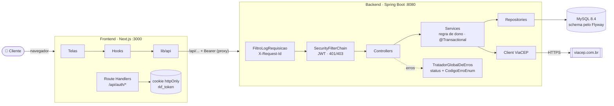

<div align="center">
  
</div>

<details open>
<summary><b>🩺 Como o RKF Bank está construído hoje: monólito modular</b></summary>
<br/>

| | O que é | No RKF Bank |
|:-:|---|---|
| 🧱 | **Monólito modular:** uma aplicação só, publicada inteira, mas dividida em módulos por assunto | `clientes`, `contas`, `autenticacao`, `titular` (LGPD) e `compartilhado`; 23 rotas, um banco MySQL e uma imagem Docker |
| 🍰 | **Camadas dentro de cada módulo:** cada uma só chama a de baixo | `contas/ContaController` → `ContaService` → `ContaRepository`: o controller, o service, o repository, as entidades e os DTOs de um assunto moram juntos (*package by feature*) |
| 🔌 | **Portas e adaptadores nas bordas** (hexagonal só onde há tecnologia de fora) | `clientes/ConsultaCep` (adaptador `ViaCepConsultaCep`) e `contas/comprovante/NotificadorDeMovimentacao` (adaptador `NotificadorNoLog`) |
| 🚧 | **Fronteiras verificadas por teste** | [`ArquiteturaModulosTest`](backend/src/test/java/com/br/rkfbank/ArquiteturaModulosTest.java) (ArchUnit): o compartilhado não conhece os módulos, só o adaptador conhece o ViaCEP, controller não fala com repository e o banco de cada módulo é só dele |
| 🛡️ | **BFF na frente** (*Backend for Frontend*) | o Next.js guarda o token no cookie `httpOnly` e repassa as chamadas para a API |
| 🧵 | **Thread:** o "trabalhador" que executa o código, uma instrução depois da outra | cada requisição roda numa **thread virtual** (Java 21+): quando espera o banco ou o ViaCEP, libera a vaga para outra requisição |
| ⏱️ | **Síncrono × assíncrono:** quem pede espera a resposta × pede e segue | a API responde de forma síncrona (a transferência devolve `204` na hora); o **comprovante** sai de forma assíncrona pelo **Outbox** (até 2 s depois), e as rotinas agendadas também (anonimização às 03h, limpeza às 04h) |

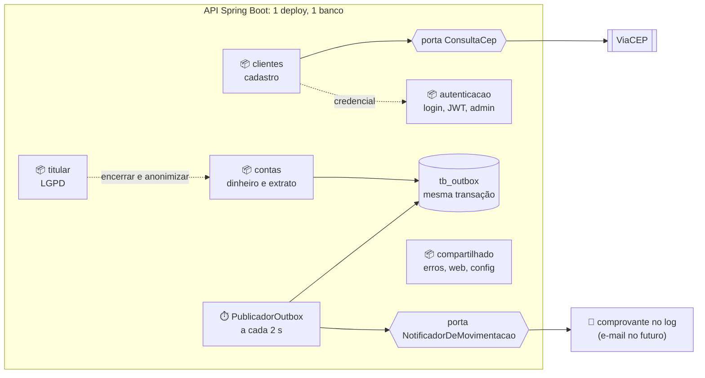

<details>
<summary>📦 <b>O que mora em cada módulo</b> (clique)</summary>
<br/>

| Módulo | O que tem | Onde |
|---|---|---|
| **clientes** | cadastro com CEP, `Cliente`, `Endereco`, porta `ConsultaCep` e o adaptador do ViaCEP | [`clientes/`](backend/src/main/java/com/br/rkfbank/clientes) |
| **contas** | abertura, depósito, saque, transferência, extrato, idempotência, conciliação e o comprovante (Outbox) | [`contas/`](backend/src/main/java/com/br/rkfbank/contas) |
| **autenticacao** | login, JWT, refresh token, limite de tentativas, credencial do cadastro, troca de senha e gestão de usuários pelo ADMIN | [`autenticacao/`](backend/src/main/java/com/br/rkfbank/autenticacao) |
| **titular** | LGPD: meus dados, correção, encerramento, termos e a rotina de anonimização | [`titular/`](backend/src/main/java/com/br/rkfbank/titular) |
| **compartilhado** | `config` (CORS, OpenAPI, log, rotinas), `erros` (exceções e `TratadorGlobalDeErros`), `web` (JSON de erro e de página) e `validacao` (`@CpfValido`) | [`compartilhado/`](backend/src/main/java/com/br/rkfbank/compartilhado) |

**Antes (até 29/10/2026)** as pastas eram por camada (`controllers/`, `services/`, `repositories/`...): cada assunto
novo espalhava arquivos por cinco pastas e nada impedia um módulo de mexer no banco de outro. A mudança moveu as
classes sem mudar nenhuma regra: os 356 testes que já existiam continuaram verdes.

</details>

<details>
<summary>🧩 <b>Design patterns usados</b> (clique)</summary>
<br/>

| Padrão | Onde está |
|---|---|
| **Monólito modular** e **Camadas** | um módulo por assunto, e dentro dele controller → service → repository |
| **Ports & Adapters** (hexagonal nas bordas) | `ConsultaCep` → `ViaCepConsultaCep` · `NotificadorDeMovimentacao` → `NotificadorNoLog` |
| **Transactional Outbox** | `ComprovanteService` grava o evento na transação do dinheiro (`Propagation.MANDATORY`); `PublicadorOutbox` entrega depois |
| **Inversão de dependência** | `LimpezaPeriodica`: a rotina das 04h (compartilhado) chama cada módulo sem conhecer nenhum |
| **DTO**, **Repository**, **Injeção de dependência** | `dto/` com `record` em cada módulo; Spring Data; construtores dos services |
| **Proxy** | é como o `@Transactional` funciona por baixo: o Spring põe um objeto na frente do service que abre e fecha a transação |
| **Singleton** | todo `@Service` e `@Component`: uma instância para a aplicação inteira |
| **Chain of Responsibility** | a sequência de filtros: `FiltroLogRequisicao` → Spring Security → controller |
| **Adapter** | `ViaCepConsultaCep` (ViaCEP → `EnderecoDoCep`) e `ConversorTokenUsuario` (JWT → usuário logado) |
| **Execute Around** | `IdempotenciaService.executarUmaVez`: o "antes e depois" da chave num lugar, a movimentação no meio |
| **Exception Translation** | `TratadorGlobalDeErros` + `CodigoErroEnum`: toda exceção vira o mesmo JSON de erro |
| **Static Factory** e **Builder** | `PaginaResponse.de(page)` · `JwtClaimsSet.builder()` para montar o token JWT |
| **Domínio rico** | `Conta.sacar`, `depositar` e `transferirPara`: a regra do saldo mora na própria conta (feito com TDD) |
| **Lock otimista** | `@Version` na `Conta`: duas operações ao mesmo tempo não sobrescrevem o saldo (`409`) |
| **Idempotent Receiver** | `Idempotency-Key` + `tb_idempotencia`: repetir o pedido não move o dinheiro nem gera outro comprovante |

Catálogo completo, com o que **não** usar e por quê: [planing/padroes-de-projeto.md](planing/padroes-de-projeto.md).

</details>

</details>

<details>
<summary><b>🧩 Cada camada, ponto a ponto: o que faz, por que existe e onde está</b> (clique)</summary>
<br/>

| # | Camada | Papel | Por que importa | No código |
|:-:|---|---|---|---|
| 1 | **Filtros** | dão um `X-Request-Id` a cada chamada e registram método, rota, status e tempo | rastrear uma requisição em todos os logs | [`FiltroLogRequisicao`](backend/src/main/java/com/br/rkfbank/compartilhado/config/FiltroLogRequisicao.java) |
| 2 | **Segurança** | valida o JWT, confere no banco se o usuário ainda vale e barra `401`/`403` por perfil | ninguém chega ao controller sem identidade | [`ConfiguracaoSeguranca`](backend/src/main/java/com/br/rkfbank/autenticacao/ConfiguracaoSeguranca.java) · [`ConversorTokenUsuario`](backend/src/main/java/com/br/rkfbank/autenticacao/ConversorTokenUsuario.java) |
| 3 | **Controllers** | traduzem HTTP ↔ Java: rota, `@Valid` no DTO, quem está logado (`UsuarioLogado`) e o status de sucesso | a camada web fica fina; regra nenhuma mora aqui | um por módulo, ex.: [`contas/ContaController`](backend/src/main/java/com/br/rkfbank/contas/ContaController.java) |
| 4 | **DTOs** (`record`) | o formato de entrada e saída da API, com as validações de formato | a entidade JPA nunca vaza; o contrato não muda quando o banco muda | `dto/` de cada módulo, ex.: [`contas/dto`](backend/src/main/java/com/br/rkfbank/contas/dto) |
| 5 | **Services** | a regra de negócio: dono da conta, saldo, conta ativa, idempotência, LGPD; abrem a transação (`@Transactional`) | tudo-ou-nada no dinheiro; testável sem HTTP | um por módulo, ex.: [`contas/ContaService`](backend/src/main/java/com/br/rkfbank/contas/ContaService.java) |
| 6 | **Mapeamento** | métodos `paraResponse`/`paraContaResponse` convertem entidade → DTO | só o que a tela usa sai da API (LGPD) | dentro de cada service |
| 7 | **Repositories** | consultas ao banco pelo Spring Data JPA | o service pede "contas do cliente", não escreve SQL | um por módulo, ex.: [`contas/ContaRepository`](backend/src/main/java/com/br/rkfbank/contas/ContaRepository.java) |
| 8 | **Entities** | as tabelas como classes; `Conta` tem `@Version` (lock otimista) | duas operações na mesma conta não se sobrescrevem | nos módulos, ex.: [`contas/Conta`](backend/src/main/java/com/br/rkfbank/contas/Conta.java) |
| 9 | **Portas e adaptadores** | o módulo pede pela interface (`ConsultaCep`); o adaptador fala com o ViaCEP, com timeout | falha externa vira `503`, não `500`; trocar de provedor não mexe na regra | [`ViaCepClient`](backend/src/main/java/com/br/rkfbank/clientes/viacep/ViaCepClient.java) |
| 10 | **Exceções + `CodigoErroEnum`** | o service lança `new RegraNegocioException(CodigoErroEnum.SALDO_INSUFICIENTE)`; o enum guarda o código e a mensagem | um lugar só para o texto de cada erro; o front decide pelo `codigo` | [`compartilhado/erros`](backend/src/main/java/com/br/rkfbank/compartilhado/erros) |
| 11 | **Tratador de erros** | escolhe o status HTTP de cada exceção e monta o JSON padrão | todo erro sai no mesmo formato | [`TratadorGlobalDeErros`](backend/src/main/java/com/br/rkfbank/compartilhado/erros/TratadorGlobalDeErros.java) |
| 12 | **Flyway** | cria e evolui o schema (V1 a V16) e carrega as contas de teste | o banco de todo mundo é igual ao de produção | [`db/migration`](backend/src/main/resources/db/migration) |

</details>

<details>
<summary><b>🛣️ Uma transferência do clique ao banco, passo a passo</b> (clique)</summary>
<br/>

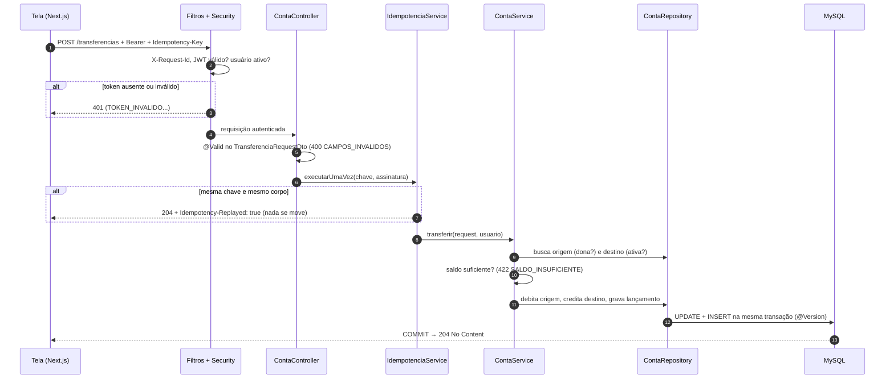

Mais diagramas (telas, containers, rastreabilidade tela → tabela, sessão): **[🗺️ Atlas de fluxos](FLUXOS.md)**.

</details>

<details>
<summary><b>🆚 Antes × depois: decisões que mudaram o projeto</b> (clique em cada uma)</summary>
<br/>

<details><summary>🗄️ Banco: <code>ddl-auto=update</code> → Flyway</summary>

| Antes | Depois |
|---|---|
| o Hibernate "adivinhava" o schema: FKs com nome aleatório e sem índice no extrato | `V1` a `V5` versionados (uma tabela por versão), revisados em PR e iguais em todo ambiente |
| renomear um campo criava uma coluna nova e deixava os dados na velha | `ALTER TABLE ... RENAME COLUMN` numa migração nova |

</details>
<details><summary>🔐 Acesso: qualquer um movimentava qualquer conta → JWT + regra de dono</summary>

| Antes | Depois |
|---|---|
| `POST /contas/{id}/saques` funcionava sem login, para qualquer id | sem token dá `401`; conta de outra pessoa dá `403` |
| `GET /clientes` mostrava o CPF de todo mundo | só o `ADMIN` lista clientes |

</details>
<details><summary>🍪 Token: <code>localStorage</code> → cookie <code>httpOnly</code></summary>

| Com `localStorage` (descartado) | Com cookie `httpOnly` |
|---|---|
| qualquer script da página (um XSS) leria o token | o Next grava o cookie e o JavaScript não alcança |

</details>
<details><summary>💰 Dinheiro: <code>double</code> → <code>BigDecimal</code></summary>

| Com `double` | Com `BigDecimal` |
|---|---|
| `0.1 + 0.2 = 0.30000000000000004` | `0.30` exato, e `DECIMAL(19,2)` no banco |

</details>

</details>

<details open>
<summary><b>🛫 Flyway: do banco vazio à API no ar</b></summary>
<br/>

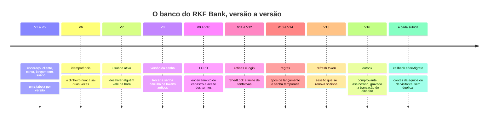

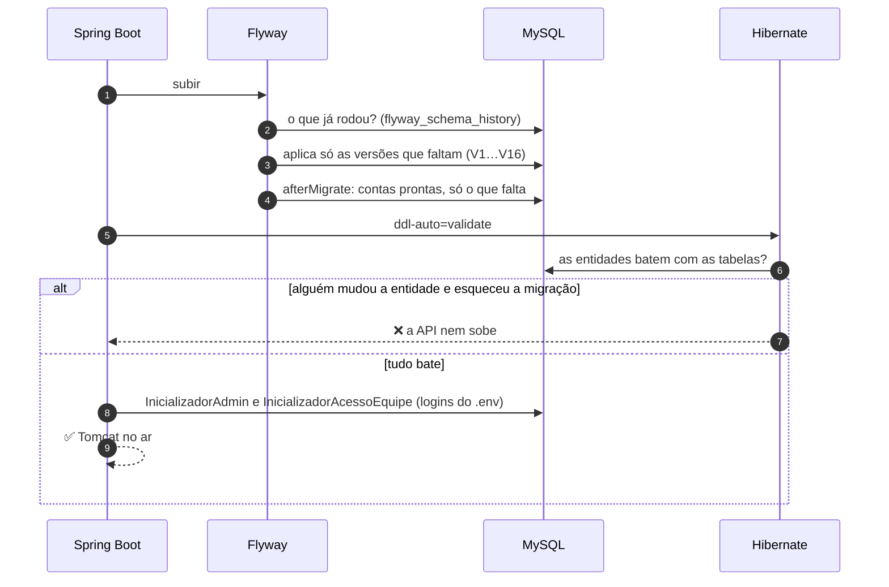

<details>
<summary>🤔 E se... (clique em cada um)</summary>
<br/>

<details><summary>...alguém editar a <code>V1</code> depois de aplicada?</summary>

❌ `Migration checksum mismatch`: o Flyway guarda o checksum de cada versão e a API recusa subir. Mudou algo? **Versão nova** (`V16__...`).

</details>
<details><summary>...alguém criar um campo na entidade e esquecer a migração?</summary>

❌ O Hibernate em `validate` compara entidade × tabela e a API **não sobe**: o erro aparece no seu computador, não em produção.

</details>
<details><summary>...a API reiniciar dez vezes?</summary>

✅ As versões rodam uma vez só; o callback `afterMigrate` roda nas dez, mas só insere o que falta. Nada duplica e saldo movimentado nunca é resetado.

</details>
<details><summary>...subir em produção?</summary>

✅ `FLYWAY_LOCATIONS=classpath:db/migration`: só o schema, **nenhuma** conta de teste.

</details>

</details>

</details>

<details>
<summary><b>🗃️ Modelo de dados (migrações V1 a V16)</b></summary>
<br/>

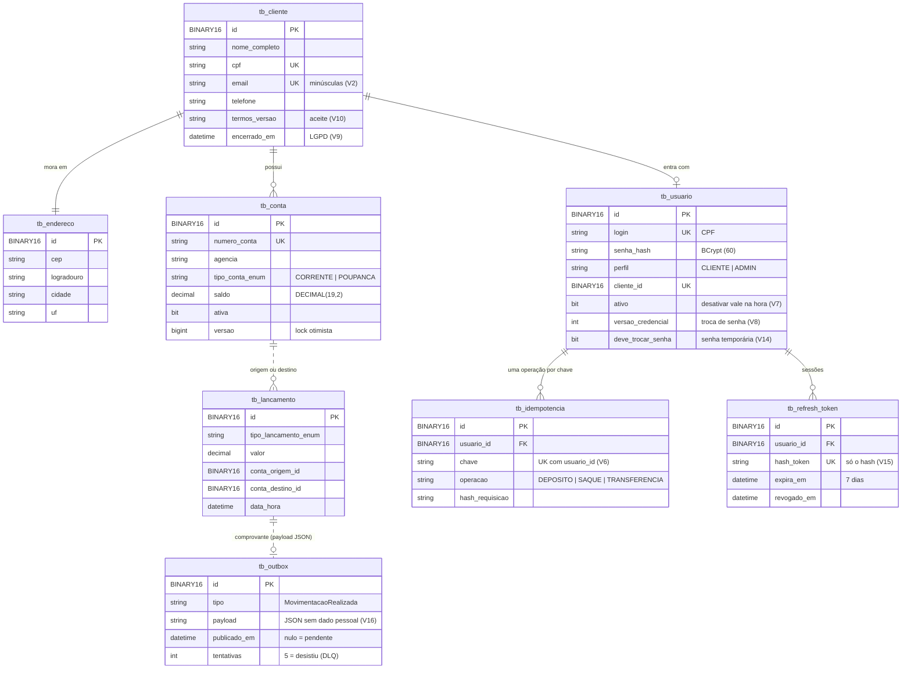

</details>

<details>
<summary><b>📦 Módulos do backend</b></summary>
<br/>

| Módulo | Responsabilidade |
|---|---|
| [`clientes`](backend/src/main/java/com/br/rkfbank/clientes) | cadastro, `Cliente`, `Endereco`, porta `ConsultaCep` e o adaptador do ViaCEP (`clientes/viacep`) |
| [`contas`](backend/src/main/java/com/br/rkfbank/contas) | `Conta` (domínio rico), `Lancamento`, movimentações, extrato, idempotência, conciliação e o comprovante (`contas/comprovante`, Outbox) |
| [`autenticacao`](backend/src/main/java/com/br/rkfbank/autenticacao) | segurança (filter chain, JWT, erros 401/403), `UsuarioLogado`, login, refresh token, credencial, admin e gestão de usuários |
| [`titular`](backend/src/main/java/com/br/rkfbank/titular) | LGPD: `/clientes/me`, encerramento, termos e a anonimização das 03h |
| [`compartilhado`](backend/src/main/java/com/br/rkfbank/compartilhado) | `config` (CORS, OpenAPI, log, rotinas), `erros` (exceções que viram status HTTP), `web` (JSON de erro e página), `validacao` (`@CpfValido`) |

Mais detalhes em [backend/README_IMPLEMENTACAO.md](backend/README_IMPLEMENTACAO.md).

</details>

<details>
<summary><b>🧰 Stack completa</b></summary>
<br/>

<div align="center">

</div>

| Lado | Tecnologias |
|---|---|
| Backend | Java 25 · Spring Boot 4.1 · Spring Web MVC · Spring Data JPA (Hibernate 7) · Spring Security + OAuth2 Resource Server · Bean Validation · `RestClient` · Flyway · Log4j2 |
| Banco | MySQL 8.4 (Docker Compose) · H2 2.5.252 (modo MySQL) nos testes · MySQL real com Testcontainers |
| Testes | JUnit 5 · Mockito · `@DataJpaTest` · `@SpringBootTest` · JaCoCo |
| Frontend | Next.js 16 (App Router) · React 19 · TypeScript 6 · Tailwind CSS 4 · shadcn/ui · Lucide · pnpm 10 |
| Esteira | GitHub Actions · CodeQL · Dependency Review · Dependabot · Conventional Commits |

</details>


## 🔬 Laboratório de arquitetura

> O que já virou código, provado por teste, e o que está **em estudo para implementação**, com plano pronto.
> Adivinhe a resposta antes de abrir cada caixa. Detalhes e código de cada tema: [planing/estudos-arquitetura.md](planing/estudos-arquitetura.md).

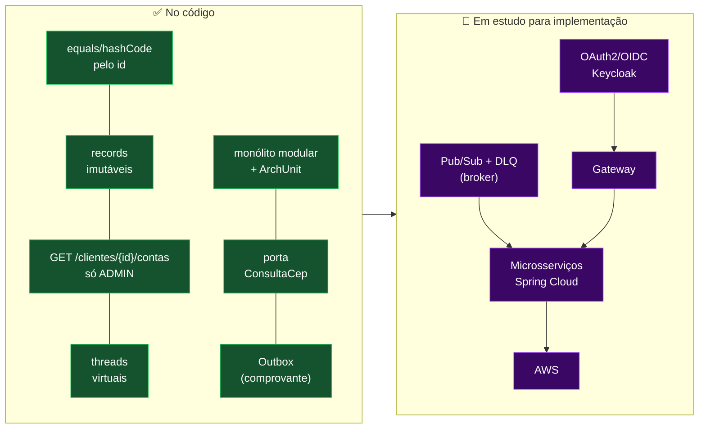

<details>
<summary><b>✅ Já no código</b> (clique em cada desafio)</summary>
<br/>

<details><summary>🧩 Salvei uma <code>Conta</code> que estava num <code>HashSet</code>. Ela continua lá?</summary>

**Continua**, porque o `hashCode` é fixo por classe. Se ele dependesse do id, mudaria de `null` para o UUID no `persist`
e a conta "sumiria" do conjunto. O `equals` compara o **id do banco** (pelo getter, para funcionar com o proxy do
Hibernate). As 7 entidades seguem o mesmo padrão. Prova: `IdentidadeEntidadesTest` (21 casos).

</details>
<details><summary>🧊 Um <code>record</code> é imutável. Dá para mudar a lista de erros depois de montar a resposta?</summary>

Dava: o record é imutável só "na casca", e a lista de dentro continuava aberta para quem tinha a referência. Agora
`ErroResponse` e `PaginaResponse` fazem `List.copyOf` no construtor compacto. Quem tentar `add` recebe
`UnsupportedOperationException`. Prova: `ImutabilidadeRespostasTest`.

</details>
<details><summary>🧵 200 cadastros esperando o ViaCEP (3 s). E o 201º?</summary>

Antes, esperava na fila: o Tomcat tem ~200 threads e cada espera prendia uma. Com `spring.threads.virtual.enabled=true`
(Java **25** continua; threads virtuais são do 21), cada requisição roda numa **thread virtual** que "desmonta" enquanto
espera I/O. O limite passa a ser o pool de conexões do banco. Prova: `ThreadsVirtuaisTest`.

</details>
<details><summary>🗂️ O cliente pode listar as contas pelo próprio id em <code>/clientes/{id}/contas</code>?</summary>

**Não** (`403`). A rota existe só para o ADMIN (suporte), com a regra na `ConfiguracaoSeguranca` **e de novo** no
`ContaService` (defesa em profundidade). O `403` vem antes do `404`: quem não é ADMIN nem descobre se o id existe. O
cliente usa `GET /contas`, que tira o dono do token. Contrato 3.2.

</details>

</details>

<details>
<summary><b>🔬 Em estudo para implementação</b> (clique em cada tema)</summary>
<br/>

<details><summary>☁️ Spring Cloud e microsserviços: por que ainda não?</summary>

O RKF Bank é um monólito bem dividido em camadas; microsserviço resolve problema de **times e escala independentes**,
que ainda não temos. Primeiro passo viável: **circuit breaker** (Resilience4j) no ViaCEP, que devolve `503` na hora em
vez de esperar o timeout. Depois: Gateway e Config Server quando houver 2+ serviços.

</details>
<details><summary>📨 Transactional Outbox (✅ no código): e se o comprovante falhar no meio da transferência?</summary>

Mandar o comprovante dentro da transferência deixaria o dinheiro refém do e-mail, e publicar direto num broker pode perder
o evento ou avisar algo que deu *rollback*. Com **Outbox**, o evento vai para a `tb_outbox` (V16) **na mesma transação**
do dinheiro (`ComprovanteService`, com `Propagation.MANDATORY`), e o `PublicadorOutbox` (a cada 2 s, ShedLock) entrega
depois pela porta `NotificadorDeMovimentacao`. Falhou 5 vezes, o evento para de ser tentado e fica no banco como DLQ.
Prova: `ComprovanteIntegracaoTest` e `PublicadorOutboxTest`. Falta só trocar o adaptador do log por um broker.

</details>
<details><summary>☠️ Pub/Sub + DLQ: e a mensagem que sempre falha?</summary>

Um *exchange* `topic` com uma fila por interessado (comprovante, auditoria). Depois de 3 tentativas (1 s, 2 s, 4 s), a
mensagem vai para a **Dead Letter Queue** e para de travar as outras; um alerta avisa e o ADMIN reprocessa.

</details>
<details><summary>🟧 AWS: o que muda no código para subir?</summary>

**Nada** no primeiro passo: a imagem Docker do perfil `prod` já existe. ECS Fargate roda a imagem, RDS guarda o MySQL e
o Secrets Manager guarda `JWT_SEGREDO` e `DB_*`. SNS + SQS (com DLQ nativa) entram junto com o Outbox.

</details>
<details><summary>🔐 OAuth2 + OIDC: a API já não usa OAuth2?</summary>

Usa **metade**: ela já é um *OAuth2 Resource Server* (valida o token). O estudo é tirar a emissão da API e passar para
um **Authorization Server** (Keycloak), com login, MFA e o *ID token* do OIDC. Regra de dono, `@AuthenticationPrincipal`
e os testes com `jwt()` ficam iguais.

</details>

</details>


## 🚀 Rodando o projeto

| Ferramenta | Versão |
|---|---|
| [JDK](https://adoptium.net/temurin/releases/?version=25) | **25** (o Maven Enforcer bloqueia outras) |
| [Docker Desktop](https://www.docker.com/products/docker-desktop/) | recente |
| [Node.js](https://nodejs.org/) + [pnpm](https://pnpm.io/installation) | 20+ e 10 (`corepack enable`) |

<details open>
<summary><b>⚡ Visitante: API em 1 comando, sem Docker (perfil <code>visitante</code>)</b></summary>
<br/>

```bash
./mvnw spring-boot:run -Dspring-boot.run.profiles=visitante   # PowerShell: .\mvnw.cmd spring-boot:run "-Dspring-boot.run.profiles=visitante"
```

Sobe com H2 em memória, sem `.env`, com duas contas fictícias prontas e segredo do JWT sorteado (ninguém forja token).
Não existe admin nem conta da equipe nesse perfil. Guia de 15 minutos, 13 passos: **[VISITANTES.md](VISITANTES.md)**.

| Quem | CPF (login) | Senha | Conta |
|---|---|---|---|
| **Ana Visitante (Origem)** | `246.813.579-28` | `Visitante@2026` | 0001 / 900001 · R$ 1.000,00 |
| **Bruno Visitante (Destino)** | `975.318.642-82` | `Visitante@2026` | 0001 / 900002 · R$ 500,00 |

Roteiro completo (H2, MySQL, Insomnia, permissões, caminho feliz, idempotência, 401/403/429, erros, Spring Security + OAuth2):
[como testar o projeto](backend/README_TESTES_E2E.md). Quando usar cada perfil:
[backend/README.md → Perfis](backend/README.md#-perfis-qual-usar-e-quando).

</details>

<details open>
<summary><b>1️⃣ Banco (MySQL no Docker)</b></summary>
<br/>

```bash
cp .env.example .env          # preencha senhas e gere o JWT_SEGREDO: openssl rand -base64 48
docker compose up -d          # MySQL na porta 5441
docker compose ps             # espere "healthy"
```

</details>

<details open>
<summary><b>2️⃣ Backend (porta 8080)</b></summary>
<br/>

O Spring **lê o `.env` da raiz sozinho** (desde 20/10/2026): basta rodar da raiz do repositório.

```bash
./mvnw spring-boot:run        # PowerShell: .\mvnw.cmd spring-boot:run
```

As tabelas nascem pelo **Flyway** (`V1` a `V16`) e, a cada subida, o callback `afterMigrate` garante as contas da
equipe (Fellipe = origem, Renan = destino). O login delas vem da `EQUIPE_SENHA` do `.env`: os acessos ficam no guia
privado da equipe, fora do repositório. As migrações foram reorganizadas em 20/10/2026: se a API recusar com
*Migration checksum mismatch* ou *applied migration not resolved locally*, rode
`docker compose down -v && docker compose up -d` **uma vez** (apaga os dados locais).

</details>

<details open>
<summary><b>🧪 Testar: pela IDE, no Insomnia e olhando o banco</b></summary>
<br/>

| Quero... | Como |
|---|---|
| rodar pela IntelliJ | o projeto traz 3 configurações prontas (pasta `.run/`): **API · Visitante (H2)**, **API · Equipe (H2)** e **API · MySQL (Docker)** |
| testar sem copiar e colar | importe [`backend/insomnia/rkfbank.insomnia.yaml`](backend/insomnia/rkfbank.insomnia.yaml) (ou o `.json`, Insomnia 9) no Insomnia: 83 requisições do cliente em ordem, cada uma com uma explicação em palavras simples (a pasta 02 é o roteiro E2E completo), e o login guarda o token sozinho |
| ver as tabelas no H2 | `http://localhost:8080/h2-console` · JDBC URL `jdbc:h2:mem:rkfbank-visitante` (ou `rkfbank-equipe`) · usuário `sa`, senha vazia |
| ver as tabelas no MySQL | `localhost:5441` com o usuário do `.env` (IntelliJ *Database*, DBeaver) ou `docker exec` no container `rkfbank-mysql` |
| tornar alguém ADMIN | pelo `.env` (primeiro admin), pela API (`PATCH /admin/usuarios/{id}/perfil`) ou por SQL num banco local |

Passo a passo de tudo isso, com as permissões de cada rota e todos os payloads:
**[Como testar o projeto, do zero](backend/README_TESTES_E2E.md)**.

</details>

<details open>
<summary><b>3️⃣ Frontend (porta 3000)</b></summary>
<br/>

```bash
cd frontend
cp .env.example .env.local
pnpm install
pnpm dev
```

Abra <http://localhost:3000> e entre em `/login` com uma conta de teste (visitante, equipe) ou crie uma em `/cadastro`.

</details>

<details>
<summary><b>🧯 Problemas comuns</b></summary>
<br/>

| Sintoma | Causa provável | Solução |
|---|---|---|
| `Rule 0: RequireJavaVersion failed` | JDK diferente do 25 | instale o JDK 25 e aponte o `JAVA_HOME` |
| `JWT_SEGREDO ausente ou curto` | `.env` sem segredo, ou rodou fora da raiz | gere com `openssl rand -base64 48` e rode da raiz |
| `Access denied for user` | rodou fora da raiz (o `.env` não foi achado) | rode da raiz do repositório |
| `Communications link failure` | MySQL desligado ou subindo | `docker compose ps` e espere o `healthy` |
| `Validate failed: Migration checksum mismatch` | MySQL de antes da reorganização de 20/10, ou uma migração aplicada foi editada | 1x por máquina: `docker compose down -v && docker compose up -d`; fora isso, nunca edite `V<n>__`, crie uma nova versão |
| Login da Ana dá `401` | a API não está no perfil `visitante` | suba com `-Dspring-boot.run.profiles=visitante` |
| Toda movimentação dá `400` | faltou o header `Idempotency-Key` | gere um UUID por operação ([contrato](backend/README_CONTRATO_API.md#idempotência-idempotency-key)) |
| Login dá `429` | 5 senhas erradas seguidas | espere 15 min ou reinicie a API |
| Cadastro devolve `503` | ViaCEP fora do ar | tente de novo em alguns segundos |
| Volta para o login toda hora | o token de renovação foi revogado (logout, troca de senha, reuso) ou passaram 7 dias | entre de novo; se acontecer a cada 15 min, confira se o cookie `rkf_refresh` existe (DevTools → Application) |

</details>


## 🧪 Qualidade e testes

<div align="center">
  
</div>

```bash
scripts/validar.sh backend          # testes em H2, resumo curto (sem Docker)
scripts/validar.sh frontend         # lint + typecheck + build
scripts/testar-no-mysql.sh          # testes de integração contra o MySQL do Docker
node scripts/smoke-e2e.mjs          # fluxo real contra a API no ar
node scripts/rodar-colecao-insomnia.mjs  # a coleção do Insomnia inteira pelo terminal
node scripts/engenharia-reversa-jwt.mjs  # tenta forjar o JWT: tudo tem que dar 401
node scripts/varrer-cves.js         # vulnerabilidades conhecidas no Maven e no pnpm
```

<details open>
<summary><b>🔁 TDD na prática: a regra do saldo nasceu de um teste</b></summary>
<br/>

A regra do dinheiro saiu do `ContaService` e foi morar na entidade `Conta` (**domínio rico**), seguindo o ciclo do
**TDD** em três commits. Os testes vieram primeiro; o código, depois.

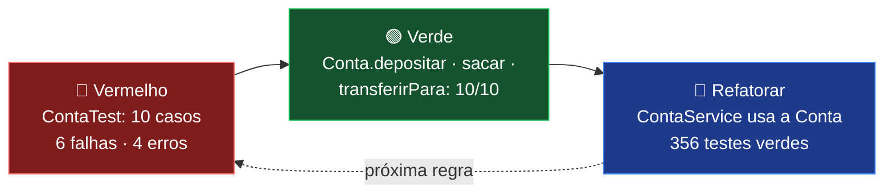

| Fase | Commit | O que aconteceu |
|:-:|---|---|
| 🔴 | [`4247476`](https://github.com/k3vinrich4rd/rkf_bank/commit/4247476) | `ContaTest` descreve as regras; a `Conta` só tem esqueletos e **os 10 casos falham** |
| 🟢 | [`8895571`](https://github.com/k3vinrich4rd/rkf_bank/commit/8895571) | o mínimo para passar: valor positivo, saldo conferido antes de debitar, transferência tudo-ou-nada |
| 🔵 | [`e745cfb`](https://github.com/k3vinrich4rd/rkf_bank/commit/e745cfb) | o `ContaService` passa a chamar a `Conta`; os 346 testes que já existiam seguem verdes |

<details><summary>🧪 A borda que mais dá bug: dá para sacar <b>exatamente</b> o saldo? (clique)</summary>

```java
@ParameterizedTest(name = "saldo 100.00, saque {0} → saldo {1}")
@CsvSource({"99.99, 0.01", "100.00, 0.00"})
void deveSubtrairQuandoHaSaldo(String valor, String saldoFinal) {
    Conta conta = contaComSaldo("100.00");
    conta.sacar(new BigDecimal(valor));
    assertThat(conta.getSaldo()).isEqualByComparingTo(saldoFinal);
}
```

**Dá.** E está escrito no teste antes do código: `saldo.compareTo(valor) < 0` recusa, igual não. Teste de unidade
puro, sem Spring, sem banco e sem mock: roda em milissegundos.

</details>

</details>

<details>
<summary><b>📋 O que cada suíte cobre</b></summary>
<br/>

| Suíte | O que cobre |
|---|---|
| `ClienteServiceTest` | cadastro, CPF/e-mail duplicado, ViaCEP, senha em BCrypt |
| `ContaTest` | **regras de saldo na própria `Conta`** (depositar, sacar, transferir), escritas com **TDD** antes do código |
| `ContaServiceTest` | abertura, depósito, saque, transferência, extrato e regra de dono (`403`) |
| `TokenServiceTest` / `AutenticacaoServiceTest` | JWT (claims, 15 min, adulteração, chave errada) e login sem enumeração |
| `UsuarioServiceTest` / `InicializadorAdminTest` | primeiro `ADMIN` pelo `.env` |
| `SegurancaIntegracaoTest` | Spring inteiro com tokens reais: `401`, `403`, `429`, perfis, `alg: none` |
| `IdempotenciaServiceTest` / `DadosEquipeIntegracaoTest` | dinheiro nunca sai duas vezes (`Idempotency-Key`) e saldo sempre bate com o extrato |
| `GestaoUsuariosIntegracaoTest` | promover, rebaixar, desativar e trocar senha valendo na hora |
| `PerfilVisitanteIntegracaoTest` | o perfil público não expõe nada da equipe |
| `ClienteControllerTest` / `ContaControllerTest` | status de cada rota e limites da paginação (inclui `GET /clientes/{id}/contas`: `200`, página, `403`, `401`) |
| `RotasContratoIntegracaoTest` | as rotas do contrato com o seed real: ADMIN `200`, cliente inexistente `404`, Fellipe `403` |
| `IdentidadeEntidadesTest` | `equals`/`hashCode` das 7 entidades: sem id, mesmo id e `HashSet` depois do persist |
| `ImutabilidadeRespostasTest` | records com lista não mudam depois de montados (`List.copyOf`) |
| `ThreadsVirtuaisTest` | as tarefas da aplicação rodam em thread virtual (`spring.threads.virtual.enabled`) |
| `TratadorGlobalDeErrosTest` | cada exceção no formato de erro |
| `ViaCepClientTest` | CEP encontrado, inexistente (`422`) e ViaCEP fora (`503`) |
| `CpfValidoValidatorTest` | dígitos verificadores e máscara |
| `FiltroLogRequisicaoTest` | `X-Request-Id` reaproveitado, gerado e rejeitado contra log forjado |
| `ConsoleH2LigadoTest` / `ConsoleH2DesligadoTest` | console do H2 aberto só nos perfis com H2, sem afrouxar a segurança da API |
| `*RepositoryTest` | consultas, constraints, cascata, `@Version` e `tb_usuario` (`@DataJpaTest` com as migrações do Flyway) |

Relatório de cobertura: `target/site/jacoco/index.html`. Teste manual de aceite: [roteiro E2E](backend/README_TESTES_E2E.md) + [coleção do Insomnia](backend/insomnia/rkfbank.insomnia.json).

</details>

<details>
<summary><b>⚙️ Esteira no GitHub Actions</b></summary>
<br/>

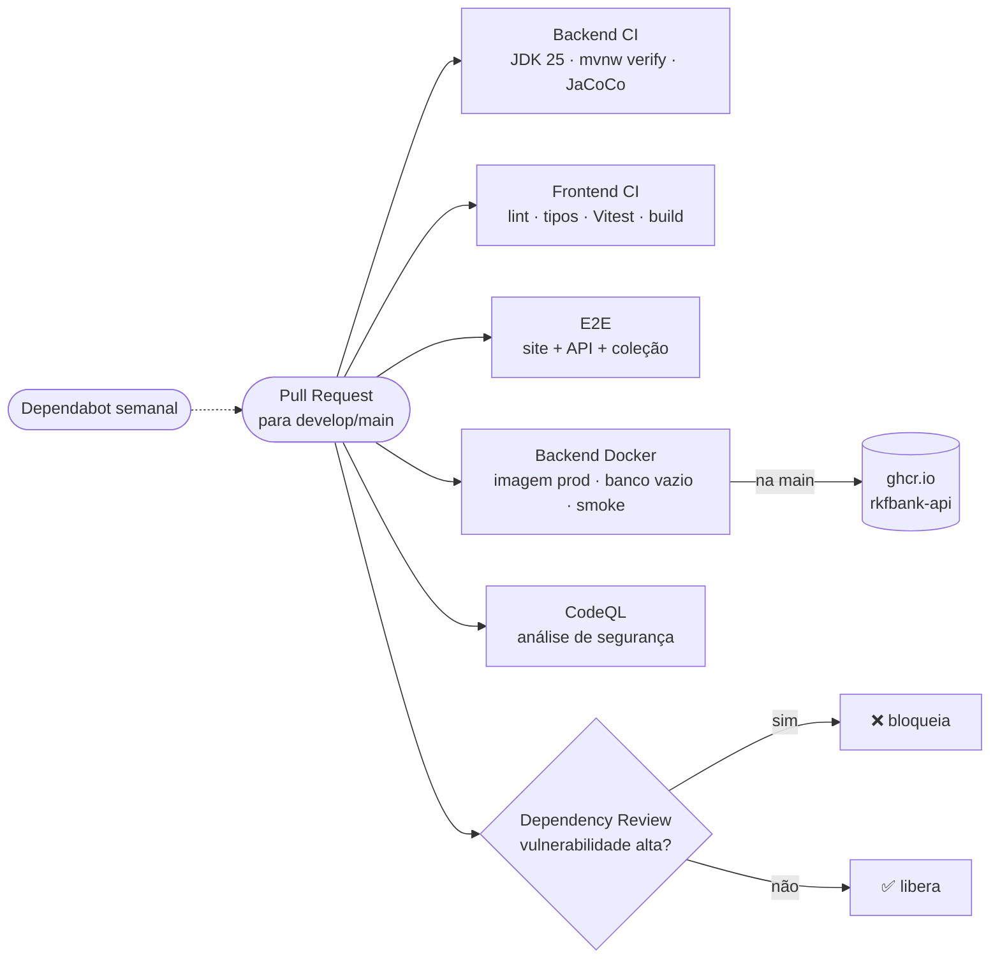

| Workflow | Arquivo | O que faz |
|---|---|---|
| Backend CI | [`backend-ci.yml`](.github/workflows/backend-ci.yml) | compila, testa e publica relatórios |
| Frontend CI | [`frontend-ci.yml`](.github/workflows/frontend-ci.yml) | lint, tipos, testes (Vitest) e build do site |
| E2E (aplicação inteira) | [`e2e.yml`](.github/workflows/e2e.yml) | sobe a API e o build de produção do site juntos: coleção do Insomnia (83), smoke (42) e o site falando com a API pelo proxy |
| Backend Docker | [`backend-docker.yml`](.github/workflows/backend-docker.yml) | constrói a imagem, roda no perfil `prod` (512 MB, MySQL vazio) com o smoke; na `main`, publica no ghcr.io |
| Backend CodeQL | [`backend-codeql.yml`](.github/workflows/backend-codeql.yml) | procura vulnerabilidades no código Java |
| Dependency Review | [`backend-dependency-review.yml`](.github/workflows/backend-dependency-review.yml) | barra dependência vulnerável ou com licença AGPL |
| Dependabot | [`dependabot.yml`](.github/dependabot.yml) | PRs de atualização para a `develop` |

</details>

<details>
<summary><b>🔎 Logs rastreáveis</b></summary>
<br/>

```text
INFO  [tomcat-handler-12] [e2e-transf-001] c.b.r.s.ContaService : Transferencia de 50.00 da conta 672e4ddf-... para 83af15fb-...
INFO  [tomcat-handler-12] [e2e-transf-001] c.b.r.c.FiltroLogRequisicao : POST /transferencias -> 204 (15 ms)
```

Cada requisição ganha um `X-Request-Id` que aparece em todas as linhas, até no SQL. O `tomcat-handler-N` é a **thread virtual** que atendeu a requisição (com `spring.threads.virtual.enabled=true`; antes era `http-nio-8080-exec-N`, uma das ~200 threads do Tomcat). CPF, e-mail, senha e token **nunca** entram no log. Configuração: [`log4j2-spring.xml`](backend/src/main/resources/log4j2-spring.xml).

</details>


## 🤖 Skills de IA do time

> O RKF Bank também tem **skills**: comandos do [Claude Code](https://docs.anthropic.com/en/docs/claude-code/overview) que
> repetem o processo do time, do planejamento à entrega. Cada uma mora em [`.claude/skills/<nome>/SKILL.md`](.claude/skills),
> lê o [CLAUDE.md](CLAUDE.md) e segue as mesmas regras de quem programa: português, testes 100% verdadeiros, LGPD e
> **script determinístico antes de IA** (as skills chamam `scripts/validar.sh`, `smoke-e2e.mjs`, `varrer-cves.js`...).

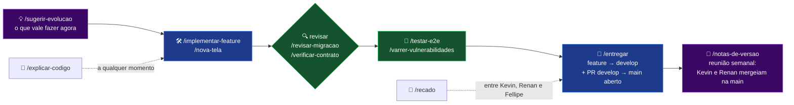

<table>
  <tr>
    <td align="center" width="33%"><h3>🛠️</h3><code>/implementar-feature &lt;n&gt;</code><br/><sub>implementa a feature <code>n</code> do <a href="planing/checklist-features.md">checklist</a> explicando cada conceito enquanto faz</sub></td>
    <td align="center" width="33%"><h3>🖼️</h3><code>/nova-tela &lt;nome&gt;</code><br/><sub>tela no padrão do frontend: página + screen + hook, rota e camada <code>lib/api</code> (área do Renan)</sub></td>
    <td align="center" width="33%"><h3>📖</h3><code>/explicar-codigo &lt;alvo&gt;</code><br/><sub>explica um arquivo, fluxo ou conceito do projeto, sem alterar nada</sub></td>
  </tr>
  <tr>
    <td align="center"><h3>🗄️</h3><code>/revisar-migracao</code><br/><sub>revisa o <code>V&lt;n&gt;__*.sql</code>: migração já aplicada, operação destrutiva, MySQL × H2 e entidades</sub></td>
    <td align="center"><h3>📜</h3><code>/verificar-contrato</code><br/><sub>compara backend, <a href="backend/README_CONTRATO_API.md">contrato</a> e <code>frontend/lib/api/types.ts</code> e aponta divergências</sub></td>
    <td align="center"><h3>🧪</h3><code>/testar-e2e</code><br/><sub>sobe a API no MySQL do Docker e roda o fluxo real, do cadastro ao extrato</sub></td>
  </tr>
  <tr>
    <td align="center"><h3>🛡️</h3><code>/varrer-vulnerabilidades</code><br/><sub>CVEs conhecidas no Maven e no pnpm (OSV.dev) e a correção mínima segura</sub></td>
    <td align="center"><h3>🚀</h3><code>/entregar</code><br/><sub>Git Flow do time: <code>develop</code> atualizada → branch → <code>git pull</code> da <code>develop</code> e conflitos → PR e merge na <code>develop</code> → PR <code>develop → main</code> aberto</sub></td>
    <td align="center"><h3>📝</h3><code>/notas-de-versao</code><br/><sub>o que vai da <code>develop</code> para a <code>main</code>, com resumo para o PO e sugestão de versão</sub></td>
  </tr>
  <tr>
    <td align="center"><h3>💡</h3><code>/sugerir-evolucao [área]</code><br/><sub>próximas evoluções com mais valor de portfólio (<a href="planing/padroes-de-projeto.md">padrões de projeto</a>, arquitetura, segurança)</sub></td>
    <td align="center"><h3>💬</h3><code>/recado</code><br/><sub>escreve, responde ou lista os <a href="planing/recados.md">recados do time</a></sub></td>
    <td align="center"><h3>⚙️</h3><a href="CLAUDE.md"><code>CLAUDE.md</code></a><br/><sub>o contexto que toda skill lê: camadas, regras do dinheiro, LGPD, Git e armadilhas conhecidas</sub></td>
  </tr>
</table>

<details>
<summary><b>🎯 Qual skill eu uso? (clique na sua situação)</b></summary>
<br/>

<details><summary>🆕 Vou começar a próxima feature do checklist</summary>

`/implementar-feature <n>`. Antes, se não sabe qual pegar, `/sugerir-evolucao` prioriza pelo MVP e pela régua Júnior → Pleno.

</details>
<details><summary>🗄️ Mudei uma entidade e criei a <code>V16__...sql</code></summary>

`/revisar-migracao` antes do commit: ela barra a edição de uma migração já mergeada (o checksum mudaria e a API não subiria) e o SQL que roda no MySQL mas quebra no H2.

</details>
<details><summary>🔌 Mudei uma rota ou um DTO</summary>

`/verificar-contrato` compara as três fontes (código, contrato e tipos do frontend). Depois, `/testar-e2e` prova o fluxo de verdade.

</details>
<details><summary>🚨 O GitHub avisou de uma vulnerabilidade</summary>

`/varrer-vulnerabilidades`: mostra o risco de cada CVE e propõe a menor versão que corrige, sem pular de versão à toa.

</details>
<details><summary>✅ Terminei e quero subir</summary>

`/entregar`: traz a `develop` para a sua branch (`git pull`) e resolve os conflitos, valida o lado que mudou, organiza os commits, abre o PR para a `develop`, espera o CI, mergeia e deixa o PR `develop → main` aberto. O merge na `main` é do Kevin e do Renan, na reunião semanal, com `/notas-de-versao`.

</details>
<details><summary>🤔 Não entendi como o <code>@Version</code> protege o saldo</summary>

`/explicar-codigo Conta` (ou o nome de qualquer classe, fluxo ou conceito): explica o porquê e o como, com o código real, sem mexer em nada.

</details>

</details>


## 🧭 Roadmap

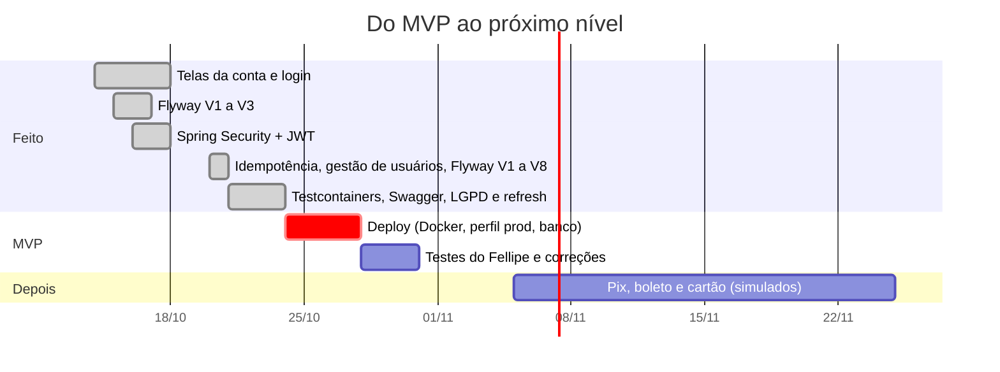

<details open>
<summary><b>🚀 MVP — até 31/10/2026</b></summary>
<br/>

- [x] Cadastro com ViaCEP, abertura de conta, depósito, saque, transferência e extrato
- [x] Logs rastreáveis, CI, CodeQL e Dependabot
- [x] Banco versionado com Flyway (V1 a V16), contas da equipe (Fellipe e Renan) e perfil público de visitante
- [x] Idempotência nas movimentações, número de conta gerado pelo banco, limite de tentativas no login e health check
- [x] Login com Spring Security + JWT, perfis e regra de dono
- [x] Frontend: landing, cadastro, login, conta, movimentações e extrato
- [x] Gestão de usuários pelo ADMIN (promover, rebaixar, desativar) e troca de senha, valendo na hora
- [x] Testes de integração com Testcontainers + MySQL real (protege o deploy)
- [x] Backend: `GET /contas/{id}` (a lista por cliente virou `GET /contas`, do token)
- [x] LGPD mínimo: política de privacidade e aceite dos termos versionado
- [x] Sessão com *refresh token*, logout de verdade e Swagger UI
- [x] LGPD: encarregados (Kevin e Renan) e canal de contato na Política de Privacidade
- [ ] Fellipe testa tudo como primeiro cliente e os bugs são corrigidos
- [x] Imagem Docker e perfil `prod` sem dados de teste, testados num MySQL vazio ([guia de publicação](backend/README_DEPLOY.md))
- [ ] Colocar no ar (provedor e banco gerenciado) e atualizar este README com link e prints

</details>

<details>
<summary><b>🔭 Depois do MVP</b></summary>
<br/>

- [x] `MockMvc` nos controllers e teste de concorrência no MySQL real ([checklist](planing/checklist-features.md))
- [x] Swagger UI com o botão *Authorize* (springdoc-openapi)
- [x] Refresh token (2FA continua ideia futura)
- [x] "Meus dados", editar perfil e encerrar conta (direitos do titular)
- [x] CI do frontend (lint, tipos, Vitest e build)
- [x] Domínio rico em `Conta` (regra de saldo na entidade) feito com **TDD**: vermelho → verde → refatorar
- [x] Threads virtuais, `equals`/`hashCode` nas entidades, respostas imutáveis e `GET /clientes/{id}/contas` só para o ADMIN (contrato 3.2)
- [ ] Pix, boleto, QR Code e cartão virtual (simulados) — [funcionalidades futuras](planing/debitos-tecnicos.md#funcionalidades-futuras-)
- [ ] 🤖 Assistente do extrato com Spring AI (ideia)

</details>

<details>
<summary><b>🔬 Em estudo para implementação</b> (com plano e código de exemplo)</summary>
<br/>

| Tema | Primeiro passo viável | Gatilho |
|---|---|---|
| [Spring Cloud e microsserviços](planing/estudos-arquitetura.md#5-spring-cloud-e-microsserviços-) | circuit breaker (Resilience4j) no ViaCEP | 2º time ou parte com carga diferente |
| [Mensageria + Transactional Outbox](planing/estudos-arquitetura.md#6-mensageria-e-transactional-outbox-) | ✅ `tb_outbox` + publicador com ShedLock (comprovante no log); falta o broker | e-mail ou push do comprovante |
| [Pub/Sub + DLQ](planing/estudos-arquitetura.md#7-pubsub-e-dead-letter-queue-dlq-) | exchange `topic` com DLQ e 3 tentativas | depende do Outbox |
| [AWS](planing/estudos-arquitetura.md#8-serviços-aws-) | ECS Fargate + RDS + Secrets Manager com a imagem atual | deploy depois do MVP |
| [OAuth2 + OIDC](planing/estudos-arquitetura.md#9-oauth2-e-oidc-com-provedor-externo-) | Keycloak emitindo o token; a API já é Resource Server | login social, MFA ou 2º sistema |

</details>

Planejamento detalhado: [planing/roadmap.md](planing/roadmap.md) · [checklist de features](planing/checklist-features.md) · [decisões](planing/decisoes.md).


## 👥 Quem faz o RKF Bank

> Os três são **idealizadores** do RKF Bank: tiveram a ideia juntos, em Osasco, e dividiram o banco em três frentes, cada um com a sua função: **API** (Kevin), **site** (Renan) e **produto** (Fellipe).

<div align="center">
  
</div>

<table>
  <tr>
    <td align="center" valign="top" width="33%">
      <a href="https://www.linkedin.com/in/kevin-richard-b68a54203/"></a>
      <h3>Kevin Richard</h3>
      <a href="https://www.linkedin.com/in/kevin-richard-b68a54203/"></a>
      <br/>
      
      <p align="left"><sub><i>“Conhecimento nunca é demais.”</i> Movido pela vontade de aprender e de acumular experiências, quer crescer como pessoa e como profissional de forma <b>honesta e constante</b>, com determinação, foco, persistência, ambição, espírito de time e empatia.</sub></p>
      <p align="left"><sub><b>No RKF Bank:</b> <b>idealizador</b> e responsável pelo <b>backend</b>: API REST em Java e Spring Boot, MySQL com Flyway, Spring Security + JWT, ViaCEP, logs e testes. Objetivo: o dinheiro de cada cliente sempre certo e nenhum dado pessoal vazando.</sub></p>
      <a href="mailto:kevinrichardve@gmail.com"></a>
      <a href="https://github.com/k3vinrich4rd"></a>
    </td>
    <td align="center" valign="top" width="33%">
      <h3>Fellipe Santana</h3>
      
      <br/>
      
      <p align="left"><sub><i>“Se não funciona para o cliente, não está pronto.”</i> Olha o banco pelos olhos de quem usa: transforma ideia em prioridade, prioridade em critério de aceite e só dá o ok quando o fluxo funciona de ponta a ponta.</sub></p>
      <p align="left"><sub><b>No RKF Bank:</b> <b>idealizador</b> e <b>PO & QA</b>: define o que o produto precisa e é o <b>primeiro cliente</b> — a conta de origem que nasce pronta em todo ambiente é a dele. Valida o MVP pelo guia de testes antes do lançamento.</sub></p>
      
    </td>
    <td align="center" valign="top" width="33%">
      <a href="https://www.linkedin.com/in/renan-costa-barros/"></a>
      <h3>Renan Barros</h3>
      <a href="https://www.linkedin.com/in/renan-costa-barros/"></a>
      <br/>
      
      <p align="left"><sub><i>“Transformar problemas em soluções.”</i> Do administrativo para a tecnologia: de Jovem Aprendiz a Assistente Financeiro em três anos, com <b>quatro promoções</b>, e já entregou na empresa um sistema em Next.js + PostgreSQL que automatizou a triagem de notas fiscais. Cursa GTI e a formação Full Stack da DevClub.</sub></p>
      <p align="left"><sub><b>No RKF Bank:</b> <b>idealizador</b> e responsável pelo <b>frontend</b>: site em Next.js, React e TypeScript, identidade visual RKF, telas da conta, login com cookie <code>httpOnly</code> e logs com máscara. Objetivo: parecer e funcionar como um banco digital de verdade.</sub></p>
      <a href="mailto:renanbarros.tech@gmail.com"></a>
      <a href="https://github.com/renanbarrostech-cmd"></a>
    </td>
  </tr>
</table>

<details>
<summary><b>📖 A história de cada um, em detalhe</b></summary>
<br/>

**Kevin Richard — backend.** Acredita que conhecimento nunca é demais e vive buscando informação nova e momentos de
aprendizado para evoluir no pessoal e no profissional. O jeito de crescer é o de quem não pula etapa: determinação,
foco, persistência e ambição, sem perder a coletividade e a empatia com quem está do lado. No RKF Bank isso aparece em
cada PR: teste antes de entregar, decisão registrada e documentação que ensina quem vem depois.

**Renan Barros — frontend.** Desde criança queria entender como as coisas funcionavam, mas a carreira começou no
administrativo: entrou como Jovem Aprendiz na Expresso Salomé em 2023 e, em três anos, conquistou quatro promoções
(Auxiliar de Escritório, Auxiliar Financeiro, Assistente Financeiro). Dali vieram organização, análise de processos e
melhoria contínua. Em transição para tecnologia, cursa Gestão da Tecnologia da Informação na Estácio e a formação Full
Stack da DevClub (140h+), e já gerou resultado real: um sistema de triagem de notas fiscais (Next.js, React,
TypeScript, Tailwind, Drizzle e PostgreSQL) que trocou um processo manual e sujeito a erro por um automatizado. Também
faz freelas de sites, landing pages, dashboards e automações para pequenas empresas. Meta: primeira vaga como Dev Full
Stack Júnior, rumo a Engenheiro de Software.

**Fellipe Santana — produto e qualidade.** É quem garante que o banco resolve o problema de quem usa: decide prioridade,
escreve o que "pronto" significa e testa como cliente — por isso a conta de origem que nasce em todo ambiente é a dele.
<sub>(Texto provisório, montado a partir do papel dele no time; será trocado pelo "Sobre" do LinkedIn assim que o Fellipe enviar o link.)</sub>

</details>

<div align="center">

Dúvida sobre a API ou o banco? **Kevin**. Telas e site? **Renan**. Produto, prioridade e testes de aceite? **Fellipe**.
Bug ou sugestão? Abra uma [issue](https://github.com/k3vinrich4rd/rkf_bank/issues).

</div>

### 📍 Feito em Osasco

<div align="center">
  
</div>

O RKF Bank nasceu em **Osasco**, na Grande São Paulo, da ideia de três amigos que queriam aprender construindo algo de verdade. Arraste e dê zoom no mapa:

```geojson
{
  "type": "FeatureCollection",
  "features": [
    {
      "type": "Feature",
      "properties": {
        "title": "RKF Bank · Osasco, SP",
        "description": "Kevin, Renan e Fellipe: o time inteiro é de Osasco",
        "marker-color": "#3B82F6",
        "marker-size": "large",
        "marker-symbol": "bank"
      },
      "geometry": { "type": "Point", "coordinates": [-46.7917, -23.5329] }
    }
  ]
}
```

<details>
<summary><b>🤝 Como o time trabalha</b></summary>
<br/>

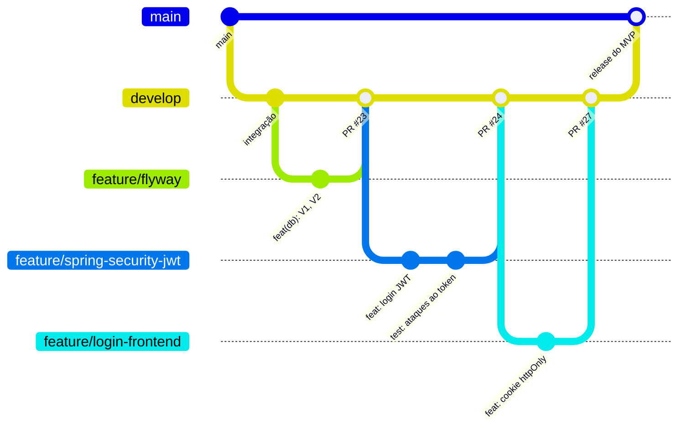

- **Branches:** `main` é o que vai ao ar, `develop` é a integração; toda tarefa sai da `origin/develop` atualizada.
- **Git Flow de cada mudança:** atualizar a `develop` → criar a branch → `git pull origin develop` na branch e resolver conflitos → PR para a `develop` → PR `develop → main` aberto, que **só o Kevin e o Renan mergeiam**.
- **Commits:** [Conventional Commits](https://www.conventionalcommits.org/pt-br) em português, validados por hook.
- **PRs:** revisão do outro dev + CI verde. **Contrato primeiro:** mudou rota, muda o [contrato](backend/README_CONTRATO_API.md) no mesmo PR.
- **IA no time:** o [CLAUDE.md](CLAUDE.md) e as [skills de IA do time](#-skills-de-ia-do-time) (`/implementar-feature`, `/entregar`, `/revisar-migracao`, `/testar-e2e`...) dão a qualquer agente o mesmo contexto e as mesmas regras do time.

Passo a passo completo: [CONTRIBUTING.md](CONTRIBUTING.md).

</details>


## 💬 Pergunte ao RKF

> Perguntas que um cliente, um recrutador ou um dev costumam fazer. Clique para abrir.

<details>
<summary><b>Por que a transferência nunca deixa o dinheiro "no meio do caminho"?</b></summary>
<br/>

Débito, crédito e lançamento do extrato acontecem dentro de um único `@Transactional`: ou os três são gravados, ou nenhum. E o `@Version` na `Conta` impede que duas operações simultâneas sobrescrevam o saldo (a segunda recebe `409`).

</details>

<details>
<summary><b>Por que o token fica num cookie e não no <code>localStorage</code>?</b></summary>
<br/>

Qualquer script que rode na página (um XSS, uma dependência comprometida) consegue ler o `localStorage`. Com cookie `httpOnly`, gravado pelo servidor do Next, o JavaScript não alcança o token. `SameSite=Lax` protege contra CSRF. Decisão registrada em [decisoes.md](planing/decisoes.md).

</details>

<details>
<summary><b>Por que Flyway em vez de deixar o Hibernate criar as tabelas?</b></summary>
<br/>

Com `ddl-auto=update` o Hibernate "adivinha" o schema, não remove nem renomeia nada e não deixa histórico. Com Flyway, cada mudança é um SQL versionado (`V1__` a `V15__`), revisado no PR e igual em todo ambiente; o Hibernate só **valida**. Migração aplicada nunca se edita: o checksum muda e a API não sobe.

</details>

<details>
<summary><b>O RKF Bank é um banco de verdade?</b></summary>
<br/>

Ainda não: é um projeto real de engenharia, com processo de time, mas sem autorização do Banco Central. Pix e boleto, quando vierem, serão **simulados** entre as contas do próprio RKF Bank, para aprender o domínio sem depender de terceiros.

</details>

### 🎯 Desafio relâmpago

**1. Um cliente logado tenta sacar da conta de outra pessoa. Qual status a API devolve?**

<details><summary>A) 401 Unauthorized</summary>

❌ **Quase.** `401` é para quem **não** está autenticado (sem token, token vencido ou adulterado).

</details>
<details><summary>B) 403 Forbidden</summary>

✅ **Isso!** Ele está autenticado, mas não é dono da conta. A regra fica no `ContaService`, com o `clienteId` vindo do token assinado.

</details>
<details><summary>C) 422 Unprocessable Entity</summary>

❌ **Ainda não.** `422` é regra de negócio (saldo insuficiente). Responder `422` aqui revelaria o saldo de outra pessoa.

</details>

**2. Alguém troca `"perfil":"CLIENTE"` por `"ADMIN"` no payload do JWT. O que acontece?**

<details><summary>A) Vira admin, o payload é só Base64</summary>

❌ **Não.** O payload é legível, mas a **assinatura** HS256 deixa de bater.

</details>
<details><summary>B) 401: assinatura inválida</summary>

✅ **Isso!** O `JwtDecoder` confere assinatura e algoritmo em toda requisição. Rode `node scripts/engenharia-reversa-jwt.mjs` para ver.

</details>

**3. Como a senha do cliente fica guardada no banco?**

<details><summary>A) Criptografada, para poder ser recuperada</summary>

❌ **Não.** Se dá para descriptografar, quem rouba a chave lê todas as senhas.

</details>
<details><summary>B) Como hash BCrypt com salt</summary>

✅ **Isso!** Hash de mão única, com salt embutido e lento de propósito contra força bruta. Nem o time consegue ver a sua senha.

</details>

**4. A rede cai no meio da transferência e o app manda a mesma de novo. O dinheiro sai duas vezes?**

<details><summary>A) Sai: a API não tem como saber</summary>

❌ Tem sim: o app manda um `Idempotency-Key` por operação.

</details>
<details><summary>B) Não: a repetição volta 204 com <code>Idempotency-Replayed: true</code></summary>

✅ **Isso!** A chave foi gravada na mesma transação do dinheiro (`tb_idempotencia`, V6). A repetição só confirma.

</details>

**5. O admin rebaixa alguém que está logado com um token de ADMIN válido por mais 50 minutos. E aí?**

<details><summary>A) Continua admin até o token vencer</summary>

❌ Seria assim com JWT puro, que é *stateless*.

</details>
<details><summary>B) A próxima requisição dele dá 401</summary>

✅ **Isso!** O `ConversorTokenUsuario` confere o banco a cada requisição: o perfil do token não bate mais.

</details>

**6. Qual versão do Flyway criou a coluna que faz a troca de senha derrubar os tokens antigos?**

<details><summary>A) V5</summary>

❌ A V5 criou a `tb_usuario`.

</details>
<details><summary>B) V8</summary>

✅ **Isso!** `versao_credencial`: sobe a cada troca e vai dentro do token.

</details>


## 📚 Documentação

| Área | Documento | O que tem |
|---|---|---|
| Time | [CONTRIBUTING.md](CONTRIBUTING.md) | branches, commits, PRs e revisão |
| Time e IA | [CLAUDE.md](CLAUDE.md) | regras do projeto para pessoas e agentes de IA |
| Time e IA | [🤖 Skills de IA do time](#-skills-de-ia-do-time) · [`.claude/skills/`](.claude/skills) | os comandos do Claude Code que repetem o processo do time, do planejamento à entrega |
| Todos | [🗺️ Atlas de fluxos](FLUXOS.md) | como cada parte se conecta: contexto, telas, árvore da transferência, containers, componentes, rastreabilidade tela → tabela, sessão e fluxo do time |
| API | [Contrato da API](backend/README_CONTRATO_API.md) | rotas, autenticação, JSON, regras e erros |
| Segurança | [Spring Security + OAuth2 + JWT](backend/README_SEGURANCA.md) | como o login, o token, os filtros, a autorização e o cookie do front funcionam, e por que é assim |
| Backend | [backend/README.md](backend/README.md) | como rodar, testes, banco, Flyway e problemas comuns |
| Backend | [Arquitetura e implementação](backend/README_IMPLEMENTACAO.md) | camadas e trechos reais |
| Backend | [Como testar o projeto](backend/README_TESTES_E2E.md) · [Coleção do Insomnia](backend/insomnia/rkfbank.insomnia.json) · [Visitantes](VISITANTES.md) | rodar (IDE, H2 ou MySQL), ver o banco, permissões, payloads e roteiros; aceite do MVP pela coleção |
| Deploy | [Publicar o RKF Bank](backend/README_DEPLOY.md) · [Dockerfile](Dockerfile) | onde publicar (grátis × sempre ligado), imagem Docker, perfil `prod`, variáveis e o que conferir; responsáveis: Kevin e Renan |
| Frontend | [frontend/README.md](frontend/README.md) · [Logs](frontend/lib/logger/README.md) | como rodar e logs com máscara |
| Planejamento | [planing/](planing/README.md) · [Padrões de projeto](planing/padroes-de-projeto.md) | roadmap, decisões, checklist de features, débitos, recados e padrões |
| Planejamento | [Estudos de arquitetura](planing/estudos-arquitetura.md) | o que já está no código e o que está em estudo (Outbox, DLQ, OAuth2/OIDC, AWS), com plano e exemplo |

<br/>

<div align="center">

<a href="planing/roadmap.md"></a>

<sub>📍 RKF Banco Digital — idealizado e feito em Osasco, SP, por Kevin Richard, Renan Barros e Fellipe Santana.</sub>
<br/>
<a href="#readme">⬆️ voltar ao topo</a>

</div>
