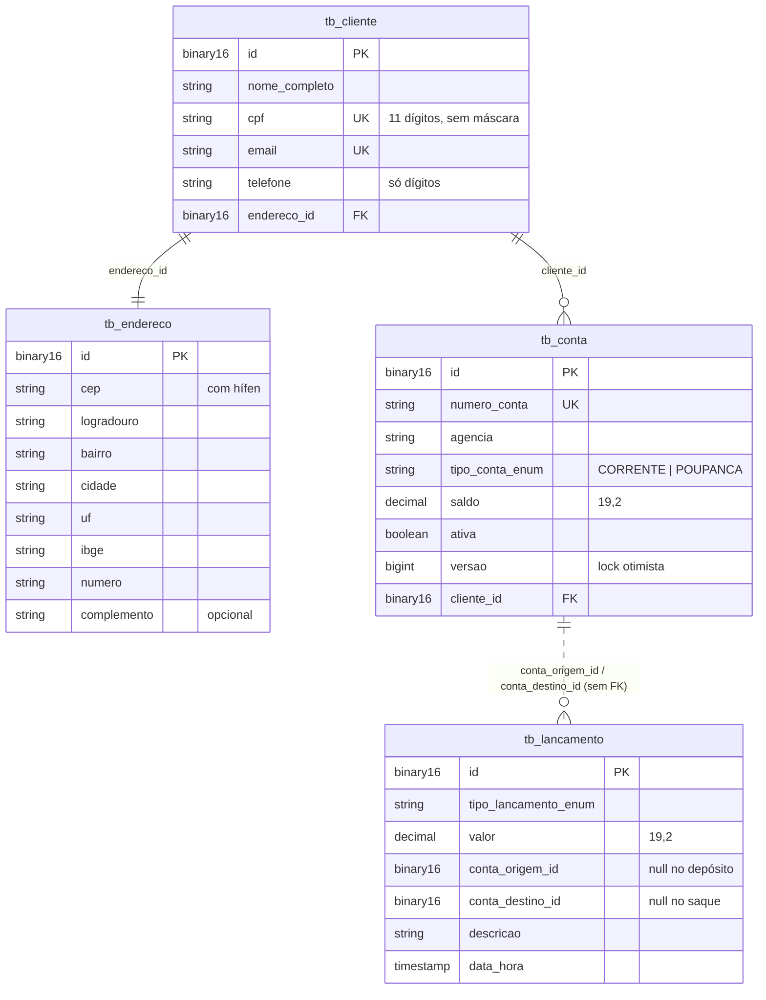

# RKF Bank — Backend

API REST do RKF Bank: clientes, contas, movimentações e extrato.

| | |
|---|---|
| **Responsável** | Kevin ([@k3vinrich4rd](https://github.com/k3vinrich4rd)) |
| **Stack** | Java 25 · Spring Boot 4.1 · Spring Web MVC · Spring Data JPA (Hibernate) · Jakarta Validation · RestClient |
| **Banco** | MySQL 8.4 (Docker) — H2 em memória disponível para testes |
| **Build** | Maven Wrapper (`pom.xml` na raiz do repositório) · JaCoCo para cobertura |
| **Porta** | `8080` |

## 📄 Documentos do backend

| Documento | Conteúdo |
|---|---|
| [README_CONTRATO_API.md](README_CONTRATO_API.md) | **fonte da verdade** de rotas, payloads, regras e erros |
| [README_IMPLEMENTACAO.md](README_IMPLEMENTACAO.md) | arquitetura, camadas, decisões internas e **como criar um endpoint** |
| [README_TESTES_E2E.md](README_TESTES_E2E.md) | roteiro de teste manual do fluxo completo (Postman/Insomnia/curl) |
| [CHECKLIST_TESTES_E2E.md](CHECKLIST_TESTES_E2E.md) | checklist de validação do MVP com o resultado da última execução |

---

## ▶️ Como rodar

> Todos os comandos rodam na **raiz do repositório** (onde está o `pom.xml`), não dentro de `backend/`.

```bash
# 1. banco
cp .env.example .env
docker compose up -d

# 2. variáveis no terminal (o Spring não lê o .env sozinho)
set -a && source .env && set +a           # Git Bash / Linux / macOS

# 3. API
./mvnw spring-boot:run                    # Windows: .\mvnw.cmd spring-boot:run
```

No PowerShell, o passo 2 é:

```powershell
Get-Content .env | Where-Object { $_ -match '^\s*[^#].*=' } | ForEach-Object {
  $nome, $valor = $_ -split '=', 2; Set-Item "env:$nome" $valor
}
```

Conferindo: `curl http://localhost:8080/clientes` → `[]`.

### Variáveis de ambiente

| Variável | Padrão no `.env.example` | Usada por |
|---|---|---|
| `MYSQL_USER` | `usuario-do-banco` | Docker e Spring |
| `MYSQL_PASSWORD` | `senha-do-banco` | Docker e Spring |
| `MYSQL_DATABASE` | `rkfbank` | Docker e Spring |
| `MYSQL_PORT` | `5441` | Docker (porta exposta) e Spring |
| `MYSQL_ROOT_PASSWORD` | `senha-root-do-banco` | só Docker |
| `MYSQL_VERSION` | `8.4` | só Docker |

> ⚠️ Se as variáveis **não** estiverem no terminal, o Spring usa os padrões de
> `application.properties` (`rkfbank` / `rkfbank`), que **não batem** com o usuário criado pelo Docker —
> resultado: `Access denied for user`. Ver [débitos técnicos](../planing/debitos-tecnicos.md).

### Configurações da aplicação

Arquivo: [`src/main/resources/application.properties`](src/main/resources/application.properties)

| Propriedade | Valor | Observação |
|---|---|---|
| `spring.jpa.hibernate.ddl-auto` | `update` | o Hibernate cria/altera tabelas sozinho (trocar por Flyway — débito técnico) |
| `spring.jpa.show-sql` | `false` | o SQL sai pelo logger `org.hibernate.SQL` do `log4j2-spring.xml`, com o `requestId` da chamada |
| `viacep.base-url` | `https://viacep.com.br/ws` | |
| `viacep.timeout-ms` | `3000` | tempo máximo de conexão e de leitura do ViaCEP |

---

## 🧪 Testes

Três jeitos, do mais simples ao mais completo:

```bash
# 1. Sem Docker: perfil "test" usa H2 em memória (recomendado no dia a dia)
./mvnw clean verify -Dspring.profiles.active=test     # PowerShell: .\mvnw.cmd clean verify "-Dspring.profiles.active=test"

# 2. Com o MySQL do Docker já no ar e o .env carregado no terminal (ver "Como rodar")
./mvnw clean verify

# 3. Script: derruba e recria o MySQL (APAGA os dados) e roda os testes com o perfil "test"
./run-test.sh                      # todos
./run-test.sh ContaServiceTest     # uma classe
```

Relatório de cobertura: abra `target/site/jacoco/index.html` no navegador.

> O `run-test.sh` roda os testes com `-Dspring.profiles.active=test`, ou seja, **em H2**: o MySQL recriado fica
> limpo para o teste manual E2E, mas os testes automatizados não o usam. Ele também fixa o `JAVA_HOME` no JDK 25 de `~/.jdks/ms-25.0.4`. Se o seu JDK 25 estiver em outro lugar,
> ajuste a linha `export JAVA_HOME=...` antes de rodar.

| Classe de teste | O que cobre | Estilo |
|---|---|---|
| `CpfValidoValidatorTest` | algoritmo de CPF | unitário puro |
| `ClienteViaCepTest` | integração com ViaCEP (sucesso, CEP inexistente, falha) | unitário com mock |
| `ClienteServiceTest` / `ContaServiceTest` | regras de negócio | Mockito (`@ExtendWith(MockitoExtension.class)`) |
| `ClienteControllerTest` / `ContaControllerTest` | status HTTP e delegação ao service | Mockito |
| `ControllerExceptionHandlerTest` | exceção → status + corpo de erro | unitário |
| `FiltroLogRequisicaoTest` | `X-Request-Id` reaproveitado, gerado e saneado | unitário |
| `EntitiesAndEnumsTest` | getters/setters, enums, `@PrePersist` | unitário |
| `ClienteRepositoryTest` | `existsByCpf`/`existsByEmail`, unicidade, cascata de endereço e contas, `orphanRemoval`, paginação | `@DataJpaTest` (H2) |
| `ContaRepositoryTest` | `existsByNumeroConta`, unicidade, campos obrigatórios, enum como texto, `@Version` (lock otimista), paginação | `@DataJpaTest` (H2) |
| `LancamentoRepositoryTest` | extrato (origem **ou** destino, do mais novo para o mais antigo), `@PrePersist` da `dataHora`, campos obrigatórios | `@DataJpaTest` (H2) |
| `RkfbankApplicationTests` | o contexto Spring sobe | `@SpringBootTest` |

> ⚠️ `RkfbankApplicationTests` sobe o Spring inteiro. Com o perfil padrão ele **precisa do MySQL no ar e das
> variáveis de ambiente carregadas**; com `-Dspring.profiles.active=test` ele usa H2 e roda sem banco.
> Os testes de repositório (`@DataJpaTest`) trocam o datasource por um **H2 embutido** em qualquer perfil, então
> também rodam sem MySQL. Os demais testes nunca dependem de banco.

Teste manual ponta a ponta: [README_TESTES_E2E.md](README_TESTES_E2E.md) ·
resultado da última execução: [CHECKLIST_TESTES_E2E.md](CHECKLIST_TESTES_E2E.md).

**Padrão de nome:** `deve<Resultado>[Quando<Condição>]` — ex.: `deveRetornarEnderecoQuandoViaCepResponderComSucesso`,
`deveRejeitarPaginacaoComPaginaNegativa`.
Use o padrão *Arrange / Act / Assert* (prepara, executa, verifica).

---

## 🗄️ Banco de dados



Os IDs são UUID na API, mas ficam como `binary(16)` no MySQL. Para ler no Workbench/DBeaver:

```sql
SELECT BIN_TO_UUID(id) AS id, nome_completo, cpf, email FROM tb_cliente;

SELECT BIN_TO_UUID(id) AS id, numero_conta, saldo, ativa FROM tb_conta;

SELECT BIN_TO_UUID(id) AS id, tipo_lancamento_enum, valor,
       BIN_TO_UUID(conta_origem_id)  AS origem,
       BIN_TO_UUID(conta_destino_id) AS destino,
       data_hora
FROM tb_lancamento
ORDER BY data_hora DESC;

-- buscar por um UUID específico
SELECT * FROM tb_conta WHERE id = UUID_TO_BIN('407d727e-4e43-4c93-b01c-331cbaba42fb');
```

Conexão: `localhost:5441`, usuário e senha do seu `.env`.

---

## 🧯 Problemas comuns

| Sintoma | Causa provável | Solução |
|---|---|---|
| `Access denied for user 'rkfbank'` | variáveis do `.env` não carregadas no terminal | carregue o `.env` (seção "Como rodar") |
| `Communications link failure` | MySQL não está no ar ou ainda subindo | `docker compose ps` — espere `healthy` |
| `Rule 0 ... RequireJavaVersion failed` | JDK diferente de 25 | instale o JDK 25 e ajuste `JAVA_HOME` |
| `Port 8080 was already in use` | outra instância rodando | feche a outra ou mate o processo da porta |
| Cadastro devolve `503` | ViaCEP fora do ar ou sem internet | tente de novo; confira `https://viacep.com.br/ws/01001000/json/` |
| Cadastro devolve `422 CEP não encontrado` | CEP não existe no ViaCEP | use um CEP real, ex.: `01001000` |
| Mudei uma entidade e a coluna antiga ficou | `ddl-auto=update` não remove colunas | em dev: `docker compose down -v` apaga o banco e recria |
| `mvnw: Permission denied` (Linux/macOS) | arquivo sem permissão de execução | `chmod +x mvnw` |
| Testes de repositório falham com `The database has been closed` | H2 2.4.x quebra o `CHECK ... IN (...)` das colunas de enum | mantenha `<h2.version>2.3.232</h2.version>` no `pom.xml` até o H2 corrigir |
