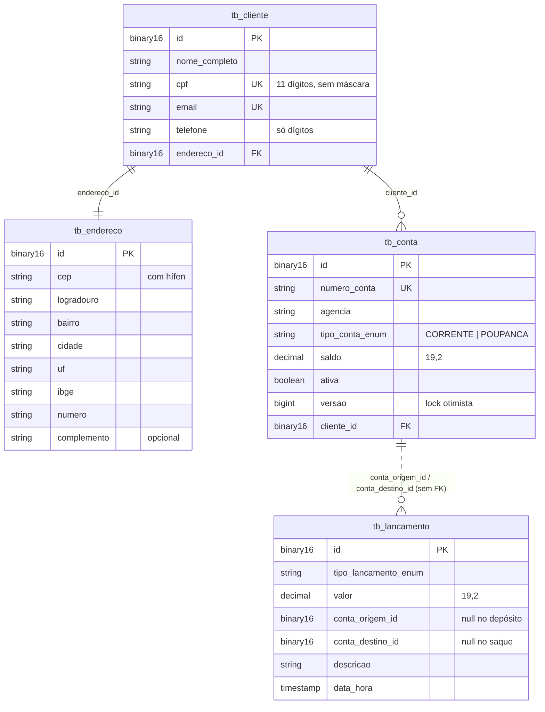

# RKF Bank — Backend

API REST do RKF Bank: clientes, contas, movimentações e extrato.

| | |
|---|---|
| **Responsável** | Kevin ([@k3vinrich4rd](https://github.com/k3vinrich4rd)) |
| **Stack** | Java 25 · Spring Boot 4.1 · Spring Web MVC · Spring Data JPA (Hibernate) · Jakarta Validation · RestClient |
| **Banco** | MySQL 8.4 (Docker) — H2 em memória disponível para testes |
| **Build** | Maven Wrapper (`pom.xml` na raiz do repositório) · JaCoCo para cobertura |
| **Porta** | `8080` |

## 📄 Documentos do backend

| Documento | Conteúdo |
|---|---|
| [README_CONTRATO_API.md](README_CONTRATO_API.md) | **fonte da verdade** de rotas, payloads, regras e erros |
| [README_IMPLEMENTACAO.md](README_IMPLEMENTACAO.md) | arquitetura, camadas, decisões internas e **como criar um endpoint** |
| [README_TESTES_E2E.md](README_TESTES_E2E.md) | **como testar do zero**: rodar pela IDE ou terminal (H2 ou MySQL), ver o banco (console do H2, MySQL), Insomnia, permissões, como tornar alguém ADMIN, todos os payloads e os roteiros de teste |
| [insomnia/rkfbank.insomnia.json](insomnia/rkfbank.insomnia.json) | coleção do Insomnia pública (83 requisições do cliente, sem o ADMIN; também em `.yaml` para o Insomnia 10+; a pasta 02 é o roteiro E2E completo e o login guarda o token sozinho); gerada por `scripts/gerar-colecao-insomnia.mjs` |
| `.equipe/GUIA_TESTES_EQUIPE.md` (fora do Git) | guia **privado** da equipe (Kevin, Renan e Fellipe): acessos de teste do Fellipe, do Renan e do ADMIN; o roteiro da API fica em `.equipe/testes/BACKEND_E2E.md` |

---

## ▶️ Como rodar

> Todos os comandos rodam na **raiz do repositório** (onde está o `pom.xml` e o `.env`), não dentro de `backend/`.

**Visitante, sem Docker e sem `.env`:** `./mvnw spring-boot:run -Dspring-boot.run.profiles=visitante` — guia em
[VISITANTES.md](../VISITANTES.md). Quando usar cada perfil: [Perfis](#-perfis-qual-usar-e-quando).

**Equipe, com MySQL (o jeito do dia a dia):**

```bash
cp .env.example .env          # 1x por máquina: JWT_SEGREDO seu (openssl rand -base64 48); EQUIPE_SENHA e admin do guia privado
docker compose up -d          # MySQL na porta 5441; espere "healthy" em: docker compose ps
./mvnw spring-boot:run        # Windows: .\mvnw.cmd spring-boot:run
```

Desde 20/10/2026 o Spring **lê o `.env` sozinho** (`spring.config.import=optional:file:.env[.properties]`): não é
mais preciso carregar as variáveis no terminal. Variável de ambiente de verdade continua valendo mais que o `.env`.
Os scripts de shell que usam as variáveis (`scripts/testar-no-mysql.sh`, `docker exec ... mysql`) ainda carregam o
`.env` por conta própria.

Conferindo: `curl -s http://localhost:8080/actuator/health` → `{"status":"UP",...}` e
`curl -i http://localhost:8080/contas` → `401` (a API está no ar e exige login). Nos perfis com H2, o banco abre no
navegador em `http://localhost:8080/h2-console` (JDBC URL `jdbc:h2:mem:rkfbank-visitante` ou `rkfbank-equipe`,
usuário `sa`, senha vazia; [guia, 1.4](README_TESTES_E2E.md#14-ver-o-banco-por-dentro-opcional)). Para as rotas protegidas, faça
`POST /auth/login` e mande `Authorization: Bearer <token>` em toda chamada, e `Idempotency-Key` nas movimentações
([contrato](README_CONTRATO_API.md#autenticação-jwt) e
[guia, seção 18](README_TESTES_E2E.md#18-como-a-segurança-funciona-spring-security--oauth2--jwt)).

### Variáveis de ambiente

| Variável | Padrão no `.env.example` | Usada por |
|---|---|---|
| `MYSQL_USER` | `usuario-do-banco` | Docker e Spring |
| `MYSQL_PASSWORD` | `senha-do-banco` | Docker e Spring |
| `MYSQL_DATABASE` | `rkfbank` | Docker e Spring |
| `MYSQL_PORT` | `5441` | Docker (porta exposta) e Spring |
| `MYSQL_ROOT_PASSWORD` | `senha-root-do-banco` | só Docker |
| `MYSQL_VERSION` | `8.4` | só Docker |
| `JWT_SEGREDO` | valor de exemplo: **troque** | Spring: assina e confere o JWT. **Obrigatório**, mínimo 32 bytes; sem ele a API não sobe |
| `JWT_EXPIRACAO` | `15m` | Spring: validade do token (opcional) |
| `ADMIN_CPF` / `ADMIN_SENHA` | vazios | Spring: criam o primeiro `ADMIN` na subida, se preenchidos (opcional) |
| `EQUIPE_SENHA` | vazio | Spring: login do Fellipe e do Renan (contas da equipe); mín. 12 bytes. Valor real só no guia privado |
| `FLYWAY_LOCATIONS` | (não está no exemplo) | Spring: em produção, `classpath:db/migration` (sem dados prontos) |

> O Spring lê o `.env` da raiz sozinho. Sem ele (ou rodando de outra pasta), usa os padrões do
> `application.properties` (`rkfbank` / `rkfbank`), que **não batem** com o usuário do Docker: `Access denied for user`.

### Configurações da aplicação

Arquivo: [`src/main/resources/application.properties`](src/main/resources/application.properties)

| Propriedade | Valor | Observação |
|---|---|---|
| `spring.jpa.hibernate.ddl-auto` | `validate` | quem cria e altera o schema é o **Flyway** ([Migrações](#-migrações-flyway)); o Hibernate só confere se as entidades batem com o banco e impede a subida se não baterem |
| `spring.jpa.properties.hibernate.type.preferred_uuid_jdbc_type` | `BINARY` | UUID sempre como `BINARY(16)`: é o que o MySQL já usa e faz o H2 dos testes validar o mesmo schema |
| `spring.jpa.show-sql` | `false` | o SQL sai pelo logger `org.hibernate.SQL` do `log4j2-spring.xml`, com o `requestId` da chamada |
| `viacep.base-url` | `https://viacep.com.br/ws` | |
| `viacep.timeout-ms` | `3000` | tempo máximo de conexão e de leitura do ViaCEP |
| `rkfbank.jwt.segredo` | `${JWT_SEGREDO}` | sem padrão de propósito; o perfil `test` traz um segredo só para testes |
| `rkfbank.jwt.expiracao` | `${JWT_EXPIRACAO:15m}` | validade do token |
| `rkfbank.admin.cpf` / `rkfbank.admin.senha` | `${ADMIN_CPF:}` / `${ADMIN_SENHA:}` | admin inicial (`InicializadorAdmin`) |
| `rkfbank.equipe.senha` | `${EQUIPE_SENHA:}` | login das contas da equipe (`InicializadorAcessoEquipe`) |
| `spring.config.import` | `optional:file:${RKFBANK_ENV:.env}[.properties]` | lê o `.env` da raiz; nos testes, o `pom.xml` aponta para um arquivo que não existe |
| `spring.flyway.locations` | `${FLYWAY_LOCATIONS:classpath:db/migration,classpath:db/seed/equipe}` | schema + contas da equipe |
| `management.endpoints.web.exposure.include` | `health` | só o `/actuator/health` (sem detalhes) |

### Segurança (Spring Security + JWT)

Regras de rota em [`ConfiguracaoSeguranca`](src/main/java/com/br/rkfbank/config/ConfiguracaoSeguranca.java):
públicas só `POST /clientes`, `POST /auth/login` e `GET /actuator/health`; `GET /clientes` e `/admin/**` só `ADMIN`; o resto exige
token. A **regra de dono** (conta de outro cliente → `403`) fica no `ContaService`, porque depende do dado e não só do
perfil. `401`/`403` barrados nos filtros saem no formato padrão pelo `TratadorErrosSeguranca`. Senha em BCrypt em
`tb_usuario` (`V5`). Login com limite: 5 erros para o mesmo CPF em 15 min → `429` (`LimitadorTentativasLogin`).
Movimentações exigem `Idempotency-Key` (`IdempotenciaService`, `tb_idempotencia` na `V6`). A cada requisição, o
`ConversorTokenUsuario` confere em `tb_usuario` se o usuário do token existe, está ativo, tem o mesmo perfil e a mesma versão de senha (senão `401`):
é o que faz a gestão de usuários do ADMIN (`/admin/usuarios`: promover, rebaixar, desativar, redefinir senha) e a troca de senha (`PATCH /usuarios/me/senha`) valerem na hora.

---

## 🎬 Perfis: qual usar e quando

### Antes: o que é um "perfil" do Spring

*Profile* (perfil) é um **nome que liga um conjunto extra de configurações**. O Spring sempre lê o
`application.properties`; com um perfil ativo, lê **também** o `application-<perfil>.properties` e, em cada chave
repetida, **o do perfil ganha**. É assim que o mesmo código fala com o MySQL num caso e com o H2 em outro, sem `if`.
Ativa-se com `-Dspring-boot.run.profiles=<nome>` (Maven), `--spring.profiles.active=<nome>` (jar),
`SPRING_PROFILES_ACTIVE=<nome>` (variável) ou *Active profiles* no IntelliJ.

### Os quatro perfis

| Perfil | Para quem | Banco | Contas prontas | Segredos | Arquivo |
|---|---|---|---|---|---|
| **padrão** (nenhum) | equipe, dia a dia | MySQL (Docker), dados **ficam** | Fellipe e Renan (login com `EQUIPE_SENHA`) + admin do `.env` | todos do `.env`; sem `JWT_SEGREDO` não sobe | `application.properties` |
| **`equipe`** | equipe, teste rápido sem Docker | H2 em memória, dados **somem** | iguais ao padrão | todos do `.env` | `application-equipe.properties` |
| **`visitante`** | quem chega pelo GitHub | H2 em memória, dados **somem** | Ana e Bruno Visitante (senha pública) — **sem** equipe, **sem** admin | JWT sorteado a cada subida; `.env` ignorado para segredos | `application-visitante.properties` |
| **`test`** | testes automatizados | H2 em memória, **vazio** | nenhuma (os testes criam as suas) | fixos de teste | `src/test/resources/application-test.properties` (fora do jar) |

**Precisa de algum perfil?** Para o dia a dia da equipe, não: o padrão (MySQL) é o caminho. O `equipe` é atalho de
quem está sem Docker; o `visitante` existe para o repositório público poder ser testado **sem expor nada da equipe**.

### Por que o visitante é seguro de publicar

- **Senha pública só abre contas de mentira:** Ana e Bruno existem apenas nesse perfil, num banco que some ao parar.
- **Ninguém forja token:** `rkfbank.jwt.segredo-aleatorio=true` sorteia 48 bytes com `SecureRandom` na subida. Não
  há segredo escrito em lugar nenhum: com um segredo fixo no Git, quem o lesse emitiria token de admin.
- **Nada da equipe vaza para ele:** não existe admin, não existem Fellipe e Renan, e `JWT_SEGREDO`, `ADMIN_*` e
  `EQUIPE_SENHA` do `.env` de quem roda são ignorados. O `PerfilVisitanteIntegracaoTest` prova os três pontos.

### Por que as contas da equipe não têm senha no Git

O repositório é público. O seed `db/seed/equipe` cria clientes, contas e lançamentos do Fellipe e do Renan **sem
usuário**; na subida, o `InicializadorAcessoEquipe` cria o login deles com a `EQUIPE_SENHA` do `.env` (mesmo raciocínio
do `InicializadorAdmin`). Sem `EQUIPE_SENHA`, as contas existem mas ninguém entra. Trocou a senha no `.env`? Na próxima
subida a nova vale. Os acessos ficam no **guia privado da equipe**, em `.equipe/` (pasta no `.gitignore`).

### Os riscos que continuam

- **H2 não é MySQL.** Os scripts rodam nos dois, mas há diferenças (ex.: `UNIQUE` de e-mail ignora maiúsculas no
  MySQL e não no H2; o `ClienteService` normaliza). Passou no `equipe`/`visitante` **não** prova que passa no MySQL:
  migração nova se valida com `scripts/testar-no-mysql.sh` ou subindo no MySQL.
- **Nunca ligue seed em produção:** lá, `FLYWAY_LOCATIONS=classpath:db/migration`.

## 🧪 Testes

Três jeitos, do mais simples ao mais completo:

```bash
# 1. Perfil "test": H2 em memória + os testes de mysql/ num MySQL 8.4 do Testcontainers (pulados sem Docker)
./mvnw clean verify -Dspring.profiles.active=test     # PowerShell: .\mvnw.cmd clean verify "-Dspring.profiles.active=test"

# 2. Com o MySQL do Docker já no ar e o .env carregado no terminal (ver "Como rodar")
./mvnw clean verify

# 3. Script: derruba e recria o MySQL (APAGA os dados) e roda os testes com o perfil "test"
./run-test.sh                      # todos
./run-test.sh ContaServiceTest     # uma classe
```

Relatório de cobertura: abra `target/site/jacoco/index.html` no navegador.

> O `run-test.sh` roda os testes com `-Dspring.profiles.active=test`, ou seja, **em H2**: o MySQL recriado fica
> limpo para o teste manual E2E, mas os testes automatizados não o usam. Ele também fixa o `JAVA_HOME` no JDK 25 de `~/.jdks/ms-25.0.4`. Se o seu JDK 25 estiver em outro lugar,
> ajuste a linha `export JAVA_HOME=...` antes de rodar.

Atalhos que mostram só o resumo (o log completo fica em `.validar/`):

```bash
scripts/validar.sh backend         # testes (H2 + MySQL do Testcontainers se houver Docker) + cobertura
node scripts/smoke-e2e.mjs         # com a API no ar: fluxo real em 42 verificações (cadastro com aceite → extrato, sessão e erros)
```

### 🔁 Mudei algo: quais testes rodar?

| Se você mudou... | Rode | E confira |
|---|---|---|
| **regra de negócio** (`services`) | `scripts/validar.sh backend` | existe um teste novo cobrindo a regra (`*ServiceTest`); escreva o teste antes e veja ele falhar |
| **entidade JPA ou estrutura do banco** | crie `db/migration/V<n>__descricao.sql` → `scripts/validar.sh backend` → `./run-test.sh` → suba a API → smoke | a API sobe num banco vazio (`Successfully applied N migrations`); `flyway_schema_history` com a versão nova; `/revisar-migracao` |
| **consulta ou repository** | `scripts/validar.sh backend` | um `*RepositoryTest` (`@DataJpaTest`) cobrindo a consulta |
| **rota, request ou response** | `scripts/validar.sh backend` → suba a API → smoke | [contrato da API](README_CONTRATO_API.md), [roteiro E2E](README_TESTES_E2E.md), `/verificar-contrato` e recado para o frontend |
| **dependência** (`pom.xml`) | `scripts/validar.sh backend` → suba a API no MySQL → smoke → `node scripts/varrer-cves.js backend` | testes com mock não provam que a biblioteca nova funciona: a API precisa subir de verdade |
| **configuração** (`application*.properties`) | `scripts/validar.sh backend` → suba a API no perfil padrão (MySQL) | a mudança vale nos dois perfis? (`test` usa H2) |
| **segurança** (rotas públicas, perfis, regra de dono, JWT) | `scripts/validar.sh backend` → `scripts/testar-no-mysql.sh` → suba a API → smoke → `node scripts/engenharia-reversa-jwt.mjs` | `SegurancaIntegracaoTest` cobre o cenário novo; nenhum ataque do script de engenharia reversa passa; [guia, seção 18](README_TESTES_E2E.md#18-como-a-segurança-funciona-spring-security--oauth2--jwt) |
| **qualquer coisa e quer provar no MySQL** (não só no H2) | `docker compose up -d` → `scripts/testar-no-mysql.sh` | a saída mostra `Database dialect: MySQLDialect`; não apaga dados |
| **só documentação** | nada | links e comandos citados continuam funcionando |

**Antes do PR que mexe em regra, rota ou banco:** `./run-test.sh` (**apaga o MySQL local**) → subir a API → `node scripts/smoke-e2e.mjs`
→ `node scripts/rodar-colecao-insomnia.mjs` → se mudou o comportamento visível, refazer os itens afetados do
[roteiro E2E manual](README_TESTES_E2E.md).

> ⚠️ Classe de teste precisa terminar em `Test`, `Tests` ou `TestCase`; senão o Surefire **ignora em silêncio**.

| Classe de teste | O que cobre | Estilo |
|---|---|---|
| `CpfValidoValidatorTest` | algoritmo de CPF | unitário puro |
| `ViaCepClientTest` | integração com ViaCEP (sucesso, CEP inexistente, falha) | unitário com mock |
| `ClienteServiceTest` / `ContaServiceTest` | regras de negócio | Mockito (`@ExtendWith(MockitoExtension.class)`) |
| `ClienteControllerTest` / `ContaControllerTest` | JSON de entrada e saída, Bean Validation, formato de erro com `codigo`, `401`/`403` das regras de rota, header de repetição da idempotência | `@WebMvcTest` + MockMvc (base `ControllerWebMvcBase`, services mockados) |
| `TratadorGlobalDeErrosTest` | exceção → status + corpo de erro | unitário |
| `FiltroLogRequisicaoTest` | `X-Request-Id` reaproveitado, gerado e saneado | unitário |
| `EntitiesAndEnumsTest` | getters/setters, enums, `@PrePersist` | unitário |
| `ClienteRepositoryTest` | `existsByCpf`/`existsByEmail`, unicidade, cascata do endereço, **conta nunca apagada** (sem `orphanRemoval`; cliente com conta não se exclui), paginação | `@DataJpaTest` (H2) |
| `ContaRepositoryTest` | `existsByNumeroConta`, unicidade, campos obrigatórios, enum como texto, `@Version` (lock otimista), paginação | `@DataJpaTest` (H2) |
| `LancamentoRepositoryTest` | extrato (origem **ou** destino, do mais novo para o mais antigo), `@PrePersist` da `dataHora`, campos obrigatórios | `@DataJpaTest` (H2) |
| `UsuarioRepositoryTest` | `findByLogin`, admin sem cliente, unicidade de login e de cliente (`V5`), banco de teste começa vazio | `@DataJpaTest` (H2) |
| `TokenServiceTest` | claims do JWT, HS256, 15 min, payload adulterado, chave errada, segredo curto | unitário com encoder/decoder reais |
| `AutenticacaoServiceTest` / `UsuarioServiceTest` / `InicializadorAdminTest` / `InicializadorAcessoEquipeTest` | login (mesma resposta e mesmo custo para CPF inexistente), usuário desativado, troca da própria senha, admin e login da equipe pelo `.env` | Mockito |
| `IdempotenciaServiceTest` | `Idempotency-Key`: primeira chamada, repetição, chave com outro corpo (`422`), sem chave (`400`), corrida (`409`) | Mockito |
| `GestaoUsuarioServiceTest` | promover, rebaixar, desativar, redefinir senha, travas (não mexer em si mesmo, admin sem cadastro) | Mockito |
| `LimitadorTentativasLoginTest` | 5 erros em 15 min → `429`, janela que expira, acerto zera o contador | unitário com relógio manual |
| `RkfbankApplicationTests` | o contexto Spring sobe | `@SpringBootTest` |
| `SegurancaIntegracaoTest` | cadeia de filtros de verdade: `401` (sem token, vencido, outra chave, `alg:none`, adulterado), login, BCrypt no banco, regra de dono `403`, perfil `ADMIN`, `429`, health check | `@SpringBootTest` + MockMvc (H2; MySQL com `testar-no-mysql.sh`) |
| `DadosEquipeIntegracaoTest` | seed da equipe + `EQUIPE_SENHA`, idempotência de ponta a ponta, conciliação saldo × extrato, seed rodando duas vezes, versões do Flyway | `@SpringBootTest` + MockMvc (H2 próprio) |
| `GestaoUsuariosIntegracaoTest` | promover, rebaixar, desativar e trocar/redefinir senha derrubando o token antigo na hora | `@SpringBootTest` + MockMvc (H2 novo por teste) |
| `PerfilVisitanteIntegracaoTest` | perfil `visitante`: só Ana e Bruno, sem admin nem equipe, JWT sorteado (segredo do ambiente não vale) | `@SpringBootTest` + MockMvc (H2 próprio) |
| `RefreshTokenIntegracaoTest` | `POST /auth/refresh` (rotação, reuso derruba todas as sessões, vencido), `POST /auth/logout` e troca de senha revogando as renovações | `@SpringBootTest` + MockMvc (H2 próprio) |
| `TermosIntegracaoTest` / `TitularIntegracaoTest` | LGPD: versão dos termos, aceite obrigatório no cadastro, CPF mascarado, meus dados, encerramento e anonimização (inclusive a descrição dos lançamentos) | `@SpringBootTest` + MockMvc (H2 próprio) |
| `ConciliacaoIntegracaoTest` | `GET /admin/conciliacao`: só ADMIN, aponta conta com saldo diferente do extrato | `@SpringBootTest` + MockMvc (H2 próprio) |
| `SwaggerIntegracaoTest` | especificação OpenAPI pública com as rotas do contrato, rotas públicas sem cadeado, Swagger UI abrindo sem token | `@SpringBootTest` + MockMvc |
| `ConversorTokenUsuarioTest` | token de usuário desativado, com perfil ou senha alterados; senha temporária; cache opcional | unitário com relógio manual |
| `CodigoErroEnumTest` | todo código com mensagem própria e o tipo `CodigoErro` do frontend com exatamente os mesmos códigos | unitário (lê `frontend/lib/api/types.ts`) |
| `mysql/MigracoesMySqlTest` | MySQL 8.4 de verdade: V1 a V15 em ordem e os tipos de produção (`DECIMAL`, `BINARY(16)`) | Testcontainers (`MySqlIntegracaoBase`) |
| `mysql/FluxoBancarioMySqlTest` | do cadastro ao extrato no MySQL; saldo insuficiente não grava nada | Testcontainers + MockMvc |
| `mysql/ConcorrenciaMySqlTest` | transferências simultâneas não criam nem somem dinheiro; cópia desatualizada perde para o lock otimista | Testcontainers, threads de verdade |

> **H2 × MySQL: qual banco cada teste usa?**
>
> | Comando | `@SpringBootTest` | `@DataJpaTest` | Para quê |
> |---|---|---|---|
> | `scripts/validar.sh backend` | H2; os de `mysql/` num **MySQL 8.4 do Testcontainers** | H2 (modo MySQL) | dia a dia; sem Docker, os de `mysql/` são pulados |
> | `./run-test.sh` | igual ao de cima (o script recria o MySQL local, mas roda com o perfil `test`) | H2 (modo MySQL) | garantir banco limpo para o teste manual |
> | `scripts/testar-no-mysql.sh` | **MySQL** do Docker | (não roda) | provar consultas, tipos e migrações no banco real |
> | API no ar + `smoke-e2e.mjs` | **MySQL** (perfil padrão) | — | fluxo real por HTTP |
>
> A maior parte dos testes continua em H2 (rápido e sem Docker), em `MODE=MySQL`. Diferença de dialeto, migração
> e concorrência de verdade ficam com os testes de `mysql/` (Testcontainers, feature 3), que o CI sempre roda.
> `@DataJpaTest` usa o H2 do perfil `test` (`spring.test.database.replace=none`), não um embutido sem modo.
> Com o perfil padrão (sem `-Dspring.profiles.active=test`), `RkfbankApplicationTests` precisa do MySQL e do `.env` carregado.

Teste manual ponta a ponta: [README_TESTES_E2E.md](README_TESTES_E2E.md) · conferência automática:
`node scripts/rodar-colecao-insomnia.mjs` (a coleção inteira contra a API no ar).

**Padrão de nome:** `deve<Resultado>[Quando<Condição>]` — ex.: `deveRetornarEnderecoQuandoViaCepResponderComSucesso`,
`deveRejeitarPaginacaoComPaginaNegativa`.
Use o padrão *Arrange / Act / Assert* (prepara, executa, verifica).

---

## 🗄️ Banco de dados



Os IDs são UUID na API, mas ficam como `binary(16)` no MySQL. Para ler no Workbench/DBeaver:

```sql
SELECT BIN_TO_UUID(id) AS id, nome_completo, cpf, email FROM tb_cliente;

SELECT BIN_TO_UUID(id) AS id, numero_conta, saldo, ativa FROM tb_conta;

SELECT BIN_TO_UUID(id) AS id, tipo_lancamento_enum, valor,
       BIN_TO_UUID(conta_origem_id)  AS origem,
       BIN_TO_UUID(conta_destino_id) AS destino,
       data_hora
FROM tb_lancamento
ORDER BY data_hora DESC;

-- buscar por um UUID específico
SELECT * FROM tb_conta WHERE id = UUID_TO_BIN('407d727e-4e43-4c93-b01c-331cbaba42fb');
```

Conexão: `localhost:5441`, usuário e senha do seu `.env`.

### 🛫 Migrações (Flyway)

O schema nasce e evolui por scripts versionados. Na subida da API (e em todo teste com banco), o Flyway aplica o que
falta **antes** de o Hibernate validar as entidades (`ddl-auto=validate`) e registra cada versão em `flyway_schema_history`.

```
src/main/resources/db/
├── migration/                         ← schema: roda em TODO ambiente (dev, teste, produção)
│   ├── V1__criar_tabela_endereco.sql
│   ├── V2__criar_tabela_cliente.sql
│   ├── V3__criar_tabela_conta.sql
│   ├── V4__criar_tabela_lancamento.sql   (+ índices do extrato)
│   ├── V5__criar_tabela_usuario.sql      (login por CPF, hash BCrypt, perfil CLIENTE/ADMIN)
│   ├── V6__criar_tabela_idempotencia.sql (Idempotency-Key das movimentações)
│   ├── V7__adicionar_ativo_usuario.sql   (acesso revogável pelo ADMIN)
│   ├── V8__adicionar_versao_credencial_usuario.sql (troca de senha derruba tokens antigos)
│   ├── V9__adicionar_encerramento_cliente.sql (LGPD: encerramento pelo titular e anonimização)
│   ├── V10__adicionar_aceite_termos_cliente.sql (LGPD: versão e data do aceite dos termos)
│   ├── V11__criar_tabela_shedlock.sql   (rotinas agendadas rodam em uma instância só)
│   ├── V12__criar_tabela_tentativa_login.sql (limitador de login contra força bruta)
│   ├── V13__restringir_tipo_lancamento.sql (DEPOSITO, SAQUE e TRANSFERENCIA)
│   ├── V14__adicionar_deve_trocar_senha_usuario.sql (senha temporária redefinida pelo ADMIN)
│   └── V15__criar_tabela_refresh_token.sql (token de renovação de uso único)
└── seed/                              ← dados prontos: só onde spring.flyway.locations incluir a pasta
    ├── equipe/afterMigrate__dados_equipe.sql         (Fellipe = origem, Renan = destino; sem senha)
    └── visitante/afterMigrate__dados_visitantes.sql  (Ana e Bruno Visitante; senha pública)
```

| Pasta | Quando roda | Perfis |
|---|---|---|
| `db/migration` | uma vez por versão, na ordem (`V1` → `V9`) | todos |
| `db/seed/equipe` | **a cada subida** (callback `afterMigrate`), sem entrar no histórico; idempotente | padrão e `equipe` |
| `db/seed/visitante` | idem | só `visitante` |

O seed **só insere o que falta**: saldo já movimentado nunca é resetado, e apagou as contas na mão, elas voltam na
próxima subida. Começar do zero de verdade: `docker compose down -v && docker compose up -d`. Testes que garantem:
`DadosEquipeIntegracaoTest` e `PerfilVisitanteIntegracaoTest`.

**Criar uma migração nova:** `db/migration/V10__descricao_em_snake_case.sql` (dois sublinhados), SQL que rode no MySQL
**e** no H2 dos testes, e `scripts/validar.sh backend`. Mudou uma tabela que o seed usa? Ajuste os
`afterMigrate__*.sql` no mesmo PR (callback não tem checksum, pode ser editado). Com o Claude Code,
`/revisar-migracao` confere antes do commit.

> ⚠️ **Migração aplicada nunca se edita.** O Flyway guarda o checksum de cada `V`; mudar um arquivo já aplicado
> (até um comentário) faz a API recusar a subida com *Migration checksum mismatch*. Errou? Crie um `V` novo que corrige.

> 🔁 **Reestruturação de 20/10/2026** ([decisão](../planing/decisoes.md)): os antigos `V1__schema_inicial`,
> `V2__email_minusculo` e `V3__usuarios` viraram `V1`→`V5` (uma tabela por versão; a `V6` veio depois, com a idempotência), aproveitando que ainda não existe
> banco de produção. **Uma vez por máquina**, recrie o MySQL local: `docker compose down -v && docker compose up -d`
> (apaga os dados locais; as contas do Fellipe e do Renan voltam sozinhas na subida).

---

## 🧯 Problemas comuns

| Sintoma | Causa provável | Solução |
|---|---|---|
| `Access denied for user 'rkfbank'` | rodou fora da raiz (o `.env` não foi achado) ou `.env` sem `MYSQL_*` | rode da raiz; confira o `.env` |
| `Could not resolve placeholder 'JWT_SEGREDO'` ou `JWT_SEGREDO ausente ou curto` | `.env` sem `JWT_SEGREDO` (ou com menos de 32 bytes), ou não carregado | gere com `openssl rand -base64 48`, ponha no `.env` e rode da raiz |
| Toda chamada devolve `401` | sem `Authorization: Bearer`, token vencido (15 min) ou `JWT_SEGREDO` trocado | faça login de novo |
| Fellipe/Renan dão `401` | `EQUIPE_SENHA` vazia ou diferente da do guia privado (o log diz `0 de 2 contas com login`) | confira o `.env` e reinicie |
| Toda movimentação dá `400` | faltou o header `Idempotency-Key` (contrato 2.1) | gere um UUID por operação |
| Login dá `429` | 5 senhas erradas seguidas para o mesmo CPF | espere 15 min ou reinicie a API |
| `Communications link failure` | MySQL não está no ar ou ainda subindo | `docker compose ps` — espere `healthy` |
| `Rule 0 ... RequireJavaVersion failed` | JDK diferente de 25 | instale o JDK 25 e ajuste `JAVA_HOME` |
| `Port 8080 was already in use` | outra instância rodando | feche a outra ou mate o processo da porta |
| Cadastro devolve `503` | ViaCEP fora do ar ou sem internet | tente de novo; confira `https://viacep.com.br/ws/01001000/json/` |
| Cadastro devolve `422 CEP não encontrado` | CEP não existe no ViaCEP | use um CEP real, ex.: `01001000` |
| `Schema validation: missing column` / `wrong column type` | mudou a entidade sem criar migração | crie um `V<n>__...sql` com a alteração; o Hibernate não altera mais o banco |
| `Found non-empty schema(s) ... but no schema history table` | MySQL local criado pelo Hibernate antes do Flyway | `docker compose down -v && docker compose up -d` uma vez (apaga os dados locais) |
| `Migration checksum mismatch` ou `Detected applied migration not resolved locally` | banco local de antes da reestruturação de 20/10, ou alguém editou uma migração já aplicada | primeira vez depois de 20/10: `docker compose down -v && docker compose up -d`; fora isso, desfaça a edição e crie um `V` novo |
| Fellipe e Renan não aparecem | API no perfil `visitante`/`test` ou `FLYWAY_LOCATIONS` sem `db/seed/equipe` | suba sem perfil (MySQL) ou com `equipe` |
| `mvnw: Permission denied` (Linux/macOS) | arquivo sem permissão de execução | `chmod +x mvnw` |
| Testes de repositório falham com `The database has been closed` | H2 2.4.x (o que o Boot traz) quebra o `CHECK ... IN (...)` das colunas de enum | mantenha `<h2.version>2.5.252</h2.version>` no `pom.xml` |
| `Unknown data type: "DATETIME"` ao subir com H2 | URL do H2 sem `MODE=MySQL` (o H2 2.5 só aceita `DATETIME` nesse modo) | acrescente `;MODE=MySQL` à URL (`jdbc:h2:mem:nome;MODE=MySQL`) |
