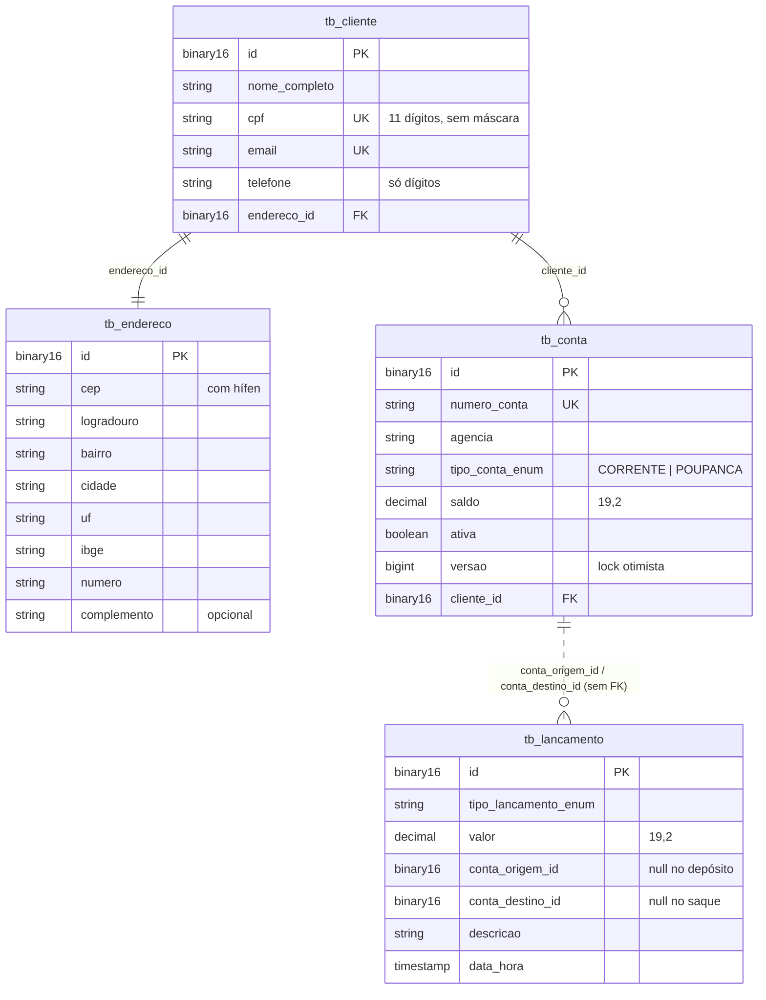

# RKF Bank — Backend

API REST do RKF Bank: clientes, contas, movimentações e extrato.

| | |
|---|---|
| **Responsável** | Kevin ([@k3vinrich4rd](https://github.com/k3vinrich4rd)) |
| **Stack** | Java 25 · Spring Boot 4.1 · Spring Web MVC · Spring Data JPA (Hibernate) · Jakarta Validation · RestClient |
| **Banco** | MySQL 8.4 (Docker) — H2 em memória disponível para testes |
| **Build** | Maven Wrapper (`pom.xml` na raiz do repositório) · JaCoCo para cobertura |
| **Porta** | `8080` |

## 📄 Documentos do backend

| Documento | Conteúdo |
|---|---|
| [README_CONTRATO_API.md](README_CONTRATO_API.md) | **fonte da verdade** de rotas, payloads, regras e erros |
| [README_IMPLEMENTACAO.md](README_IMPLEMENTACAO.md) | arquitetura, camadas, decisões internas e **como criar um endpoint** |
| [README_TESTES_E2E.md](README_TESTES_E2E.md) | roteiro de teste manual do fluxo completo (Postman/Insomnia/curl) |
| [CHECKLIST_TESTES_E2E.md](CHECKLIST_TESTES_E2E.md) | checklist de validação do MVP com o resultado da última execução |

---

## ▶️ Como rodar

> Todos os comandos rodam na **raiz do repositório** (onde está o `pom.xml`), não dentro de `backend/`.

```bash
# 1. banco (no .env, troque JWT_SEGREDO por um valor seu: openssl rand -base64 48)
cp .env.example .env
docker compose up -d

# 2. variáveis no terminal (o Spring não lê o .env sozinho)
set -a && source <(tr -d '\r' < .env) && set +a   # Git Bash / Linux / macOS (o tr remove o \r do .env salvo com CRLF)

# 3. API
./mvnw spring-boot:run                    # Windows: .\mvnw.cmd spring-boot:run
```

No PowerShell, o passo 2 é:

```powershell
Get-Content .env | Where-Object { $_ -match '^\s*[^#].*=' } | ForEach-Object {
  $nome, $valor = $_ -split '=', 2; Set-Item "env:$nome" $valor
}
```

Conferindo: `curl -i http://localhost:8080/contas` → `401` no formato de erro padrão (a API está no ar e exige login).
Para chamar as rotas protegidas, cadastre-se, faça `POST /auth/login` e mande `Authorization: Bearer <token>`
([contrato](README_CONTRATO_API.md#autenticação-jwt) e [roteiro, seção 7](README_TESTES_E2E.md#7-login-perfis-e-dados-sensíveis-spring-security--jwt)).

### Variáveis de ambiente

| Variável | Padrão no `.env.example` | Usada por |
|---|---|---|
| `MYSQL_USER` | `usuario-do-banco` | Docker e Spring |
| `MYSQL_PASSWORD` | `senha-do-banco` | Docker e Spring |
| `MYSQL_DATABASE` | `rkfbank` | Docker e Spring |
| `MYSQL_PORT` | `5441` | Docker (porta exposta) e Spring |
| `MYSQL_ROOT_PASSWORD` | `senha-root-do-banco` | só Docker |
| `MYSQL_VERSION` | `8.4` | só Docker |
| `JWT_SEGREDO` | valor de exemplo: **troque** | Spring: assina e confere o JWT. **Obrigatório**, mínimo 32 bytes; sem ele a API não sobe |
| `JWT_EXPIRACAO` | `15m` | Spring: validade do token (opcional) |
| `ADMIN_CPF` / `ADMIN_SENHA` | vazios | Spring: criam o primeiro `ADMIN` na subida, se preenchidos (opcional) |

> ⚠️ Se as variáveis **não** estiverem no terminal, o Spring usa os padrões de
> `application.properties` (`rkfbank` / `rkfbank`), que **não batem** com o usuário criado pelo Docker —
> resultado: `Access denied for user`. Ver [débitos técnicos](../planing/debitos-tecnicos.md).

### Configurações da aplicação

Arquivo: [`src/main/resources/application.properties`](src/main/resources/application.properties)

| Propriedade | Valor | Observação |
|---|---|---|
| `spring.jpa.hibernate.ddl-auto` | `validate` | quem cria e altera o schema é o **Flyway** ([Migrações](#-migrações-flyway)); o Hibernate só confere se as entidades batem com o banco e impede a subida se não baterem |
| `spring.jpa.properties.hibernate.type.preferred_uuid_jdbc_type` | `BINARY` | UUID sempre como `BINARY(16)`: é o que o MySQL já usa e faz o H2 dos testes validar o mesmo schema |
| `spring.jpa.show-sql` | `false` | o SQL sai pelo logger `org.hibernate.SQL` do `log4j2-spring.xml`, com o `requestId` da chamada |
| `viacep.base-url` | `https://viacep.com.br/ws` | |
| `viacep.timeout-ms` | `3000` | tempo máximo de conexão e de leitura do ViaCEP |
| `rkfbank.jwt.segredo` | `${JWT_SEGREDO}` | sem padrão de propósito; o perfil `test` traz um segredo só para testes |
| `rkfbank.jwt.expiracao` | `${JWT_EXPIRACAO:15m}` | validade do token |
| `rkfbank.admin.cpf` / `rkfbank.admin.senha` | `${ADMIN_CPF:}` / `${ADMIN_SENHA:}` | admin inicial (`CriadorAdmin`) |

### Segurança (Spring Security + JWT)

Regras de rota em [`ConfiguracaoSeguranca`](src/main/java/com/br/rkfbank/config/ConfiguracaoSeguranca.java):
públicas só `POST /clientes` e `POST /auth/login`; `GET /clientes` só `ADMIN`; o resto exige token. A **regra de dono**
(conta de outro cliente → `403`) fica no `ContaService`, porque depende do dado e não só do perfil. `401`/`403` barrados
nos filtros saem no formato padrão pelo `RespostaErroSeguranca`. Senha em BCrypt em `tb_usuario` (`V3`).

---

## 🧪 Testes

Três jeitos, do mais simples ao mais completo:

```bash
# 1. Sem Docker: perfil "test" usa H2 em memória (recomendado no dia a dia)
./mvnw clean verify -Dspring.profiles.active=test     # PowerShell: .\mvnw.cmd clean verify "-Dspring.profiles.active=test"

# 2. Com o MySQL do Docker já no ar e o .env carregado no terminal (ver "Como rodar")
./mvnw clean verify

# 3. Script: derruba e recria o MySQL (APAGA os dados) e roda os testes com o perfil "test"
./run-test.sh                      # todos
./run-test.sh ContaServiceTest     # uma classe
```

Relatório de cobertura: abra `target/site/jacoco/index.html` no navegador.

> O `run-test.sh` roda os testes com `-Dspring.profiles.active=test`, ou seja, **em H2**: o MySQL recriado fica
> limpo para o teste manual E2E, mas os testes automatizados não o usam. Ele também fixa o `JAVA_HOME` no JDK 25 de `~/.jdks/ms-25.0.4`. Se o seu JDK 25 estiver em outro lugar,
> ajuste a linha `export JAVA_HOME=...` antes de rodar.

Atalhos que mostram só o resumo (o log completo fica em `.validar/`):

```bash
scripts/validar.sh backend         # testes em H2 + cobertura, sem Docker
node scripts/smoke-e2e.mjs         # com a API no ar: fluxo real em 17 verificações (cadastro → extrato + erros)
```

### 🔁 Mudei algo: quais testes rodar?

| Se você mudou... | Rode | E confira |
|---|---|---|
| **regra de negócio** (`services`) | `scripts/validar.sh backend` | existe um teste novo cobrindo a regra (`*ServiceTest`); escreva o teste antes e veja ele falhar |
| **entidade JPA ou estrutura do banco** | crie `db/migration/V<n>__descricao.sql` → `scripts/validar.sh backend` → `./run-test.sh` → suba a API → smoke | a API sobe num banco vazio (`Successfully applied N migrations`); `flyway_schema_history` com a versão nova; `/revisar-migracao` |
| **consulta ou repository** | `scripts/validar.sh backend` | um `*RepositoryTest` (`@DataJpaTest`) cobrindo a consulta |
| **rota, request ou response** | `scripts/validar.sh backend` → suba a API → smoke | [contrato da API](README_CONTRATO_API.md), [roteiro E2E](README_TESTES_E2E.md), `/verificar-contrato` e recado para o frontend |
| **dependência** (`pom.xml`) | `scripts/validar.sh backend` → suba a API no MySQL → smoke → `node scripts/varrer-cves.js backend` | testes com mock não provam que a biblioteca nova funciona: a API precisa subir de verdade |
| **configuração** (`application*.properties`) | `scripts/validar.sh backend` → suba a API no perfil padrão (MySQL) | a mudança vale nos dois perfis? (`test` usa H2) |
| **segurança** (rotas públicas, perfis, regra de dono, JWT) | `scripts/validar.sh backend` → `scripts/testar-no-mysql.sh` → suba a API → smoke → `node scripts/engenharia-reversa-jwt.mjs` | `SegurancaIntegracaoTest` cobre o cenário novo; nenhum ataque do script de engenharia reversa passa; [roteiro, seção 7](README_TESTES_E2E.md#7-login-perfis-e-dados-sensíveis-spring-security--jwt) |
| **qualquer coisa e quer provar no MySQL** (não só no H2) | `docker compose up -d` → `scripts/testar-no-mysql.sh` | a saída mostra `Database dialect: MySQLDialect`; não apaga dados |
| **só documentação** | nada | links e comandos citados continuam funcionando |

**Antes do PR que mexe em regra, rota ou banco:** `./run-test.sh` (**apaga o MySQL local**) → subir a API → `node scripts/smoke-e2e.mjs`
→ se mudou o comportamento visível, refazer os itens afetados do [roteiro E2E manual](README_TESTES_E2E.md) e atualizar o
[checklist E2E](CHECKLIST_TESTES_E2E.md).

> ⚠️ Classe de teste precisa terminar em `Test`, `Tests` ou `TestCase`; senão o Surefire **ignora em silêncio**.

| Classe de teste | O que cobre | Estilo |
|---|---|---|
| `CpfValidoValidatorTest` | algoritmo de CPF | unitário puro |
| `ClienteViaCepTest` | integração com ViaCEP (sucesso, CEP inexistente, falha) | unitário com mock |
| `ClienteServiceTest` / `ContaServiceTest` | regras de negócio | Mockito (`@ExtendWith(MockitoExtension.class)`) |
| `ClienteControllerTest` / `ContaControllerTest` | status HTTP e delegação ao service | Mockito |
| `ControllerExceptionHandlerTest` | exceção → status + corpo de erro | unitário |
| `FiltroLogRequisicaoTest` | `X-Request-Id` reaproveitado, gerado e saneado | unitário |
| `EntitiesAndEnumsTest` | getters/setters, enums, `@PrePersist` | unitário |
| `ClienteRepositoryTest` | `existsByCpf`/`existsByEmail`, unicidade, cascata de endereço e contas, `orphanRemoval`, paginação | `@DataJpaTest` (H2) |
| `ContaRepositoryTest` | `existsByNumeroConta`, unicidade, campos obrigatórios, enum como texto, `@Version` (lock otimista), paginação | `@DataJpaTest` (H2) |
| `LancamentoRepositoryTest` | extrato (origem **ou** destino, do mais novo para o mais antigo), `@PrePersist` da `dataHora`, campos obrigatórios | `@DataJpaTest` (H2) |
| `UsuarioRepositoryTest` | `findByLogin`, admin sem cliente, unicidade de login e de cliente (`V3`) | `@DataJpaTest` (H2) |
| `TokenServiceTest` | claims do JWT, HS256, 15 min, payload adulterado, chave errada, segredo curto | unitário com encoder/decoder reais |
| `AuthServiceTest` / `UsuarioServiceTest` / `CriadorAdminTest` | login (mesma resposta e mesmo custo para CPF inexistente), admin pelo `.env` | Mockito |
| `RkfbankApplicationTests` | o contexto Spring sobe | `@SpringBootTest` |
| `SegurancaIntegracaoTest` | cadeia de filtros de verdade: `401` (sem token, vencido, outra chave, `alg:none`, adulterado), login, BCrypt no banco, regra de dono `403`, perfil `ADMIN` | `@SpringBootTest` + MockMvc (H2; MySQL com `testar-no-mysql.sh`) |

> **H2 × MySQL: qual banco cada teste usa?**
>
> | Comando | `@SpringBootTest` | `@DataJpaTest` | Para quê |
> |---|---|---|---|
> | `scripts/validar.sh backend` | H2 | H2 | dia a dia: rápido, sem Docker |
> | `./run-test.sh` | H2 (o script recria o MySQL, mas roda com o perfil `test`) | H2 | garantir banco limpo; **não** testa o MySQL |
> | `scripts/testar-no-mysql.sh` | **MySQL** do Docker | (não roda) | provar consultas, tipos e migrações no banco real |
> | API no ar + `smoke-e2e.mjs` | **MySQL** (perfil padrão) | — | fluxo real por HTTP |
>
> Usar H2 nos testes é decisão do projeto (rapidez e nada de Docker para rodar). O custo é que diferença de
> dialeto só aparece no MySQL, por isso o `testar-no-mysql.sh` e o smoke antes do PR que mexe no banco.
> `@DataJpaTest` troca o banco por H2 embutido **em qualquer perfil**; MySQL real para eles é a feature 3 (Testcontainers).
> Com o perfil padrão (sem `-Dspring.profiles.active=test`), `RkfbankApplicationTests` precisa do MySQL e do `.env` carregado.

Teste manual ponta a ponta: [README_TESTES_E2E.md](README_TESTES_E2E.md) ·
resultado da última execução: [CHECKLIST_TESTES_E2E.md](CHECKLIST_TESTES_E2E.md).

**Padrão de nome:** `deve<Resultado>[Quando<Condição>]` — ex.: `deveRetornarEnderecoQuandoViaCepResponderComSucesso`,
`deveRejeitarPaginacaoComPaginaNegativa`.
Use o padrão *Arrange / Act / Assert* (prepara, executa, verifica).

---

## 🗄️ Banco de dados



Os IDs são UUID na API, mas ficam como `binary(16)` no MySQL. Para ler no Workbench/DBeaver:

```sql
SELECT BIN_TO_UUID(id) AS id, nome_completo, cpf, email FROM tb_cliente;

SELECT BIN_TO_UUID(id) AS id, numero_conta, saldo, ativa FROM tb_conta;

SELECT BIN_TO_UUID(id) AS id, tipo_lancamento_enum, valor,
       BIN_TO_UUID(conta_origem_id)  AS origem,
       BIN_TO_UUID(conta_destino_id) AS destino,
       data_hora
FROM tb_lancamento
ORDER BY data_hora DESC;

-- buscar por um UUID específico
SELECT * FROM tb_conta WHERE id = UUID_TO_BIN('407d727e-4e43-4c93-b01c-331cbaba42fb');
```

Conexão: `localhost:5441`, usuário e senha do seu `.env`.

### 🛫 Migrações (Flyway)

O schema nasce e evolui por scripts versionados em
[`src/main/resources/db/migration`](src/main/resources/db/migration). Na subida da API (e em todo teste com banco),
o Flyway aplica o que falta, **antes** de o Hibernate validar as entidades, e registra cada versão na tabela
`flyway_schema_history`.

| Versão | O que faz |
|---|---|
| `V1__schema_inicial.sql` | as 4 tabelas, constraints com nome legível (`uk_`, `fk_`, `ck_`) e índices do extrato |
| `V2__email_minusculo.sql` | migração de dados: e-mails existentes em minúsculas (o `ClienteService` faz o mesmo nos novos) |
| `V3__usuarios.sql` | `tb_usuario`: login (CPF), hash BCrypt da senha, perfil (`CLIENTE`/`ADMIN`) e `cliente_id` opcional. Clientes de antes da V3 ficam sem senha: recrie o banco local |

**Criar uma migração nova:** arquivo `V<próxima versão>__descricao_em_snake_case.sql` (dois sublinhados), SQL que rode
no MySQL **e** no H2 dos testes, e `scripts/validar.sh backend`. Com o Claude Code, `/revisar-migracao` confere antes do commit.

> ⚠️ **Migração aplicada nunca se edita.** O Flyway guarda o checksum de cada arquivo; mudar um `V` já aplicado
> (até um comentário) faz a API recusar a subida com *Migration checksum mismatch*. Errou? Crie um `V` novo que corrige.

> **Primeira vez depois do Flyway:** se o seu MySQL local foi criado pelo Hibernate (antes desta mudança), a API recusa
> subir com *Found non-empty schema... but no schema history table*. Recrie o banco uma vez:
> `docker compose down -v && docker compose up -d` (**apaga os dados locais**). Não há produção ainda, então não usamos *baseline*.

---

## 🧯 Problemas comuns

| Sintoma | Causa provável | Solução |
|---|---|---|
| `Access denied for user 'rkfbank'` | variáveis do `.env` não carregadas no terminal | carregue o `.env` (seção "Como rodar") |
| `Could not resolve placeholder 'JWT_SEGREDO'` ou `JWT_SEGREDO ausente ou curto` | `.env` sem `JWT_SEGREDO` (ou com menos de 32 bytes), ou não carregado | gere com `openssl rand -base64 48`, ponha no `.env` e carregue de novo |
| Toda chamada devolve `401` | sem `Authorization: Bearer`, token vencido (15 min) ou `JWT_SEGREDO` trocado | faça login de novo |
| Login devolve `401` com a senha certa | cliente cadastrado antes da `V3` (não tem senha) | recrie o banco local ou cadastre de novo |
| `Communications link failure` | MySQL não está no ar ou ainda subindo | `docker compose ps` — espere `healthy` |
| `Rule 0 ... RequireJavaVersion failed` | JDK diferente de 25 | instale o JDK 25 e ajuste `JAVA_HOME` |
| `Port 8080 was already in use` | outra instância rodando | feche a outra ou mate o processo da porta |
| Cadastro devolve `503` | ViaCEP fora do ar ou sem internet | tente de novo; confira `https://viacep.com.br/ws/01001000/json/` |
| Cadastro devolve `422 CEP não encontrado` | CEP não existe no ViaCEP | use um CEP real, ex.: `01001000` |
| `Schema validation: missing column` / `wrong column type` | mudou a entidade sem criar migração | crie um `V<n>__...sql` com a alteração; o Hibernate não altera mais o banco |
| `Found non-empty schema(s) ... but no schema history table` | MySQL local criado pelo Hibernate antes do Flyway | `docker compose down -v && docker compose up -d` uma vez (apaga os dados locais) |
| `Migration checksum mismatch for migration version N` | alguém editou uma migração já aplicada | desfaça a edição (`git checkout -- <arquivo>`) e crie um `V` novo com a correção |
| `mvnw: Permission denied` (Linux/macOS) | arquivo sem permissão de execução | `chmod +x mvnw` |
| Testes de repositório falham com `The database has been closed` | H2 2.4.x quebra o `CHECK ... IN (...)` das colunas de enum | mantenha `<h2.version>2.3.232</h2.version>` no `pom.xml` até o H2 corrigir |
