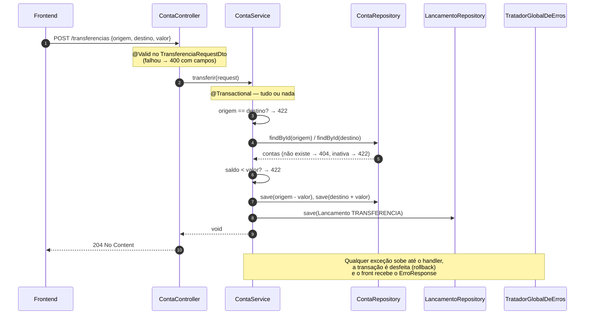
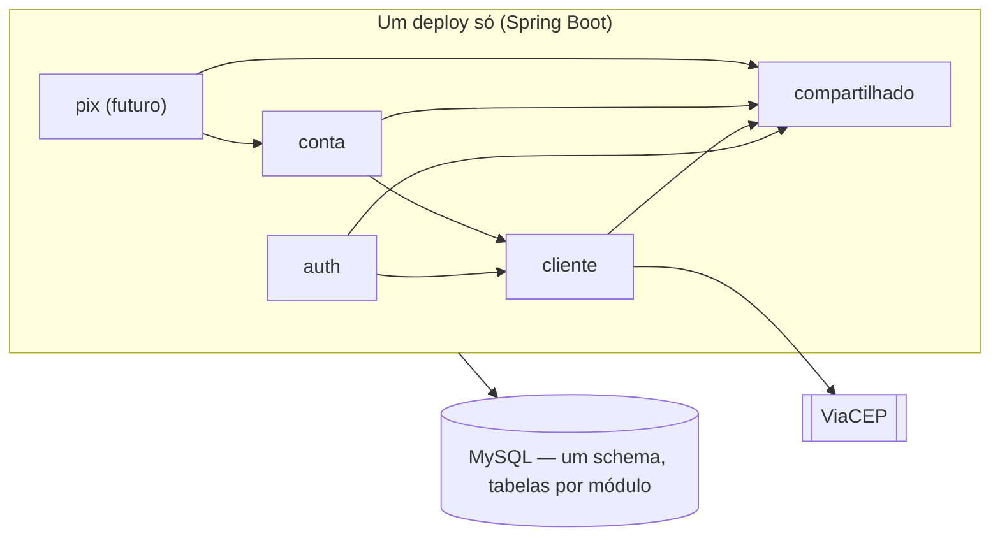

# RKF Bank — Arquitetura e implementação do backend

Este documento explica **como o backend é organizado, por que foi feito assim** e **como adicionar código novo
sem bagunçar a estrutura**. Para rotas e payloads, veja o [contrato](README_CONTRATO_API.md).

---

## 1. Visão geral

Padrão adotado: **arquitetura em camadas** (*Layered Architecture*).


**Regra de dependência:** cada camada só conhece a de baixo. Controller não acessa repository; repository não
conhece DTO; entidade JPA nunca sai pela API.

**Por que camadas (e não hexagonal, microsserviços etc.)?** O sistema é pequeno, o time tem duas pessoas e o
prazo é curto. Camadas são simples, conhecidas por qualquer dev Spring e facilitam testar cada parte isolada.
Quando o domínio crescer (Pix, cartão), dá para evoluir para pacotes por funcionalidade — ver seção 7.

---

## 2. Mapa de pacotes

Raiz: `backend/src/main/java/com/br/rkfbank/`

| Pacote | Responsabilidade | Pode | Não pode |
|---|---|---|---|
| `controllers` | contrato HTTP: rota, `@Valid`, status, query params | chamar services | ter regra de negócio, acessar repository |
| `controllers/handlers` | traduzir exceção em status + `ErroResponse` | — | ter regra de negócio |
| `services` | regras de negócio, orquestração, `@Transactional` | chamar repositories, clients e outros services | conhecer `HttpServletRequest`, `ResponseEntity` |
| `repositories` | consultas ao banco | métodos derivados (`existsBy...`, `findBy...`) e `@Query` | ter regra de negócio |
| `entities` (+ `enums`) | modelo persistido (tabelas) | anotações JPA | ser devolvida na API |
| `dto/request` | o que **entra** na API, com Bean Validation | `@NotBlank`, `@Pattern`, `@CpfValido`… | lógica |
| `dto/response` | o que **sai** da API | — | expor dados internos (ex.: `versao`) |
| `dto/comum` | formato padrão de erro | — | — |
| `clients/viacep` | chamar o ViaCEP e traduzir falhas em exceções nossas | `RestClient`, timeouts | regra de negócio de cliente |
| `exceptions` | exceções de domínio (cada uma mapeia um status) | — | — |
| `validation` | validações customizadas (`@CpfValido`) | — | — |
| `config` | beans de configuração (segurança, CORS para `/**` com origens de `CORS_ORIGENS`, log, admin) | — | — |

---

## 3. Caminho de uma requisição

Exemplo: **transferência** (`POST /transferencias`).



---

## 4. Como cada camada foi implementada

### 4.1 Controller — fino, só HTTP

[`ClienteController.java`](src/main/java/com/br/rkfbank/controllers/ClienteController.java)

```java
@PostMapping
public ResponseEntity<ClienteResponseDto> cadastrar(@Valid @RequestBody CadastroClienteRequestDto request) {
    return ResponseEntity.status(201).body(clienteService.cadastrar(request));
}
```

- `@Valid` dispara as anotações do DTO **antes** de chegar no service.
- Listagens aceitam `page` e `size` (qualquer um deles pede a página); a validação de limites (`page >= 0`, `1 <= size <= 100`)
  fica no próprio controller porque é regra de **HTTP**, não de negócio.

### 4.2 DTOs — `record` com validação

[`CadastroClienteRequestDto.java`](src/main/java/com/br/rkfbank/dto/request/cliente/CadastroClienteRequestDto.java)

```java
public record CadastroClienteRequestDto(
        @NotBlank(message = "cpf é obrigatório")
        @CpfValido(message = "cpf inválido")
        String cpf,
        ...
) {}
```

**Por que `record`?** É imutável, sem boilerplate e deixa claro que DTO é só dado.
**Por que não devolver a entidade?** A entidade tem campos internos (`versao`, relacionamentos), e qualquer
mudança no banco quebraria o frontend. O DTO é o contrato; a entidade é detalhe de implementação.

### 4.3 Service — onde mora a regra

[`ContaService.java`](src/main/java/com/br/rkfbank/services/ContaService.java)

```java
@Transactional
public void sacar(UUID contaId, SaqueRequestDto request) {
    Conta conta = buscarAtiva(contaId);              // 404 ou 422
    BigDecimal valor = validarValor(request.valor()); // > 0, 2 casas

    if (conta.getSaldo().compareTo(valor) < 0) {
        throw new RegraNegocioException(CodigoErroEnum.SALDO_INSUFICIENTE); // 422
    }

    conta.setSaldo(conta.getSaldo().subtract(valor));
    contaRepository.save(conta);
    salvarLancamento(TipoLancamentoEnum.SAQUE, valor, conta.getId(), null, request.descricao());
}
```

Pontos de atenção que valem estudo:

| Técnica | Onde | Por quê |
|---|---|---|
| `BigDecimal` para dinheiro | `Conta.saldo`, `Lancamento.valor` | `double` erra conta (`0.1 + 0.2 != 0.3`) |
| `compareTo` em vez de `equals` | comparação de saldo | `new BigDecimal("1.0").equals(new BigDecimal("1.00"))` é `false` |
| `setScale(2, HALF_EVEN)` | `validarValor` | arredondamento bancário, padrão em sistemas financeiros |
| `@Transactional` | todo método que escreve | débito + crédito + lançamento: tudo ou nada |
| `@Transactional(readOnly = true)` | listagens | otimização e intenção explícita |
| `@Version` (lock otimista) | `Conta.versao` | dois saques simultâneos não "somem" um com o outro → `409` |
| checar unicidade **e** capturar `DataIntegrityViolationException` | `cadastrar`, `abrir` | o `exists` dá mensagem boa; o `catch` cobre a corrida entre duas requisições |
| `saveAndFlush` | cadastro de cliente e conta | força o `INSERT` dentro do `try`, para o `catch` acima funcionar |
| sanitizar antes de validar no banco | CPF, telefone, CEP | `529.982.247-25` e `52998224725` são o mesmo CPF |
| normalizar o e-mail (`trim` + `toLowerCase(Locale.ROOT)`) | `cadastrar` | `Joao@X.com` e `joao@x.com` são o mesmo e-mail em qualquer banco; `Locale.ROOT` evita surpresas de idioma (o `I` turco) |

### 4.4 Repository — Spring Data deriva a query pelo nome

[`LancamentoRepository.java`](src/main/java/com/br/rkfbank/repositories/LancamentoRepository.java)

```java
List<Lancamento> findByContaOrigemIdOrContaDestinoIdOrderByDataHoraDesc(UUID contaOrigemId, UUID contaDestinoId);
```

Vira: `WHERE conta_origem_id = ? OR conta_destino_id = ? ORDER BY data_hora DESC`.

### 4.5 Entidades

| Entidade | Destaques |
|---|---|
| `Cliente` | `cpf` e `email` com `UniqueConstraint`; `Endereco` 1:1 obrigatório com `cascade = ALL`; 1:N com `Conta` |
| `Endereco` | dados vindos do ViaCEP + `numero`/`complemento` do usuário |
| `Conta` | `saldo` `DECIMAL(19,2)`; `tipoContaEnum` salvo como texto; `@Version versao` |
| `Lancamento` | guarda só os **IDs** das contas (sem FK); `dataHora` preenchida no `@PrePersist` |

Enums são salvos como `VARCHAR` (`EnumType.STRING`), não como número nem `ENUM` nativo do MySQL —
assim, reordenar ou adicionar valores não corrompe dados antigos.

### 4.6 Integração ViaCEP

[`ViaCepClient.java`](src/main/java/com/br/rkfbank/clients/viacep/ViaCepClient.java)

| Situação | O que acontece | Status final |
|---|---|---|
| CEP encontrado | devolve `ViaCepResponseDto` | — |
| ViaCEP responde `{"erro": true}` (com HTTP 200!) | `RegraNegocioException(CodigoErroEnum.CEP_NAO_ENCONTRADO)` | `422` |
| ViaCEP responde 5xx | `ServicoExternoIndisponivelException()` | `503` |
| timeout (3 s), DNS, rede | `ServicoExternoIndisponivelException(causa)` (a causa vai só para o log) | `503` |

Lição: **serviço externo sempre falha em algum momento.** Timeout configurado + tradução de erro evitam que
uma API de terceiros derrube a nossa.

### 4.7 Tratamento de erros centralizado

[`TratadorGlobalDeErros.java`](src/main/java/com/br/rkfbank/controllers/handlers/TratadorGlobalDeErros.java)
(`@RestControllerAdvice`) transforma exceções em `ErroResponse`. Ele só escolhe o **status**: o `codigo` e a `message`
vêm do [`CodigoErroEnum`](src/main/java/com/br/rkfbank/exceptions/CodigoErroEnum.java) que a exceção carrega, então
nenhuma frase de erro é escrita em service ou controller.

| Exceção | Status | Quando usar ao criar código novo |
|---|---|---|
| `MethodArgumentNotValidException` | `400` | automática, vem do `@Valid` |
| `HttpMessageNotReadableException` | `400` | automática, JSON inválido |
| `MethodArgumentTypeMismatchException` | `400` | automática, UUID inválido na URL |
| `RequisicaoInvalidaException(campo, msg)` | `400` | validação manual que precisa apontar um campo |
| `ClienteNaoEncontradoException` / `ContaNaoEncontradaException` / `UsuarioNaoEncontradoException` | `404` | recurso não existe |
| `ConflitoException(CodigoErroEnum.X)` | `409` | **conflito**: algo já existe (CPF, e-mail, número de conta) ou chamada simultânea |
| `OptimisticLockingFailureException` | `409` | automática, concorrência |
| `RegraNegocioException(CodigoErroEnum.X)` | `422` | **regra de negócio violada** (saldo, conta inativa, CEP) |
| `ServicoExternoIndisponivelException()` | `503` | dependência externa falhou |

> 💡 O nome `ConflitoException` engana: ela significa **conflito (409)**, não "qualquer regra de negócio".
> Para regra violada, use `RegraNegocioException` (422).
>
> **Erro novo?** Acrescente uma constante no `CodigoErroEnum` com a mensagem, lance a exceção com ela, documente o
> código na [seção 6 do contrato](README_CONTRATO_API.md#6-erros) e no tipo `CodigoErro` de `frontend/lib/api/types.ts`.
> Nunca renomeie um código existente: o front decide por ele.

### 4.8 Validação customizada `@CpfValido`

- Anotação: [`validation/CpfValido.java`](src/main/java/com/br/rkfbank/validation/CpfValido.java)
- Lógica: [`validation/CpfValidoValidator.java`](src/main/java/com/br/rkfbank/validation/CpfValidoValidator.java)
  — remove máscara, exige 11 dígitos, rejeita todos iguais (`111.111.111-11`) e confere os dois dígitos verificadores.
- Valor vazio retorna `true` de propósito: quem cuida de "obrigatório" é o `@NotBlank`. Cada anotação, uma responsabilidade.

---

## 5. Passo a passo: criando um endpoint novo

Exemplo real do roadmap: **`GET /contas/{contaId}`** (tela de saldo).

1. **Contrato** — mova o endpoint da seção 7 para a seção 4 do [contrato](README_CONTRATO_API.md), com
   resposta e erros. Avise o frontend.
2. **DTO** — reaproveite `ContaResponseDto` (se precisar de campos novos, crie outro record em `dto/response/conta`).
3. **Service** — em `ContaService`:

   ```java
   @Transactional(readOnly = true)
   public ContaResponseDto buscarPorId(UUID contaId) {
       return contaRepository.findById(contaId)
               .map(this::paraContaResponse)
               .orElseThrow(ContaNaoEncontradaException::new);
   }
   ```

   > Decisão para registrar: conta inativa deve aparecer (só leitura) ou dar `422`? Pergunte antes de codar.

4. **Controller** — em `ContaController`:

   ```java
   @GetMapping("/{contaId}")
   public ResponseEntity<ContaResponseDto> buscar(@PathVariable UUID contaId) {
       return ResponseEntity.ok(contaService.buscarPorId(contaId));
   }
   ```

5. **Testes**
   - `ContaServiceTest`: encontra a conta; lança `ContaNaoEncontradaException` quando não existe.
   - `ContaControllerTest`: devolve `200` com o corpo do service.
6. **Rodar** `./mvnw clean verify` e testar na mão (ver [README_TESTES_E2E.md](README_TESTES_E2E.md)).
7. **Frontend** — adicionar `buscar(contaId)` em `frontend/lib/api/contas.ts` (o Renan ou você, no mesmo PR
   se combinado).
8. **PR** com o checklist do [CONTRIBUTING.md](../CONTRIBUTING.md).

---

## 6. Testes

Os testes ficam em `backend/src/test/java/com/br/rkfbank/`, espelhando os pacotes do código.

| Camada | Como testamos | Exemplo |
|---|---|---|
| Validação | instancia o validator e chama `isValid` | `CpfValidoValidatorTest` |
| Client externo | mock do `RestClient` | `ViaCepClientTest` |
| Service | `@ExtendWith(MockitoExtension.class)`, mocks dos repositories | `ContaServiceTest` |
| Controller | chama o método do controller com service mockado | `ContaControllerTest` |
| Handler | chama o handler com a exceção e confere status/corpo | `TratadorGlobalDeErrosTest` |
| Aplicação | `@SpringBootTest` (sobe o contexto inteiro) | `RkfbankApplicationTests` |

**O que um bom teste de service cobre:** caminho feliz, cada `throw` (um teste por regra) e o que foi salvo
(use `ArgumentCaptor` para conferir o `Lancamento` gerado).

**Próximo nível** (ver [débitos técnicos](../planing/debitos-tecnicos.md)): testes de controller com `MockMvc`
(testam JSON e status de verdade) e testes de integração com Testcontainers (MySQL real).

---

## 7. Evolução planejada

| Hoje | Próximo passo | Por quê |
|---|---|---|
| ~~`ddl-auto=update`~~ | ✅ **Flyway** com migrations versionadas (`db/migration`), Hibernate em `validate` | histórico do banco no Git; deploy previsível |
| Sem documentação gerada | **springdoc-openapi** (Swagger UI) | contrato navegável e sempre atualizado |
| ~~Sem autenticação~~ | ✅ **Spring Security + JWT** (OAuth2 Resource Server), senha com BCrypt | qualquer um conseguia mexer em qualquer conta |
| `System.out` do Hibernate | **logs estruturados** com id por requisição | rastrear uma operação de ponta a ponta |
| Pacotes por camada | **monólito modular** por funcionalidade (`cliente/`, `conta/`, `auth/`) | quando entrar Pix e cartão — ver seção 8 |

A lista completa, com prioridade, está em [planing/debitos-tecnicos.md](../planing/debitos-tecnicos.md).

---

## 8. Revisão de arquitetura (20/10/2026)

Revisão feita olhando o código, não a intenção: pacotes, `ContaService`, entidades, segurança, migrações e testes.

### 8.1 Veredito

**A arquitetura em camadas continua certa para o MVP. Não reescreva nada agora.** O código respeita a regra de
dependência (controller → service → repository), a entidade não vaza pela API, a regra de dono está no service com o
`clienteId` vindo do token, dinheiro é `BigDecimal` com lock otimista, e o schema é versionado. Trocar para hexagonal ou
microsserviços hoje custaria semanas e não resolveria nenhum problema que o time tem.

O que **muda** é o destino: quando entrar a primeira feature grande (Pix ou cartão), o alvo é um **monólito modular**,
e há **três ajustes de domínio** que precisam vir **antes de ir para produção**, porque mexem com dinheiro.

### 8.2 O que está bom (manter)

| Ponto | Por que é bom |
|---|---|
| Camadas finas e DTO `record` | fácil de ler, testar e explicar em entrevista |
| Regra de dono no `ContaService` (403 antes de 404/422) | não vaza se a conta existe nem o saldo dela |
| Resource Server do Spring validando o JWT | segurança com código oficial, não filtro caseiro |
| `@Version` em `Conta` | duas escritas simultâneas viram `409` em vez de saldo errado |
| Flyway com `ddl-auto=validate` + seed separado (`db/seed`) | schema igual em todo ambiente; dado de demo nunca vai para produção |
| `X-Request-Id` em todo log | rastreia uma operação de ponta a ponta |

### 8.3 Riscos encontrados, por gravidade

| # | Risco | Onde | Por que importa | Recomendação |
|:-:|---|---|---|---|
| 1 🔴 | **Transferência sem idempotência** | `POST /transferencias` | a rede cai depois do débito, o app tenta de novo e o dinheiro sai **duas vezes** | header `Idempotency-Key` (UUID gerado pelo cliente) + tabela `tb_idempotencia` com a chave e a resposta; repetiu a chave, devolve a mesma resposta sem movimentar |
| 2 🔴 | **Conta pode ser apagada em cascata** | `Cliente.contas` com `cascade = ALL, orphanRemoval = true` | tirar uma conta da lista do cliente **apaga** a conta; banco não apaga conta, **encerra** (o extrato precisa sobreviver) | trocar por `cascade = PERSIST` (sem `orphanRemoval`) e encerrar com `ativa = false` |
| 3 🟡 | **Quem chama escolhe o número da conta** | `AberturaContaRequestDto.numeroConta` | número de conta é identidade do banco; o frontend hoje sorteia e tenta de novo no `409` | o backend gera número + dígito verificador (já está nos débitos); muda o contrato → combinar com o Renan |
| 4 🟡 | **Saldo e extrato são duas verdades** | `tb_conta.saldo` + `tb_lancamento` | se um dia um `UPDATE` manual mexer no saldo, nada avisa | manter o saldo como "cache" e criar um teste/rotina de **conciliação** (`saldo = soma dos lançamentos`); no futuro, partidas dobradas (`DEBITO` na origem + `CREDITO` no destino, os enums já existem) |
| 5 🟡 | **Sem health check** | `pom.xml` sem Actuator | o deploy (e o Docker) não tem como saber se a API está viva | `spring-boot-starter-actuator` expondo só `health` |
| 6 🟢 | **Pacotes por camada** | `controllers/`, `services/`... | com Pix e cartão, cada pasta vira uma gaveta com tudo misturado | monólito modular (8.4) |

### 8.4 Arquitetura alvo: monólito modular

Um único deploy (como hoje), mas o código organizado **por funcionalidade**, com cada módulo expondo só uma fachada:

```text
com.br.rkfbank
├── cliente/        ClienteController, ClienteService, Cliente, Endereco, ClienteRepository, viacep/
├── conta/          ContaController, ContaService, Conta, Lancamento, repositórios, regras de saldo
├── auth/           AuthController, AutenticacaoService, TokenService, Usuario, ConfiguracaoSeguranca
├── pix/            (futuro) chaves, cobrança, transferência instantânea — usa conta/ pela fachada
└── compartilhado/  erros (TratadorGlobalDeErros), logs (FiltroLogRequisicao), validação (@CpfValido)
```



| Por que essa e não... | Motivo |
|---|---|
| ...microsserviços | 3 pessoas, um banco, sem necessidade de escalar partes separadas. Microsserviço traria rede, consistência eventual e deploy múltiplo sem ganho |
| ...hexagonal completa | portas e adaptadores para tudo é cerimônia demais para CRUD + regras simples. Vale só onde há integração externa (o ViaCEP já está atrás do `ViaCepClient`, e o Pix terá um adaptador igual) |
| ...ficar como está para sempre | com 3+ domínios, "camadas" espalha uma feature em 6 pastas; por funcionalidade, uma feature = uma pasta |

**Quando mover:** no PR que começar o Pix, e não antes. Como mover sem quebrar: uma pasta por PR, só `git mv` e ajuste
de `import` (nenhuma regra muda), `scripts/validar.sh backend` verde em cada um. Opcional depois: **Spring Modulith**
(`@ApplicationModule` + um teste que falha se `cliente` importar algo de dentro de `conta`).

### 8.5 O que já foi feito (20/10/2026, mesmo dia da revisão)

| # | Risco | Status |
|:-:|---|---|
| 1 | Transferência sem idempotência | ✅ `Idempotency-Key` obrigatório em depósito, saque e transferência (`IdempotenciaService`, V6) |
| 2 | Conta apagada em cascata | ✅ `cascade = PERSIST`, sem `orphanRemoval`; FK impede excluir cliente com conta |
| 3 | Quem chama escolhe o número da conta | ✅ banco gera 8 dígitos com DV; frontend parou de sortear |
| 4 | Saldo × extrato | ✅ teste de conciliação no `DadosEquipeIntegracaoTest` (rotina em produção continua como próximo passo) |
| 5 | Sem health check | ✅ `GET /actuator/health` público, sem detalhes |
| — | Login sem limite (débito antigo) | ✅ `429` depois de 5 erros por CPF em 15 min |
| 6 | Pacotes por camada | ⏳ monólito modular junto com o Pix |

### 8.6 Ordem sugerida (original)

1. 🔴 Idempotência na transferência e fim do `orphanRemoval` em contas (antes do "Colocar no ar").
2. 🟡 Número de conta gerado pelo backend (com o Renan, muda o contrato) e Actuator `health`.
3. 🟡 Teste de conciliação saldo × extrato.
4. 🟢 Monólito modular junto com o Pix.

Itens registrados em [planing/debitos-tecnicos.md](../planing/debitos-tecnicos.md); a proposta de arquitetura alvo
está em "Ainda falta decidir" de [planing/decisoes.md](../planing/decisoes.md) para o time aprovar.
