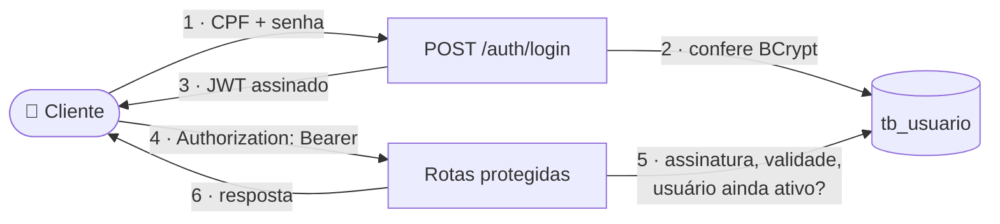
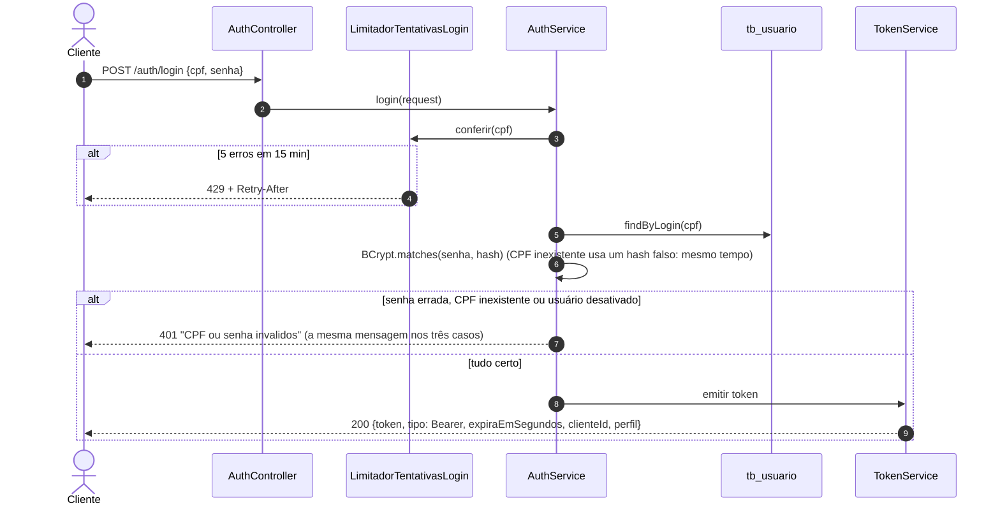
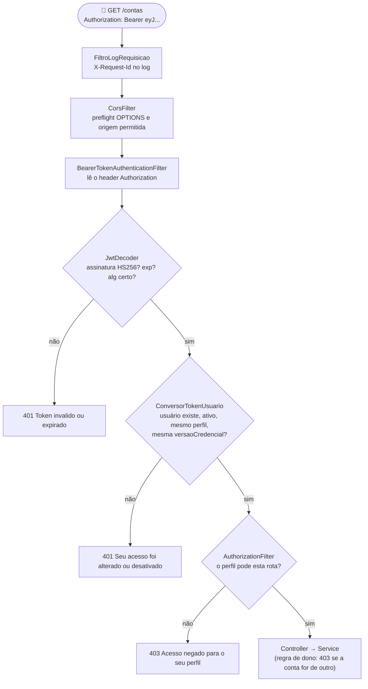
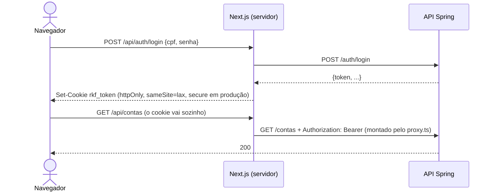

# 🔐 RKF Bank — Como a segurança funciona (Spring Security + OAuth2 + JWT)

> **Para quem é:** o time (Kevin, Renan, Felipe) e quem chegar no projeto. Explica **o que** cada peça faz, **por que**
> foi feita assim e **onde** está no código. Sem senha nenhuma aqui: o repositório é público.
> Para testar na prática: [guia de testes](README_TESTES_E2E.md) (seções 3, 6 e 8). Contrato: [README_CONTRATO_API.md](README_CONTRATO_API.md).

| Quero entender... | Vá para |
|---|---|
| a ideia geral em 1 minuto | [1. Visão geral](#1-visão-geral) |
| onde entra o OAuth2 (e onde não entra) | [2. OAuth2 no RKF Bank](#2-oauth2-no-rkf-bank) |
| o login, passo a passo | [3. Login](#3-login-de-cpf--senha-a-token) |
| o que acontece em cada requisição | [4. Cada requisição](#4-cada-requisição-a-cadeia-de-filtros) |
| quem pode o quê | [5. Autorização](#5-autorização-perfil-e-dono) |
| como o frontend guarda o token | [6. Frontend](#6-frontend-cookie-httponly-e-proxy-bff) |
| as proteções extras | [7. Proteções](#7-proteções-que-vão-além-do-tutorial) |
| por que não é igual aos tutoriais | [8. Decisões](#8-decisões-e-o-que-ficou-de-fora) |
| onde mexer | [9. Mapa do código](#9-mapa-do-código) |

---

## 1. Visão geral

Três perguntas, três respostas:

| Pergunta | Nome técnico | Resposta no RKF Bank | Erro |
|---|---|---|---|
| **Quem é você?** | autenticação | CPF + senha no `POST /auth/login`, conferidos contra o hash BCrypt | `401` |
| **Como provo isso nas próximas chamadas?** | token | um **JWT** assinado (HS256) no header `Authorization: Bearer <token>` | `401` |
| **Você pode fazer isto?** | autorização | perfil (`CLIENTE`/`ADMIN`) por rota + **regra de dono** no service | `403` |

**Stateless (sem estado):** o servidor não guarda sessão. Cada requisição carrega o token e se prova sozinha. Por isso
a API escala horizontalmente (várias instâncias) sem "sessão grudada" num servidor.

---

## 2. OAuth2 no RKF Bank

OAuth2 é um **padrão de delegação de acesso**: define papéis e como um token é emitido e validado. O RKF Bank usa
**uma parte oficial** dele, não o fluxo inteiro.

| Papel do OAuth2 | O que faz | No RKF Bank |
|---|---|---|
| *Resource Owner* | dono dos dados | o cliente (Felipe, Ana...) |
| *Client* | o app que pede acesso | o site Next.js (ou o Postman) |
| *Authorization Server* | confere a identidade e **emite** o token | a própria API, no `POST /auth/login` (login próprio, não é um Authorization Server OAuth2 completo) |
| *Resource Server* | **valida** o token e protege as rotas | a própria API, com `spring-boot-starter-security-oauth2-resource-server` ✅ |

**Por que só o Resource Server:** é a metade que mais dá trabalho fazer certo (validar assinatura, algoritmo,
validade, emissor) e que o Spring Security já entrega pronta e auditada. Escrever um filtro de JWT "na mão", como em
muitos tutoriais antigos, é onde nascem falhas como aceitar `alg: none`. A emissão é um login próprio com CPF + senha,
porque hoje só existe **um** app consumindo a API.

**Quando o OAuth2 completo entra:** com mais de um app (app mobile, parceiro), login social ou MFA. Aí o login sai da
API e vai para um Authorization Server dedicado (Spring Authorization Server ou Keycloak), com *authorization code +
PKCE* e *refresh token*. O Resource Server continua igual: só muda quem emite.

Bônus de padrão: o Spring Security 7 publica sozinho `GET /.well-known/oauth-protected-resource` (RFC 9728), e o `401`
traz `WWW-Authenticate: Bearer` apontando para ele (RFC 6750).

---

## 3. Login: de CPF + senha a token

**O que vai dentro do token** (o payload é só Base64: qualquer um lê, ninguém consegue alterar sem a chave):

| Claim | Valor | Para quê |
|---|---|---|
| `iss` | `rkfbank` | quem emitiu |
| `sub` | id do **usuário** (nunca o CPF) | quem é |
| `iat` / `exp` | emitido em / vence em | validade (15 min no padrão, 60 nos perfis de teste) |
| `perfil` | `CLIENTE` ou `ADMIN` | vira `ROLE_CLIENTE` / `ROLE_ADMIN` |
| `clienteId` | id do cadastro (ADMIN do `.env` não tem) | regra de dono |
| `versaoCredencial` | número que sobe a cada troca de senha | derrubar tokens antigos |

**A chave (HS256):** a mesma chave assina (no login) e confere (em cada requisição). Vem de `JWT_SEGREDO` no `.env`
(mínimo 32 bytes; a API **não sobe** com chave curta). No perfil `visitante`, é sorteada a cada subida: ninguém conhece.

---

## 4. Cada requisição: a cadeia de filtros

O Spring Security é uma **cadeia de filtros** (padrão *Chain of Responsibility*) que roda **antes** do controller.
Cada filtro pode deixar passar ou responder na hora.

**O passo que os tutoriais não têm (`ConversorTokenUsuario`):** um JWT sozinho vale até vencer, mesmo que o admin
tenha desativado a pessoa. Aqui, a cada requisição, um `SELECT` pela chave primária confere o usuário no banco. Por
isso **desativar, rebaixar ou trocar a senha derruba o token na hora** (`401`). Custo: 1 consulta rápida por chamada;
quando o volume crescer, um cache de poucos segundos resolve (está nos débitos técnicos).

Todo `401`/`403` sai no **mesmo formato de erro** da API (`RespostaErroSeguranca`), porque esses filtros recusam antes
do `ControllerExceptionHandler` existir para a requisição.

---

## 5. Autorização: perfil e dono

Duas camadas, cada uma no lugar certo:

| Camada | Pergunta | Onde | Exemplo |
|---|---|---|---|
| **Por perfil** (rota) | este **tipo** de usuário pode usar a rota? | `ConfiguracaoSeguranca` (`hasRole("ADMIN")`) | `CLIENTE` em `GET /clientes` → `403` |
| **Por dono** (dado) | este **dado** é seu? | `ContaService` (`UsuarioLogado.ehDonoDoCliente`) | Bruno sacando da conta da Ana → `403` |

Por que a regra de dono não fica na configuração do Security: ela depende do **dado** (de quem é a conta?), que só o
service conhece. E o `clienteId` usado é sempre o **do token**, nunca o que vem no corpo ou na URL.

| Rota | Quem |
|---|---|
| `POST /clientes`, `POST /auth/login`, `GET /actuator/health` | público |
| `GET /clientes`, `/admin/**` | só `ADMIN` |
| todo o resto | qualquer usuário logado (e a regra de dono no service) |

---

## 6. Frontend: cookie `httpOnly` e proxy (BFF)

O token **nunca** fica ao alcance do JavaScript do navegador.

| Proteção | Contra o quê |
|---|---|
| `httpOnly` | script injetado na página (XSS) não lê o token |
| `sameSite=lax` | outro site não consegue mandar o cookie num `POST` |
| proxy `/api` do Next (BFF, *Backend For Frontend*) | o navegador fala com a mesma origem (sem CORS) e nunca vê o token |

---

## 7. Proteções que vão além do tutorial

| Proteção | Como | Onde |
|---|---|---|
| Hash de senha | BCrypt (custo 10, salt embutido); limite de 72 bytes conferido em bytes, não em caracteres | `ConfiguracaoSeguranca`, `ClienteService` |
| Anti-enumeração | CPF inexistente e senha errada: mesma mensagem **e** mesmo tempo (hash falso) | `AuthService` |
| Força bruta | 5 erros por CPF em 15 min → `429` com `Retry-After` | `LimitadorTentativasLogin` |
| Revogação imediata | usuário ativo + perfil + `versaoCredencial` conferidos a cada requisição | `ConversorTokenUsuario` |
| Algoritmo fixo | só HS256; token com outro `alg` (inclusive `none`) é recusado | `jwtDecoder` |
| Chave forte | `JWT_SEGREDO` ≥ 32 bytes, senão a API não sobe | `chaveJwt` |
| Idempotência | `Idempotency-Key` em toda movimentação | `IdempotenciaService` |
| Injeção de log | URL e mensagens da requisição passam pelo `LogSeguro`, e o Log4j2 codifica CR/LF | `LogSeguro`, `log4j2-spring.xml` |
| LGPD nos logs | nunca CPF, senha, token ou e-mail no log; `toString` dos DTOs esconde os campos | DTOs e services |
| CORS | só as origens de `CORS_ORIGENS`; *preflight* respondido antes da autenticação | `ConfiguracaoCors` |

**E o CSRF desligado?** É de propósito (e o alerta do CodeQL foi revisado e descartado como falso positivo). CSRF
explora o navegador anexando sozinho um **cookie de sessão**; esta API não tem sessão nem lê cookie, só aceita o token
no header `Authorization`, que nenhum navegador manda sozinho. Se um dia a API autenticar por cookie, o CSRF **tem**
que voltar.

Prova automática: `node scripts/engenharia-reversa-jwt.mjs` tenta forjar o token (`alg: none`, payload adulterado,
assinatura trocada): todas as tentativas têm que dar `401`.

---

## 8. Decisões (e o que ficou de fora)

Comparado com os tutoriais mais comuns de Spring Security + JWT (por exemplo, `UserDetailsServiceImpl` +
`AuthenticationManager` + `JwtService` com chaves RSA):

| Tutorial típico | RKF Bank | Por quê |
|---|---|---|
| `UserDetailsService` + `AuthenticationManager` conferem a senha | o `AuthService` confere com `PasswordEncoder.matches` | precisamos de regras no meio do login (limite por CPF, usuário desativado com a mesma resposta, perfil e `clienteId` no token). As duas formas são corretas; a do tutorial é a mais "idiomática" do Spring e vale migrar se o login crescer (o `DaoAuthenticationProvider` já protege contra ataque de tempo) |
| `XxxServiceImpl` implementando `UserDetailsService` | sem `Impl` | lá o `Impl` implementa uma **interface do framework**: é o caso certo de usar interface. Aqui não usamos essa interface. Se um dia usar, o nome de mercado é pelo papel (`UsuarioDetailsService`), não `Impl` |
| claim `scope` → autoridades `SCOPE_x` | claim `perfil` → `ROLE_x` | o RKF Bank tem papéis (cliente, admin), não escopos de API de terceiros |
| chave RSA (RS256): privada assina, pública confere | chave simétrica HS256 | uma API só, que emite e confere. Com mais serviços validando token, o certo é RS256 + JWKS (próximo passo) |
| token vale até vencer | revogação imediata | banco: rebaixar ou desativar tem que valer **agora** |
| expiração fixa no código (`3600L`) | `JWT_EXPIRACAO` no `.env` | ajustar por ambiente sem recompilar |
| `schema.sql` | Flyway (`V1…V9`) | banco versionado e igual em todo ambiente |
| tudo num pacote só | camadas (`config`, `security`, `controllers`, `services`...) | tutorial é curto; projeto real cresce |

**Próximos passos de segurança:** *refresh token* revogável (`POST /auth/refresh`), RS256 + JWKS, Authorization Server
dedicado quando houver mais de um app, 2FA, auditoria de quem fez o quê.

---

## 9. Mapa do código

| Arquivo | Papel |
|---|---|
| `config/ConfiguracaoSeguranca.java` | cadeia de filtros, rotas públicas e de admin, stateless, Resource Server, BCrypt, chave e encoder/decoder do JWT |
| `config/JwtPropriedades.java` | `JWT_SEGREDO`, `JWT_EXPIRACAO`, chave sorteada no perfil visitante |
| `config/ConfiguracaoCors.java` | origens permitidas e headers expostos |
| `config/RespostaErroSeguranca.java` | `401`/`403` no formato de erro da API |
| `config/FiltroLogRequisicao.java` · `config/LogSeguro.java` | `X-Request-Id` e log sem injeção |
| `config/CriadorAdmin.java` · `config/CriadorAcessoEquipe.java` | primeiro admin e login da equipe, a partir do `.env` |
| `services/AuthService.java` | login e troca da própria senha |
| `services/TokenService.java` | monta e assina o JWT |
| `services/GestaoUsuarioService.java` | promover, rebaixar, desativar, redefinir senha (admin) |
| `security/ConversorTokenUsuario.java` | token → usuário logado, conferindo o banco |
| `security/LimitadorTentativasLogin.java` | limite de tentativas por CPF |
| `security/UsuarioLogado.java` | quem está chamando, para os services (regra de dono) |
| `frontend/proxy.ts` · `frontend/lib/auth/cookies.ts` · `frontend/app/api/auth/*` | cookie `httpOnly`, proxy e rotas de sessão do Next |
