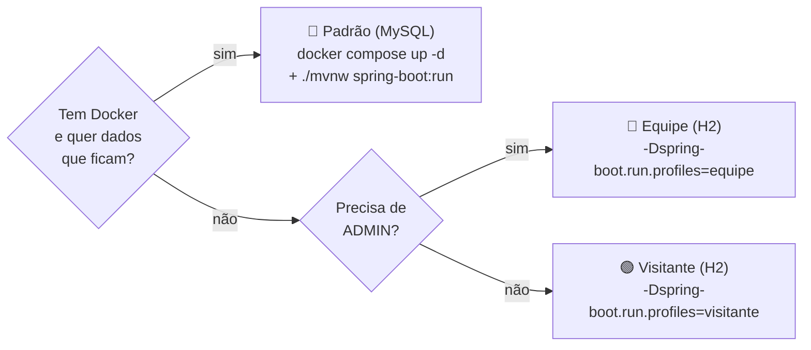
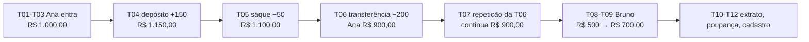
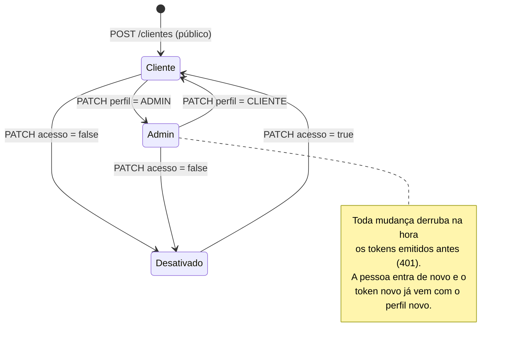
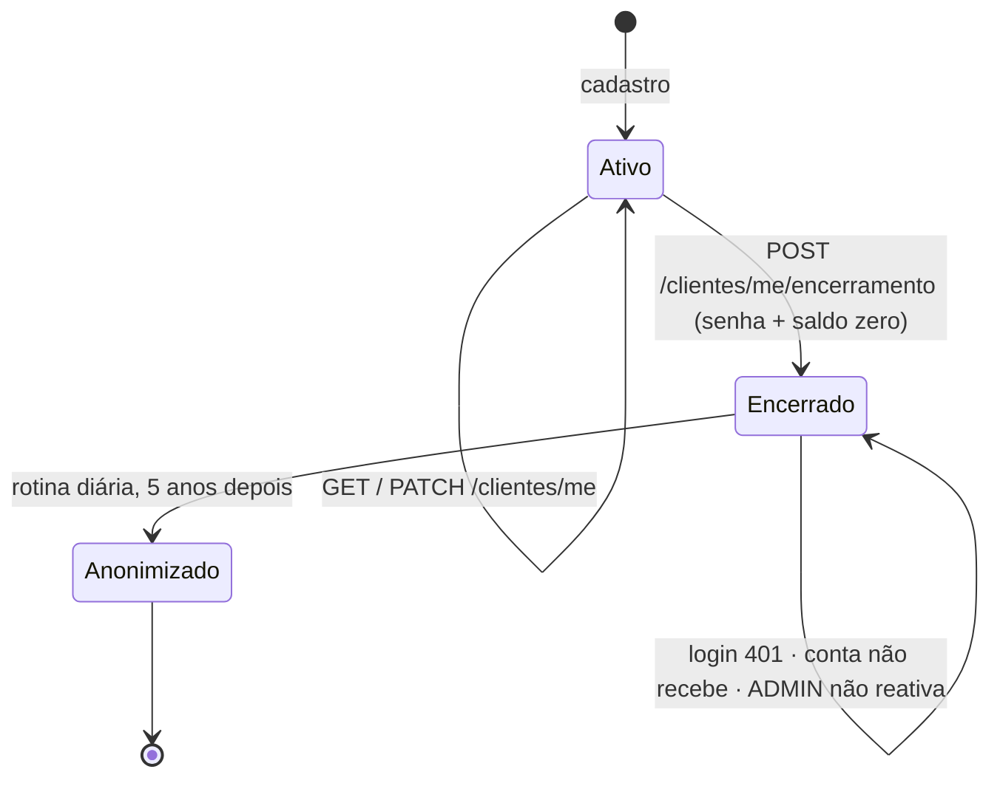
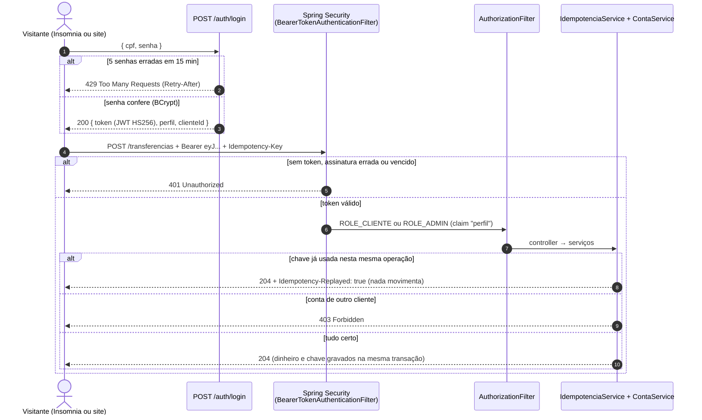

# RKF Bank — Como testar o projeto, do zero

> **Para quem é:** qualquer pessoa que queira rodar e testar a API inteira na própria máquina, sem ajuda: visitantes,
> recrutadores, quem está chegando no projeto. Cada passo diz **o que fazer**, **o que deve aparecer** e **por quê**.
> Só quer ver funcionando em 5 minutos? [VISITANTES.md](../VISITANTES.md).
>
> 🔒 A equipe (Kevin, Renan e Felipe) segue este mesmo guia com as contas internas; as senhas delas ficam no guia
> privado, **fora** do repositório. Aqui aparecem só as **contas de visitante** e valores de teste inventados.

Respostas reais, capturadas entre 20 e 22/10/2026 (contrato **2.6**). Ao repetir, só mudam `id`s gerados, `dataHora`,
`timestamp` e o `token`.

**Como ler:** a **Parte 1** deixa tudo pronto (rodar, ver o banco, Insomnia, permissões, payloads). A **Parte 2** são
os roteiros de teste. A **Parte 3** explica o que acontece por dentro. Primeira vez? Faça a Parte 1 na ordem.

| Quero... | Vá para |
|---|---|
| escolher entre H2 e MySQL | [1. Três jeitos de rodar](#1-três-jeitos-de-rodar) |
| instalar o que falta | [2. Pré-requisitos](#2-pré-requisitos-uma-vez-só) |
| rodar pela IDE ou pelo terminal | [3. IDE](#3-rodar-pela-ide-intellij) · [4. Terminal](#4-rodar-pelo-terminal) |
| ver as tabelas (H2 ou MySQL) | [5. Olhar o banco](#5-olhar-o-banco-h2-ou-mysql) |
| testar sem copiar e colar | [6. Insomnia](#6-insomnia-importar-a-coleção-e-testar-sem-copiar-e-colar) |
| saber quem pode chamar cada rota | [7. Autenticação e permissões](#7-autenticação-e-permissões-quem-pode-o-quê) |
| tornar alguém ADMIN | [8. Tornar alguém ADMIN](#8-como-tornar-alguém-admin-três-jeitos) |
| copiar o corpo de qualquer requisição | [9. Catálogo de payloads](#9-catálogo-de-payloads-todas-as-funcionalidades) |
| seguir um roteiro de testes | [Parte 2](#parte-2--roteiros-de-teste) |
| entender Spring Security, OAuth2, JWT e as camadas | [Parte 3](#parte-3--entender-por-dentro) |
| resolver um erro na hora de subir | [Problemas comuns](#problemas-comuns) |

---

# Parte 1 · Preparar e rodar

## 1. Três jeitos de rodar

A mesma API sobe em três **perfis** do Spring. Perfil é um conjunto de configurações escolhido na hora de subir
(`application-<perfil>.properties` por cima do `application.properties`). Muda o banco e as contas que já vêm prontas;
o código é o mesmo.

| | 🟢 **Visitante** | 🔵 **Equipe** | 🐬 **Padrão (MySQL)** |
|---|---|---|---|
| Banco | H2 em memória (`rkfbank-visitante`) | H2 em memória (`rkfbank-equipe`) | MySQL 8.4 no Docker (porta `5441`) |
| Ao parar a API | tudo some | tudo some | **fica gravado** (volume do Docker) |
| Contas prontas | Ana (origem) e Bruno (destino) | Felipe (origem) e Renan (destino) | Felipe e Renan |
| ADMIN | não existe (de propósito) | o do `.env` (`ADMIN_CPF`/`ADMIN_SENHA`) | o do `.env` |
| Precisa de | só o JDK | JDK + `.env` | JDK + `.env` + Docker |
| Console do H2 | ✅ `/h2-console` | ✅ `/h2-console` | ❌ (use o cliente do MySQL) |
| Validade do token | 60 min | 60 min (ou `JWT_EXPIRACAO`) | 15 min (ou `JWT_EXPIRACAO`) |
| Use quando | primeiro contato, demonstração | testar rápido sem Docker, com admin | ver os dados persistirem, o mais perto do real |



**H2 × MySQL, em uma frase:** o H2 é um banco que roda **dentro** da própria API, na memória (zero instalação, ótimo
para testar); o MySQL é um servidor de banco separado, como em produção. As mesmas migrações do Flyway criam as
tabelas nos dois, então o comportamento da API é igual.

### Contas prontas

| | 🟠 **Origem** (visitante) | 🔵 **Destino** (visitante) | 🟠 **Origem** (equipe) | 🔵 **Destino** (equipe) |
|---|---|---|---|---|
| Quem | Ana Visitante (Origem) | Bruno Visitante (Destino) | Felipe Santana (Teste Origem) | Renan Barros (Teste Destino) |
| CPF (login) | `246.813.579-28` | `975.318.642-82` | `123.456.789-09` | `987.654.321-00` |
| Senha | `Visitante@2026` | `Visitante@2026` | `EQUIPE_SENHA` do `.env` | `EQUIPE_SENHA` do `.env` |
| `clienteId` | `a0000000-0000-4000-8000-000000000112` | `a0000000-0000-4000-8000-000000000122` | `5eed0000-0000-4000-8000-000000000012` | `5eed0000-0000-4000-8000-000000000022` |
| `contaId` | `a0000000-0000-4000-8000-000000000114` | `a0000000-0000-4000-8000-000000000124` | `5eed0000-0000-4000-8000-000000000014` | `5eed0000-0000-4000-8000-000000000024` |
| Agência / conta | `0001` / `900001` | `0001` / `900002` | `0001` / `100001` | `0001` / `100002` |
| Saldo ao nascer | R$ 1.000,00 | R$ 500,00 | R$ 1.000,00 | R$ 500,00 |

Nomes, CPFs (válidos pelos dígitos verificadores), e-mails e endereços são fictícios. Quem cria essas contas é o
Flyway, nos arquivos `db/seed/visitante` e `db/seed/equipe` (seção 5.3). As da equipe nascem **sem senha** no Git: o
login delas é criado na subida com a `EQUIPE_SENHA` do seu `.env`.

---

## 2. Pré-requisitos (uma vez só)

| Ferramenta | Para quê | Como conferir | Obrigatória? |
|---|---|---|---|
| **JDK 25** | compilar e rodar a API (o `pom.xml` exige o 25) | `java -version` → `25.x` | ✅ |
| **Git** | clonar o repositório | `git --version` | ✅ |
| **IntelliJ IDEA** (Community serve) | rodar e depurar pela IDE (seção 3) | — | recomendada |
| **Insomnia** (9 ou mais novo) | testar sem copiar e colar (seção 6) | — | recomendada |
| **Docker Desktop** | só para o perfil MySQL | `docker version` mostra *Server* | só MySQL |
| **Node.js 22** | scripts de apoio (`rodar-colecao-insomnia.mjs`, `smoke-e2e.mjs`) | `node -v` | opcional |
| Internet | o cadastro busca o endereço no ViaCEP | — | só no cadastro |

O Maven **não** precisa ser instalado: o projeto traz o *wrapper* (`./mvnw` / `mvnw.cmd`), que baixa a versão certa.

### O arquivo `.env` (perfis equipe e MySQL)

O perfil visitante **ignora** o `.env`. Os outros dois leem dele os segredos, que nunca vão para o Git:

```bash
cp .env.example .env      # na raiz do repositório; depois edite os valores
```

| Variável | O que é | Valor para testar |
|---|---|---|
| `JWT_SEGREDO` | chave que assina os tokens (mín. 32 bytes). **Obrigatória**: sem ela a API não sobe | `openssl rand -base64 48` (Git Bash) |
| `ADMIN_CPF` / `ADMIN_SENHA` | o primeiro ADMIN, criado na subida se ainda não existir | um CPF válido seu de teste, ex. `11144477735`, e uma senha de 8+ caracteres |
| `EQUIPE_SENHA` | senha do Felipe e do Renan (mín. 12 bytes) | equipe: a do guia privado · visitante: invente uma |
| `MYSQL_*` | usuário, senha, banco e porta do MySQL do Docker | os do `.env.example` servem |

**Onde a API procura o `.env`:** na **pasta de onde ela é iniciada** (`spring.config.import=optional:file:.env`). Por
isso a API sempre roda **a partir da raiz do repositório** (no terminal e na IDE). Variável do terminal ou da IDE vale
mais que o `.env`.

---

## 3. Rodar pela IDE (IntelliJ)

1. **File → Open** e escolha a **raiz** do repositório (a pasta do `pom.xml`). Espere o Maven importar (barra de
   progresso no canto inferior).
2. **File → Project Structure → Project → SDK**: escolha um **JDK 25** (se não houver, *Add SDK → Download JDK*).
3. No topo, ao lado do ▶️, abra a lista de configurações. O projeto já traz três prontas (pasta `.run/`):

| Configuração | Perfil | Antes de rodar |
|---|---|---|
| **API · Visitante (H2)** | `visitante` | nada |
| **API · Equipe (H2)** | `equipe` | `.env` preenchido |
| **API · MySQL (Docker)** | padrão | `.env` + `docker compose up -d` (seção 4.3) |

4. ▶️ **Run** (ou 🐞 **Debug**, para parar em *breakpoints*). Pronto quando o console mostrar `Tomcat started on port 8080`.

Não apareceram? Crie uma: **Run → Edit Configurations → + → Application**.

| Campo | Valor |
|---|---|
| Main class | `com.br.rkfbank.RkfbankApplication` |
| VM options | `-Dspring.profiles.active=visitante` (ou `equipe`; vazio = MySQL) |
| Working directory | `$PROJECT_DIR$` (a raiz: é onde o `.env` é lido) |
| Environment variables | opcional: `JWT_SEGREDO=...;ADMIN_CPF=...` (vale mais que o `.env`) |

> 💡 Rodar pela IDE liga o **DevTools**: ao recompilar (`Ctrl+F9`), a API reinicia sozinha. No H2 em memória isso
> **recria o banco** (as contas prontas voltam ao saldo inicial).

---

## 4. Rodar pelo terminal

Sempre na **raiz** do repositório. Git Bash, Linux e macOS usam `./mvnw`; PowerShell usa `.\mvnw.cmd` e o `-D` entre
aspas.

### 4.1 🟢 Visitante (H2)

```bash
./mvnw spring-boot:run -Dspring-boot.run.profiles=visitante
```

```powershell
.\mvnw.cmd spring-boot:run "-Dspring-boot.run.profiles=visitante"
```

### 4.2 🔵 Equipe (H2, com ADMIN)

Com o `.env` preenchido, é só trocar o perfil:

```bash
./mvnw spring-boot:run -Dspring-boot.run.profiles=equipe
```

Sem `.env` (visitante que quer testar o ADMIN), passe tudo pelo terminal; nada vai para o Git e tudo some ao parar:

```bash
export JWT_SEGREDO="$(openssl rand -base64 48)"
export ADMIN_CPF=11144477735 ADMIN_SENHA='admin-local-123' EQUIPE_SENHA='equipe-local-1234'
./mvnw spring-boot:run -Dspring-boot.run.profiles=equipe
```

```powershell
$env:JWT_SEGREDO = [Convert]::ToBase64String((1..48 | ForEach-Object { Get-Random -Max 256 }))
$env:ADMIN_CPF = "11144477735"; $env:ADMIN_SENHA = "admin-local-123"; $env:EQUIPE_SENHA = "equipe-local-1234"
.\mvnw.cmd spring-boot:run "-Dspring-boot.run.profiles=equipe"
```

### 4.3 🐬 Padrão (MySQL no Docker)

```bash
docker compose up -d                 # sobe o MySQL 8.4 (container rkfbank-mysql, porta 5441)
docker ps                            # espere STATUS "(healthy)": o MySQL leva uns 20 s na primeira vez
./mvnw spring-boot:run               # sem perfil = padrão = MySQL
```

| Comando útil | O que faz |
|---|---|
| `docker compose stop` | desliga o MySQL e **mantém** os dados |
| `docker compose up -d` | liga de novo, com os dados de antes |
| `docker compose down -v` | ⚠️ apaga o container **e os dados** (o `-v` remove o volume). Use para começar do zero |
| `./run-test.sh` | ⚠️ apaga o MySQL local, sobe de novo e roda os testes |

### 4.4 Como saber que subiu certo

No log, procure (exemplo do visitante):

```text
The following 1 profile is active: "visitante"
Successfully applied 9 migrations to schema "PUBLIC", now at version v9
Executing SQL callback: afterMigrate - dados visitantes
Tomcat started on port 8080
```

No MySQL, a partir da segunda subida aparece `Schema `rkfbank` is up to date. No migration necessary.`: o Flyway viu
que as 9 migrações já estão aplicadas. E a saúde da API:

```bash
curl -s http://localhost:8080/actuator/health
# {"groups":["liveness","readiness"],"status":"UP"}
```

Espere o `UP`. Durante a subida aparece `OUT_OF_SERVICE` e o login das contas prontas ainda pode dar `401`: os acessos
são criados no fim da inicialização.

---

## 5. Olhar o banco (H2 ou MySQL)

Testar uma API é também conferir que o banco ficou certo: o saldo mudou? O lançamento foi gravado? O usuário virou
ADMIN?

### 5.1 H2: o console web (perfis visitante e equipe)

1. Com a API no ar, abra **http://localhost:8080/h2-console**.
2. Preencha **exatamente** assim (⚠️ o console sugere `jdbc:h2:mem:testdb`, que é um banco **vazio**: troque):

| Campo | Visitante | Equipe |
|---|---|---|
| Driver Class | `org.h2.Driver` | `org.h2.Driver` |
| JDBC URL | `jdbc:h2:mem:rkfbank-visitante` | `jdbc:h2:mem:rkfbank-equipe` |
| User Name | `sa` | `sa` |
| Password | *(vazio)* | *(vazio)* |

3. **Connect**. À esquerda ficam as tabelas; clique numa para montar o `SELECT`, e **Run** (`Ctrl+Enter`) executa.

Consultas prontas (os ids são `BINARY(16)`; o `CAST(... AS UUID)` mostra no formato que a API usa):

```sql
-- Contas, saldos e donos
SELECT CAST(c.id AS UUID) AS conta_id, c.agencia, c.numero_conta, c.tipo_conta_enum, c.saldo, c.ativa, cl.nome_completo
FROM tb_conta c JOIN tb_cliente cl ON cl.id = c.cliente_id ORDER BY cl.nome_completo;

-- Extrato de todo mundo, do mais novo para o mais antigo
SELECT l.tipo_lancamento_enum, l.valor, l.descricao, l.data_hora,
       CAST(l.conta_origem_id AS UUID) AS origem, CAST(l.conta_destino_id AS UUID) AS destino
FROM tb_lancamento l ORDER BY l.data_hora DESC;

-- Usuários: login (CPF), perfil e se está ativo. O hash BCrypt fica em senha_hash; a senha nunca é gravada.
SELECT login, perfil, ativo, versao_credencial FROM tb_usuario;

-- Quais migrações o Flyway aplicou (no H2, os nomes desta tabela vão entre aspas)
SELECT "version", "description", "success" FROM "flyway_schema_history" ORDER BY "installed_rank";
```

**Por que só nesses perfis:** o console abre o banco inteiro sem senha. Ele é ligado só onde o banco é de teste e em
memória (`spring.h2.console.enabled=true` nos perfis H2), só aceita acesso da sua própria máquina, e o perfil padrão o
desliga de forma explícita. Quem libera o caminho na segurança é a `ConfiguracaoConsoleH2` (Parte 3).

### 5.2 MySQL: pelo terminal ou por um cliente gráfico

**Terminal** (usa as credenciais do container, sem digitar senha):

```bash
docker exec -it rkfbank-mysql sh -c 'mysql -u"$MYSQL_USER" -p"$MYSQL_PASSWORD" "$MYSQL_DATABASE"'
```

**Cliente gráfico** (IntelliJ *Database*, DBeaver, MySQL Workbench): host `localhost`, porta `5441`, banco `rkfbank`,
usuário e senha = `MYSQL_USER` / `MYSQL_PASSWORD` do `.env`. No IntelliJ: **View → Tool Windows → Database → + → Data
Source → MySQL** (ele baixa o driver).

No MySQL, o UUID binário vira texto com `BIN_TO_UUID`:

```sql
SELECT BIN_TO_UUID(c.id) AS conta_id, c.numero_conta, c.saldo, c.ativa, cl.nome_completo
FROM tb_conta c JOIN tb_cliente cl ON cl.id = c.cliente_id ORDER BY cl.nome_completo;

SELECT l.tipo_lancamento_enum, l.valor, l.descricao, l.data_hora,
       BIN_TO_UUID(l.conta_origem_id) AS origem, BIN_TO_UUID(l.conta_destino_id) AS destino
FROM tb_lancamento l ORDER BY l.data_hora DESC LIMIT 20;

SELECT login, perfil, ativo FROM tb_usuario;
SELECT version, description, success FROM flyway_schema_history ORDER BY installed_rank;
```

> ✍️ **Só olhe, não edite saldo na mão.** Mudar `saldo` direto no banco deixa a conta diferente da soma do extrato:
> é exatamente o tipo de inconsistência que a API existe para impedir. A exceção didática é promover alguém a ADMIN
> (seção 8.3).

### 5.3 Como as migrações estão organizadas (e por que faz sentido)

```text
backend/src/main/resources/db/
├── migration/                       ← SCHEMA: roda em TODO ambiente (dev, teste, produção)
│   ├── V1__criar_tabela_endereco.sql
│   ├── V2__criar_tabela_cliente.sql
│   ├── V3__criar_tabela_conta.sql
│   ├── V4__criar_tabela_lancamento.sql
│   ├── V5__criar_tabela_usuario.sql
│   ├── V6__criar_tabela_idempotencia.sql
│   ├── V7__adicionar_ativo_usuario.sql
│   ├── V8__adicionar_versao_credencial_usuario.sql
│   └── V9__adicionar_encerramento_cliente.sql
└── seed/                            ← DADOS DE DEMONSTRAÇÃO: só onde o perfil incluir a pasta
    ├── equipe/afterMigrate__dados_equipe.sql         (perfil padrão e equipe)
    └── visitante/afterMigrate__dados_visitantes.sql  (só visitante)
```

| Decisão | Por quê |
|---|---|
| Uma tabela por versão (V1–V6), depois uma mudança por versão (V7–V9) | o histórico conta a evolução do banco; cada arquivo é pequeno e revisável |
| Migração aplicada **nunca** é editada | o Flyway guarda o *checksum* de cada uma; editar faz a API recusar subir (veja *Problemas comuns*) |
| Schema e dados de demonstração separados | produção usa só `db/migration` (`FLYWAY_LOCATIONS`); conta de teste nunca vai para o ar |
| Seeds como *callback* `afterMigrate` | rodam a **cada** subida e não entram no histórico; apagou uma conta pronta, ela volta |
| Seeds idempotentes (`INSERT ... WHERE NOT EXISTS`) | rodar 1 ou 100 vezes dá o mesmo resultado, e saldo já movimentado nunca é zerado |
| Ids fixos (`5eed...`, `a000...`) | o guia e a coleção do Insomnia usam os mesmos ids em qualquer máquina |
| SQL compatível com MySQL **e** H2 (`X'...'`, `BINARY(16)`) | o mesmo arquivo serve aos dois bancos; os testes passam no H2 e a API roda no MySQL |
| `ddl-auto=validate` no Hibernate | o Hibernate **confere** as tabelas, mas quem cria é só o Flyway: um único dono do schema |

Mudou uma entidade? Crie `V10__descricao.sql` (e rode `/revisar-migracao`). Detalhes e diagrama das tabelas:
[backend/README.md → Banco de dados](README.md#banco-de-dados).

---

## 6. Insomnia: importar a coleção e testar sem copiar e colar

A coleção [`backend/insomnia/rkfbank.insomnia.json`](insomnia/rkfbank.insomnia.json) tem **49 requisições** em 9
pastas, na ordem de um teste completo. Ninguém copia token nem id: os scripts guardam tudo sozinhos.

### 6.1 Importar (uma vez)

1. Insomnia → **Import** (no painel inicial, ou o botão ao lado de *Create*) → **File** → escolha
   `backend/insomnia/rkfbank.insomnia.json` → **Import**. Aparece a coleção **RKF Bank API**.
2. Abra a coleção e, no seletor de ambiente (canto superior esquerdo), escolha:
   - **Visitante (H2, Ana e Bruno)** → API no perfil visitante. Já vem pronto.
   - **Equipe (MySQL ou H2, Felipe e Renan)** → edite o ambiente (ícone ⚙️) e troque os três `COLE_AQUI_...` pelos
     valores do seu `.env`. A equipe importa o arquivo privado, que já vem preenchido (guia privado).
3. Mudou a coleção no Git? Importe de novo: ela substitui a anterior (mesmos ids).

### 6.2 Usar

Mande as requisições **de cima para baixo**, começando por `00 · Comece aqui`.

| O que você vê | O que é |
|---|---|
| Aba **Auth → Bearer** com `{{ _.token_origem }}` | o token que o login guardou: você não cola nada |
| Aba **Headers** com `Idempotency-Key: ` | uma chave nova a cada envio (Parte 3) |
| Aba **Scripts → After-response** | o código que guarda o token/id e confere o status |
| Aba **Tests** na resposta | ✅/❌ de cada conferência (`status 204`, `mensagem: Saldo insuficiente`...) |
| Ícone ⚙️ do ambiente | os valores guardados até agora (`token_origem`, `novo_cpf`, `conta_nova_id`...) |

| Pasta | O que testa | Depende de |
|---|---|---|
| `00` Comece aqui | a API está no ar | — |
| `01` Login | guarda `token_origem`, `token_destino`, `token_admin` | — |
| `02` Cliente novo | cadastro com **CPF válido sorteado**, login, abrir corrente e poupança | internet (ViaCEP) |
| `03` Dinheiro | contas, depósito, saque, transferência, extrato (simples e paginado) | `01` |
| `04` Idempotência | a mesma chave não movimenta duas vezes | `01` |
| `05` ADMIN | listar clientes/contas/usuários, promover, rebaixar, desativar, reativar, redefinir senha | `01` (ADMIN) e `02` |
| `06` Meus dados (LGPD) | ver e corrigir os próprios dados, trocar senha, encerrar o cadastro | `02` |
| `07` Erros | `401`, `403`, `404`, `400`, `422`: cada proteção funcionando | `01` |
| `08` Rotas obsoletas | as rotas antigas ainda respondem, com `Deprecation: true` | `01` |

No ambiente **Visitante**, o login do ADMIN e a pasta `05` dão `401`: é o esperado (o visitante não tem ADMIN). Para
testá-las, suba o perfil equipe (seção 4.2) e use o ambiente **Equipe**.

### 6.3 A mesma coleção pelo terminal

Para conferir tudo de uma vez (ou sem abrir o Insomnia), com a API no ar:

```bash
node scripts/rodar-colecao-insomnia.mjs                       # ambiente Visitante: 38/38 (pula o ADMIN)
node scripts/rodar-colecao-insomnia.mjs --ambiente equipe     # precisa do ADMIN no ambiente: 49/49
node scripts/rodar-colecao-insomnia.mjs --pasta 03            # só uma pasta
```

A coleção é gerada por `node scripts/gerar-colecao-insomnia.mjs`: mudou uma rota no contrato, mude lá e gere de novo.

---

## 7. Autenticação e permissões: quem pode o quê

**Como entrar:** `POST /auth/login` com CPF e senha devolve um **token** (JWT). Em toda outra chamada, mande
`Authorization: Bearer <token>`. No Insomnia isso já está feito (aba Auth); no curl, veja a Parte 2.

```json
{ "token": "eyJhbGciOiJIUzI1NiJ9...", "tipo": "Bearer", "expiraEmSegundos": 3600,
  "clienteId": "a0000000-0000-4000-8000-000000000112", "perfil": "CLIENTE" }
```

**Quem eu sou?** O `perfil` da resposta do login: `CLIENTE` (todo cadastro) ou `ADMIN`. O ADMIN criado pelo `.env`
vem com `clienteId: null` (não é cliente, não tem conta).

| Rota | 🌐 Sem token | 👤 `CLIENTE` | 🛡️ `ADMIN` |
|---|:-:|:-:|:-:|
| `GET /actuator/health` | ✅ | ✅ | ✅ |
| `POST /clientes` (cadastro) | ✅ | ✅ | ✅ |
| `POST /auth/login` | ✅ | ✅ | ✅ |
| `POST /contas` (abrir conta) | 401 | ✅ no próprio cadastro | 422 se não tiver cadastro de cliente¹ |
| `GET /contas` | 401 | ✅ só as dele | ✅ **todas** |
| `POST /contas/{id}/depositos` · `/saques` | 401 | ✅ só nas dele (outra → 403) | só nas dele (outra → 403)² |
| `POST /transferencias` | 401 | ✅ origem tem que ser dele; destino qualquer | idem² |
| `GET /contas/{id}/lancamentos` | 401 | ✅ só das dele | só das dele² |
| `GET` · `PATCH /clientes/me`, `POST /clientes/me/encerramento` | 401 | ✅ | 422 se não tiver cadastro de cliente¹ |
| `PATCH /usuarios/me/senha` | 401 | ✅ | ✅ |
| `GET /clientes` | 401 | 403 | ✅ |
| `GET /admin/usuarios`, `PATCH /admin/usuarios/{id}/...` | 401 | 403 | ✅ (menos em si mesmo → 422) |

¹ O ADMIN do `.env` não é cliente. Um cliente **promovido** a ADMIN continua dono do próprio cadastro e das contas.
² O ADMIN **vê** tudo, mas não **mexe** no dinheiro dos outros: a regra de dono vale para todo mundo.

Como ler o erro: `401` = "não sei quem você é" (sem token, token vencido, senha errada) · `403` = "sei quem você é,
mas não pode" · `422` = "pode, mas a regra não deixa" · `429` = "tentou demais".

**Como descobrir as minhas permissões na prática:** faça login e veja o `perfil`; depois chame `GET /clientes`.
`200` = você é ADMIN; `403` = CLIENTE. A pasta `07` da coleção mostra cada recusa.

---

## 8. Como tornar alguém ADMIN (três jeitos)

O ADMIN **não** nasce por rota pública (senão qualquer um viraria admin). São três caminhos, do mais comum ao mais
"de bastidor":


### 8.1 Pelo `.env`: o primeiro ADMIN

Preencha `ADMIN_CPF` e `ADMIN_SENHA` (seção 2) e suba nos perfis equipe ou MySQL. Na subida, o log mostra
`Usuario admin <id> criado a partir do .env`. Se esse CPF já existir, nada muda. Login normal:
`POST /auth/login {"cpf":"<ADMIN_CPF>","senha":"<ADMIN_SENHA>"}` → `"perfil":"ADMIN"`.

### 8.2 Pela API: um ADMIN promove um cliente (o jeito certo)

1. Login do ADMIN → `token_admin`.
2. `GET /admin/usuarios` → ache a pessoa pelo `nome` e copie o **`id`** (é o id do usuário, não o `clienteId`).
3. `PATCH /admin/usuarios/{id}/perfil` com `{"perfil":"ADMIN"}` → `200`.
4. O token antigo da pessoa passa a dar `401` (`Seu acesso foi alterado...`). Ela faz login de novo e o token novo já
   vem com `"perfil":"ADMIN"`.

No Insomnia, a pasta `05` faz isso com o cliente novo, sem copiar id nenhum. Para voltar: `{"perfil":"CLIENTE"}`.

### 8.3 Pelo banco: SQL direto (só em banco local de teste)

Útil para entender o que a API grava, ou quando ainda não existe ADMIN nenhum:

```sql
UPDATE tb_usuario SET perfil = 'ADMIN' WHERE login = '98765432100';   -- login = CPF só com números
SELECT login, perfil, ativo FROM tb_usuario WHERE login = '98765432100';
```

Rode no console do H2 (5.1) ou no MySQL (5.2) e faça **login de novo**: `"perfil":"ADMIN"` e `GET /clientes` → `200`
(testado em 22/10/2026 no H2 e no MySQL). O token de antes da mudança cai com `401`, porque a cada requisição a API
confere no banco se o perfil do token ainda é o mesmo.

> ⚠️ Em ambiente de verdade, ninguém mexe no banco na mão: a mudança pela API (8.2) fica no log com quem fez,
> confere as regras (ninguém se promove nem se rebaixa) e derruba os tokens antigos da forma certa.

---

## 9. Catálogo de payloads (todas as funcionalidades)

Base: `http://localhost:8080`. 🔑 = precisa de `Authorization: Bearer <token>`. 🔁 = precisa de `Idempotency-Key` (um
valor novo por operação, 8 a 100 caracteres `A-Z a-z 0-9 - _`; um UUID serve). Todos com `Content-Type: application/json`.
O contrato completo, com cada erro possível, está no [README_CONTRATO_API.md](README_CONTRATO_API.md).

### Públicas

```http
GET /actuator/health
→ 200 {"groups":["liveness","readiness"],"status":"UP"}
```

```http
POST /clientes
{
  "nomeCompleto": "Joao Silva",
  "cpf": "52998224725",
  "email": "joao.silva@rkfbank.com",
  "telefone": "11999998888",
  "cep": "01001000",
  "numero": "123",
  "complemento": "Apto 45",
  "senha": "senha-forte-1"
}
→ 201 com o cliente (sem senha). CPF tem que ser válido e único; outros CPFs válidos: 70483726052, 39053344705.
```

```http
POST /auth/login
{ "cpf": "246.813.579-28", "senha": "Visitante@2026" }
→ 200 { "token", "tipo": "Bearer", "expiraEmSegundos", "clienteId", "perfil" }
```

### Contas e dinheiro (🔑 cliente)

```http
POST /contas                                    🔑   abre conta no cadastro do dono do token
{ "tipoConta": "CORRENTE" }                          ou "POUPANCA"; agência e número são gerados
→ 201 { "id", "clienteId", "agencia": "0001", "numeroConta": "12345678", "tipoContaEnum", "saldo": 0.00, "ativa": true }

GET /contas                                     🔑   array · GET /contas?page=0&size=10 → página
GET /contas/{contaId}/lancamentos               🔑   extrato · ?page=0&size=5 → página
```

```http
POST /contas/{contaId}/depositos                🔑 🔁
{ "valor": 150.00, "descricao": "Freela" }
→ 204

POST /contas/{contaId}/saques                   🔑 🔁
{ "valor": 50.00, "descricao": "Pastel" }
→ 204

POST /transferencias                            🔑 🔁
{
  "contaOrigemId": "a0000000-0000-4000-8000-000000000114",
  "contaDestinoId": "a0000000-0000-4000-8000-000000000124",
  "valor": 200.00,
  "descricao": "Aluguel"
}
→ 204
```

`valor`: mínimo `0.01`, no máximo 2 casas. `descricao`: opcional, até 140 caracteres.

### Meus dados e senha (🔑)

```http
GET  /clientes/me                               🔑   → 200 o próprio cadastro
PATCH /clientes/me                              🔑   só o que mudou; CPF não muda; CEP novo exige "numero"
{ "email": "ana.nova@exemplo.test", "telefone": "11912345678", "cep": "01001000", "numero": "10", "complemento": "" }
→ 200

PATCH /usuarios/me/senha                        🔑
{ "senhaAtual": "Visitante@2026", "novaSenha": "senha-nova-da-ana" }
→ 204 (todo token antigo passa a dar 401: faça login de novo)

POST /clientes/me/encerramento                  🔑   exige saldo zero em todas as contas
{ "senha": "Visitante@2026" }
→ 200 { "encerradoEm", "anonimizacaoPrevistaPara", "motivoDaRetencao" }
```

### ADMIN (🔑 admin)

```http
GET /clientes?page=0&size=10                    🔑   todos os clientes
GET /contas?page=0&size=20                      🔑   todas as contas
GET /admin/usuarios                             🔑   [{ "id", "cpf": "***.982.247-**", "nome", "perfil", "ativo", "clienteId" }]

PATCH /admin/usuarios/{usuarioId}/perfil        🔑   { "perfil": "ADMIN" }  ou  { "perfil": "CLIENTE" }   → 200
PATCH /admin/usuarios/{usuarioId}/acesso        🔑   { "ativo": false }     ou  { "ativo": true }         → 200
PATCH /admin/usuarios/{usuarioId}/senha         🔑   { "novaSenha": "senha-temporaria-1" }                 → 204
```

---

# Parte 2 · Roteiros de teste

Os roteiros abaixo são os mesmos da coleção do Insomnia, com o **porquê** de cada resultado. Usam as contas de
visitante; no perfil equipe, troque Ana → Felipe e Bruno → Renan (os ids estão na seção 1).

### Pelo terminal, se preferir (Git Bash / PowerShell)

```bash
API=http://localhost:8080
H='Content-Type: application/json'
CA=a0000000-0000-4000-8000-000000000114   # conta da Ana
CB=a0000000-0000-4000-8000-000000000124   # conta do Bruno
login() { curl -s -X POST $API/auth/login -H "$H" -d "{\"cpf\":\"$1\",\"senha\":\"Visitante@2026\"}" | sed -E 's/.*"token":"([^"]+)".*/\1/'; }
TA=$(login 24681357928); AA="Authorization: Bearer $TA"
TB=$(login 97531864282); AB="Authorization: Bearer $TB"
chave() { echo "Idempotency-Key: $(node -e 'console.log(crypto.randomUUID())')"; }
```

```powershell
$API = "http://localhost:8080"; $CA = "a0000000-0000-4000-8000-000000000114"; $CB = "a0000000-0000-4000-8000-000000000124"
function Login($cpf) { (Invoke-RestMethod -Method Post "$API/auth/login" -ContentType "application/json" -Body (@{cpf=$cpf; senha="Visitante@2026"} | ConvertTo-Json)).token }
$TA = Login "24681357928"; $TB = Login "97531864282"
function Mov($token) { @{ Authorization = "Bearer $token"; "Idempotency-Key" = [guid]::NewGuid().ToString() } }
Invoke-RestMethod -Method Post "$API/contas/$CA/depositos" -Headers (Mov $TA) -ContentType "application/json" -Body '{"valor":150.00}'
```

---

## 10. Caminho feliz (T01 a T12)



| # | O que fazer | Request | Esperado |
|---|---|---|---|
| T01 | Login da Ana | `POST /auth/login` `{"cpf":"246.813.579-28","senha":"Visitante@2026"}` | `200` · `perfil CLIENTE` · `clienteId …112` · `expiraEmSegundos 3600` |
| T02 | Contas da Ana | `GET /contas` (token Ana) | `200`, **1** conta `900001`, `saldo 1000.00` |
| T03 | Extrato inicial | `GET /contas/{{contaAna}}/lancamentos` | `DEPOSITO 1000.00` "Saldo de boas-vindas do visitante" |
| T04 | Depósito R$ 150 | `POST /contas/{{contaAna}}/depositos` + chave nova · `{"valor":150.00,"descricao":"Freela"}` | `204`; saldo `1150.00` |
| T05 | Saque R$ 50 | `POST /contas/{{contaAna}}/saques` + chave nova · `{"valor":50.00,"descricao":"Pastel"}` | `204`; saldo `1100.00` |
| T06 | Transferir R$ 200 ao Bruno | `POST /transferencias` + chave **K** · `{"contaOrigemId":"{{contaAna}}","contaDestinoId":"{{contaBruno}}","valor":200.00,"descricao":"Aluguel"}` | `204`, sem `Idempotency-Replayed`; Ana `900.00` |
| T07 | **Repetir a T06** com a mesma **K** | idem | `204` **com** `Idempotency-Replayed: true`; Ana continua `900.00` |
| T08 | Login do Bruno | `{"cpf":"97531864282","senha":"Visitante@2026"}` | `200` · `clienteId …122` |
| T09 | Bruno vê o dinheiro | `GET /contas` e extrato (token Bruno) | `saldo 700.00`; **um** `TRANSFERENCIA 200.00` |
| T10 | Extrato da Ana | `GET /contas/{{contaAna}}/lancamentos` | `TRANSFERENCIA 200` → `SAQUE 50` → `DEPOSITO 150` → `DEPOSITO 1000`; soma = **900** |
| T11 | Poupança com número gerado | `POST /contas` `{"tipoConta":"POUPANCA"}` (o cliente vem do token) | `201` · agência `0001` · número de **8 dígitos** (o último é dígito verificador) · `saldo 0.00` |
| T12 | Cadastro de cliente novo (público, ViaCEP) | `POST /clientes` sem token (corpo da seção 9) | `201`, CPF/telefone formatados, endereço do ViaCEP, **sem** senha na resposta |

Confira no banco (seção 5): depois da T10, `SELECT` em `tb_conta` mostra `900.00` e `700.00`, e `tb_lancamento` tem
os quatro lançamentos da Ana. Respostas reais de referência:

```text
T06 → HTTP/1.1 204
T07 → HTTP/1.1 204
      Idempotency-Replayed: true
```

```json
// T11
{"id":"4d7532a3-...","clienteId":"a0000000-0000-4000-8000-000000000112","agencia":"0001","numeroConta":"95143998","tipoContaEnum":"POUPANCA","saldo":0.00,"ativa":true}
```

No Git Bash:

```bash
curl -s -o /dev/null -w "%{http_code}\n" -X POST $API/contas/$CA/depositos -H "$H" -H "$AA" -H "$(chave)" -d '{"valor":150.00,"descricao":"Freela"}'
curl -s -o /dev/null -w "%{http_code}\n" -X POST $API/contas/$CA/saques    -H "$H" -H "$AA" -H "$(chave)" -d '{"valor":50.00,"descricao":"Pastel"}'
K="$(chave)"
curl -s -i -X POST $API/transferencias -H "$H" -H "$AA" -H "$K" -d "{\"contaOrigemId\":\"$CA\",\"contaDestinoId\":\"$CB\",\"valor\":200.00,\"descricao\":\"Aluguel\"}" | grep -E "^HTTP|^Idempotency"
curl -s -i -X POST $API/transferencias -H "$H" -H "$AA" -H "$K" -d "{\"contaOrigemId\":\"$CA\",\"contaDestinoId\":\"$CB\",\"valor\":200.00,\"descricao\":\"Aluguel\"}" | grep -E "^HTTP|^Idempotency"
curl -s $API/contas -H "$AA"; echo; curl -s $API/contas -H "$AB"; echo
```

---

## 11. Cenários de segurança (S01 a S13)

| # | Cenário | Como provocar | Esperado |
|---|---|---|---|
| S01 | Sem token | `curl -i $API/contas` | `401` · `Autenticacao necessaria: envie o token no header Authorization (Bearer)` |
| S02 | Senha errada | login da Ana com `"senha":"errada123"` | `401` · `CPF ou senha invalidos` |
| S03 | CPF sem cadastro | login com `39053344705` | `401` com a **mesma** mensagem do S02 |
| S04 | Token que não é JWT | `Authorization: Bearer isso-nao-e-um-jwt` | `401` · `Token invalido ou expirado; faca login novamente` |
| S05 | Token adulterado | troque uma letra do meio do token | `401` · mesma do S04 |
| S06 | Token de outra execução | faça login, **reinicie** a API e use o token antigo | `401`: o segredo foi sorteado de novo (visitante) |
| S07 | Bruno saca da conta da Ana | `POST /contas/{{contaAna}}/saques` + chave, token Bruno | `403` · `Conta nao pertence ao usuario logado` |
| S08 | Bruno vê o extrato da Ana | `GET /contas/{{contaAna}}/lancamentos`, token Bruno | `403` |
| S09 | Bruno transfere saindo da Ana | transferência com origem = conta da Ana, token Bruno | `403` |
| S10 | Ana abre conta no cadastro do Bruno (pela rota **obsoleta**, a única que aceita outro cadastro na URL) | `POST /contas/clientes/{{clienteBruno}}`, token Ana | `403` · `Voce so pode abrir conta no seu proprio cadastro` |
| S11 | Cliente lista clientes | `GET /clientes`, token Ana | `403` · `Acesso negado para o seu perfil` |
| S12 | Força bruta | 5 logins errados para o Bruno, depois a senha **certa** | 5 × `401`, depois `429` com `Retry-After` (≈900 s) **mesmo com a senha certa** |
| S13 | Trocar a própria senha | `PATCH /usuarios/me/senha` (token da Ana) com `{"senhaAtual":"Visitante@2026","novaSenha":"senha-nova-da-ana"}`, depois use o token antigo | `204`; token antigo → `401` `Seu acesso foi alterado ou desativado; faca login novamente`; login com a nova → `200` (reinicie a API para voltar à senha pública) |

Por que S02 e S03 respondem igual: senão daria para descobrir quem é cliente testando CPFs. Por que S07 é `403` e não
`404`: o dono é conferido antes de qualquer coisa que revele o estado da conta. Rode o S12 por último (ou reinicie a
API depois): o Bruno fica 15 min sem entrar.

---

## 12. Cenários de erro (E01 a E20)

Token da Ana e conta dela, salvo quando dito; toda movimentação com `Idempotency-Key` nova.

| # | Cenário | Request | Esperado (`status` · `message` · `campos`) |
|---|---|---|---|
| E01 | CPF inválido | T12 com `"cpf":"12345678900"` | `400` · `cpf: cpf inválido` |
| E02 | Campo vazio | T12 com CPF novo e `"nomeCompleto":""` | `400` · `nomeCompleto: nomeCompleto e obrigatório` |
| E03 | CPF repetido | T12 com `"cpf":"24681357928"` | `409` · `CPF ja cadastrado` |
| E04 | E-mail repetido | CPF novo, `"email":"ana.visitante@exemplo.test"` | `409` · `Email ja cadastrado` |
| E05 | CEP inexistente | `"cep":"99999999"` | `422` · `CEP não encontrado` |
| E06 | Cliente inexistente | `POST /contas/clientes/00000000-0000-0000-0000-000000000000` | `403` (regra de dono antes do `404`) |
| E07 | Número de conta repetido | T11 com `"numeroConta":"900002"` | `409` · `Numero de conta ja existe` |
| E08 | Agência inválida | T11 com `"agencia":"1"` | `400` · `agencia: agencia deve ter 4 digitos` |
| E09 | Tipo inválido | `{"tipoContaEnum":"SALARIO"}` | `400` · `JSON invalido ou tipo de campo incompativel` |
| E10 | Valor zero | depósito `{"valor":0}` | `400` · `valor: valor deve ser maior que zero` |
| E11 | Três casas | depósito `{"valor":10.555}` | `400` · `valor: valor deve ter no maximo 2 casas decimais` |
| E12 | Saldo insuficiente (saque) | `{"valor":999999.00}` | `422` · `Saldo insuficiente` |
| E13 | Saldo insuficiente (transferência) | T06 com `999999.00` | `422` · `Saldo insuficiente para transferencia` |
| E14 | Mesma conta | T06 com destino = conta da Ana | `422` · `Conta de origem e destino nao podem ser iguais` |
| E15 | Conta inexistente | depósito em `00000000-0000-0000-0000-000000000000` | `404` · `Conta nao encontrada` |
| E16 | Id inválido | `GET /contas/abc/lancamentos` | `400` · `contaId: Tipo invalido para o parametro contaId` |
| E17 | Paginação inválida | `GET /contas?size=0` | `400` · `size: deve estar entre 1 e 100` |
| E18 | JSON quebrado | corpo `{ "valor": ` | `400` · `JSON invalido ou tipo de campo incompativel` |
| E19 | Sem `Idempotency-Key` | depósito sem o header | `400` · `Idempotency-Key: header Idempotency-Key e obrigatorio nas movimentacoes (gere um UUID novo por operacao)` |
| E20 | Chave reaproveitada com outro valor | repita a chave da T06 com `"valor":999.00` | `422` · `Idempotency-Key ja usada em outra requisicao; gere uma chave nova para esta operacao` |

Depois de E10–E20, o saldo da Ana **não muda** (confira no banco). Mapa de status: `400` entrada · `401` identidade ·
`403` permissão · `404` não existe · `409` conflito · `422` regra · `429` tentativas demais · `503` ViaCEP fora.

---

## 13. Rotas novas, rotas obsoletas, paginação e CORS (contrato 2.6)

O contrato 2.6 trouxe as rotas para o padrão de mercado. As antigas **continuam funcionando** (ninguém quebra) e avisam
pelos headers `Deprecation: true` (RFC 9745) e `Link: <rota nova>; rel="successor-version"` (RFC 8288). Saem só num
contrato 3.0.

| Antiga | Nova |
|---|---|
| `POST /contas/clientes/{clienteId}` | `POST /contas` (o cliente vem do token) |
| `POST /contas/{contaId}/deposito` · `/saque` | `POST /contas/{contaId}/depositos` · `/saques` |
| `POST /contas/transferencia` | `POST /transferencias` |
| `PATCH /auth/senha` | `PATCH /usuarios/me/senha` |
| `?paginado=true&page=0&size=10` | `?page=0&size=10` |

### Rotas obsoletas (R01 a R05)

```bash
curl -s -D - -o /dev/null -X POST $API/contas/$CA/deposito -H "$H" -H "$AA" -H "$(chave)" -d '{"valor":5.00}' | grep -iE "^HTTP|^deprecation|^link"
```

| # | Rota antiga | Esperado |
|---|---|---|
| R01 | `POST /contas/{contaAna}/deposito` | `204` · `Deprecation: true` · `Link: </contas/{contaAna}/depositos>; rel="successor-version"` |
| R02 | `POST /contas/{contaAna}/saque` | `204` · `Link: </contas/{contaAna}/saques>; ...` |
| R03 | `POST /contas/transferencia` | `204` · `Link: </transferencias>; ...` |
| R04 | `POST /contas/clientes/{clienteAna}` `{"tipoContaEnum":"POUPANCA"}` | `201` · `Link: </contas>; ...` |
| R05 | a **nova** `POST /contas/{contaAna}/depositos` | `204` **sem** `Deprecation` |

Por que assim: quem consome a API (o front, um app, um parceiro) não quebra no dia da mudança; ferramentas e o próprio
front conseguem detectar o header e migrar com calma. É como as APIs públicas grandes evoluem.

### Paginação (P01 a P03)

| # | Chamada | Esperado |
|---|---|---|
| P01 | `GET /contas?page=0&size=1` (token Ana, depois da T11) | `{"content":[...],"totalElements":2,"totalPages":2,"number":0,"size":1,"first":true,"last":false}`: **só** esses 7 campos |
| P02 | `GET /contas?paginado=true` (forma antiga) | página com `"size":10` (o padrão) |
| P03 | `GET /contas` (sem nada) | **array** simples, sem paginação |

Basta `page` **ou** `size` na URL para vir a página. O formato é um DTO próprio (`PaginaResponse`), e não o `Page` do
Spring: não muda quando o Spring Data muda.

### CORS (C01 a C03)

O site de hoje passa pelo proxy do Next e nem usa CORS. Isto vale para um navegador chamando a API **direto** (outro
front, deploy em domínio separado). As origens permitidas vêm de `CORS_ORIGENS` (padrão `http://localhost:3000`).

```bash
curl -s -D - -o /dev/null -X OPTIONS $API/transferencias -H "Origin: http://localhost:3000" \
  -H "Access-Control-Request-Method: POST" -H "Access-Control-Request-Headers: authorization,content-type,idempotency-key"
```

| # | Cenário | Esperado |
|---|---|---|
| C01 | *preflight* (`OPTIONS`, sem token) de `http://localhost:3000` | `200` · `Access-Control-Allow-Origin: http://localhost:3000` · `Access-Control-Expose-Headers: X-Request-Id, Idempotency-Replayed, Retry-After` |
| C02 | *preflight* de `https://site-estranho.example` | `403` |
| C03 | `GET /contas` com token e `Origin: http://localhost:3000` | `200` com os mesmos headers do C01 |

---

## 14. Administração: validar usuários e gerenciar perfis (A01 a A24)

Precisa de um ADMIN: suba o perfil equipe (seção 4.2; o exemplo usa o admin de teste `11144477735` /
`admin-local-123`). No Insomnia, é a pasta `05`.

### 14.1 O ciclo de vida de um usuário



Por que o token antigo cai: a cada requisição o `ConversorTokenUsuario` confere em `tb_usuario` se o usuário do token
ainda existe, está `ativo`, tem o **mesmo perfil** e a mesma `versaoCredencial` (que sobe a cada troca de senha). Sem
isso, quem foi rebaixado continuaria ADMIN até o token vencer.

### 14.2 Roteiro (respostas reais de 22/10/2026)

O João é cadastrado no A02; os ids `<joao>` e `<admin>` saem da lista do A06.

| # | O que fazer | Request | Esperado |
|---|---|---|---|
| A01 | Login do admin | `POST /auth/login` `{"cpf":"11144477735","senha":"admin-local-123"}` | `200` · `perfil ADMIN` · `clienteId null` (admin não é cliente) |
| A02 | Cadastrar o João (público) | `POST /clientes` com o corpo da seção 9 | `201` |
| A03 | Login do João | `{"cpf":"52998224725","senha":"senha-forte-1"}` | `200` · `perfil CLIENTE` |
| A04 | João lista clientes | `GET /clientes` (token João) | `403` · `Acesso negado para o seu perfil` |
| A05 | João entra na gestão | `GET /admin/usuarios` (token João) | `403` · mesma mensagem |
| A06 | **Validar os usuários** | `GET /admin/usuarios` (token admin) | `200`: lista com `id`, `cpf` **mascarado** (`***.982.247-**`), `nome`, `perfil`, `ativo`, `clienteId`; nunca senha nem hash |
| A07 | **Promover o João** | `PATCH /admin/usuarios/<joao>/perfil` `{"perfil":"ADMIN"}` | `200` · `perfil ADMIN` |
| A08 | Token antigo do João | `GET /contas` (token do A03) | `401` · `Seu acesso foi alterado ou desativado; faca login novamente` |
| A09 | João entra de novo | login + `GET /clientes` | `200` · `perfil ADMIN` (e continua dono da própria conta) |
| A10 | Admin mexe em si mesmo | `PATCH /admin/usuarios/<admin>/perfil` `{"perfil":"CLIENTE"}` (token admin) | `422` · `Voce nao pode alterar o seu proprio perfil ou acesso; peca a outro ADMIN` |
| A11 | João (agora ADMIN) rebaixa o admin do `.env` | mesma rota, token João | `422` · `Usuario sem cadastro de cliente nao pode virar CLIENTE; desative o acesso` |
| A12 | Rebaixar o João | `PATCH /admin/usuarios/<joao>/perfil` `{"perfil":"CLIENTE"}` | `200`; o token de ADMIN dele → `401`; novo login → `CLIENTE` |
| A13 | **Desativar** o João | `PATCH /admin/usuarios/<joao>/acesso` `{"ativo":false}` | `200` · `ativo false`; token dele → `401`; login → `401` `CPF ou senha invalidos` |
| A14 | Reativar | `{"ativo":true}` | `200`; login volta a funcionar |
| A15 | **Redefinir a senha** de quem esqueceu | `PATCH /admin/usuarios/<joao>/senha` `{"novaSenha":"senha-temporaria-1"}` | `204`; token dele → `401`; senha velha → `401`; temporária → `200` |
| A16 | João troca a temporária pela dele | `PATCH /usuarios/me/senha` `{"senhaAtual":"senha-temporaria-1","novaSenha":"senha-nova-do-joao"}` | `204` |
| A17 | Admin redefine a **própria** senha pela gestão | `PATCH /admin/usuarios/<admin>/senha` | `422` · `Para trocar a sua propria senha use PATCH /usuarios/me/senha` |
| A18 | Perfil que não existe | `{"perfil":"GERENTE"}` | `400` · `JSON invalido ou tipo de campo incompativel` |
| A19 | Usuário que não existe | `PATCH /admin/usuarios/00000000-0000-0000-0000-000000000000/perfil` | `404` · `Usuario nao encontrado` |
| A20 | Sem o campo | `PATCH .../acesso` `{}` | `400` · `ativo: ativo e obrigatorio (true ou false)` |
| A21 | Gestão sem token | `GET /admin/usuarios` | `401` |
| A22 | Admin vê todas as contas | `GET /contas` (token admin) | `200` com as contas de todos (mas não movimenta nenhuma: `403`) |
| A23 | Senha curta na redefinição | `{"novaSenha":"curta"}` | `400` · `novaSenha: novaSenha deve ter entre 8 e 72 caracteres` |
| A24 | Admin tenta abrir conta | `POST /contas` `{"tipoConta":"CORRENTE"}` (token admin) | `422` · `Seu usuario nao tem cadastro de cliente` (o admin do `.env` não é cliente) |

No Git Bash, o atalho para pegar o id do João:

```bash
TADM=$(curl -s -X POST $API/auth/login -H "$H" -d '{"cpf":"11144477735","senha":"admin-local-123"}' | sed -E 's/.*"token":"([^"]+)".*/\1/')
curl -s $API/admin/usuarios -H "Authorization: Bearer $TADM"     # procure o "nome":"Joao Silva" e copie o "id"
JOAO=<cole o id aqui>
curl -s -X PATCH $API/admin/usuarios/$JOAO/perfil -H "$H" -H "Authorization: Bearer $TADM" -d '{"perfil":"ADMIN"}'
```

Regras que estes cenários provam: **ninguém mexe em si mesmo** (o admin não se tranca para fora e sempre sobra um ADMIN
ativo), **usuário nunca é apagado** (é desativado: o histórico de movimentações aponta para ele) e **mudança vale na
hora** (sem esperar o token vencer).

---

## 15. Meus dados: direitos do titular, LGPD (L01 a L13)

A LGPD garante ao titular **ver**, **corrigir** e **pedir o fim** do tratamento dos próprios dados (art. 18). Num banco,
"apagar agora" esbarra na lei de prevenção à lavagem de dinheiro, que manda guardar o cadastro por 5 anos depois do fim
do relacionamento. Por isso o encerramento **desliga tudo na hora** e **anonimiza depois** (contrato, seção 3.6).



Rode **depois** das seções 10 a 12 (a L09 esvazia a conta da Ana) ou reinicie a API antes. Token da Ana, salvo quando
dito. No Insomnia, a pasta `06` faz o encerramento num cliente novo, sem estragar a Ana.

| # | O que fazer | Request | Esperado |
|---|---|---|---|
| L01 | Ver os próprios dados | `GET /clientes/me` | `200`, cadastro da Ana (o mesmo formato do cadastro, sem senha) |
| L02 | Corrigir e-mail e telefone | `PATCH /clientes/me` `{"telefone":"(11) 91234-5678","email":"Ana.Nova@Exemplo.test"}` | `200`; e-mail salvo em minúsculas, telefone formatado, CPF igual |
| L03 | Mudar de endereço | `PATCH /clientes/me` `{"cep":"01001000","numero":"10"}` | `200`; endereço vindo do ViaCEP, número `10` |
| L04 | CEP sem número | `{"cep":"01001000"}` | `400` · `numero: numero e obrigatorio quando o cep muda` |
| L05 | Corpo vazio | `{}` | `400` · `corpo: envie pelo menos um campo para corrigir` |
| L06 | E-mail de outra pessoa | `{"email":"bruno.visitante@exemplo.test"}` | `409` · `Email ja cadastrado` |
| L07 | Encerrar com senha errada | `POST /clientes/me/encerramento` `{"senha":"errada123"}` | `422` · `Senha incorreta` |
| L08 | Encerrar com saldo | `{"senha":"Visitante@2026"}` | `422` · `Transfira o saldo das suas contas antes de encerrar o cadastro` |
| L09 | Zerar o saldo | transferência de todo o saldo da Ana para o Bruno (+ chave nova) | `204` |
| L10 | Encerrar | `{"senha":"Visitante@2026"}` | `200` com `encerradoEm`, `anonimizacaoPrevistaPara` (+5 anos) e `motivoDaRetencao` |
| L11 | Token antigo | `GET /clientes/me` | `401` · `Seu acesso foi alterado ou desativado; faca login novamente` |
| L12 | Login de novo | `POST /auth/login` da Ana | `401` · `CPF ou senha invalidos` |
| L13 | Bruno manda dinheiro para a conta encerrada | transferência Bruno → Ana | `422` · `Conta inativa` |

O que o log mostra: `Cliente <id> corrigiu o cadastro (campos=[telefone, email])` e `Cliente <id> encerrou o cadastro`;
**nunca** os valores. No banco: `tb_conta.ativa = false`, `tb_usuario.ativo = false` e o cadastro continua lá até a
anonimização (5 anos depois), provada pelo `TitularIntegracaoTest`, que adianta o relógio.

---

## 16. Conferindo nos logs

Cada requisição ganha um `X-Request-Id` (devolvido no header e impresso em todas as linhas de log dela). Mande o seu
(`-H "X-Request-Id: meu-teste-001"`) e procure no console. Operações concluídas saem em `INFO`, recusas em `WARN`, e
**nunca** aparece CPF, e-mail, senha, hash ou token.

**Tentativa de forjar uma linha de log (injeção de log):** uma URL com quebra de linha codificada tenta escrever uma
linha falsa no console.

```bash
curl -s -o /dev/null -w "%{http_code}\n" "$API/contas%0d%0a2026-10-22%20INFO%20Login%20concluido" -H "$AA"
```

✅ `400`, e o log mostra **uma** linha só, com o texto ainda codificado (`GET /contas%0d%0a2026-10-22%20INFO...`):
nenhuma linha falsa "Login concluido" aparece. Quem protege: o `LogSeguro` (troca quebra de linha por `_` em tudo que
vem da requisição) e o `%enc{%m}{CRLF}` do `log4j2-spring.xml`.

---

## 17. Checklist e o que roda sozinho

| ✔ | Item | Seção |
|:-:|---|---|
| ☐ | API subiu com 9 migrações e o callback das contas prontas; `health` = `UP` | 4.4 |
| ☐ | Abri o banco (console do H2 ou MySQL) e achei as contas prontas | 5 |
| ☐ | Coleção do Insomnia importada e rodada de cima a baixo | 6 |
| ☐ | Ana e Bruno entram e cada um vê só a própria conta | T01–T09 |
| ☐ | Movimentações `204`; saldos finais Ana 900.00 / Bruno 700.00 (na API **e** no banco) | T04–T09 |
| ☐ | Repetir a transferência **não** debita duas vezes | T07 |
| ☐ | Extrato soma igual ao saldo | T10 |
| ☐ | S01–S13 e E01–E20 com o status esperado | 11, 12 |
| ☐ | Rotas antigas funcionam com `Deprecation` + `Link`; paginação por `page`/`size`; CORS só para a origem permitida | 13 |
| ☐ | Tornei alguém ADMIN pela API e pelo banco; token antigo caiu na hora | 8, 14 |
| ☐ | Vi, corrigi e encerrei um cadastro | 15 |
| ☐ | Sei dizer em qual camada cada cenário foi barrado | 19 |

| Comando | O que prova |
|---|---|
| `scripts/validar.sh backend` | 264 testes (regras, segurança, idempotência, repositórios, seeds, console do H2) |
| `node scripts/rodar-colecao-insomnia.mjs` | a coleção do Insomnia inteira contra a API no ar |
| `node scripts/smoke-e2e.mjs` | o fluxo resumido contra a API no ar (no perfil `visitante`: 32 verificações) |

---

# Parte 3 · Entender por dentro

## 18. Como a segurança funciona (Spring Security + OAuth2 + JWT)

### 18.1 Os quatro conceitos

| Conceito | Pergunta que responde | No RKF Bank |
|---|---|---|
| **Autenticação** | *quem é você?* | CPF + senha em `POST /auth/login`, conferida contra o hash **BCrypt** em `tb_usuario` |
| **Token (JWT)** | *como provo quem sou nas próximas chamadas?* | o login devolve um **JWT** assinado (HS256), enviado em `Authorization: Bearer <token>` |
| **Autorização por perfil** | *o seu tipo de usuário pode usar esta rota?* | `ADMIN` lista clientes e vê todas as contas; `CLIENTE` não (`403`) |
| **Autorização por dono** | *este dado é seu?* | cliente só mexe nas **próprias** contas (`403`); o `clienteId` vem **do token**, nunca do corpo |

### 18.2 Onde entra o OAuth2 (e onde não entra)

| Papel no OAuth2 | O que faz | No RKF Bank |
|---|---|---|
| *Resource Owner* | dono dos dados | o cliente (Ana, Bruno) |
| *Client* | app que pede acesso | o site Next.js (ou o seu Insomnia) |
| *Authorization Server* | confere a identidade e **emite** o token | a própria API, no `POST /auth/login` |
| *Resource Server* | **valida** o token e protege as rotas | a própria API, com `spring-boot-starter-security-oauth2-resource-server` |

Usamos a metade **Resource Server** do OAuth2 de verdade — a parte oficial do Spring Security que valida assinatura,
algoritmo, expiração e emissor do JWT — em vez de um filtro caseiro. A emissão é um login próprio com CPF + senha.
Fluxos completos do OAuth2 (*authorization code*, *refresh token*, login social) entram quando houver mais de um app
consumindo a API (18.7). Explicação completa: [README_SEGURANCA.md](README_SEGURANCA.md).

### 18.3 O caminho de uma requisição



### 18.4 O que vai dentro do token

`header.payload.assinatura`; as duas primeiras partes são **só Base64** (qualquer um lê). Por isso o payload não
leva CPF, nome nem senha. Exemplo real:

```json
{"iss":"rkfbank","sub":"<id do usuário>","clienteId":"<id do cliente>","exp":1792532005,"iat":1792531105,"perfil":"CLIENTE"}
```

`sub` é o id do **usuário** (não o CPF); `clienteId` é de onde sai a regra de dono; `perfil` vira `ROLE_CLIENTE` ou
`ROLE_ADMIN`; `exp - iat` é a validade. Quem garante que ninguém trocou `CLIENTE` por `ADMIN` é a **assinatura**
(HMAC-SHA256): mudou uma letra, não bate → `401`.

### 18.5 Quem é quem no código

| Arquivo | Papel |
|---|---|
| `config/ConfiguracaoSeguranca.java` | rotas públicas, rota de admin, *stateless*, Resource Server com JWT, BCrypt, chave HS256 |
| `config/ConfiguracaoConsoleH2.java` | uma **segunda** cadeia de filtros, só para `/h2-console/**` e só nos perfis H2: libera o console e permite os *frames* dele (`X-Frame-Options: SAMEORIGIN`), sem afrouxar a API |
| `services/AutenticacaoService.java` + `security/LimitadorTentativasLogin.java` | confere CPF + senha (mesma resposta para CPF inexistente e senha errada) e o limite de tentativas |
| `services/TokenService.java` | monta e assina o JWT |
| `services/IdempotenciaService.java` | garante que cada movimentação acontece uma vez só por `Idempotency-Key` |
| `security/ConversorTokenUsuario.java` | a cada requisição, confere se o usuário do token ainda existe, está ativo e tem o mesmo perfil (senão `401`): é o que faz desativar ou rebaixar alguém valer na hora |
| `config/TratadorErrosSeguranca.java` | 401/403 do Spring no formato de erro da API |

Rotas públicas: `POST /clientes`, `POST /auth/login`, `GET /actuator/health`, `/error` e
`GET /.well-known/oauth-protected-resource` (metadado do RFC 9728). Todo o resto exige token.

### 18.6 Idempotência: por que toda movimentação pede uma chave

Em dinheiro, **repetir** uma chamada é perigoso: a rede cai depois do débito, o app tenta de novo, e sem proteção o
valor sai duas vezes. Por isso depósito, saque e transferência exigem o header `Idempotency-Key`:

| Situação | Resposta |
|---|---|
| chave nova | movimenta, `204` |
| mesma chave + mesmo corpo (repetição) | `204` + `Idempotency-Replayed: true`, **nada** movimenta |
| mesma chave + corpo diferente | `422` (a chave já foi usada para outra operação) |
| sem chave | `400` |

Regra para quem chama: gere um UUID novo **por operação** e reuse o mesmo **só** para repetir aquela operação.

### 18.7 Próximos passos de segurança

| Passo | Para quê |
|---|---|
| Refresh token | sessão longa sem token de acesso longo |
| RS256 + JWKS | quem só valida não precisa do segredo que assina |
| Authorization Server dedicado (Spring Authorization Server / Keycloak) | vários apps, login social, MFA |

---

## 19. Cada camada, o que faz e por que é assim

Uma requisição atravessa as camadas sempre na mesma ordem. Cada uma tem **um** trabalho; quando ela recusa, as de
baixo nem ficam sabendo. É por isso que cada cenário deste guia "morre" num lugar previsível:


| # | Camada (onde fica) | O que faz | Por que foi feita assim | Sem ela... | Cenários |
|:-:|---|---|---|---|---|
| 1 | **Filtro de log** (`config/FiltroLogRequisicao`) | dá um `X-Request-Id` a cada requisição, põe no MDC e devolve no header; loga método, rota, status e tempo | filtro roda **antes de tudo**, até de uma requisição recusada pela segurança; o id liga todas as linhas de log da mesma chamada | um erro em produção vira "agulha no palheiro": mil linhas sem saber quais são da mesma chamada | seção 16 |
| 2 | **Segurança** (`config/ConfiguracaoSeguranca`, `security/*`) | valida o JWT (assinatura HS256, validade), confere o usuário no banco e o perfil exigido pela rota | Resource Server oficial do Spring em vez de filtro caseiro; **stateless** (sem sessão), então a API escala; conferir `tb_usuario` a cada chamada faz desativação valer na hora | qualquer um movimenta qualquer conta; token roubado ou de rebaixado vale até expirar | S01–S06, S11–S13, A04–A13, A21 |
| 3 | **Controller** (`controllers/*`) + **Bean Validation** (`dto/request/*`, `validation/@CpfValido`) | traduz HTTP ↔ Java: lê o JSON, valida o **formato** (`@Valid`), chama o service, escolhe o status (`201`, `204`) | controller fino: **não tem regra de negócio**, então a regra pode ser testada sem HTTP; validação de formato declarada no DTO, num lugar só | regra espalhada entre controllers; dado inválido chegando ao banco | E01, E02, E08–E11, E16–E19, A18, A20, A23 |
| 4 | **Service** (`services/*`) | as regras do banco: saldo, conta ativa, **dono da conta**, uma movimentação por chave (`IdempotenciaService`), débito + crédito + lançamento numa **transação** | é o "cérebro": não sabe nada de HTTP; o `@Transactional` garante tudo-ou-nada; a regra de dono usa o `clienteId` **do token**, nunca do corpo | transferência pela metade, saque duplicado quando a rede falha, cliente mexendo na conta do outro | T04–T11, S07–S10, E12–E15, E20, A10, A11, A15–A17 |
| 5 | **Repository + JPA** (`repositories/*`, `entities/*`) | lê e grava; `@Version` na `Conta` detecta duas escritas simultâneas | Spring Data gera o SQL a partir do nome do método; o lock otimista não trava a tabela (bom para conflito raro) | SQL à mão em todo lugar; duas transferências ao mesmo tempo apagando uma à outra (*lost update*) | conflito → `409` (teste `ContaRepositoryTest`) |
| 6 | **Banco + Flyway** (`db/migration/V1…V9`) | `UNIQUE`, `FK`, `CHECK`, índices do extrato; schema versionado | o banco é a **última linha de defesa**: mesmo com bug no Java, ele recusa CPF repetido; o Flyway deixa o banco igual em toda máquina (seção 5.3) | bancos diferentes em cada máquina; dado duplicado quando duas chamadas passam juntas pela checagem do service | E03, E04, E07 |
| ↗ | **Client ViaCEP** (`clients/viacep`) | busca o endereço com timeout de 3 s; "CEP não existe" vira `422`, "ViaCEP fora" vira `503` | integração isolada num client: dá para trocar de fornecedor ou mockar no teste sem mexer no service | uma API externa lenta trava as threads da nossa; endereço `null` gravado | T12, E05 |
| ⤴ | **Tratamento de erros** (`controllers/handlers/TratadorGlobalDeErros`, `config/TratadorErrosSeguranca`) | toda exceção vira o **mesmo JSON** (`status`, `message`, `campos`...) com o status certo e log no nível certo | o front decide pelo `status` e mostra o `message`; nenhum stack trace ou SQL vaza para fora | cada erro num formato, `500` para regra de negócio, nome de classe e SQL expostos | todos os cenários de erro |
| ⇄ | **DTOs** (`dto/*`, `record`) | contrato de entrada e saída, separado das entidades | a entidade pode mudar sem quebrar o front; resposta leva só o necessário (LGPD: nada de senha, CPF mascarado na gestão) | a API devolveria a entidade inteira (hash de senha, relações, *lazy loading*) | A06, T12 |

> 💡 **Para entrevista:** "cada camada tem uma responsabilidade e um tipo de erro". Formato errado é `400` no controller;
> sem identidade é `401` na segurança; sem permissão é `403` (perfil na segurança, dono no service); regra é `422` no
> service; conflito é `409` (banco ou `@Version`); dependência fora é `503` no client.

---

## Problemas comuns

| Sintoma | Causa | Solução |
|---|---|---|
| `RequireJavaVersion failed` | JDK diferente do 25 | instale o JDK 25 e escolha-o na IDE (seção 3) |
| `JWT_SEGREDO` / *Could not resolve placeholder* ao subir | perfil equipe ou MySQL sem `.env`, ou API iniciada fora da raiz | preencha o `.env` (seção 2) e rode da raiz (*Working directory* = `$PROJECT_DIR$`) |
| `Communications link failure` | MySQL desligado ou ainda subindo | `docker compose up -d` e espere `(healthy)` no `docker ps` |
| `error during connect ... dockerDesktopLinuxEngine` | o Docker Desktop está fechado | abra o Docker Desktop e espere o ícone ficar verde |
| `Migration checksum mismatch for migration version 1` | seu volume do MySQL é de antes da reorganização das migrações (20/10/2026) | ⚠️ `docker compose down -v` (apaga os dados locais) e `docker compose up -d`: o Flyway recria tudo do zero |
| Console do H2 conecta, mas não há tabelas | ficou a URL sugerida `jdbc:h2:mem:testdb` | use `jdbc:h2:mem:rkfbank-visitante` ou `rkfbank-equipe` (seção 5.1) |
| `/h2-console` dá `401` | API no perfil MySQL (o console só existe nos perfis H2) | suba com `visitante` ou `equipe`, ou use o cliente do MySQL |
| Login da Ana dá `401` | a API não está no perfil `visitante` | suba com `-Dspring-boot.run.profiles=visitante` |
| Login do Felipe/Renan dá `401` | `EQUIPE_SENHA` vazia no `.env`, ou a API ainda não terminou de subir | preencha e reinicie; espere o `health` dar `UP` |
| `health` dá `OUT_OF_SERVICE` | a API ainda está subindo | espere alguns segundos |
| Insomnia: tudo dá `401` depois de um tempo | o token venceu (15 ou 60 min) | mande de novo o login da pasta `01` |
| Insomnia: `{{ _.token_origem }}` vazio | nenhum ambiente escolhido, ou o login não rodou | escolha o ambiente (6.1) e rode a pasta `01` |
| `400` em toda movimentação | faltou `Idempotency-Key` | 18.6 |
| `429` no login | 5 senhas erradas seguidas | espere 15 min ou reinicie a API |
| `401` depois de reiniciar (visitante) | o segredo do JWT é sorteado a cada subida | faça login de novo |
| `Port 8080 was already in use` | outra API rodando | feche a outra ou suba com `-Dspring-boot.run.arguments=--server.port=8081` (e use `--base-url` no script) |
| `Bind for 0.0.0.0:5441 failed` | outro MySQL usando a porta | mude `MYSQL_PORT` no `.env` |
| Cadastro `503` | ViaCEP fora ou sem internet | os testes com as contas prontas não dependem dele |
| Acento vira `JSON invalido` no curl | Git Bash quebra UTF-8 no `-d` | `--data-binary @corpo.json` (ou use o Insomnia) |
