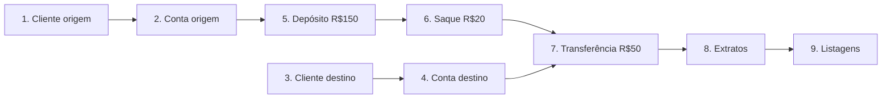

# RKF Bank — Roteiro de testes ponta a ponta (manual)

Roteiro para testar a API inteira na mão, com Postman, Insomnia ou curl. Serve para:

- conferir que tudo funciona antes de abrir um PR que mexe em regra de negócio;
- o **Fellipe** (idealizador, QA e primeiro cliente) validar o MVP;
- quem está chegando entender o fluxo real do banco.

> Rotas e formatos oficiais: [README_CONTRATO_API.md](README_CONTRATO_API.md).
> Este roteiro chama o **backend direto** (`http://localhost:8080`, **sem** `/api`).
> Resultado da última execução completa (38/38 ✅): [CHECKLIST_TESTES_E2E.md](CHECKLIST_TESTES_E2E.md).

**Todas as respostas abaixo são reais e completas**, capturadas executando este roteiro na ordem, num banco vazio,
com Java 25. Ao repetir, só mudam os valores gerados: `id`s (UUID), `dataHora` e `timestamp`.

> 🔒 **Desde o contrato 2.0 a API exige login.** As seções 1 e 2 foram capturadas antes disso e continuam valendo
> com dois ajustes: o cadastro leva `"senha"` e toda chamada fora `POST /clientes` e `POST /auth/login` leva o header
> `Authorization: Bearer <token>`. Como obter o token e os cenários de segurança: [seção 7](#7-login-perfis-e-dados-sensíveis-spring-security--jwt).

---

## 0. Preparação

1. Confira o JDK: `java -version` deve mostrar **25.x** (o Maven recusa outra versão).
2. Suba banco e API (seção "Como rodar" do [backend/README.md](README.md)).
   Sem Docker, dá para rodar com H2 em memória: `./mvnw spring-boot:run -Dspring-boot.run.profiles=test`
   (os dados somem ao parar a API; a seção 5 não se aplica).
   Com o MySQL (perfil padrão), o `.env` precisa ter `JWT_SEGREDO` (seção 7.2), senão a API não sobe. O perfil `test`
   já traz um segredo só para testes.
   As tabelas são criadas pelo **Flyway** na subida da API (migrações `V1`, `V2`... em `src/main/resources/db/migration`);
   no log aparece `Successfully applied N migrations` num banco vazio, ou `Schema ... is up to date` num banco já migrado.
3. Opcional, para começar do zero: `docker compose down -v && docker compose up -d` (**apaga todos os dados**).
   **Obrigatório uma vez** se a API recusar subir com *Found non-empty schema(s) ... but no schema history table*
   (o banco local foi criado pelo Hibernate antes do Flyway).

> **Atalho automático:** com a API no ar, `node scripts/smoke-e2e.mjs` faz uma versão resumida deste roteiro
> (cadastro e login, caminho feliz, `401`/`403` e 5 erros: 29 verificações) em segundos e pode rodar várias vezes no
> mesmo banco. Com `ADMIN_CPF` e `ADMIN_SENHA` no ambiente (os mesmos da API), confere também o admin. O roteiro manual
> continua valendo para o QA e para conferir as respostas completas. Qual teste rodar para cada tipo de mudança:
> ["Mudei algo: quais testes rodar?"](README.md#-mudei-algo-quais-testes-rodar).
4. No Postman/Insomnia, crie um ambiente com estas variáveis e use o header `Content-Type: application/json`:

| Variável | Valor inicial |
|---|---|
| `baseUrl` | `http://localhost:8080` |
| `clienteOrigemId` | (preenchido no passo 1) |
| `contaOrigemId` | (preenchido no passo 2) |
| `clienteDestinoId` | (preenchido no passo 3) |
| `contaDestinoId` | (preenchido no passo 4) |

**CPFs válidos para teste:** `52998224725`, `16899535009`, `39053344705`, `11144477735`.
**CEPs reais:** `01001000` (Praça da Sé – SP), `30140071` (Belo Horizonte – MG).

> Banco já com dados? CPF, e-mail e número de conta são únicos: se algum já existir, o passo devolve `409`.
> Use outro CPF válido (qualquer gerador de CPF serve), outro e-mail e outro `numeroConta` — ou comece do zero (item 3).

---

## 1. Caminho feliz



### Passo 1 — Criar cliente origem

`POST {{baseUrl}}/clientes`

```json
{
  "nomeCompleto": "Joao Silva",
  "cpf": "52998224725",
  "email": "joao.silva@rkfbank.com",
  "telefone": "11999998888",
  "cep": "01001000",
  "numero": "123",
  "complemento": "Apto 45"
}
```

✅ Response — CPF/telefone/CEP voltam formatados e o endereço vem do ViaCEP:

**`201 Created`**

```json
{
  "id": "0118cb9c-7e71-4f02-8fc3-ef513e1b9149",
  "nomeCompleto": "Joao Silva",
  "cpf": "529.982.247-25",
  "email": "joao.silva@rkfbank.com",
  "telefone": "(11) 99999-8888",
  "endereco": {
    "cep": "01001-000",
    "logradouro": "Praça da Sé",
    "bairro": "Sé",
    "cidade": "São Paulo",
    "uf": "SP",
    "ibge": "3550308",
    "numero": "123",
    "complemento": "Apto 45"
  }
}
```

➡️ Salve `id` em `clienteOrigemId`.

### Passo 2 — Abrir conta origem

`POST {{baseUrl}}/contas/clientes/{{clienteOrigemId}}`

```json
{ "agencia": "0001", "numeroConta": "12345678", "tipoContaEnum": "CORRENTE" }
```

✅ Response — `saldo` zerado, conta ativa e `clienteId` igual ao do passo 1:

**`201 Created`**

```json
{
  "id": "0a9a618b-f1a3-41ca-9ef7-a935eecf6b2d",
  "clienteId": "0118cb9c-7e71-4f02-8fc3-ef513e1b9149",
  "agencia": "0001",
  "numeroConta": "12345678",
  "tipoContaEnum": "CORRENTE",
  "saldo": 0.00,
  "ativa": true
}
```

➡️ Salve `id` em `contaOrigemId`.

### Passo 3 — Criar cliente destino

`POST {{baseUrl}}/clientes`

```json
{
  "nomeCompleto": "Maria Souza",
  "cpf": "16899535009",
  "email": "maria.souza@rkfbank.com",
  "telefone": "31999997777",
  "cep": "30140071",
  "numero": "500",
  "complemento": "Sala 10"
}
```

✅ Response:

**`201 Created`**

```json
{
  "id": "d974d93b-b9a7-4f18-bd49-73602380bbcf",
  "nomeCompleto": "Maria Souza",
  "cpf": "168.995.350-09",
  "email": "maria.souza@rkfbank.com",
  "telefone": "(31) 99999-7777",
  "endereco": {
    "cep": "30140-071",
    "logradouro": "Rua dos Aimorés",
    "bairro": "Boa Viagem",
    "cidade": "Belo Horizonte",
    "uf": "MG",
    "ibge": "3106200",
    "numero": "500",
    "complemento": "Sala 10"
  }
}
```

➡️ Salve `id` em `clienteDestinoId`.

### Passo 4 — Abrir conta destino

`POST {{baseUrl}}/contas/clientes/{{clienteDestinoId}}`

```json
{ "agencia": "0001", "numeroConta": "87654321", "tipoContaEnum": "POUPANCA" }
```

✅ Response:

**`201 Created`**

```json
{
  "id": "e8c54972-70ab-4c43-8dda-cd4a15d3944f",
  "clienteId": "d974d93b-b9a7-4f18-bd49-73602380bbcf",
  "agencia": "0001",
  "numeroConta": "87654321",
  "tipoContaEnum": "POUPANCA",
  "saldo": 0.00,
  "ativa": true
}
```

➡️ Salve `id` em `contaDestinoId`.

### Passo 5 — Depositar R$ 150,00 na origem

`POST {{baseUrl}}/contas/{{contaOrigemId}}/deposito`

```json
{ "valor": 150.00, "descricao": "Deposito inicial" }
```

✅ Response: **`204 No Content`** — sem corpo. Saldo da origem: **150.00**.

### Passo 6 — Sacar R$ 20,00 da origem

`POST {{baseUrl}}/contas/{{contaOrigemId}}/saque`

```json
{ "valor": 20.00, "descricao": "Saque teste" }
```

✅ Response: **`204 No Content`** — sem corpo. Saldo da origem: **130.00**.

### Passo 7 — Transferir R$ 50,00 da origem para o destino

`POST {{baseUrl}}/contas/transferencia`

```json
{
  "contaOrigemId": "{{contaOrigemId}}",
  "contaDestinoId": "{{contaDestinoId}}",
  "valor": 50.00,
  "descricao": "Transferencia aluguel"
}
```

✅ Response: **`204 No Content`** — sem corpo. Saldos: origem **80.00**, destino **50.00**.

### Passo 8 — Extratos

`GET {{baseUrl}}/contas/{{contaOrigemId}}/lancamentos`

✅ Response — 3 lançamentos, do mais novo para o mais antigo. Repare nos vínculos: a transferência tem origem e
destino; o saque só tem origem (saída); o depósito só tem destino (entrada):

**`200 OK`**

```json
[
  {
    "id": "8f03630d-c698-40a6-adf8-203732576df6",
    "tipoLancamento": "TRANSFERENCIA",
    "valor": 50.00,
    "contaOrigemId": "0a9a618b-f1a3-41ca-9ef7-a935eecf6b2d",
    "contaDestinoId": "e8c54972-70ab-4c43-8dda-cd4a15d3944f",
    "descricao": "Transferencia aluguel",
    "dataHora": "2026-10-14T01:57:45.263209Z"
  },
  {
    "id": "576c92eb-7c72-40a5-9950-567cb9d3ea56",
    "tipoLancamento": "SAQUE",
    "valor": 20.00,
    "contaOrigemId": "0a9a618b-f1a3-41ca-9ef7-a935eecf6b2d",
    "contaDestinoId": null,
    "descricao": "Saque teste",
    "dataHora": "2026-10-14T01:57:45.247471Z"
  },
  {
    "id": "f4025a27-00a4-4163-a48e-22144cb8915a",
    "tipoLancamento": "DEPOSITO",
    "valor": 150.00,
    "contaOrigemId": null,
    "contaDestinoId": "0a9a618b-f1a3-41ca-9ef7-a935eecf6b2d",
    "descricao": "Deposito inicial",
    "dataHora": "2026-10-14T01:57:45.224409Z"
  }
]
```

`GET {{baseUrl}}/contas/{{contaDestinoId}}/lancamentos`

✅ Response — 1 lançamento, a transferência recebida (`contaDestinoId` é a conta destino):

**`200 OK`**

```json
[
  {
    "id": "8f03630d-c698-40a6-adf8-203732576df6",
    "tipoLancamento": "TRANSFERENCIA",
    "valor": 50.00,
    "contaOrigemId": "0a9a618b-f1a3-41ca-9ef7-a935eecf6b2d",
    "contaDestinoId": "e8c54972-70ab-4c43-8dda-cd4a15d3944f",
    "descricao": "Transferencia aluguel",
    "dataHora": "2026-10-14T01:57:45.263209Z"
  }
]
```

### Passo 9 — Listagens

`GET {{baseUrl}}/clientes` (o mesmo que `?paginado=false`)

✅ Response — array com os 2 clientes:

**`200 OK`**

```json
[
  {
    "id": "0118cb9c-7e71-4f02-8fc3-ef513e1b9149",
    "nomeCompleto": "Joao Silva",
    "cpf": "529.982.247-25",
    "email": "joao.silva@rkfbank.com",
    "telefone": "(11) 99999-8888",
    "endereco": {
      "cep": "01001-000",
      "logradouro": "Praça da Sé",
      "bairro": "Sé",
      "cidade": "São Paulo",
      "uf": "SP",
      "ibge": "3550308",
      "numero": "123",
      "complemento": "Apto 45"
    }
  },
  {
    "id": "d974d93b-b9a7-4f18-bd49-73602380bbcf",
    "nomeCompleto": "Maria Souza",
    "cpf": "168.995.350-09",
    "email": "maria.souza@rkfbank.com",
    "telefone": "(31) 99999-7777",
    "endereco": {
      "cep": "30140-071",
      "logradouro": "Rua dos Aimorés",
      "bairro": "Boa Viagem",
      "cidade": "Belo Horizonte",
      "uf": "MG",
      "ibge": "3106200",
      "numero": "500",
      "complemento": "Sala 10"
    }
  }
]
```

`GET {{baseUrl}}/clientes?paginado=true&page=0&size=1`

✅ Response — página com 1 item, `totalElements: 2`, `totalPages: 2`:

**`200 OK`**

```json
{
  "content": [
    {
      "id": "0118cb9c-7e71-4f02-8fc3-ef513e1b9149",
      "nomeCompleto": "Joao Silva",
      "cpf": "529.982.247-25",
      "email": "joao.silva@rkfbank.com",
      "telefone": "(11) 99999-8888",
      "endereco": {
        "cep": "01001-000",
        "logradouro": "Praça da Sé",
        "bairro": "Sé",
        "cidade": "São Paulo",
        "uf": "SP",
        "ibge": "3550308",
        "numero": "123",
        "complemento": "Apto 45"
      }
    }
  ],
  "empty": false,
  "first": true,
  "last": false,
  "number": 0,
  "numberOfElements": 1,
  "pageable": {
    "offset": 0,
    "pageNumber": 0,
    "pageSize": 1,
    "paged": true,
    "sort": {
      "empty": true,
      "sorted": false,
      "unsorted": true
    },
    "unpaged": false
  },
  "size": 1,
  "sort": {
    "empty": true,
    "sorted": false,
    "unsorted": true
  },
  "totalElements": 2,
  "totalPages": 2
}
```

`GET {{baseUrl}}/contas` (o mesmo que `?paginado=false`)

✅ Response — array com as 2 contas (origem com `saldo: 80.00`, destino com `50.00`):

**`200 OK`**

```json
[
  {
    "id": "0a9a618b-f1a3-41ca-9ef7-a935eecf6b2d",
    "clienteId": "0118cb9c-7e71-4f02-8fc3-ef513e1b9149",
    "agencia": "0001",
    "numeroConta": "12345678",
    "tipoContaEnum": "CORRENTE",
    "saldo": 80.00,
    "ativa": true
  },
  {
    "id": "e8c54972-70ab-4c43-8dda-cd4a15d3944f",
    "clienteId": "d974d93b-b9a7-4f18-bd49-73602380bbcf",
    "agencia": "0001",
    "numeroConta": "87654321",
    "tipoContaEnum": "POUPANCA",
    "saldo": 50.00,
    "ativa": true
  }
]
```

`GET {{baseUrl}}/contas?paginado=true&page=0&size=10`

✅ Response — página com as 2 contas:

**`200 OK`**

```json
{
  "content": [
    {
      "id": "0a9a618b-f1a3-41ca-9ef7-a935eecf6b2d",
      "clienteId": "0118cb9c-7e71-4f02-8fc3-ef513e1b9149",
      "agencia": "0001",
      "numeroConta": "12345678",
      "tipoContaEnum": "CORRENTE",
      "saldo": 80.00,
      "ativa": true
    },
    {
      "id": "e8c54972-70ab-4c43-8dda-cd4a15d3944f",
      "clienteId": "d974d93b-b9a7-4f18-bd49-73602380bbcf",
      "agencia": "0001",
      "numeroConta": "87654321",
      "tipoContaEnum": "POUPANCA",
      "saldo": 50.00,
      "ativa": true
    }
  ],
  "empty": false,
  "first": true,
  "last": true,
  "number": 0,
  "numberOfElements": 2,
  "pageable": {
    "offset": 0,
    "pageNumber": 0,
    "pageSize": 10,
    "paged": true,
    "sort": {
      "empty": true,
      "sorted": false,
      "unsorted": true
    },
    "unpaged": false
  },
  "size": 10,
  "sort": {
    "empty": true,
    "sorted": false,
    "unsorted": true
  },
  "totalElements": 2,
  "totalPages": 1
}
```

---

## 2. Cenários de erro

Rode depois do caminho feliz (alguns dependem dos dados criados). Todo erro devolve o mesmo formato
(`timestamp`, `status`, `error`, `message`, `path`, `campos`) — ver [contrato, seção 6](README_CONTRATO_API.md#6-erros).

| # | Cenário | Esperado |
|---|---|---|
| E1 | CPF inválido | `400`, `campos[0].campo = "cpf"` |
| E2 | Campo obrigatório vazio | `400`, campo `nomeCompleto` |
| E3 | CPF repetido | `409` `CPF ja cadastrado` |
| E4 | E-mail repetido | `409` `Email ja cadastrado` |
| E5 | CEP inexistente | `422` `CEP não encontrado` |
| E6 | Cliente inexistente | `404` `Cliente não encontrado` |
| E7 | Número de conta repetido | `409` `Numero de conta ja existe` |
| E8 | Agência inválida | `400`, campo `agencia` |
| E9 | Tipo de conta inválido | `400` `JSON invalido ou tipo de campo incompativel` |
| E10 | Valor zero | `400`, campo `valor` |
| E11 | Três casas decimais | `400`, campo `valor` |
| E12 | Saldo insuficiente (saque) | `422` `Saldo insuficiente` |
| E13 | Saldo insuficiente (transferência) | `422` `Saldo insuficiente para transferencia` |
| E14 | Mesma conta | `422` `Conta de origem e destino nao podem ser iguais` |
| E15 | Conta inexistente | `404` `Conta nao encontrada` |
| E16 | ID inválido na URL | `400` `Parametro de URL invalido` |
| E17 | Paginação inválida | `400`, campo `size` |
| E18 | JSON quebrado | `400` `JSON invalido ou tipo de campo incompativel` |

Nenhum desses erros altera saldo: no fim, a origem continua com **80.00**.

### E1 — CPF inválido

`POST {{baseUrl}}/clientes`

```json
{
  "nomeCompleto": "Pedro Lima",
  "cpf": "11111111111",
  "email": "pedro.lima@rkfbank.com",
  "telefone": "11988887777",
  "cep": "01001000",
  "numero": "10"
}
```

**`400 Bad Request`**

```json
{
  "timestamp": "2026-10-14T01:57:45.366270600Z",
  "status": 400,
  "error": "Bad Request",
  "message": "Requisicao invalida",
  "path": "/clientes",
  "campos": [
    {
      "campo": "cpf",
      "mensagem": "cpf inválido"
    }
  ]
}
```

### E2 — Campo obrigatório vazio

`POST {{baseUrl}}/clientes` — mesmo corpo do E1, com CPF válido e nome vazio:

```json
{
  "nomeCompleto": "",
  "cpf": "39053344705",
  "email": "pedro.lima@rkfbank.com",
  "telefone": "11988887777",
  "cep": "01001000",
  "numero": "10"
}
```

**`400 Bad Request`**

```json
{
  "timestamp": "2026-10-14T01:57:45.376268400Z",
  "status": 400,
  "error": "Bad Request",
  "message": "Requisicao invalida",
  "path": "/clientes",
  "campos": [
    {
      "campo": "nomeCompleto",
      "mensagem": "nomeCompleto e obrigatório"
    }
  ]
}
```

### E3 — CPF repetido

`POST {{baseUrl}}/clientes` — repita o corpo do passo 1.

**`409 Conflict`**

```json
{
  "timestamp": "2026-10-14T01:57:45.384984800Z",
  "status": 409,
  "error": "Conflict",
  "message": "CPF ja cadastrado",
  "path": "/clientes",
  "campos": []
}
```

### E4 — E-mail repetido

`POST {{baseUrl}}/clientes` — CPF novo, e-mail do passo 1:

```json
{
  "nomeCompleto": "Pedro Lima",
  "cpf": "39053344705",
  "email": "joao.silva@rkfbank.com",
  "telefone": "11988887777",
  "cep": "01001000",
  "numero": "10"
}
```

**`409 Conflict`**

```json
{
  "timestamp": "2026-10-14T01:57:45.396567200Z",
  "status": 409,
  "error": "Conflict",
  "message": "Email ja cadastrado",
  "path": "/clientes",
  "campos": []
}
```

### E5 — CEP inexistente

`POST {{baseUrl}}/clientes` — CPF e e-mail novos, CEP que não existe:

```json
{
  "nomeCompleto": "Pedro Lima",
  "cpf": "39053344705",
  "email": "pedro.lima@rkfbank.com",
  "telefone": "11988887777",
  "cep": "99999999",
  "numero": "10"
}
```

**`422 Unprocessable Entity`**

```json
{
  "timestamp": "2026-10-14T01:57:45.555185300Z",
  "status": 422,
  "error": "Unprocessable Entity",
  "message": "CEP não encontrado",
  "path": "/clientes",
  "campos": []
}
```

### E6 — Cliente inexistente

`POST {{baseUrl}}/contas/clientes/00000000-0000-0000-0000-000000000000`

```json
{ "agencia": "0001", "numeroConta": "11112222", "tipoContaEnum": "CORRENTE" }
```

**`404 Not Found`**

```json
{
  "timestamp": "2026-10-14T01:57:45.561189100Z",
  "status": 404,
  "error": "Not Found",
  "message": "Cliente não encontrado",
  "path": "/contas/clientes/00000000-0000-0000-0000-000000000000",
  "campos": []
}
```

### E7 — Número de conta repetido

`POST {{baseUrl}}/contas/clientes/{{clienteOrigemId}}` — repita o corpo do passo 2.

**`409 Conflict`**

```json
{
  "timestamp": "2026-10-14T01:57:45.567751Z",
  "status": 409,
  "error": "Conflict",
  "message": "Numero de conta ja existe",
  "path": "/contas/clientes/0118cb9c-7e71-4f02-8fc3-ef513e1b9149",
  "campos": []
}
```

### E8 — Agência inválida

`POST {{baseUrl}}/contas/clientes/{{clienteOrigemId}}`

```json
{ "agencia": "1", "numeroConta": "11112222", "tipoContaEnum": "CORRENTE" }
```

**`400 Bad Request`**

```json
{
  "timestamp": "2026-10-14T01:57:45.572761Z",
  "status": 400,
  "error": "Bad Request",
  "message": "Requisicao invalida",
  "path": "/contas/clientes/0118cb9c-7e71-4f02-8fc3-ef513e1b9149",
  "campos": [
    {
      "campo": "agencia",
      "mensagem": "agencia deve ter 4 digitos"
    }
  ]
}
```

### E9 — Tipo de conta inválido

`POST {{baseUrl}}/contas/clientes/{{clienteOrigemId}}`

```json
{ "agencia": "0001", "numeroConta": "11112222", "tipoContaEnum": "SALARIO" }
```

**`400 Bad Request`**

```json
{
  "timestamp": "2026-10-14T01:57:45.576761900Z",
  "status": 400,
  "error": "Bad Request",
  "message": "JSON invalido ou tipo de campo incompativel",
  "path": "/contas/clientes/0118cb9c-7e71-4f02-8fc3-ef513e1b9149",
  "campos": []
}
```

### E10 — Valor zero

`POST {{baseUrl}}/contas/{{contaOrigemId}}/deposito`

```json
{ "valor": 0 }
```

**`400 Bad Request`**

```json
{
  "timestamp": "2026-10-14T01:57:45.581994400Z",
  "status": 400,
  "error": "Bad Request",
  "message": "Requisicao invalida",
  "path": "/contas/0a9a618b-f1a3-41ca-9ef7-a935eecf6b2d/deposito",
  "campos": [
    {
      "campo": "valor",
      "mensagem": "valor deve ser maior que zero"
    }
  ]
}
```

### E11 — Três casas decimais

`POST {{baseUrl}}/contas/{{contaOrigemId}}/deposito`

```json
{ "valor": 10.555 }
```

**`400 Bad Request`**

```json
{
  "timestamp": "2026-10-14T01:57:45.588995600Z",
  "status": 400,
  "error": "Bad Request",
  "message": "Requisicao invalida",
  "path": "/contas/0a9a618b-f1a3-41ca-9ef7-a935eecf6b2d/deposito",
  "campos": [
    {
      "campo": "valor",
      "mensagem": "valor deve ter no maximo 2 casas decimais"
    }
  ]
}
```

### E12 — Saldo insuficiente (saque)

`POST {{baseUrl}}/contas/{{contaOrigemId}}/saque`

```json
{ "valor": 999999.00 }
```

**`422 Unprocessable Entity`**

```json
{
  "timestamp": "2026-10-14T01:57:45.595615100Z",
  "status": 422,
  "error": "Unprocessable Entity",
  "message": "Saldo insuficiente",
  "path": "/contas/0a9a618b-f1a3-41ca-9ef7-a935eecf6b2d/saque",
  "campos": []
}
```

### E13 — Saldo insuficiente (transferência)

`POST {{baseUrl}}/contas/transferencia`

```json
{
  "contaOrigemId": "{{contaOrigemId}}",
  "contaDestinoId": "{{contaDestinoId}}",
  "valor": 999999.00
}
```

**`422 Unprocessable Entity`**

```json
{
  "timestamp": "2026-10-14T01:57:45.603542700Z",
  "status": 422,
  "error": "Unprocessable Entity",
  "message": "Saldo insuficiente para transferencia",
  "path": "/contas/transferencia",
  "campos": []
}
```

### E14 — Transferência para a mesma conta

`POST {{baseUrl}}/contas/transferencia`

```json
{
  "contaOrigemId": "{{contaOrigemId}}",
  "contaDestinoId": "{{contaOrigemId}}",
  "valor": 10.00
}
```

**`422 Unprocessable Entity`**

```json
{
  "timestamp": "2026-10-14T01:57:45.607062800Z",
  "status": 422,
  "error": "Unprocessable Entity",
  "message": "Conta de origem e destino nao podem ser iguais",
  "path": "/contas/transferencia",
  "campos": []
}
```

### E15 — Conta inexistente

`POST {{baseUrl}}/contas/00000000-0000-0000-0000-000000000000/deposito`

```json
{ "valor": 10.00 }
```

**`404 Not Found`**

```json
{
  "timestamp": "2026-10-14T01:57:45.612382600Z",
  "status": 404,
  "error": "Not Found",
  "message": "Conta nao encontrada",
  "path": "/contas/00000000-0000-0000-0000-000000000000/deposito",
  "campos": []
}
```

### E16 — ID inválido na URL

`GET {{baseUrl}}/contas/abc/lancamentos`

**`400 Bad Request`**

```json
{
  "timestamp": "2026-10-14T01:57:45.616381700Z",
  "status": 400,
  "error": "Bad Request",
  "message": "Parametro de URL invalido",
  "path": "/contas/abc/lancamentos",
  "campos": [
    {
      "campo": "contaId",
      "mensagem": "Tipo invalido para o parametro contaId"
    }
  ]
}
```

### E17 — Paginação inválida

`GET {{baseUrl}}/clientes?paginado=true&size=0`

**`400 Bad Request`**

```json
{
  "timestamp": "2026-10-14T01:57:45.620383800Z",
  "status": 400,
  "error": "Bad Request",
  "message": "Requisicao invalida",
  "path": "/clientes",
  "campos": [
    {
      "campo": "size",
      "mensagem": "deve estar entre 1 e 100"
    }
  ]
}
```

### E18 — JSON quebrado

`POST {{baseUrl}}/contas/{{contaOrigemId}}/deposito` com o corpo (propositalmente incompleto):

```text
{ "valor": 
```

**`400 Bad Request`**

```json
{
  "timestamp": "2026-10-14T01:57:45.626459800Z",
  "status": 400,
  "error": "Bad Request",
  "message": "JSON invalido ou tipo de campo incompativel",
  "path": "/contas/0a9a618b-f1a3-41ca-9ef7-a935eecf6b2d/deposito",
  "campos": []
}
```

---

## 3. Mesmo fluxo via curl (Git Bash)

```bash
API=http://localhost:8080
H='Content-Type: application/json'

CLIENTE_ID=$(curl -s -X POST $API/clientes -H "$H" -d '{
  "nomeCompleto":"Joao Silva","cpf":"39053344705","email":"joao.curl@rkfbank.com",
  "telefone":"11999998888","cep":"01001000","numero":"123","senha":"senha-curl-123"}' | sed -E 's/.*"id":"([^"]+)".*/\1/')

# Login: guarda o token e manda em toda chamada protegida
TOKEN=$(curl -s -X POST $API/auth/login -H "$H" -d '{"cpf":"39053344705","senha":"senha-curl-123"}' \
  | sed -E 's/.*"token":"([^"]+)".*/\1/')
AUTH="Authorization: Bearer $TOKEN"

CONTA_ID=$(curl -s -X POST $API/contas/clientes/$CLIENTE_ID -H "$H" -H "$AUTH" \
  -d '{"agencia":"0001","numeroConta":"55555555","tipoContaEnum":"CORRENTE"}' | sed -E 's/.*"id":"([^"]+)".*/\1/')

curl -i -X POST $API/contas/$CONTA_ID/deposito -H "$H" -H "$AUTH" -d '{"valor":150.00}'
curl -i -X POST $API/contas/$CONTA_ID/saque    -H "$H" -H "$AUTH" -d '{"valor":20.00}'
curl -s $API/contas/$CONTA_ID/lancamentos -H "$AUTH"

# Sem o header → 401
curl -s $API/contas/$CONTA_ID/lancamentos
```

> O `sed` extrai o campo da resposta. Com `jq` instalado, prefira `| jq -r .id` e `| jq -r .token`.
> O token vale 15 min: passou disso, rode o login de novo. Nunca cole um token real em issue, recado ou chat.

---

## 4. Acompanhando pelos logs

Cada requisição recebe um id, devolvido no header `X-Request-Id` da resposta e impresso entre colchetes em
**todas** as linhas de log daquela chamada (inclusive o SQL do Hibernate). Para achar uma chamada específica no
console, envie o seu próprio id (letras, números e `-`, até 64 caracteres):

```bash
curl -i -X POST $API/contas/transferencia -H "$H" -H "X-Request-Id: e2e-transf-001" -d '{ ... }'
```

```text
INFO  [http-nio-8080-exec-1] [e2e-transf-001] c.b.r.s.ContaService : Transferencia de 50.00 da conta 672e4ddf-... para 83af15fb-...
INFO  [http-nio-8080-exec-1] [e2e-transf-001] c.b.r.c.FiltroLogRequisicao : POST /contas/transferencia -> 204 (15 ms)
```

O que conferir durante o roteiro:

- toda chamada gera uma linha `FiltroLogRequisicao` com método, rota, status e duração;
- operações concluídas (cadastro, abertura, depósito, saque, transferência) aparecem em `INFO`;
- recusas de regra de negócio (E3–E7, E12–E15) e erros de entrada (E1, E2, E8–E11, E16–E18) aparecem em `WARN`;
- **CPF e e-mail nunca aparecem no log.** Senha, hash e token JWT também não (seção 7.6).

Configuração: [log4j2-spring.xml](src/main/resources/log4j2-spring.xml).

---

## 5. Conferindo no banco

Depois do caminho feliz, rode as consultas da seção **Banco de dados** do [backend/README.md](README.md)
e confira: 2 clientes, 2 endereços, 2 contas (80.00 e 50.00) e 4 lançamentos.

---

## 6. Checklist de validação do MVP (QA)

O checklist detalhado, item a item, com o resultado da última execução fica em
[CHECKLIST_TESTES_E2E.md](CHECKLIST_TESTES_E2E.md). Ao retestar, atualize a data e os resultados lá.
Resumo para a validação do MVP:

| ✔ | Item |
|:---:|---|
| ☐ | Passos 1 a 9 do caminho feliz com o resultado esperado |
| ☐ | Cenários E1 a E18 com o status esperado |
| ☐ | Saldos finais batem (origem 80.00, destino 50.00) |
| ☐ | Logs com `X-Request-Id` em cada linha e sem CPF/e-mail (seção 4) |
| ☐ | Mensagens de erro fazem sentido para um usuário final |
| ☐ | Cadastro pela tela (`http://localhost:3000/cadastro`) com sucesso e com erro de CPF repetido |

---

## 7. Login, perfis e dados sensíveis (Spring Security + JWT)

> ✅ **Implementado** na feature 2 (branch `feature/spring-security-jwt`, contrato 2.0). Decisões em
> [planing/decisoes.md](../planing/decisoes.md) → "Login com CPF + senha e JWT": login por CPF + senha, JWT HS256
> validado pelo OAuth2 Resource Server do Spring, `GET /clientes` só para `ADMIN`, admin inicial pelo `.env`.
> Os mesmos cenários rodam automaticamente em `SegurancaIntegracaoTest` e no `scripts/smoke-e2e.mjs`.

### 7.1 O que muda para quem testa

| Antes | Depois |
|---|---|
| Qualquer chamada funciona sem identificação | Só `POST /clientes` (cadastro) e `POST /auth/login` são públicas |
| Cadastro sem senha | Cadastro exige `senha` (8 a 72 caracteres); ela **nunca** volta no response |
| Qualquer um movimenta qualquer conta | Depósito, saque, transferência, extrato e abertura de conta só nas contas **do dono do token** |
| `GET /clientes` aberto | Só perfil `ADMIN` |
| `GET /contas` lista todas | `CLIENTE` vê só as suas; `ADMIN` vê todas |

Toda rota protegida recebe o header:

```
Authorization: Bearer <token>
```

No Postman/Insomnia, acrescente ao ambiente da seção 0:

| Variável | Valor inicial |
|---|---|
| `tokenCliente` | (preenchido no passo 7.3) |
| `tokenAdmin` | (preenchido no passo 7.4) |

E use **Auth → Bearer Token → `{{tokenCliente}}`** na coleção (ou `{{tokenAdmin}}` só nas chamadas de admin).

### 7.2 Configurar o segredo do JWT (uma vez por máquina)

O token é assinado com um segredo que fica **só no `.env`**, nunca no código nem no Git.

```bash
# gera 32 bytes aleatórios em Base64 (Git Bash)
openssl rand -base64 32
```

Coloque no `.env` (o `.env.example` traz as chaves com valores de exemplo):

```
JWT_SEGREDO=<valor gerado>
JWT_EXPIRACAO=15m
```

Depois carregue o `.env` no terminal antes do `./mvnw spring-boot:run`, como as variáveis do banco.
- Sem `JWT_SEGREDO`, ou com menos de 32 bytes, a API **não sobe** e diz por quê (de propósito: chave fraca é pior que nenhuma).
- `JWT_EXPIRACAO` é opcional (padrão `15m`); aceita `30s`, `15m`, `1h`...
- ⚠️ Trocou o `JWT_SEGREDO`? Todos os tokens emitidos antes deixam de valer (`401`). Basta fazer login de novo.

### 7.3 Cadastrar e logar um usuário comum (perfil `CLIENTE`)

Todo cadastro pela API nasce com perfil **`CLIENTE`**. Não existe campo para escolher o perfil: se existisse,
qualquer pessoa se cadastraria como admin.

**1. Cadastro:** `POST {{baseUrl}}/clientes` (o mesmo JSON do passo 1, com `senha`)

```json
{
  "nomeCompleto": "Joao Silva",
  "cpf": "52998224725",
  "email": "joao.silva@rkfbank.com",
  "telefone": "11999998888",
  "cep": "01001000",
  "numero": "123",
  "complemento": "Apto 45",
  "senha": "Senha@Forte123"
}
```

✅ `201 Created` com o mesmo corpo do passo 1. **Confira que não existe campo `senha` na resposta.**

**2. Login:** `POST {{baseUrl}}/auth/login`

```json
{ "cpf": "52998224725", "senha": "Senha@Forte123" }
```

✅ `200 OK`

```json
{
  "token": "eyJhbGciOiJIUzI1NiJ9.eyJpc3MiOiJya2ZiYW5rIiwic3ViIjoiNDhmNTQyMTktLi4uIiwicGVyZmlsIjoiQ0xJRU5URSIsImNsaWVudGVJZCI6IjAxMThjYjljLS4uLiIsImV4cCI6MTc2MDYxNTAwMH0.<assinatura>",
  "tipo": "Bearer",
  "expiraEmSegundos": 900,
  "clienteId": "0118cb9c-7e71-4f02-8fc3-ef513e1b9149",
  "perfil": "CLIENTE"
}
```

➡️ Salve `token` em `tokenCliente`. `expiraEmSegundos` = 900 (15 min). O `clienteId` é o mesmo `id` do cadastro e é o
que vai em `POST /contas/clientes/{clienteId}`.

> 💡 **Salvar o token sozinho:** na aba **Scripts → Post-response** (Postman) da requisição de login, cole
> `pm.environment.set("tokenCliente", pm.response.json().token);` (na de admin, troque para `tokenAdmin`).
> Token expirou (`401` no meio do roteiro)? É só rodar o login de novo; não precisa cadastrar outra vez.

**3. Usar o token:** a partir daqui os passos 2 a 8 da seção 1 rodam iguais, só que com o header
`Authorization: Bearer {{tokenCliente}}`. Para a transferência do passo 7, o **destino** pode ser de outro
cliente (é assim num banco de verdade). Só a **origem** precisa ser do dono do token.

> 💡 Quer ver o que tem dentro do token? Cole em [jwt.io](https://jwt.io) (só tokens de teste!). O payload
> **não é criptografado**, só assinado: qualquer um lê. Por isso o token leva só `iss` (`rkfbank`), `sub` (id do
> usuário), `perfil`, `clienteId`, `iat` e `exp`; nunca CPF, e-mail ou senha.

### 7.4 Cadastrar um administrador (perfil `ADMIN`)

Não existe rota para criar admin, de propósito. O primeiro admin nasce **na subida da API**, a partir de duas
variáveis do `.env` (como o Keycloak faz). Assim nenhuma senha de admin fica escrita no código, numa migração ou no Git.

**Por que assim, e não de outro jeito:**

| Alternativa | Por que foi descartada |
|---|---|
| Campo `perfil` no `POST /clientes` | Rota pública: qualquer pessoa mandaria `"perfil": "ADMIN"` (*escalada de privilégio*) |
| Rota `POST /admin/usuarios` | Precisa de um admin para criar o primeiro admin (problema do ovo e da galinha) e é mais uma superfície de ataque |
| Admin criado numa migração Flyway (`INSERT` com hash) | O hash vai para o Git e o **mesmo** admin com a **mesma** senha existiria em todo ambiente, inclusive produção |
| ✅ Admin inicial por variável de ambiente (`ADMIN_CPF`/`ADMIN_SENHA`) | **Escolhida**: cada ambiente tem o seu, a senha só existe no `.env` e no banco vai só o hash |

**1. Configure no `.env`** (CPF que **não** seja de cliente cadastrado; o admin não é cliente e não tem contas):

```
ADMIN_CPF=16899535009
ADMIN_SENHA=<senha só de teste>
```

**2. Suba (ou reinicie) a API.** No log aparece uma vez:

```text
INFO  ... c.b.r.s.UsuarioService : Usuario admin 273a6fdf-... criado a partir do .env
```

Nas subidas seguintes: `Usuario admin ja existe; nada a fazer`. Regras:
- Sem as duas variáveis: `ADMIN_CPF/ADMIN_SENHA nao definidos; nenhum admin criado` (a API sobe normal).
- `ADMIN_CPF` já é de um cliente: o admin **não** é criado (`WARN`); um cliente nunca é promovido em silêncio.
- Trocar `ADMIN_SENHA` depois **não** muda a senha do admin que já existe (a variável só vale na criação).

**3. Faça login** (`POST /auth/login` com `ADMIN_CPF`/`ADMIN_SENHA`) e salve em `tokenAdmin`. A resposta vem com
`"perfil": "ADMIN"` e `"clienteId": null`.

O `ADMIN` lista clientes e todas as contas, mas **não** movimenta, não vê extrato e não abre conta de ninguém (`403`).

**Alternativa: promover um cliente no banco.** Também funciona (o perfil é lido de `tb_usuario`), útil para testar
um admin que também é cliente:

MySQL (Docker), no Git Bash com o `.env` carregado:

```bash
docker exec -i rkfbank-mysql mysql -u"$MYSQL_USER" -p"$MYSQL_PASSWORD" "$MYSQL_DATABASE" -e "
  UPDATE tb_usuario SET perfil = 'ADMIN'
  WHERE cliente_id = (SELECT id FROM tb_cliente WHERE cpf = '16899535009');"
```

H2 (perfil `test`): o console `http://localhost:8080/h2-console` fica **bloqueado** pelo Spring Security (`401`).
Para ter um admin no H2, use `ADMIN_CPF`/`ADMIN_SENHA` (passos 1 a 3) em vez do `UPDATE`.

Conferir que a promoção pegou:

```sql
SELECT c.cpf, u.perfil FROM tb_usuario u JOIN tb_cliente c ON c.id = u.cliente_id;
```

Depois da promoção, **faça login de novo** e salve em `tokenAdmin`.

⚠️ **Pegadinha:** o perfil vai **dentro** do token no momento do login. Um token emitido antes da promoção continua
dizendo `CLIENTE` até expirar. Promoveu ou rebaixou alguém? Novo login.

**Rebaixar** um admin: o mesmo `UPDATE` com `perfil = 'CLIENTE'`.

> Simplificação do MVP: num banco real, o funcionário do *back-office* (área interna) tem login corporativo com
> 2 fatores, e cada ação dele vai para uma trilha de auditoria. Aqui o admin é só CPF + senha. 2 fatores e auditoria
> estão na lista de ideias futuras de [débitos técnicos](../planing/debitos-tecnicos.md).

### 7.5 Lidando com os dados de cada perfil

| Dado | Onde fica | Quem vê | Cuidado |
|---|---|---|---|
| Senha | `tb_usuario.senha_hash`, em **BCrypt** (`$2a$10$...`) | ninguém, nem o admin | Nunca volta em response nem aparece em log. Esqueceu? Não há como "ler" a senha: só redefinir (fora do MVP) |
| CPF, e-mail, telefone, endereço | `tb_cliente` / `tb_endereco` | o próprio cliente; o `ADMIN` via `GET /clientes` | São dados pessoais (LGPD): não cole em issue, print ou recado |
| Perfil (`CLIENTE`/`ADMIN`) | `tb_usuario.perfil` e dentro do token | quem tem o token | Admin nasce pelo `.env`; fora isso só muda pelo banco (7.4) |
| Token JWT | só com quem fez login (header `Authorization`) | quem tem o token age como o dono | É uma credencial: não logar, não commitar, não mandar em chat. Vale até expirar (15 min) |
| `JWT_SEGREDO` | `.env` de cada máquina | ninguém além do servidor | Quem tem o segredo emite token de qualquer um. Vazou? Troque no `.env` e reinicie: todos os tokens caem |
| `ADMIN_SENHA` | `.env` (e o hash em `tb_usuario`) | ninguém além de quem administra o ambiente | Senha só de teste; nunca a mesma em dois ambientes |

Conferindo no banco que a senha **não** está em texto puro:

```sql
SELECT c.cpf, u.perfil, u.senha_hash
FROM tb_usuario u JOIN tb_cliente c ON c.id = u.cliente_id;
-- senha_hash deve começar com $2a$ (ou $2b$) e ter 60 caracteres; nunca a senha digitada
```

Dois clientes com a **mesma** senha têm hashes **diferentes**: é o *salt* (um valor aleatório guardado dentro do
próprio hash). Se der igual, a senha não está passando pelo BCrypt.

**Boas práticas com os dados de teste:**
- Use só os CPFs de teste da seção 0 ou de um gerador; **nunca** CPF, e-mail ou telefone de pessoa real.
- Senha de teste é só de teste: não reaproveite uma senha sua.
- Esqueceu a senha de um usuário de teste? Não dá para recuperar (o hash é de mão única). Cadastre outro CPF ou
  comece do zero (seção 0, item 3: `docker compose down -v` apaga usuários, clientes e contas juntos).

### 7.6 Cenários de erro de segurança

| # | Cenário | Como provocar | Esperado |
|---|---|---|---|
| E19 | Cadastro sem senha | passo 7.3.1 sem o campo `senha` | `400`, campo `senha` |
| E20 | Senha curta | `"senha": "123"` | `400`, campo `senha` |
| E20b | Senha acima de 72 bytes | 40 vezes `ç` (cabe nos 72 caracteres, mas ocupa 80 bytes). Pelo Postman; no curl do Git Bash mande o corpo por arquivo (`--data-binary @corpo.json`): acento direto no `-d` chega quebrado e vira `JSON invalido` | `400`, campo `senha`: `senha deve ter no maximo 72 bytes` |
| E21 | Senha errada | login com senha diferente | `401` `CPF ou senha invalidos` |
| E22 | CPF não cadastrado | login com `11144477735` sem cadastro | `401` com a **mesma** mensagem do E21 |
| E23 | Sem token | `GET /contas` sem o header `Authorization` | `401` `Autenticacao necessaria: envie o token no header Authorization (Bearer)` |
| E24 | Token adulterado | troque 1 letra no meio do `token` | `401` `Token invalido ou expirado; faca login novamente` |
| E25 | Token expirado | `JWT_EXPIRACAO=1m`, reinicie, faça login e espere **2 min** (o Spring tolera 60 s de diferença de relógio) | `401` (mesma mensagem do E24) |
| E26 | Conta de outro cliente | depósito, saque, extrato ou transferência saindo de uma conta de outro CPF | `403` `Conta nao pertence ao usuario logado` |
| E27 | Abrir conta para outro cliente | `POST /contas/clientes/{id de outro cliente}` | `403` `Voce so pode abrir conta no seu proprio cadastro` |
| E28 | Cliente comum lista clientes | `GET /clientes` com `tokenCliente` | `403` `Acesso negado para o seu perfil` |
| E29 | Admin lista clientes | `GET /clientes` com `tokenAdmin` | `200` com todos |

Por que E21 e E22 têm a **mesma** mensagem: se a API dissesse "CPF não cadastrado", qualquer um descobriria quem
é cliente do banco testando CPFs (*enumeração de usuários*).

**`401` × `403`:** `401 Unauthorized` = "não sei quem você é" (sem token, token inválido ou expirado).
`403 Forbidden` = "sei quem você é, mas você não pode fazer isso" (conta de outro, rota de admin).
Os dois saem no mesmo formato de erro da seção 2.

Nos logs (seção 4), confira que **não aparecem** senha, token nem `JWT_SEGREDO`, e que as recusas `401`/`403`
saem em `WARN` com o `X-Request-Id`:

```text
WARN  ... [smoke-e2e-123456] c.b.r.c.RespostaErroSeguranca : 401 em /contas: InsufficientAuthenticationException
WARN  ... [smoke-e2e-654321] c.b.r.s.ContaService : Operacao recusada: usuario 6f93a7b0-... nao e dono da conta 2d1e...
```

Prova automática: depois de `scripts/validar.sh backend`, `grep -c eyJ .validar/backend.log` deve dar `0`
(todo JWT começa com `eyJ`).

### 7.7 Testar sozinho, do zero (passo a passo)

Roteiro para conferir a feature inteira sem ajuda, em ~15 minutos. Cada passo diz o que você deve ver; se não vir,
pare ali. Comandos no **Git Bash**, na raiz do repositório.

**Passo 0. Pré-requisitos (uma vez)**

| O quê | Como conferir |
|---|---|
| JDK 25 | `java -version` → `25.x` |
| Docker Desktop aberto | `docker info` responde sem erro |
| `.env` com `JWT_SEGREDO` (e, opcional, `ADMIN_CPF`/`ADMIN_SENHA`) | `cut -d= -f1 .env` lista as chaves (nunca dê `cat .env` em tela compartilhada) |

Sem `JWT_SEGREDO`: `echo "JWT_SEGREDO=$(openssl rand -base64 48)" >> .env`.

**Passo 1. Testes automáticos no H2 (rápido, sem Docker)**

```bash
scripts/validar.sh backend
```

✅ `Tests run: 163, Failures: 0` (ou mais, se alguém acrescentou testes) e `BUILD SUCCESS`.

**Passo 2. Banco limpo** (⚠️ **apaga o MySQL local**)

```bash
./run-test.sh
```

✅ `MySQL healthy!` e de novo `Tests run: ..., Failures: 0`. Os testes aqui **ainda rodam no H2**: o script
só garante um MySQL vazio para os próximos passos.

**Passo 3. Testes de integração no MySQL real** (não apaga nada)

```bash
scripts/testar-no-mysql.sh
```

✅ Precisa aparecer `Database dialect: MySQLDialect` e `(MySQL 8.4)`. É a prova de que o teste rodou no MySQL, não no H2.

**Passo 4. Subir a API de verdade** (deixe este terminal aberto)

```bash
set -a && source <(tr -d '\r' < .env) && set +a
./mvnw spring-boot:run
```

✅ No log: `Successfully applied 3 migrations ... now at version v3` (banco vazio) e, se configurou o admin,
`Usuario admin <id> criado a partir do .env`.

**Passo 5. Fluxo completo + segurança** (em outro terminal)

```bash
set -a && source <(tr -d '\r' < .env) && set +a   # para o smoke conhecer o ADMIN
node scripts/smoke-e2e.mjs
```

✅ `29/29 verificações OK` (com o admin; sem ele, 28/28 e um `⏭️`).

**Passo 6. Engenharia reversa e ataques ao token**

```bash
node scripts/engenharia-reversa-jwt.mjs
```

✅ `15/15 verificações OK` com o `.env` carregado (14/14 sem ele). Entenda cada linha na [seção 7.8](#78-engenharia-reversa-o-que-dá-para-descobrir-sem-o-código).

**Passo 7. Na mão, para fixar** (Postman, Insomnia ou curl da [seção 3](#3-mesmo-fluxo-via-curl-git-bash))

1. Cadastre com senha → `201`, sem `senha` na resposta.
2. Login → copie o `token`.
3. `GET /contas` **sem** header → `401`; **com** `Authorization: Bearer <token>` → `200`.
4. Cadastre um segundo cliente, abra uma conta para ele e tente sacar dela com o **primeiro** token → `403`.
5. `GET /clientes` com token de cliente → `403`; com token do admin → `200`.
6. Espere 16 minutos e repita o passo 3 com o mesmo token → `401` (expirou).

**Passo 8. No IntelliJ**

- `SegurancaIntegracaoTest` → ▶ ao lado da classe (já tem `@ActiveProfiles("test")`, roda sem configurar nada).
- Para **ver** a regra de dono acontecendo: breakpoint em `ContaService.buscarDoDono`, clique em 🐞 Debug no teste
  `contaDeOutroClienteDa403EmTodasAsOperacoes` e observe `usuario.clienteId()` × `conta.getCliente().getId()`.

**Se algo falhar:** tabela "Problemas comuns" do [backend/README.md](README.md#-problemas-comuns).

### 7.8 Engenharia reversa: o que dá para descobrir sem o código

*Engenharia reversa* é descobrir como um sistema funciona olhando o que ele **produz** (token, banco, bytecode, logs),
sem confiar no que o código-fonte ou a documentação **dizem**. Aqui ela serve para duas coisas: entender por dentro
e provar que um atacante, fazendo o mesmo, não consegue nada.

#### a) Abrindo o JWT sem a chave

Header e payload são só Base64. Qualquer um decodifica, sem segredo nenhum:

```bash
TOKEN=<cole o token do login>
echo "$TOKEN" | cut -d. -f1 | tr '_-' '/+' | base64 -d 2>/dev/null; echo
echo "$TOKEN" | cut -d. -f2 | tr '_-' '/+' | base64 -d 2>/dev/null; echo
```

Saída real (o `base64` pode reclamar do *padding* no fim; o conteúdo aparece mesmo assim):

```text
{"alg":"HS256"}
{"iss":"rkfbank","sub":"65cd923c-ba48-4107-85f5-004081c2ba37","clienteId":"3c97b992-7aea-443a-a1e7-515fc938c368","exp":1792169896,"iat":1792168996,"perfil":"CLIENTE"}
```

O que isso ensina: `exp - iat = 900` (15 min); `sub` é o id do usuário e **não** o CPF; e qualquer coisa colocada no
payload é pública. A **assinatura** (terceira parte) é que não dá para refazer sem o `JWT_SEGREDO`.

#### b) Tentando forjar acesso (`scripts/engenharia-reversa-jwt.mjs`)

O script faz o que um atacante faria com o token na mão. Saída real contra o MySQL:

```text
✅ Payload adulterado (perfil CLIENTE → ADMIN) mantendo a assinatura original → 401
✅ "alg":"none" (token sem assinatura, ataque clássico) → 401
✅ Assinatura removida (header.payload.) → 401
✅ Assinado com chave chutada ("secret") → 401
✅ Assinado com chave chutada (o valor de exemplo do .env.example) → 401
✅ Expiração esticada para daqui a 10 anos → 401
✅ clienteId trocado pelo de outra pessoa → 401
✅ Token de ADMIN forjado com o segredo real → 200 (por isso o segredo nunca vai para o Git)
```

A última linha é a prova de controle: com a chave certa, a mesma forja **funciona**. Então os `401` vieram da
assinatura, e não de um token mal montado. E ela mostra o tamanho do estrago se o `JWT_SEGREDO` vazar.
O `alg:none` e o payload adulterado também viraram testes permanentes em `SegurancaIntegracaoTest`.

#### c) Desmontando o hash BCrypt no banco

```bash
set -a && source <(tr -d '\r' < .env) && set +a
docker exec -i rkfbank-mysql mysql -u"$MYSQL_USER" -p"$MYSQL_PASSWORD" "$MYSQL_DATABASE" --table -e "
  SELECT SUBSTRING(senha_hash,1,4) versao, SUBSTRING(senha_hash,5,2) custo,
         SUBSTRING(senha_hash,8,22) salt, LENGTH(senha_hash) tamanho
  FROM tb_usuario WHERE perfil = 'CLIENTE' LIMIT 2;"
```

```text
+--------+-------+------------------------+---------+
| versao | custo | salt                   | tamanho |
+--------+-------+------------------------+---------+
| $2a$   | 10    | tt5zpI5CK0yxE46enp9ubu |      60 |
| $2a$   | 10    | kALqLzJke5dnFXZyj7UWyO |      60 |
+--------+-------+------------------------+---------+
```

Esses dois clientes foram criados pelo smoke com **a mesma senha**, e mesmo assim o salt e o hash saíram diferentes.
É isso que derruba as *rainbow tables* (tabelas prontas de hash → senha). O `custo 10` significa 2¹⁰ rodadas: lento de
propósito.

#### d) Conferindo o schema real (e não o que a migração diz)

```bash
docker exec -i rkfbank-mysql mysql -u"$MYSQL_USER" -p"$MYSQL_PASSWORD" "$MYSQL_DATABASE" -e "SHOW CREATE TABLE tb_usuario\G"
```

O MySQL devolve a tabela como ele a guardou: `varchar(60)` no hash, os dois `UNIQUE KEY`, a `FOREIGN KEY` e o
`CHECK`, que ele reescreve como `(perfil in (_utf8mb4'CLIENTE',_utf8mb4'ADMIN'))`.

#### e) Desmontando o bytecode com `javap` (vem no JDK)

Pergunta: o `toString()` que esconde a senha está mesmo no `.class` que roda? Compare um record comum com o nosso:

```bash
javap -c -p target/classes/com/br/rkfbank/dto/request/conta/AbrirContaRequestDto.class | grep -A2 "String toString"
javap -c -p target/classes/com/br/rkfbank/dto/request/auth/LoginRequestDto.class      | grep -A3 "String toString"
```

```text
public final java.lang.String toString();
     1: invokedynamic #20,  0   // InvokeDynamic #0:toString:(L.../AbrirContaRequestDto;)Ljava/lang/String;

public java.lang.String toString();
     0: ldc           #16       // String LoginRequestDto[cpf=***, senha=***]
     2: areturn
```

O record comum delega a um `invokedynamic` (`ObjectMethods.bootstrap`), que monta o texto com **todos** os campos em
tempo de execução: se fosse o `LoginRequestDto`, a senha iria junto. O nosso virou uma constante (`ldc`): não existe
caminho no bytecode que leia o campo `senha`. (Sem `javap` no PATH: `$JAVA_HOME/bin/javap`.)

No IntelliJ dá para fazer o mesmo sem terminal: abra qualquer `.class` (inclusive das bibliotecas, com **Ctrl+N** →
`BearerTokenAuthenticationFilter`) e ele mostra o código **descompilado** (decompilador Fernflower embutido), ou use
**View → Show Bytecode** num arquivo do projeto.

#### f) Pedindo ao Spring a lista de filtros que ele montou

```bash
./mvnw spring-boot:run -Dspring-boot.run.profiles=test \
  "-Dspring-boot.run.arguments=--server.port=8081 --logging.level.org.springframework.security.web.DefaultSecurityFilterChain=DEBUG"
```

Na subida aparece `Will secure any request with filters:`, seguido de 13 filtros na ordem em que rodam:

```text
DisableEncodeUrlFilter → WebAsyncManagerIntegrationFilter → SecurityContextHolderFilter → HeaderWriterFilter →
LogoutFilter → OAuth2ProtectedResourceMetadataFilter → BearerTokenAuthenticationFilter → RequestCacheAwareFilter →
SecurityContextHolderAwareRequestFilter → AnonymousAuthenticationFilter → SessionManagementFilter →
ExceptionTranslationFilter → AuthorizationFilter
```

Os três que importam aqui: `BearerTokenAuthenticationFilter` lê e valida o token (o `401` de token inválido nasce
nele); `ExceptionTranslationFilter` transforma "não autenticado" e "sem permissão" em `401`/`403`, chamando o nosso
`RespostaErroSeguranca`; e `AuthorizationFilter` aplica as regras da `SecurityFilterChain` (o `403` do `GET /clientes`).

**Achado desta investigação:** o `OAuth2ProtectedResourceMetadataFilter` publica, sem token,
`GET /.well-known/oauth-protected-resource` (padrão RFC 9728, novo no Spring Security 7):

```text
{"resource":"http://localhost:8081","bearer_methods_supported":["header"],"tls_client_certificate_bound_access_tokens":true}
```

Não vaza nada sensível, mas é uma terceira rota pública que não estava no contrato. Foi documentada e ganhou um
teste (`metadadoDoRecursoProtegidoEPublicoESoDizComoMandarOToken`) que falha se um dia ela passar a expor mais coisa.
