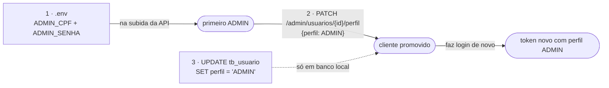
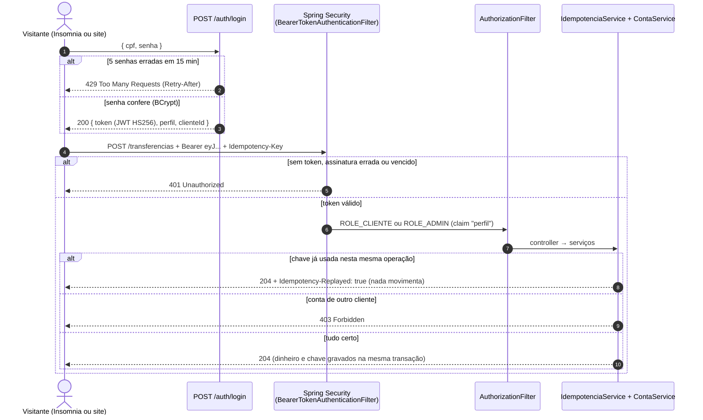
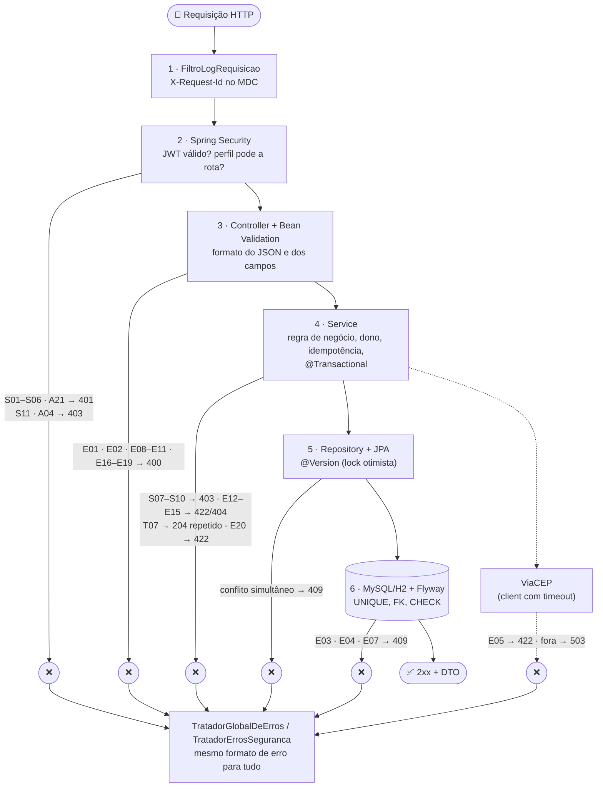

# 🧪 Como testar o RKF Bank (API) — do zero, com pedido e resposta de cada passo

> Para **qualquer pessoa** que clonou o repositório (recrutador, colega, curioso) testar a API inteira na própria
> máquina. Contrato **3.1** (23/10/2026). A ordem é a de quem testa de verdade: **entender** o que vai ser testado →
> **preparar** o ambiente pelo IntelliJ → testar tudo o que um **ADMIN** pode (e não pode) → testar tudo como
> **cliente**. Cada passo tem o pedido completo (rota, headers e corpo) e a resposta que a API devolveu de verdade.
> Tudo aqui usa só **contas públicas** (Ana e Bruno) ou contas que **você** cria na sua máquina: nenhuma senha da equipe.
> Tela? [Roteiro do frontend](../frontend/README_TESTES_E2E.md). Só quer clicar? [Visitantes, em 5 minutos](../VISITANTES.md).

| Parte | O que tem | Tempo |
|---|---|:-:|
| [0 · Entenda antes de testar](#parte-0--entenda-antes-de-testar) | os perfis, quem é quem, os cenários e as palavras que aparecem nas respostas | 5 min |
| [1 · Prepare o ambiente pelo IntelliJ](#parte-1--prepare-o-ambiente-pelo-intellij) | JDK 25, rodar a API, `.env`, ver o banco, importar a coleção | 15 min (1ª vez) |
| [2 · Teste como ADMIN](#parte-2--teste-como-admin) | o seu ADMIN no MySQL: usuários, perfis, senha temporária, conciliação e as travas | 10 min |
| [3 · Teste como cliente](#parte-3--teste-como-cliente) | Ana e Bruno, cliente novo do cadastro ao extrato, idempotência, LGPD, erros e sessão | 15 min |
| [4 · Por dentro e problemas comuns](#parte-4--por-dentro-e-problemas-comuns) | logs, como a segurança funciona, cada camada, problemas comuns | consulta |

> ⚡ **Pressa?** Parte 1.3 (▶️ **API · Visitante (H2)**) → importe a coleção (1.6) → mande as pastas `00` a `09` com o
> ambiente **Visitante**. Ou, pelo terminal, com a API no ar: `node scripts/rodar-colecao-insomnia.mjs` → `82/82`.

---

## Parte 0 — Entenda antes de testar

### Os perfis da API

A mesma API sobe de três jeitos. Para testar como **cliente**, o perfil `visitante` não pede configuração nenhuma.
Para testar como **ADMIN**, use o perfil padrão (MySQL) com um `.env` seu: o `visitante` **não tem ADMIN de propósito**,
porque a senha dele é pública.

| Perfil | Configuração no IntelliJ | Banco | Quem existe | Precisa de |
|---|---|---|---|---|
| `visitante` | **API · Visitante (H2)** | H2 em memória (zera a cada subida) | Ana e Bruno, senha pública `Visitante@2026`; **sem ADMIN** | nada (nem `.env`, nem Docker) |
| padrão | **API · MySQL (Docker)** | MySQL 8.4 do `docker compose` (guarda tudo) | o **seu** ADMIN e duas contas de teste (Fellipe e Renan) com a **sua** senha | `.env` + Docker Desktop |
| `equipe` | **API · Equipe (H2)** | H2 em memória | o mesmo do padrão | `.env` (é o perfil do dia a dia do time) |

### Quem é quem

| Pessoa | Perfil da API | Papel | CPF (login) | Senha | Conta |
|---|---|---|---|---|---|
| **Ana Visitante** | `visitante` | cliente ORIGEM | `246.813.579-28` | `Visitante@2026` | corrente `900001` · id `a0000000-0000-4000-8000-000000000114` · R$ 1.000,00 |
| **Bruno Visitante** | `visitante` | cliente DESTINO | `975.318.642-82` | `Visitante@2026` | corrente `900002` · id `a0000000-0000-4000-8000-000000000124` · R$ 500,00 |
| **Cliente Novo** | qualquer | cliente que você cadastra no teste | `529.982.247-25` (CPF válido de exemplo) | `minha-senha-forte` | as que abrir |
| **o seu ADMIN** | padrão (MySQL) | administra usuários e confere o banco | o `ADMIN_CPF` do **seu** `.env` (sugestão: `111.444.777-35`) | o `ADMIN_SENHA` do **seu** `.env` | nenhuma (não é cliente) |
| **Fellipe e Renan (Teste)** | padrão (MySQL) | contas de teste que o seed cria: ORIGEM `5eed…0014` e DESTINO `5eed…0024` | `123.456.789-09` e `987.654.321-00` | a `EQUIPE_SENHA` do **seu** `.env` | correntes `100001` e `100002` |

Todos os CPFs, nomes e endereços são fictícios (CPFs válidos só pelos dígitos verificadores).

### Os cenários que este roteiro cobre

| Cenário | Onde | O que prova |
|---|---|---|
| ADMIN entra, lista usuários, clientes e todas as contas | Parte 2 | o perfil `ADMIN` vê tudo, com CPF mascarado |
| ADMIN promove, rebaixa, desativa, reativa e redefine senha | Parte 2 | a mudança vale **na próxima requisição** (o token antigo cai) |
| ADMIN não mexe em si mesmo nem no dinheiro dos outros | Parte 2 | travas `PROPRIO_ACESSO` e `PROPRIA_SENHA_PELA_GESTAO` e regra de dono (`403`) |
| Senha temporária | Parte 2 | depois da redefinição, só a troca de senha funciona |
| Conciliação | Parte 2 | o saldo de cada conta bate com a soma do extrato |
| Cadastro com aceite dos termos, CPF/CEP com máscara e ViaCEP | Parte 3 | LGPD e higienização dos dados |
| Contas ORIGEM e DESTINO, depósito, saque, transferência, saldo e extrato | Parte 3 | o fluxo do MVP, conferido centavo a centavo |
| Idempotência | Parte 3 | a mesma movimentação repetida não sai duas vezes |
| Regra de dono | Parte 3 | ninguém vê nem movimenta a conta de outro cliente |
| Meus dados (LGPD) e troca de senha | Parte 3 | ver, corrigir e encerrar o próprio cadastro |
| Erros que devem acontecer | Parte 3 | `400`, `401`, `403`, `404`, `409`, `422`, cada um com o `codigo` do contrato |
| Sessão | Parte 3 | renovar sem senha, reuso derrubando tudo, logout |

### Palavras que aparecem nas respostas

| Palavra | O que é |
|---|---|
| `token` | o **token de acesso** (JWT): vai em `Authorization: Bearer <token>` em toda rota protegida. Vale 15 min no MySQL e 60 min no perfil `visitante` (`expiraEmSegundos`) |
| `refreshToken` | o **token de renovação**: troca o par em `POST /auth/refresh` sem pedir a senha. Vale 7 dias e é de **uso único** |
| `Idempotency-Key` | header obrigatório em depósito, saque e transferência: um UUID novo por operação. Repetir a mesma chave com o mesmo corpo não movimenta de novo |
| `codigo` | o identificador estável do erro (ex.: `SALDO_INSUFICIENTE`). O `message` é só para ler e pode mudar |
| `deveTrocarSenha` | `true` quando a senha foi redefinida pelo ADMIN: só a troca de senha funciona até a pessoa escolher outra |
| `***.982.247-**` | CPF mascarado: as respostas nunca devolvem o CPF inteiro |

Contrato completo (todas as rotas, campos e códigos de erro): [README_CONTRATO_API.md](README_CONTRATO_API.md).

---

## Parte 1 — Prepare o ambiente pelo IntelliJ

### 1.1 Instalar (uma vez)

| Ferramenta | Para quê | Como conferir |
|---|---|---|
| **Git** (no Windows, já traz o Git Bash) | clonar o repositório e rodar os comandos | `git --version` |
| **IntelliJ IDEA** (Community serve) | abrir o projeto, rodar a API e ver o banco | — |
| **JDK 25** | a API é Java 25 (o IntelliJ baixa para você no 1.2) | `java -version` → `25.x` |
| **Insomnia** (10 ou mais novo) | mandar as requisições da coleção | — |
| **Node 20+** | só para os scripts de teste pelo terminal | `node -v` |
| **Docker Desktop** | só para o perfil MySQL (Parte 2) | `docker version` mostra "Server" |

```bash
git clone https://github.com/k3vinrich4rd/rkf_bank.git
```

### 1.2 Abrir o projeto (uma vez)

1. **File → Open…** → escolha a pasta **raiz** `rkf_bank` (a que tem `pom.xml` e `docker-compose.yml`, **não** a
   `backend/`) → **Trust Project**. O IntelliJ reconhece o Maven sozinho: espere a barra de baixo terminar
   ("Indexing", "Resolving dependencies"). Erro na aba **Maven** (à direita)? 🔄 **Reload All Maven Projects**.
2. **JDK 25:** **File → Project Structure… → Project → SDK → Add SDK → Download JDK…** → Version **25** (qualquer
   vendor; o time usa Microsoft OpenJDK) → **OK**. Na mesma tela, **Language level: 25**. Sem isso, o ▶️ falha com
   `invalid source release: 25` ou `RequireJavaVersion failed`.

### 1.3 Rodar a API como visitante (Parte 3)

No alto da janela, ao lado do ▶️, abra a lista de configurações (vêm prontas na pasta `.run/` do repositório) e
escolha **API · Visitante (H2)** → ▶️. Por baixo, ela roda `RkfbankApplication` com
`-Dspring.profiles.active=visitante`, com a pasta de trabalho na raiz do projeto. Na aba **Run** (embaixo):

```text
The following 1 profile is active: "visitante"
Successfully applied 15 migrations to schema "PUBLIC", now at version v15
Started RkfbankApplication in 9.5 seconds
```

✅ Abra http://localhost:8080/actuator/health → `{"groups":["liveness","readiness"],"status":"UP"}`.
📖 **Swagger:** http://localhost:8080/swagger-ui.html lista todas as rotas; faça o login em `POST /auth/login`
(**Try it out**), copie o `token`, clique em **Authorize** e cole: as rotas protegidas funcionam por ali também.
🐞 Quer ver o código rodando? Use **Debug** no lugar do ▶️ e ponha um breakpoint em `ContaService.transferir`.

Pelo terminal (sem IntelliJ), o mesmo: `./mvnw spring-boot:run -Dspring-boot.run.profiles=visitante`.

#### A configuração não apareceu? Crie na mão (VM options)

O IntelliJ só lê a pasta `.run/` quando o projeto é aberto pela **raiz**. Se a lista ao lado do ▶️ estiver vazia (ou
você quer entender o que ela faz), crie a sua:

1. **Run → Edit Configurations… → + → Application**.
2. **Name:** `API · Visitante (H2)` · **JDK:** 25 · **Main class:** `com.br.rkfbank.RkfbankApplication`
   (o módulo é `rkfbank`).
3. **Modify options → Add VM options** (o campo fica escondido por padrão) e escreva o perfil:

| Para testar | VM options | Precisa de |
|---|---|---|
| como cliente, sem nada instalado | `-Dspring.profiles.active=visitante` | nada |
| como ADMIN, no MySQL | *(vazio: é o perfil padrão)* | `.env` + `docker compose up -d` |
| como ADMIN, sem Docker | `-Dspring.profiles.active=equipe` | `.env` |
| com outra porta (a 8080 está ocupada) | some ` -Dserver.port=8081` ao perfil | mude a URL do ambiente do Insomnia também |

4. **Working directory:** a pasta **raiz** do repositório (`$PROJECT_DIR$`). É dela que a API lê o `.env`: com a
   pasta `backend/` ali, o ADMIN não nasce e o login dele dá `401`.
5. **OK** → ▶️. No log, a primeira linha útil diz qual perfil subiu: `The following 1 profile is active: "visitante"`.

> **VM option × variável de ambiente × argumento:** `-Dspring.profiles.active=visitante` (VM options),
> `SPRING_PROFILES_ACTIVE=visitante` (**Environment variables**) e `--spring.profiles.active=visitante`
> (**Program arguments**) fazem a mesma coisa; use **um** deles. Se dois existirem, o argumento vence a VM option.

### 1.4 Rodar a API com o seu ADMIN (Parte 2)

O ADMIN não nasce por rota (senão qualquer um viraria admin): a API o cria **na subida**, a partir do `.env` da raiz.
Como o `visitante` não tem ADMIN, a Parte 2 usa o perfil padrão, com MySQL e um `.env` **seu**:

1. Na raiz, copie o exemplo: `cp .env.example .env` (o `.env` é ignorado pelo Git: nada dele vai para o GitHub).
2. Preencha os valores (os de MySQL podem ficar como no exemplo; os outros são **seus**, escolha à vontade):

```dotenv
JWT_SEGREDO=um-segredo-local-qualquer-com-mais-de-32-bytes-123     # ou: openssl rand -base64 48
ADMIN_CPF=11144477735                                               # um CPF válido; este é de exemplo
ADMIN_SENHA=minha-senha-de-admin-1
EQUIPE_SENHA=minha-senha-das-contas-de-teste                        # login das contas de teste Fellipe e Renan
```

3. Suba o MySQL: no terminal do IntelliJ (**View → Tool Windows → Terminal**), `docker compose up -d` e espere
   `(healthy)` em `docker ps`.
4. Escolha **API · MySQL (Docker)** → ▶️. A própria API lê o `.env` da raiz (`spring.config.import` no
   `application.properties`), por isso a configuração roda da raiz. No log:

```text
Successfully applied 15 migrations to schema `rkfbank`, now at version v15
Acesso da equipe conferido: 2 de 2 contas com login
Usuario admin 822092d9-... criado a partir do .env
```

> O MySQL guarda tudo entre uma subida e outra. Para começar do zero: `docker compose down -v && docker compose up -d`.

### 1.5 Ver o banco

- **H2 (perfil `visitante`):** o banco vive **dentro** da API, então use o console no navegador:
  http://localhost:8080/h2-console → JDBC URL `jdbc:h2:mem:rkfbank-visitante` (⚠️ ele sugere `testdb`, que é vazio),
  usuário `sa`, senha vazia → **Connect**. Experimente:
  `SELECT numero_conta, saldo FROM tb_conta;` e `SELECT login, perfil FROM tb_usuario;`.
- **MySQL:** no IntelliJ, **View → Tool Windows → Database → + → Data Source → MySQL**. Host `localhost`, Port `5441`,
  User/Password e Database = `MYSQL_USER`, `MYSQL_PASSWORD` e `MYSQL_DATABASE` do `.env` → **Test Connection** → **OK**.

### 1.6 Importar a coleção no Insomnia

A coleção tem **114 requisições** em pastas numeradas, e cada login guarda o token sozinho (nada de copiar e colar):
[`insomnia/rkfbank.insomnia.yaml`](insomnia/rkfbank.insomnia.yaml) (Insomnia 10+) ou
[`insomnia/rkfbank.insomnia.json`](insomnia/rkfbank.insomnia.json) (Insomnia 9).

1. Insomnia → **Import** → **File** → `backend/insomnia/rkfbank.insomnia.yaml`.
2. Escolha o ambiente no canto superior esquerdo:
   - **Visitante (H2, Ana e Bruno)** para a Parte 3 (API · Visitante);
   - **Equipe (MySQL ou H2, Fellipe e Renan)** para a Parte 2: clique no ⚙️ e troque os três `COLE_AQUI_...` pelos
     valores do **seu** `.env` (`EQUIPE_SENHA`, `ADMIN_CPF` e `ADMIN_SENHA`).
3. Mande de cima para baixo, pasta por pasta. Cada resposta mostra ✅/❌ na aba **Tests**. As Partes 2 e 3 trazem o
   pedido e a resposta esperada de cada requisição com o mesmo número (`05.07` = pasta 05, 7ª requisição).

A coleção inteira também roda pelo terminal, com a API no ar:

```bash
node scripts/rodar-colecao-insomnia.mjs                       # ambiente Visitante → 82/82 (a pasta do ADMIN é pulada)
```

### 1.7 Terminal com `curl` (para os passos A e V)

Os passos manuais das Partes 2 e 3 também saem pelo terminal (Git Bash no Windows). Cole **uma vez** por terminal:

```bash
API=http://localhost:8080
H='Content-Type: application/json'
login() { curl -s -X POST $API/auth/login -H "$H" -d "{\"cpf\":\"$1\",\"senha\":\"$2\"}"; }
token() { sed -E 's/.*"token":"([^"]+)".*/\1/'; }
chave() { echo "Idempotency-Key: $(node -e 'console.log(crypto.randomUUID())')"; }
```

> No Git Bash, JSON de `curl -d` vai **sem acento**: o terminal estraga o UTF-8 no caminho (no Insomnia não há esse problema).

### 1.8 Rodar os testes automáticos

Botão direito em `backend/src/test/java` → **Run 'All Tests'** (307 testes; os 7 de `mysql/` sobem um MySQL de verdade
com Testcontainers e são pulados sem Docker). Pelo terminal: `scripts/validar.sh backend`.

---

## Parte 2 — Teste como ADMIN

> Pré-requisito: API no perfil **padrão** com o **seu** `.env` (1.4). No perfil `visitante` não existe ADMIN: tudo
> aqui daria `401` no login.

O ADMIN **vê** tudo e **administra usuários**, mas segue a regra de dono: não deposita, não saca, não transfere e não
vê o extrato de ninguém. Primeiro pelo terminal (A00 a A16, com o **Cliente Novo** como alvo), depois a pasta `05`
da coleção inteira.

### Quem pode o quê

**Como entrar:** `POST /auth/login` com CPF e senha devolve um **token** (JWT). Em toda outra chamada, mande
`Authorization: Bearer <token>`. No Insomnia isso já está feito (aba Auth); no curl, veja o 1.7.

```json
{ "token": "eyJhbGciOiJIUzI1NiJ9...", "tipo": "Bearer", "expiraEmSegundos": 3600,
  "clienteId": "a0000000-0000-4000-8000-000000000112", "perfil": "CLIENTE",
  "deveTrocarSenha": false, "refreshToken": "q3Jd0kX4...", "refreshExpiraEmSegundos": 604800 }
```

**Quem eu sou?** O `perfil` da resposta do login: `CLIENTE` (todo cadastro) ou `ADMIN`. O ADMIN criado pelo `.env`
vem com `clienteId: null` (não é cliente, não tem conta).

| Rota | 🌐 Sem token | 👤 `CLIENTE` | 🛡️ `ADMIN` |
|---|:-:|:-:|:-:|
| `GET /actuator/health` | ✅ | ✅ | ✅ |
| `POST /clientes` (cadastro) | ✅ | ✅ | ✅ |
| `POST /auth/login`, `/auth/refresh`, `/auth/logout`, `GET /termos` | ✅ | ✅ | ✅ |
| `POST /contas` (abrir conta) | 401 | ✅ no próprio cadastro | 422 se não tiver cadastro de cliente¹ |
| `GET /contas` | 401 | ✅ só as dele | ✅ **todas** |
| `GET /contas/{id}` | 401 | ✅ só as dele (outra → 403) | ✅ qualquer uma |
| `POST /contas/{id}/depositos` · `/saques` | 401 | ✅ só nas dele (outra → 403) | só nas dele (outra → 403)² |
| `POST /transferencias` | 401 | ✅ origem tem que ser dele; destino qualquer | idem² |
| `GET /contas/{id}/lancamentos` | 401 | ✅ só das dele | só das dele² |
| `GET` · `PATCH /clientes/me`, `POST /clientes/me/encerramento` | 401 | ✅ | 422 se não tiver cadastro de cliente¹ |
| `PATCH /usuarios/me/senha` | 401 | ✅ | ✅ |
| `GET /clientes` | 401 | 403 | ✅ |
| `GET /admin/usuarios`, `PATCH /admin/usuarios/{id}/...` | 401 | 403 | ✅ (menos em si mesmo → 422) |
| `GET /admin/conciliacao` | 401 | 403 | ✅ |

¹ O ADMIN do `.env` não é cliente. Um cliente **promovido** a ADMIN continua dono do próprio cadastro e das contas.
² O ADMIN **vê** tudo, mas não **mexe** no dinheiro dos outros: a regra de dono vale para todo mundo.

Como ler o erro: `401` = "não sei quem você é" (sem token, token vencido, senha errada) · `403` = "sei quem você é,
mas não pode" (inclusive `TROCA_DE_SENHA_OBRIGATORIA`, com senha temporária) · `422` = "pode, mas a regra não deixa" ·
`429` = "tentou demais".

**Como descobrir as minhas permissões na prática:** faça login e veja o `perfil`; depois chame `GET /clientes`.
`200` = você é ADMIN; `403` = CLIENTE. A pasta `07` da coleção mostra cada recusa.


### Como tornar alguém ADMIN (três jeitos)

O ADMIN **não** nasce por rota pública (senão qualquer um viraria admin). São três caminhos, do mais comum ao mais
"de bastidor":



#### 1 · Pelo `.env`: o primeiro ADMIN

Preencha `ADMIN_CPF` e `ADMIN_SENHA` no `.env` (1.4) e suba no perfil MySQL (ou `equipe`). Na subida, o log mostra
`Usuario admin <id> criado a partir do .env`. Se esse CPF já existir, nada muda. Login normal:
`POST /auth/login {"cpf":"<ADMIN_CPF>","senha":"<ADMIN_SENHA>"}` → `"perfil":"ADMIN"`.

#### 2 · Pela API: um ADMIN promove um cliente (o jeito certo)

1. Login do ADMIN → `token_admin`.
2. `GET /admin/usuarios` → ache a pessoa pelo `nome` e copie o **`id`** (é o id do usuário, não o `clienteId`).
3. `PATCH /admin/usuarios/{id}/perfil` com `{"perfil":"ADMIN"}` → `200`.
4. O token antigo da pessoa passa a dar `401` `ACESSO_ALTERADO`. Ela faz login de novo e o token novo já
   vem com `"perfil":"ADMIN"`.

No Insomnia, a pasta `05` faz isso com o cliente novo, sem copiar id nenhum. Para voltar: `{"perfil":"CLIENTE"}`.

#### 3 · Pelo banco: SQL direto (só em banco local de teste)

Útil para entender o que a API grava, ou quando ainda não existe ADMIN nenhum:

```sql
UPDATE tb_usuario SET perfil = 'ADMIN' WHERE login = '98765432100';   -- login = CPF só com números
SELECT login, perfil, ativo FROM tb_usuario WHERE login = '98765432100';
```

Rode no console do H2 ou no MySQL (1.5) e faça **login de novo**: `"perfil":"ADMIN"` e `GET /clientes` → `200`
(testado em 22/10/2026 no H2 e no MySQL). O token de antes da mudança cai com `401`, porque a cada requisição a API
confere no banco se o perfil do token ainda é o mesmo.

> ⚠️ Em ambiente de verdade, ninguém mexe no banco na mão: a mudança pela API (8.2) fica no log com quem fez,
> confere as regras (ninguém se promove nem se rebaixa) e derruba os tokens antigos da forma certa.


### Pelo terminal: o ADMIN gerenciando o Cliente Novo

Variáveis: as do 1.7 e, no mesmo terminal, os valores do **seu** `.env`:

```bash
set -a && source <(tr -d '\r' < .env) && set +a
AA="Authorization: Bearer $(login "$ADMIN_CPF" "$ADMIN_SENHA" | token)"; echo "${AA:22:3}"     # imprime eyJ
```

**A00 · Cadastre o Cliente Novo (público, é ele que o ADMIN vai gerenciar)**

```bash
curl -s -X POST $API/clientes -H "$H" -d '{"nomeCompleto":"Cliente Novo","cpf":"529.982.247-25","email":"cliente.novo@exemplo.test","telefone":"(11) 99999-8888","cep":"06020-010","numero":"123","complemento":"Apto 45","senha":"minha-senha-forte","aceiteTermos":true}'; echo
```

```http
POST /clientes
Content-Type: application/json

{
  "nomeCompleto": "Cliente Novo",
  "cpf": "529.982.247-25",
  "email": "cliente.novo@exemplo.test",
  "telefone": "(11) 99999-8888",
  "cep": "06020-010",
  "numero": "123",
  "complemento": "Apto 45",
  "senha": "minha-senha-forte",
  "aceiteTermos": true
}
```

✅ **201** — CPF mascarado, endereço do ViaCEP (Osasco/SP) e o aceite dos termos gravado:

```json
{
  "id": "1a3de7a4-602b-4eb2-ab92-91bc0e5209f6",
  "nomeCompleto": "Cliente Novo",
  "cpf": "***.982.247-**",
  "email": "cliente.novo@exemplo.test",
  "telefone": "(11) 99999-8888",
  "endereco": {
    "cep": "06020-010",
    "logradouro": "Avenida dos Autonomistas",
    "bairro": "Vila Yara",
    "cidade": "Osasco",
    "uf": "SP",
    "ibge": "3534401",
    "numero": "123",
    "complemento": "Apto 45"
  },
  "termosVersao": "2026-10-23",
  "termosAceitosEm": "2026-10-23T17:46:07.012629500Z"
}
```

Já existe esse CPF no seu banco? `409` `CPF_JA_CADASTRADO`: siga, ele já está lá.

**A01 · Login do ADMIN**

```http
POST /auth/login
Content-Type: application/json

{ "cpf": "<ADMIN_CPF do seu .env>", "senha": "<ADMIN_SENHA do seu .env>" }
```

✅ **200**

```json
{
  "token": "eyJhbGciOiJIUzI1NiJ9...",
  "tipo": "Bearer",
  "expiraEmSegundos": 900,
  "clienteId": null,
  "perfil": "ADMIN",
  "deveTrocarSenha": false,
  "refreshToken": "q3Jd0kX4...",
  "refreshExpiraEmSegundos": 604800
}
```

`clienteId: null`: o ADMIN do `.env` não é cliente e não tem conta.

**A02 · Usuários** — e guarde o `id` do Cliente Novo.

```bash
curl -s $API/admin/usuarios -H "$AA"; echo
UC=$(curl -s $API/admin/usuarios -H "$AA" | node -e "let s='';process.stdin.on('data',d=>s+=d).on('end',()=>console.log(JSON.parse(s).find(u=>u.nome==='Cliente Novo').id))")
```

✅ **200**, admins primeiro, CPF sempre mascarado:

```json
[
  { "id": "822092d9-f335-47a5-9715-791464292887", "cpf": "***.444.777-**", "nome": null, "perfil": "ADMIN", "ativo": true, "clienteId": null },
  { "id": "d066371d-5143-4f9e-88bf-0ad64bc8d7b3", "cpf": "***.456.789-**", "nome": "Fellipe Santana (Teste Origem)", "perfil": "CLIENTE", "ativo": true, "clienteId": "5eed0000-0000-4000-8000-000000000012" },
  { "id": "4cd41f10-9bce-44fa-9cd5-fbba77b1db4d", "cpf": "***.982.247-**", "nome": "Cliente Novo", "perfil": "CLIENTE", "ativo": true, "clienteId": "1a3de7a4-602b-4eb2-ab92-91bc0e5209f6" },
  { "id": "7c18a8ce-bafb-440c-b9b0-7c8f14de691e", "cpf": "***.654.321-**", "nome": "Renan Barros (Teste Destino)", "perfil": "CLIENTE", "ativo": true, "clienteId": "5eed0000-0000-4000-8000-000000000022" }
]
```

O `id` daqui (`tb_usuario`) é o que vai nas rotas `/admin/usuarios/{usuarioId}/...`, **não** o `clienteId`.

**A03 · Clientes, paginado** — `GET /clientes?page=0&size=1`

```bash
curl -s "$API/clientes?page=0&size=1" -H "$AA"; echo
```

✅ **200** — uma página no formato do contrato (só estes 7 campos em volta do `content`):

```json
{
  "content": [ { "id": "1a3de7a4-...", "nomeCompleto": "Cliente Novo", "cpf": "***.982.247-**", "email": "cliente.novo@exemplo.test", "...": "o mesmo formato do A00" } ],
  "totalElements": 4,
  "totalPages": 4,
  "number": 0,
  "size": 1,
  "first": true,
  "last": false
}
```

**A04 a A08 · Perfil e acesso**

```bash
curl -s -X PATCH $API/admin/usuarios/$UC/perfil -H "$H" -H "$AA" -d '{"perfil":"ADMIN"}'; echo
curl -s -X PATCH $API/admin/usuarios/$UC/perfil -H "$H" -H "$AA" -d '{"perfil":"CLIENTE"}'; echo
curl -s -X PATCH $API/admin/usuarios/$UC/acesso -H "$H" -H "$AA" -d '{"ativo":false}'; echo
login 52998224725 minha-senha-forte; echo
curl -s -o /dev/null -w "%{http_code}\n" -X PATCH $API/admin/usuarios/$UC/acesso -H "$H" -H "$AA" -d '{"ativo":true}'
```

| # | Pedido | Corpo | ✅ Resposta |
|---|---|---|---|
| A04 | `PATCH /admin/usuarios/{usuarioId}/perfil` | `{"perfil":"ADMIN"}` | **200** `{"id":"4cd41f10-...","cpf":"***.982.247-**","nome":"Cliente Novo","perfil":"ADMIN","ativo":true,"clienteId":"1a3de7a4-..."}` |
| A05 | `PATCH /admin/usuarios/{usuarioId}/perfil` | `{"perfil":"CLIENTE"}` | **200**, o mesmo com `"perfil":"CLIENTE"` |
| A06 | `PATCH /admin/usuarios/{usuarioId}/acesso` | `{"ativo":false}` | **200**, o mesmo com `"ativo":false` |
| A07 | `POST /auth/login` do desativado | `{"cpf":"52998224725","senha":"minha-senha-forte"}` | **401** `{"codigo":"CREDENCIAIS_INVALIDAS","message":"CPF ou senha inválidos",...}` (a mesma resposta de senha errada, de propósito) |
| A08 | `PATCH /admin/usuarios/{usuarioId}/acesso` | `{"ativo":true}` | **200**, entra de novo |

Cada mudança vale **na próxima requisição**: o token que a pessoa tinha antes passa a dar `401` `ACESSO_ALTERADO`.
"Remover" = desativar: o usuário nunca é apagado (o histórico de movimentações aponta para ele).

**A09 · Trava: o ADMIN mexendo em si mesmo**

```bash
EU=$(login "$ADMIN_CPF" "$ADMIN_SENHA" | node -e "let s='';process.stdin.on('data',d=>s+=d).on('end',()=>console.log(JSON.parse(Buffer.from(JSON.parse(s).token.split('.')[1],'base64url')).sub))")
curl -s -X PATCH $API/admin/usuarios/$EU/perfil -H "$H" -H "$AA" -d '{"perfil":"CLIENTE"}'; echo
```

✅ **422**

```json
{ "status": 422, "error": "Unprocessable Entity", "codigo": "PROPRIO_ACESSO", "message": "Você não pode alterar o seu próprio perfil ou acesso; peça a outro ADMIN", "path": "/admin/usuarios/822092d9-.../perfil", "campos": [] }
```

O `sub` do token (o payload é só Base64, dá para ler) é o id do próprio usuário. Ninguém se tranca para fora.

**A10 · Conciliação: saldo × extrato**

```bash
curl -s $API/admin/conciliacao -H "$AA"; echo
```

✅ **200** `[]`. Cada linha que aparecesse (`contaId`, `numeroConta`, `saldo`, `saldoPeloExtrato`) seria uma conta
cujo saldo não bate com a soma do extrato: bug ou alteração manual no banco.

**A11 · O ADMIN não mexe no dinheiro dos outros**

```bash
CF=$(curl -s $API/contas -H "$AA" | node -e "let s='';process.stdin.on('data',d=>s+=d).on('end',()=>console.log(JSON.parse(s)[0].id))")
curl -s -X POST $API/contas/$CF/depositos -H "$H" -H "$AA" -H "$(chave)" -d '{"valor":1.00}'; echo
```

✅ **403** `{"codigo":"CONTA_DE_OUTRO_CLIENTE","message":"Conta não pertence ao usuário logado",...}`. Ele **vê** todas as
contas em `GET /contas`, mas a regra de dono vale para todo mundo.

**A12 a A15 · Senha temporária** — o Cliente Novo esqueceu a senha; o ADMIN redefine.

```bash
curl -s -o /dev/null -w "%{http_code}\n" -X PATCH $API/admin/usuarios/$UC/senha -H "$H" -H "$AA" -d '{"novaSenha":"senha-temporaria-1"}'
LT=$(login 52998224725 senha-temporaria-1); echo "$LT" | grep -o '"deveTrocarSenha":[a-z]*'; AT="Authorization: Bearer $(echo "$LT" | token)"
curl -s $API/contas -H "$AT"; echo
curl -s -o /dev/null -w "%{http_code}\n" -X PATCH $API/usuarios/me/senha -H "$H" -H "$AT" -d '{"senhaAtual":"senha-temporaria-1","novaSenha":"minha-senha-forte"}'
```

| # | Pedido | ✅ Resposta |
|---|---|---|
| A12 | `PATCH /admin/usuarios/{usuarioId}/senha` `{"novaSenha":"senha-temporaria-1"}` | **204**; os tokens da pessoa caem na hora |
| A13 | login com a temporária | **200** com `"deveTrocarSenha":true` |
| A14 | `GET /contas` com esse token | **403** `{"codigo":"TROCA_DE_SENHA_OBRIGATORIA","message":"Sua senha foi redefinida: troque-a antes de continuar",...}` |
| A15 | `PATCH /usuarios/me/senha` `{"senhaAtual":"senha-temporaria-1","novaSenha":"minha-senha-forte"}` | **204**; o próximo login vem com `"deveTrocarSenha":false` |

**A16 · E o cliente na rota do ADMIN?**

```bash
curl -s $API/admin/usuarios -H "Authorization: Bearer $(login 52998224725 minha-senha-forte | token)"; echo
```

✅ **403** `{"codigo":"PERFIL_SEM_PERMISSAO","message":"Acesso negado para o seu perfil",...}`.

### Pela coleção: pasta 05 inteira (o que o ADMIN pode e não pode)

> Ambiente **Equipe** com os valores do seu `.env` (1.6). Ordem: `00` → `01` (logins, inclusive o do ADMIN) → `02`
> (cadastra o cliente novo, com CPF sorteado, que o ADMIN vai gerenciar) → `05`.

<!-- roteiro-gerado:admin:inicio -->
> 🤖 Gerado por `scripts/gerar-roteiro-e2e.mjs` a partir da coleção do Insomnia e de uma execução real dela (ambiente **MySQL com o .env de um visitante**, 30 requisições, todas com o resultado esperado). Ids, números de conta, datas e CPFs sorteados mudam a cada execução; status, campos e `codigo` não. Tokens aparecem cortados.

| Pasta da coleção | Passos | O que prova |
|---|:-:|---|
| [05 · ADMIN: gestão de clientes, contas e usuários](#05--admin-gestão-de-clientes-contas-e-usuários) | 05.01–05.30 | ADMIN: listar, promover, rebaixar, desativar, redefinir senha (temporária), conciliação e as travas |

### 05 · ADMIN: gestão de clientes, contas e usuários

Tudo o que o ADMIN faz e tudo o que ele **não** pode fazer. Precisa do **Login · ADMIN** (pasta 01) e do **cliente novo** (pasta 02): é nele que o ADMIN mexe, para não estragar as contas fixas. No perfil visitante não há ADMIN: tudo aqui dá `401` (use o ambiente Equipe com a API no perfil `equipe` ou MySQL).

#### 05.01 · Listar clientes (array)

Só ADMIN. Sem `page`/`size` vem um array com todos; com eles, uma página.

📥 usa: `token_admin`

**Pedido**

```http
GET /clientes
Authorization: Bearer {{ token_admin }}
```

**Resposta esperada**

✅ **200**

```json
[
  {
    "id": "430e0b2a-3aa3-48fc-90ee-05e103131565",
    "nomeCompleto": "Cliente Novo do Insomnia",
    "cpf": "***.309.952-**",
    "email": "cliente.novo.mvl9gjfi@exemplo.test",
    "telefone": "(11) 99999-8888",
    "endereco": {
      "cep": "06020-010",
      "logradouro": "Avenida dos Autonomistas",
      "bairro": "Vila Yara",
      "cidade": "Osasco",
      "uf": "SP",
      "ibge": "3534401",
      "numero": "123",
      "complemento": "Apto 45"
    },
    "termosVersao": "2026-10-23",
    "termosAceitosEm": "2026-10-23T17:45:41.155228Z"
  },
  {
    "id": "5eed0000-0000-4000-8000-000000000012",
    "nomeCompleto": "Fellipe Santana (Teste Origem)",
    "cpf": "***.456.789-**",
    "email": "fellipe.santana@rkfbank.test",
    "telefone": "(11) 98765-0001",
    "endereco": {
      "cep": "06013-000",
      "logradouro": "Rua Antônio Agu",
      "bairro": "Centro",
      "cidade": "Osasco",
      "uf": "SP",
      "ibge": "3534401",
      "numero": "1001",
      "complemento": null
    },
    "termosVersao": null,
    "termosAceitosEm": null
  },
  "… mais 1 item no mesmo formato"
]
```

🔎 A coleção confere: *status 200*

#### 05.02 · Listar clientes (paginado)

📥 usa: `token_admin`

**Pedido**

```http
GET /clientes?page=0&size=10
Authorization: Bearer {{ token_admin }}
```

**Resposta esperada**

✅ **200**

```json
{
  "content": [
    {
      "id": "430e0b2a-3aa3-48fc-90ee-05e103131565",
      "nomeCompleto": "Cliente Novo do Insomnia",
      "cpf": "***.309.952-**",
      "email": "cliente.novo.mvl9gjfi@exemplo.test",
      "telefone": "(11) 99999-8888",
      "endereco": {
        "cep": "06020-010",
        "logradouro": "Avenida dos Autonomistas",
        "bairro": "Vila Yara",
        "cidade": "Osasco",
        "uf": "SP",
        "ibge": "3534401",
        "numero": "123",
        "complemento": "Apto 45"
      },
      "termosVersao": "2026-10-23",
      "termosAceitosEm": "2026-10-23T17:45:41.155228Z"
    },
    {
      "id": "5eed0000-0000-4000-8000-000000000012",
      "nomeCompleto": "Fellipe Santana (Teste Origem)",
      "cpf": "***.456.789-**",
      "email": "fellipe.santana@rkfbank.test",
      "telefone": "(11) 98765-0001",
      "endereco": {
        "cep": "06013-000",
        "logradouro": "Rua Antônio Agu",
        "bairro": "Centro",
        "cidade": "Osasco",
        "uf": "SP",
        "ibge": "3534401",
        "numero": "1001",
        "complemento": null
      },
      "termosVersao": null,
      "termosAceitosEm": null
    },
    "… mais 1 item no mesmo formato"
  ],
  "totalElements": 3,
  "totalPages": 1,
  "number": 0,
  "size": 10,
  "first": true,
  "last": true
}
```

🔎 A coleção confere: *status 200* · *é página*

#### 05.03 · Listar TODAS as contas (paginado)

A mesma rota do cliente, mas o ADMIN recebe as contas de todo mundo.

📥 usa: `token_admin`

**Pedido**

```http
GET /contas?page=0&size=20
Authorization: Bearer {{ token_admin }}
```

**Resposta esperada**

✅ **200**

```json
{
  "content": [
    {
      "id": "5eed0000-0000-4000-8000-000000000014",
      "clienteId": "5eed0000-0000-4000-8000-000000000012",
      "agencia": "0001",
      "numeroConta": "100001",
      "tipoConta": "CORRENTE",
      "saldo": 1085,
      "ativa": true
    },
    {
      "id": "5eed0000-0000-4000-8000-000000000024",
      "clienteId": "5eed0000-0000-4000-8000-000000000022",
      "agencia": "0001",
      "numeroConta": "100002",
      "tipoConta": "CORRENTE",
      "saldo": 525,
      "ativa": true
    },
    "… mais 2 itens no mesmo formato"
  ],
  "totalElements": 4,
  "totalPages": 1,
  "number": 0,
  "size": 20,
  "first": true,
  "last": true
}
```

🔎 A coleção confere: *status 200*

#### 05.04 · Listar usuários (guarda o id do cliente novo)

CPF vem mascarado. O `id` daqui (tb_usuario) é o que vai nas rotas abaixo, **não** o `clienteId`.

📥 usa: `token_admin` · 📤 guarda: `usuario_novo_id`

**Pedido**

```http
GET /admin/usuarios
Authorization: Bearer {{ token_admin }}
```

**Resposta esperada**

✅ **200**

```json
[
  {
    "id": "822092d9-f335-47a5-9715-791464292887",
    "cpf": "***.xxx.xxx-**",
    "nome": null,
    "perfil": "ADMIN",
    "ativo": true,
    "clienteId": null
  },
  {
    "id": "d066371d-5143-4f9e-88bf-0ad64bc8d7b3",
    "cpf": "***.456.789-**",
    "nome": "Fellipe Santana (Teste Origem)",
    "perfil": "CLIENTE",
    "ativo": true,
    "clienteId": "5eed0000-0000-4000-8000-000000000012"
  },
  "… mais 2 itens no mesmo formato"
]
```

🔎 A coleção confere: *status 200* · *achou o cliente novo* · *CPF mascarado*

#### 05.05 · Promover o cliente novo a ADMIN

Vale na próxima requisição: o token antigo do promovido passa a dar `401`.

📥 usa: `usuario_novo_id`, `token_admin`

**Pedido**

```http
PATCH /admin/usuarios/51e0aa80-d0ab-432d-9685-f0a6662eb47e/perfil
Authorization: Bearer {{ token_admin }}
Content-Type: application/json

{
  "perfil": "ADMIN"
}
```

**Resposta esperada**

✅ **200**

```json
{
  "id": "51e0aa80-d0ab-432d-9685-f0a6662eb47e",
  "cpf": "***.309.952-**",
  "nome": "Cliente Novo do Insomnia",
  "perfil": "ADMIN",
  "ativo": true,
  "clienteId": "430e0b2a-3aa3-48fc-90ee-05e103131565"
}
```

🔎 A coleção confere: *status 200* · *virou ADMIN*

#### 05.06 · Token antigo do promovido → 401

📥 usa: `token_novo`

**Pedido**

```http
GET /contas
Authorization: Bearer {{ token_novo }}
```

**Resposta esperada**

✅ **401**

```json
{
  "timestamp": "2026-10-23T17:45:42.254682100Z",
  "status": 401,
  "error": "Unauthorized",
  "codigo": "ACESSO_ALTERADO",
  "message": "Seu acesso foi alterado ou desativado; faça login novamente",
  "path": "/contas",
  "campos": []
}
```

🔎 A coleção confere: *status 401* · *codigo ACESSO_ALTERADO*

#### 05.07 · Login do promovido (já vem ADMIN)

📥 usa: `novo_cpf`, `novo_senha` · 📤 guarda: `token_novo`, `refresh_novo`

**Pedido**

```http
POST /auth/login
Content-Type: application/json

{
  "cpf": "31030995257",
  "senha": "senha-do-novo-mvl9gjfi"
}
```

**Resposta esperada**

✅ **200**

```json
{
  "token": "eyJhbGciOiJIUzI1NiJ9...",
  "tipo": "Bearer",
  "expiraEmSegundos": 900,
  "clienteId": "430e0b2a-3aa3-48fc-90ee-05e103131565",
  "perfil": "ADMIN",
  "deveTrocarSenha": false,
  "refreshToken": "q3Jd0kX4...",
  "refreshExpiraEmSegundos": 604800
}
```

🔎 A coleção confere: *status 200* · *perfil ADMIN*

#### 05.08 · Promovido lista clientes → 200

Agora ele é ADMIN e continua dono das próprias contas (o cadastro de cliente não some).

📥 usa: `token_novo`

**Pedido**

```http
GET /clientes?page=0&size=5
Authorization: Bearer {{ token_novo }}
```

**Resposta esperada**

✅ **200**

```json
{
  "content": [
    {
      "id": "430e0b2a-3aa3-48fc-90ee-05e103131565",
      "nomeCompleto": "Cliente Novo do Insomnia",
      "cpf": "***.309.952-**",
      "email": "cliente.novo.mvl9gjfi@exemplo.test",
      "telefone": "(11) 99999-8888",
      "endereco": {
        "cep": "06020-010",
        "logradouro": "Avenida dos Autonomistas",
        "bairro": "Vila Yara",
        "cidade": "Osasco",
        "uf": "SP",
        "ibge": "3534401",
        "numero": "123",
        "complemento": "Apto 45"
      },
      "termosVersao": "2026-10-23",
      "termosAceitosEm": "2026-10-23T17:45:41.155228Z"
    },
    {
      "id": "5eed0000-0000-4000-8000-000000000012",
      "nomeCompleto": "Fellipe Santana (Teste Origem)",
      "cpf": "***.456.789-**",
      "email": "fellipe.santana@rkfbank.test",
      "telefone": "(11) 98765-0001",
      "endereco": {
        "cep": "06013-000",
        "logradouro": "Rua Antônio Agu",
        "bairro": "Centro",
        "cidade": "Osasco",
        "uf": "SP",
        "ibge": "3534401",
        "numero": "1001",
        "complemento": null
      },
      "termosVersao": null,
      "termosAceitosEm": null
    },
    "… mais 1 item no mesmo formato"
  ],
  "totalElements": 3,
  "totalPages": 1,
  "number": 0,
  "size": 5,
  "first": true,
  "last": true
}
```

🔎 A coleção confere: *status 200*

#### 05.09 · Promovido tenta rebaixar o ADMIN do .env → 422

O ADMIN do `.env` não é cliente: virar CLIENTE não faz sentido. Para tirá-lo, desative o acesso.

📥 usa: `usuario_admin_id`, `token_novo`

**Pedido**

```http
PATCH /admin/usuarios/822092d9-f335-47a5-9715-791464292887/perfil
Authorization: Bearer {{ token_novo }}
Content-Type: application/json

{
  "perfil": "CLIENTE"
}
```

**Resposta esperada**

✅ **422**

```json
{
  "timestamp": "2026-10-23T17:45:42.380219Z",
  "status": 422,
  "error": "Unprocessable Entity",
  "codigo": "PERFIL_CLIENTE_SEM_CADASTRO",
  "message": "Usuário sem cadastro de cliente não pode virar CLIENTE; desative o acesso",
  "path": "/admin/usuarios/822092d9-f335-47a5-9715-791464292887/perfil",
  "campos": []
}
```

🔎 A coleção confere: *status 422* · *codigo PERFIL_CLIENTE_SEM_CADASTRO*

#### 05.10 · Rebaixar de volta a CLIENTE

📥 usa: `usuario_novo_id`, `token_admin`

**Pedido**

```http
PATCH /admin/usuarios/51e0aa80-d0ab-432d-9685-f0a6662eb47e/perfil
Authorization: Bearer {{ token_admin }}
Content-Type: application/json

{
  "perfil": "CLIENTE"
}
```

**Resposta esperada**

✅ **200**

```json
{
  "id": "51e0aa80-d0ab-432d-9685-f0a6662eb47e",
  "cpf": "***.309.952-**",
  "nome": "Cliente Novo do Insomnia",
  "perfil": "CLIENTE",
  "ativo": true,
  "clienteId": "430e0b2a-3aa3-48fc-90ee-05e103131565"
}
```

🔎 A coleção confere: *status 200*

#### 05.11 · Desativar o acesso

"Remover" = desativar: o usuário nunca é apagado (o histórico de movimentações aponta para ele).

📥 usa: `usuario_novo_id`, `token_admin`

**Pedido**

```http
PATCH /admin/usuarios/51e0aa80-d0ab-432d-9685-f0a6662eb47e/acesso
Authorization: Bearer {{ token_admin }}
Content-Type: application/json

{
  "ativo": false
}
```

**Resposta esperada**

✅ **200**

```json
{
  "id": "51e0aa80-d0ab-432d-9685-f0a6662eb47e",
  "cpf": "***.309.952-**",
  "nome": "Cliente Novo do Insomnia",
  "perfil": "CLIENTE",
  "ativo": false,
  "clienteId": "430e0b2a-3aa3-48fc-90ee-05e103131565"
}
```

🔎 A coleção confere: *status 200* · *ativo false*

#### 05.12 · Login do desativado → 401

📥 usa: `novo_cpf`, `novo_senha`

**Pedido**

```http
POST /auth/login
Content-Type: application/json

{
  "cpf": "31030995257",
  "senha": "senha-do-novo-mvl9gjfi"
}
```

**Resposta esperada**

✅ **401**

```json
{
  "timestamp": "2026-10-23T17:45:42.522945600Z",
  "status": 401,
  "error": "Unauthorized",
  "codigo": "CREDENCIAIS_INVALIDAS",
  "message": "CPF ou senha inválidos",
  "path": "/auth/login",
  "campos": []
}
```

🔎 A coleção confere: *status 401* · *codigo CREDENCIAIS_INVALIDAS*

#### 05.13 · Reativar o acesso

📥 usa: `usuario_novo_id`, `token_admin`

**Pedido**

```http
PATCH /admin/usuarios/51e0aa80-d0ab-432d-9685-f0a6662eb47e/acesso
Authorization: Bearer {{ token_admin }}
Content-Type: application/json

{
  "ativo": true
}
```

**Resposta esperada**

✅ **200**

```json
{
  "id": "51e0aa80-d0ab-432d-9685-f0a6662eb47e",
  "cpf": "***.309.952-**",
  "nome": "Cliente Novo do Insomnia",
  "perfil": "CLIENTE",
  "ativo": true,
  "clienteId": "430e0b2a-3aa3-48fc-90ee-05e103131565"
}
```

🔎 A coleção confere: *status 200*

#### 05.14 · Redefinir a senha (quem esqueceu)

O script passa a senha nova para `novo_senha`. Ela é **temporária** (contrato 3.1): no próximo login a pessoa precisa trocá-la.

🎲 sorteia antes: `senha_redefinida` · 📥 usa: `usuario_novo_id`, `senha_redefinida`, `token_admin` · 📤 guarda: `novo_senha`

**Pedido**

```http
PATCH /admin/usuarios/51e0aa80-d0ab-432d-9685-f0a6662eb47e/senha
Authorization: Bearer {{ token_admin }}
Content-Type: application/json

{
  "novaSenha": "redefinida-mvl9gl1s"
}
```

**Resposta esperada**

✅ **204** · sem corpo

🔎 A coleção confere: *status 204*

#### 05.15 · Login com a senha temporária (deveTrocarSenha)

📥 usa: `novo_cpf`, `novo_senha` · 📤 guarda: `token_novo`, `refresh_novo`

**Pedido**

```http
POST /auth/login
Content-Type: application/json

{
  "cpf": "31030995257",
  "senha": "redefinida-mvl9gl1s"
}
```

**Resposta esperada**

✅ **200**

```json
{
  "token": "eyJhbGciOiJIUzI1NiJ9...",
  "tipo": "Bearer",
  "expiraEmSegundos": 900,
  "clienteId": "430e0b2a-3aa3-48fc-90ee-05e103131565",
  "perfil": "CLIENTE",
  "deveTrocarSenha": true,
  "refreshToken": "q3Jd0kX4...",
  "refreshExpiraEmSegundos": 604800
}
```

🔎 A coleção confere: *status 200* · *deveTrocarSenha*

#### 05.16 · Senha temporária em outra rota → 403

Com a senha temporária, o token só abre `PATCH /usuarios/me/senha`.

📥 usa: `token_novo`

**Pedido**

```http
GET /contas
Authorization: Bearer {{ token_novo }}
```

**Resposta esperada**

✅ **403**

```json
{
  "timestamp": "2026-10-23T17:45:42.742650900Z",
  "status": 403,
  "error": "Forbidden",
  "codigo": "TROCA_DE_SENHA_OBRIGATORIA",
  "message": "Sua senha foi redefinida: troque-a antes de continuar",
  "path": "/contas",
  "campos": []
}
```

🔎 A coleção confere: *status 403* · *codigo TROCA_DE_SENHA_OBRIGATORIA*

#### 05.17 · Trocar a senha temporária

🎲 sorteia antes: `senha_escolhida` · 📥 usa: `novo_senha`, `senha_escolhida`, `token_novo` · 📤 guarda: `novo_senha`

**Pedido**

```http
PATCH /usuarios/me/senha
Authorization: Bearer {{ token_novo }}
Content-Type: application/json

{
  "senhaAtual": "escolhida-mvl9gl7b",
  "novaSenha": "escolhida-mvl9gl7b"
}
```

**Resposta esperada**

✅ **204** · sem corpo

🔎 A coleção confere: *status 204*

#### 05.18 · Login · cliente novo (de novo, senha escolhida)

📥 usa: `novo_cpf`, `novo_senha` · 📤 guarda: `token_novo`, `refresh_novo`

**Pedido**

```http
POST /auth/login
Content-Type: application/json

{
  "cpf": "31030995257",
  "senha": "escolhida-mvl9gl7b"
}
```

**Resposta esperada**

✅ **200**

```json
{
  "token": "eyJhbGciOiJIUzI1NiJ9...",
  "tipo": "Bearer",
  "expiraEmSegundos": 900,
  "clienteId": "430e0b2a-3aa3-48fc-90ee-05e103131565",
  "perfil": "CLIENTE",
  "deveTrocarSenha": false,
  "refreshToken": "q3Jd0kX4...",
  "refreshExpiraEmSegundos": 604800
}
```

🔎 A coleção confere: *status 200* · *sem troca pendente*

#### 05.19 · Trava: ADMIN mexe no próprio perfil → 422

Ninguém mexe em si mesmo: o ADMIN não se tranca para fora e sempre sobra um ADMIN ativo.

📥 usa: `usuario_admin_id`, `token_admin`

**Pedido**

```http
PATCH /admin/usuarios/822092d9-f335-47a5-9715-791464292887/perfil
Authorization: Bearer {{ token_admin }}
Content-Type: application/json

{
  "perfil": "ADMIN"
}
```

**Resposta esperada**

✅ **422**

```json
{
  "timestamp": "2026-10-23T17:45:43.078746700Z",
  "status": 422,
  "error": "Unprocessable Entity",
  "codigo": "PROPRIO_ACESSO",
  "message": "Você não pode alterar o seu próprio perfil ou acesso; peça a outro ADMIN",
  "path": "/admin/usuarios/822092d9-f335-47a5-9715-791464292887/perfil",
  "campos": []
}
```

🔎 A coleção confere: *status 422* · *codigo PROPRIO_ACESSO*

#### 05.20 · Trava: ADMIN redefine a própria senha pela gestão → 422

A própria senha se troca em `PATCH /usuarios/me/senha`, que exige a atual (um token roubado não basta).

📥 usa: `usuario_admin_id`, `token_admin`

**Pedido**

```http
PATCH /admin/usuarios/822092d9-f335-47a5-9715-791464292887/senha
Authorization: Bearer {{ token_admin }}
Content-Type: application/json

{
  "novaSenha": "nao-vai-mudar-123"
}
```

**Resposta esperada**

✅ **422**

```json
{
  "timestamp": "2026-10-23T17:45:43.090257100Z",
  "status": 422,
  "error": "Unprocessable Entity",
  "codigo": "PROPRIA_SENHA_PELA_GESTAO",
  "message": "Para trocar a sua própria senha use PATCH /usuarios/me/senha",
  "path": "/admin/usuarios/822092d9-f335-47a5-9715-791464292887/senha",
  "campos": []
}
```

🔎 A coleção confere: *status 422* · *codigo PROPRIA_SENHA_PELA_GESTAO*

#### 05.21 · Perfil que não existe → 400

📥 usa: `usuario_novo_id`, `token_admin`

**Pedido**

```http
PATCH /admin/usuarios/51e0aa80-d0ab-432d-9685-f0a6662eb47e/perfil
Authorization: Bearer {{ token_admin }}
Content-Type: application/json

{
  "perfil": "GERENTE"
}
```

**Resposta esperada**

✅ **400**

```json
{
  "timestamp": "2026-10-23T17:45:43.114584900Z",
  "status": 400,
  "error": "Bad Request",
  "codigo": "JSON_INVALIDO",
  "message": "JSON inválido ou tipo de campo incompatível",
  "path": "/admin/usuarios/51e0aa80-d0ab-432d-9685-f0a6662eb47e/perfil",
  "campos": []
}
```

🔎 A coleção confere: *status 400*

#### 05.22 · Usuário que não existe → 404

📥 usa: `token_admin`

**Pedido**

```http
PATCH /admin/usuarios/00000000-0000-4000-8000-000000000000/perfil
Authorization: Bearer {{ token_admin }}
Content-Type: application/json

{
  "perfil": "ADMIN"
}
```

**Resposta esperada**

✅ **404**

```json
{
  "timestamp": "2026-10-23T17:45:43.129541500Z",
  "status": 404,
  "error": "Not Found",
  "codigo": "USUARIO_NAO_ENCONTRADO",
  "message": "Usuário não encontrado",
  "path": "/admin/usuarios/00000000-0000-4000-8000-000000000000/perfil",
  "campos": []
}
```

🔎 A coleção confere: *status 404* · *codigo USUARIO_NAO_ENCONTRADO*

#### 05.23 · Acesso sem o campo → 400

📥 usa: `usuario_novo_id`, `token_admin`

**Pedido**

```http
PATCH /admin/usuarios/51e0aa80-d0ab-432d-9685-f0a6662eb47e/acesso
Authorization: Bearer {{ token_admin }}
Content-Type: application/json

{}
```

**Resposta esperada**

✅ **400**

```json
{
  "timestamp": "2026-10-23T17:45:43.154956800Z",
  "status": 400,
  "error": "Bad Request",
  "codigo": "CAMPOS_INVALIDOS",
  "message": "Requisição inválida",
  "path": "/admin/usuarios/51e0aa80-d0ab-432d-9685-f0a6662eb47e/acesso",
  "campos": [
    {
      "campo": "ativo",
      "mensagem": "ativo é obrigatório (true ou false)"
    }
  ]
}
```

🔎 A coleção confere: *status 400*

#### 05.24 · Senha curta na redefinição → 400

📥 usa: `usuario_novo_id`, `token_admin`

**Pedido**

```http
PATCH /admin/usuarios/51e0aa80-d0ab-432d-9685-f0a6662eb47e/senha
Authorization: Bearer {{ token_admin }}
Content-Type: application/json

{
  "novaSenha": "curta"
}
```

**Resposta esperada**

✅ **400**

```json
{
  "timestamp": "2026-10-23T17:45:43.165619800Z",
  "status": 400,
  "error": "Bad Request",
  "codigo": "CAMPOS_INVALIDOS",
  "message": "Requisição inválida",
  "path": "/admin/usuarios/51e0aa80-d0ab-432d-9685-f0a6662eb47e/senha",
  "campos": [
    {
      "campo": "novaSenha",
      "mensagem": "novaSenha deve ter entre 8 e 72 caracteres"
    }
  ]
}
```

🔎 A coleção confere: *status 400*

#### 05.25 · ADMIN do .env abre conta → 422

📥 usa: `token_admin`

**Pedido**

```http
POST /contas
Authorization: Bearer {{ token_admin }}
Content-Type: application/json

{
  "tipoConta": "CORRENTE"
}
```

**Resposta esperada**

✅ **422**

```json
{
  "timestamp": "2026-10-23T17:45:43.178924700Z",
  "status": 422,
  "error": "Unprocessable Entity",
  "codigo": "SEM_CADASTRO_CLIENTE",
  "message": "Seu usuário não tem cadastro de cliente",
  "path": "/contas",
  "campos": []
}
```

🔎 A coleção confere: *status 422* · *codigo SEM_CADASTRO_CLIENTE*

#### 05.26 · ADMIN do .env em /clientes/me → 422

📥 usa: `token_admin`

**Pedido**

```http
GET /clientes/me
Authorization: Bearer {{ token_admin }}
```

**Resposta esperada**

✅ **422**

```json
{
  "timestamp": "2026-10-23T17:45:43.193104100Z",
  "status": 422,
  "error": "Unprocessable Entity",
  "codigo": "SEM_CADASTRO_CLIENTE",
  "message": "Seu usuário não tem cadastro de cliente",
  "path": "/clientes/me",
  "campos": []
}
```

🔎 A coleção confere: *status 422* · *codigo SEM_CADASTRO_CLIENTE*

#### 05.27 · ADMIN deposita na conta de um cliente → 403

O ADMIN **vê** todas as contas, mas não **mexe** no dinheiro dos outros: a regra de dono vale para todos.

📥 usa: `conta_origem_id`, `token_admin`

**Pedido**

```http
POST /contas/5eed0000-0000-4000-8000-000000000014/depositos
Authorization: Bearer {{ token_admin }}
Content-Type: application/json
Idempotency-Key: <UUID novo a cada envio>

{
  "valor": 1
}
```

**Resposta esperada**

✅ **403**

```json
{
  "timestamp": "2026-10-23T17:45:43.208422400Z",
  "status": 403,
  "error": "Forbidden",
  "codigo": "CONTA_DE_OUTRO_CLIENTE",
  "message": "Conta não pertence ao usuário logado",
  "path": "/contas/5eed0000-0000-4000-8000-000000000014/depositos",
  "campos": []
}
```

🔎 A coleção confere: *status 403* · *codigo CONTA_DE_OUTRO_CLIENTE*

#### 05.28 · ADMIN vê o extrato de um cliente → 403

📥 usa: `conta_origem_id`, `token_admin`

**Pedido**

```http
GET /contas/5eed0000-0000-4000-8000-000000000014/lancamentos
Authorization: Bearer {{ token_admin }}
```

**Resposta esperada**

✅ **403**

```json
{
  "timestamp": "2026-10-23T17:45:43.229623500Z",
  "status": 403,
  "error": "Forbidden",
  "codigo": "CONTA_DE_OUTRO_CLIENTE",
  "message": "Conta não pertence ao usuário logado",
  "path": "/contas/5eed0000-0000-4000-8000-000000000014/lancamentos",
  "campos": []
}
```

🔎 A coleção confere: *status 403*

#### 05.29 · ADMIN vê uma conta de cliente → 200

Ver pode (como em `GET /contas`); movimentar e ver o extrato, não.

📥 usa: `conta_origem_id`, `token_admin`

**Pedido**

```http
GET /contas/5eed0000-0000-4000-8000-000000000014
Authorization: Bearer {{ token_admin }}
```

**Resposta esperada**

✅ **200**

```json
{
  "id": "5eed0000-0000-4000-8000-000000000014",
  "clienteId": "5eed0000-0000-4000-8000-000000000012",
  "agencia": "0001",
  "numeroConta": "100001",
  "tipoConta": "CORRENTE",
  "saldo": 1085,
  "ativa": true
}
```

🔎 A coleção confere: *status 200*

#### 05.30 · Conciliação: saldo × extrato

Contas cujo saldo não bate com a soma do extrato. Lista vazia é o normal; qualquer linha é bug ou alteração manual no banco.

📥 usa: `token_admin`

**Pedido**

```http
GET /admin/conciliacao
Authorization: Bearer {{ token_admin }}
```

**Resposta esperada**

✅ **200**

```json
[]
```

🔎 A coleção confere: *status 200* · *nenhuma conta divergente*

<!-- roteiro-gerado:admin:fim -->

---

## Parte 3 — Teste como cliente

Agora os mesmos recursos do lado de quem usa o banco: primeiro **Ana e Bruno** pelo terminal (V01 a V11), depois a
coleção inteira do cliente (pastas `00` a `04` e `06` a `09`, ambiente **Visitante**).

### Pelo terminal: Ana e Bruno (perfil `visitante`)

> Pré-requisito: **API · Visitante (H2)** no ar (1.3) e as variáveis do 1.7. Cada subida do perfil `visitante`
> recomeça do zero: Ana com R$ 1.000,00 e Bruno com R$ 500,00.

**V01 · Login da Ana** (e do Bruno, para conferir o outro lado)

```bash
AA="Authorization: Bearer $(login 246.813.579-28 Visitante@2026 | token)"
AB="Authorization: Bearer $(login 97531864282 Visitante@2026 | token)"
CA=a0000000-0000-4000-8000-000000000114; CB=a0000000-0000-4000-8000-000000000124
echo "${AA:22:3} ${AB:22:3}"     # imprime eyJ eyJ
```

```http
POST /auth/login
Content-Type: application/json

{ "cpf": "246.813.579-28", "senha": "Visitante@2026" }
```

✅ **200** (o CPF pode ir com ou sem máscara)

```json
{
  "token": "eyJhbGciOiJIUzI1NiJ9...",
  "tipo": "Bearer",
  "expiraEmSegundos": 3600,
  "clienteId": "a0000000-0000-4000-8000-000000000112",
  "perfil": "CLIENTE",
  "deveTrocarSenha": false,
  "refreshToken": "q3Jd0kX4...",
  "refreshExpiraEmSegundos": 604800
}
```

**V02 · Contas da Ana** — `GET /contas` (o `CLIENTE` vê só as dele)

```bash
curl -s $API/contas -H "$AA"; echo
```

✅ **200**

```json
[ { "id": "a0000000-0000-4000-8000-000000000114", "clienteId": "a0000000-0000-4000-8000-000000000112", "agencia": "0001", "numeroConta": "900001", "tipoConta": "CORRENTE", "saldo": 1000.00, "ativa": true } ]
```

(o Bruno vê só a dele: `900002`, `"saldo": 500.00`).

**V03 · Extrato inicial** — `GET /contas/{contaId}/lancamentos`

```bash
curl -s $API/contas/$CA/lancamentos -H "$AA"; echo
```

✅ **200**

```json
[ { "id": "a0000000-0000-4000-8000-000000000115", "tipoLancamento": "DEPOSITO", "valor": 1000.00, "contaOrigemId": null, "contaDestinoId": "a0000000-0000-4000-8000-000000000114", "descricao": "Saldo de boas-vindas do visitante", "dataHora": "2026-09-25T12:00:00Z" } ]
```

**V04 a V07 · Dinheiro, com idempotência** — a Ana deposita 150, saca 50 e transfere 200 para o Bruno **duas vezes
com a mesma chave** (como se a rede caísse e o app repetisse).

```bash
curl -s -o /dev/null -w "%{http_code}\n" -X POST $API/contas/$CA/depositos -H "$H" -H "$AA" -H "$(chave)" -d '{"valor":150.00,"descricao":"Freela"}'
curl -s -o /dev/null -w "%{http_code}\n" -X POST $API/contas/$CA/saques -H "$H" -H "$AA" -H "$(chave)" -d '{"valor":50.00,"descricao":"Mercado"}'
K="$(chave)"
curl -s -i -X POST $API/transferencias -H "$H" -H "$AA" -H "$K" -d "{\"contaOrigemId\":\"$CA\",\"contaDestinoId\":\"$CB\",\"valor\":200.00,\"descricao\":\"Aluguel\"}" | grep -E "^HTTP|^Idempotency"
curl -s -i -X POST $API/transferencias -H "$H" -H "$AA" -H "$K" -d "{\"contaOrigemId\":\"$CA\",\"contaDestinoId\":\"$CB\",\"valor\":200.00,\"descricao\":\"Aluguel\"}" | grep -E "^HTTP|^Idempotency"
```

| # | Pedido | Headers | Corpo | ✅ Resposta |
|---|---|---|---|---|
| V04 | `POST /contas/{conta da Ana}/depositos` | `Authorization`, `Idempotency-Key: <UUID novo>` | `{"valor":150.00,"descricao":"Freela"}` | **204**, sem corpo |
| V05 | `POST /contas/{conta da Ana}/saques` | idem | `{"valor":50.00,"descricao":"Mercado"}` | **204** |
| V06 | `POST /transferencias` | idem, chave `K` | `{"contaOrigemId":"a0000000-…0114","contaDestinoId":"a0000000-…0124","valor":200.00,"descricao":"Aluguel"}` | **204** |
| V07 | o mesmo pedido, **mesma chave `K`** | idem | idem | **204** com o header `Idempotency-Replayed: true`: **nada** foi movimentado de novo |

**V08 · Saldos** — `GET /contas/{contaId}` (uma conta só)

```bash
curl -s $API/contas/$CA -H "$AA"; echo
curl -s $API/contas/$CB -H "$AB"; echo
```

✅ **200** nas duas: Ana `"saldo": 900.00` (1000 + 150 − 50 − 200, a transferência saiu **uma** vez) e Bruno
`"saldo": 700.00` (500 + 200).

```json
{ "id": "a0000000-0000-4000-8000-000000000114", "clienteId": "a0000000-0000-4000-8000-000000000112", "agencia": "0001", "numeroConta": "900001", "tipoConta": "CORRENTE", "saldo": 900.00, "ativa": true }
```

**V09 · Extrato do Bruno** — do mais recente para o mais antigo.

```bash
curl -s $API/contas/$CB/lancamentos -H "$AB"; echo
```

✅ **200**

```json
[
  { "id": "65692dcf-3667-4688-ba34-02450555d95b", "tipoLancamento": "TRANSFERENCIA", "valor": 200.00, "contaOrigemId": "a0000000-0000-4000-8000-000000000114", "contaDestinoId": "a0000000-0000-4000-8000-000000000124", "descricao": "Aluguel", "dataHora": "2026-10-23T17:46:32.176819Z" },
  { "id": "a0000000-0000-4000-8000-000000000125", "tipoLancamento": "DEPOSITO", "valor": 500.00, "contaOrigemId": null, "contaDestinoId": "a0000000-0000-4000-8000-000000000124", "descricao": "Saldo de boas-vindas do visitante", "dataHora": "2026-09-25T12:00:00Z" }
]
```

`valor` é sempre positivo: se `contaDestinoId` é a conta que você está olhando, é **entrada**; senão, **saída**.

**V10 · Regra de dono** — o Bruno tenta ver a conta da Ana.

```bash
curl -s $API/contas/$CA -H "$AB"; echo
```

✅ **403**

```json
{ "timestamp": "2026-10-23T17:46:32.415126200Z", "status": 403, "error": "Forbidden", "codigo": "CONTA_DE_OUTRO_CLIENTE", "message": "Conta não pertence ao usuário logado", "path": "/contas/a0000000-0000-4000-8000-000000000114", "campos": [] }
```

**V11 · Cliente na rota do ADMIN**

```bash
curl -s $API/admin/usuarios -H "$AA"; echo
```

✅ **403** `{"codigo":"PERFIL_SEM_PERMISSAO","message":"Acesso negado para o seu perfil",...}`.

O cadastro do **Cliente Novo** (pedido e resposta) está no A00 da Parte 2 e funciona igual no perfil `visitante`;
abrir conta, renovar a sessão, "meus dados" e todos os erros estão logo abaixo, na coleção.

### Pela coleção: tudo o que o cliente faz (e o que não pode)

<!-- roteiro-gerado:cliente:inicio -->
> 🤖 Gerado por `scripts/gerar-roteiro-e2e.mjs` a partir da coleção do Insomnia e de uma execução real dela (ambiente **visitante**, 82 requisições, todas com o resultado esperado). Ids, números de conta, datas e CPFs sorteados mudam a cada execução; status, campos e `codigo` não. Tokens aparecem cortados.

| Pasta da coleção | Passos | O que prova |
|---|:-:|---|
| [00 · Comece aqui](#00--comece-aqui) | 00.01–00.02 | a API está no ar e qual versão dos termos o cadastro aceita |
| [01 · Login (guarda o token sozinho)](#01--login-guarda-o-token-sozinho) | 01.01–01.02 | login dos clientes ORIGEM e DESTINO e do ADMIN; tokens de acesso e de renovação guardados |
| [02 · Fluxo E2E: cliente novo, do cadastro ao extrato](#02--fluxo-e2e-cliente-novo-do-cadastro-ao-extrato) | 02.01–02.12 | cliente novo do zero: cadastro com aceite e ViaCEP, contas ORIGEM e DESTINO, depósito, saque, transferência, saldo e extrato |
| [03 · Dinheiro entre clientes (contas prontas do seed)](#03--dinheiro-entre-clientes-contas-prontas-do-seed) | 03.01–03.07 | dinheiro entre dois clientes diferentes, com as contas prontas do seed |
| [04 · Idempotência (o mesmo pedido não movimenta duas vezes)](#04--idempotência-o-mesmo-pedido-não-movimenta-duas-vezes) | 04.01–04.04 | a mesma movimentação repetida não sai duas vezes (`Idempotency-Key`) |
| [06 · Meus dados (LGPD) e senha](#06--meus-dados-lgpd-e-senha) | 06.01–06.18 | direitos do titular (LGPD): ver, corrigir e encerrar o cadastro; troca de senha |
| [07 · Erros que DEVEM acontecer](#07--erros-que-devem-acontecer) | 07.01–07.24 | as proteções: 401, 403, 404, 409, 422 e 400, cada uma com o `codigo` do contrato |
| [08 · CORS (navegador chamando a API direto)](#08--cors-navegador-chamando-a-api-direto) | 08.01–08.02 | CORS para um navegador que chama a API direto |
| [09 · Sessão: renovar e sair (refresh token)](#09--sessão-renovar-e-sair-refresh-token) | 09.01–09.11 | sessão: renovar sem senha, reuso derrubando tudo, logout |

### 00 · Comece aqui

Escolha o **ambiente** no canto superior esquerdo (Visitante ou Equipe) e mande a primeira requisição. `{"status":"UP"}` = a API está no ar. Sem resposta? Ela não subiu: veja o guia `backend/README_TESTES_E2E.md`.

#### 00.01 · Saúde da API

Pública. Usada pelo Docker e pelo deploy para saber se a API respondeu.

**Pedido**

```http
GET /actuator/health
```

**Resposta esperada**

✅ **200**

```json
{
  "groups": [
    "liveness",
    "readiness"
  ],
  "status": "UP"
}
```

🔎 A coleção confere: *status 200* · *UP*

#### 00.02 · Versão dos termos (pública)

Versão vigente dos Termos de Uso e da Política de Privacidade (contrato 3.1). A tela de cadastro mostra estes textos e manda a versão aceita em `termosVersao`.

📤 guarda: `termos_versao`

**Pedido**

```http
GET /termos
```

**Resposta esperada**

✅ **200**

```json
{
  "versao": "2026-10-23"
}
```

🔎 A coleção confere: *status 200*

### 01 · Login (guarda o token sozinho)

Cada login roda um script que salva no ambiente o token de acesso (`token_origem`, `token_destino`, `token_admin`) e o de renovação (`refresh_origem`...). As outras pastas já usam essas variáveis na aba **Auth → Bearer**. O token de acesso vence (15 min no MySQL, 60 min no H2): deu `401 Token inválido ou expirado`? Mande o login de novo, ou renove pela pasta **09 · Sessão**.

#### 01.01 · Login · cliente ORIGEM (Ana / Fellipe)

📥 usa: `cpf_origem`, `senha_clientes` · 📤 guarda: `token_origem`, `refresh_origem`, `cliente_origem_id`

**Pedido**

```http
POST /auth/login
Content-Type: application/json

{
  "cpf": "24681357928",
  "senha": "Visitante@2026"
}
```

**Resposta esperada**

✅ **200**

```json
{
  "token": "eyJhbGciOiJIUzI1NiJ9...",
  "tipo": "Bearer",
  "expiraEmSegundos": 3600,
  "clienteId": "a0000000-0000-4000-8000-000000000112",
  "perfil": "CLIENTE",
  "deveTrocarSenha": false,
  "refreshToken": "q3Jd0kX4...",
  "refreshExpiraEmSegundos": 604800
}
```

🔎 A coleção confere: *status 200*

#### 01.02 · Login · cliente DESTINO (Bruno / Renan)

📥 usa: `cpf_destino`, `senha_clientes` · 📤 guarda: `token_destino`, `refresh_destino`, `cliente_destino_id`

**Pedido**

```http
POST /auth/login
Content-Type: application/json

{
  "cpf": "97531864282",
  "senha": "Visitante@2026"
}
```

**Resposta esperada**

✅ **200**

```json
{
  "token": "eyJhbGciOiJIUzI1NiJ9...",
  "tipo": "Bearer",
  "expiraEmSegundos": 3600,
  "clienteId": "a0000000-0000-4000-8000-000000000122",
  "perfil": "CLIENTE",
  "deveTrocarSenha": false,
  "refreshToken": "q3Jd0kX4...",
  "refreshExpiraEmSegundos": 604800
}
```

🔎 A coleção confere: *status 200*

### 02 · Fluxo E2E: cliente novo, do cadastro ao extrato

O roteiro E2E principal, na ordem: cadastro (CPF, CEP e telefone com máscara, endereço pelo ViaCEP) → login → contas ORIGEM e DESTINO → depósito, saque e transferência → extratos. O cadastro sorteia CPF e e-mail novos a cada envio, então pode repetir à vontade. Precisa de internet: o endereço vem do ViaCEP.

#### 02.01 · Cadastrar cliente (público)

`aceiteTermos: true` é obrigatório (LGPD, contrato 3.1). Manda CPF, CEP e telefone **com máscara**, como a pessoa digita: a API higieniza (fica só com os dígitos), valida o CPF pelos dígitos verificadores e busca o endereço no **ViaCEP** (Osasco/SP). `201` com o cliente. A resposta traz o CPF **mascarado** e a versão dos termos aceita. O cadastro **não** devolve token: faça o login.

🎲 sorteia antes: `novo_cpf`, `novo_cpf_mascara`, `novo_email`, `novo_senha` · 📥 usa: `novo_cpf_mascara`, `novo_email`, `novo_senha` · 📤 guarda: `novo_cliente_id`

**Pedido**

```http
POST /clientes
Content-Type: application/json

{
  "nomeCompleto": "Cliente Novo do Insomnia",
  "cpf": "626.234.568-01",
  "email": "cliente.novo.mvl9hscs@exemplo.test",
  "telefone": "(11) 99999-8888",
  "cep": "06020-010",
  "numero": "123",
  "complemento": "Apto 45",
  "senha": "senha-do-novo-mvl9hscs",
  "aceiteTermos": true
}
```

**Resposta esperada**

✅ **201**

```json
{
  "id": "d42c98e2-adfa-4890-bbbc-cc0b8b3a9ad3",
  "nomeCompleto": "Cliente Novo do Insomnia",
  "cpf": "***.234.568-**",
  "email": "cliente.novo.mvl9hscs@exemplo.test",
  "telefone": "(11) 99999-8888",
  "endereco": {
    "cep": "06020-010",
    "logradouro": "Avenida dos Autonomistas",
    "bairro": "Vila Yara",
    "cidade": "Osasco",
    "uf": "SP",
    "ibge": "3534401",
    "numero": "123",
    "complemento": "Apto 45"
  },
  "termosVersao": "2026-10-23",
  "termosAceitosEm": "2026-10-23T17:46:39.322127700Z"
}
```

🔎 A coleção confere: *status 201* · *ViaCEP preencheu a cidade* · *CEP higienizado* · *CPF mascarado na resposta* · *aceite gravado*

#### 02.02 · Login · cliente novo

📥 usa: `novo_cpf`, `novo_senha` · 📤 guarda: `token_novo`, `refresh_novo`

**Pedido**

```http
POST /auth/login
Content-Type: application/json

{
  "cpf": "62623456801",
  "senha": "senha-do-novo-mvl9hscs"
}
```

**Resposta esperada**

✅ **200**

```json
{
  "token": "eyJhbGciOiJIUzI1NiJ9...",
  "tipo": "Bearer",
  "expiraEmSegundos": 3600,
  "clienteId": "d42c98e2-adfa-4890-bbbc-cc0b8b3a9ad3",
  "perfil": "CLIENTE",
  "deveTrocarSenha": false,
  "refreshToken": "q3Jd0kX4...",
  "refreshExpiraEmSegundos": 604800
}
```

🔎 A coleção confere: *status 200*

#### 02.03 · Abrir conta ORIGEM: corrente

Corpo só com `tipoConta`: o dono vem do **token**, a agência é `0001` e o número (com dígito verificador) é gerado pelo banco.

📥 usa: `token_novo` · 📤 guarda: `conta_nova_id`

**Pedido**

```http
POST /contas
Authorization: Bearer {{ token_novo }}
Content-Type: application/json

{
  "tipoConta": "CORRENTE"
}
```

**Resposta esperada**

✅ **201**

```json
{
  "id": "fbf5ab74-4a50-4125-9507-a5e7656009ce",
  "clienteId": "d42c98e2-adfa-4890-bbbc-cc0b8b3a9ad3",
  "agencia": "0001",
  "numeroConta": "36756288",
  "tipoConta": "CORRENTE",
  "saldo": 0,
  "ativa": true
}
```

🔎 A coleção confere: *status 201*

#### 02.04 · Abrir conta DESTINO: poupança

Um cliente pode ter mais de uma conta. Esta recebe a transferência logo abaixo.

📥 usa: `token_novo` · 📤 guarda: `conta_nova_destino_id`

**Pedido**

```http
POST /contas
Authorization: Bearer {{ token_novo }}
Content-Type: application/json

{
  "tipoConta": "POUPANCA"
}
```

**Resposta esperada**

✅ **201**

```json
{
  "id": "8c354810-efd9-4181-a4fd-93b6feb26f8e",
  "clienteId": "d42c98e2-adfa-4890-bbbc-cc0b8b3a9ad3",
  "agencia": "0001",
  "numeroConta": "95954651",
  "tipoConta": "POUPANCA",
  "saldo": 0,
  "ativa": true
}
```

🔎 A coleção confere: *status 201*

#### 02.05 · Minhas contas (as duas com saldo 0,00)

📥 usa: `token_novo`

**Pedido**

```http
GET /contas
Authorization: Bearer {{ token_novo }}
```

**Resposta esperada**

✅ **200**

```json
[
  {
    "id": "fbf5ab74-4a50-4125-9507-a5e7656009ce",
    "clienteId": "d42c98e2-adfa-4890-bbbc-cc0b8b3a9ad3",
    "agencia": "0001",
    "numeroConta": "36756288",
    "tipoConta": "CORRENTE",
    "saldo": 0,
    "ativa": true
  },
  {
    "id": "8c354810-efd9-4181-a4fd-93b6feb26f8e",
    "clienteId": "d42c98e2-adfa-4890-bbbc-cc0b8b3a9ad3",
    "agencia": "0001",
    "numeroConta": "95954651",
    "tipoConta": "POUPANCA",
    "saldo": 0,
    "ativa": true
  }
]
```

🔎 A coleção confere: *status 200* · *duas contas*

#### 02.06 · Depositar R$ 150,00 na ORIGEM

`204` sem corpo. O header `Idempotency-Key` (aba Headers) gera um UUID novo a cada envio.

📥 usa: `conta_nova_id`, `token_novo`

**Pedido**

```http
POST /contas/fbf5ab74-4a50-4125-9507-a5e7656009ce/depositos
Authorization: Bearer {{ token_novo }}
Content-Type: application/json
Idempotency-Key: <UUID novo a cada envio>

{
  "valor": 150,
  "descricao": "Deposito pelo Insomnia"
}
```

**Resposta esperada**

✅ **204** · sem corpo

🔎 A coleção confere: *status 204*

#### 02.07 · Sacar R$ 50,00 da ORIGEM

📥 usa: `conta_nova_id`, `token_novo`

**Pedido**

```http
POST /contas/fbf5ab74-4a50-4125-9507-a5e7656009ce/saques
Authorization: Bearer {{ token_novo }}
Content-Type: application/json
Idempotency-Key: <UUID novo a cada envio>

{
  "valor": 50,
  "descricao": "Saque pelo Insomnia"
}
```

**Resposta esperada**

✅ **204** · sem corpo

🔎 A coleção confere: *status 204*

#### 02.08 · Transferir R$ 25,00 ORIGEM → DESTINO

Débito e crédito na mesma transação: ou os dois acontecem, ou nenhum.

📥 usa: `conta_nova_id`, `conta_nova_destino_id`, `token_novo`

**Pedido**

```http
POST /transferencias
Authorization: Bearer {{ token_novo }}
Content-Type: application/json
Idempotency-Key: <UUID novo a cada envio>

{
  "contaOrigemId": "fbf5ab74-4a50-4125-9507-a5e7656009ce",
  "contaDestinoId": "8c354810-efd9-4181-a4fd-93b6feb26f8e",
  "valor": 25,
  "descricao": "Transferencia pelo Insomnia"
}
```

**Resposta esperada**

✅ **204** · sem corpo

🔎 A coleção confere: *status 204*

#### 02.09 · Saldos: ORIGEM 75,00 · DESTINO 25,00

📥 usa: `token_novo`

**Pedido**

```http
GET /contas
Authorization: Bearer {{ token_novo }}
```

**Resposta esperada**

✅ **200**

```json
[
  {
    "id": "fbf5ab74-4a50-4125-9507-a5e7656009ce",
    "clienteId": "d42c98e2-adfa-4890-bbbc-cc0b8b3a9ad3",
    "agencia": "0001",
    "numeroConta": "36756288",
    "tipoConta": "CORRENTE",
    "saldo": 75,
    "ativa": true
  },
  {
    "id": "8c354810-efd9-4181-a4fd-93b6feb26f8e",
    "clienteId": "d42c98e2-adfa-4890-bbbc-cc0b8b3a9ad3",
    "agencia": "0001",
    "numeroConta": "95954651",
    "tipoConta": "POUPANCA",
    "saldo": 25,
    "ativa": true
  }
]
```

🔎 A coleção confere: *status 200* · *origem 75* · *destino 25*

#### 02.10 · Ver só a conta ORIGEM

`GET /contas/{contaId}` (contrato 3.1): uma conta só, para atualizar o saldo sem buscar a lista inteira.

📥 usa: `conta_nova_id`, `token_novo`

**Pedido**

```http
GET /contas/fbf5ab74-4a50-4125-9507-a5e7656009ce
Authorization: Bearer {{ token_novo }}
```

**Resposta esperada**

✅ **200**

```json
{
  "id": "fbf5ab74-4a50-4125-9507-a5e7656009ce",
  "clienteId": "d42c98e2-adfa-4890-bbbc-cc0b8b3a9ad3",
  "agencia": "0001",
  "numeroConta": "36756288",
  "tipoConta": "CORRENTE",
  "saldo": 75,
  "ativa": true
}
```

🔎 A coleção confere: *status 200* · *saldo 75*

#### 02.11 · Extrato da ORIGEM (3 lançamentos)

Do mais recente para o mais antigo. `valor` sempre positivo: se `contaDestinoId` é esta conta, é entrada.

📥 usa: `conta_nova_id`, `token_novo`

**Pedido**

```http
GET /contas/fbf5ab74-4a50-4125-9507-a5e7656009ce/lancamentos
Authorization: Bearer {{ token_novo }}
```

**Resposta esperada**

✅ **200**

```json
[
  {
    "id": "e42cbd35-2c7f-4cf6-a9d0-5d66fb295973",
    "tipoLancamento": "TRANSFERENCIA",
    "valor": 25,
    "contaOrigemId": "fbf5ab74-4a50-4125-9507-a5e7656009ce",
    "contaDestinoId": "8c354810-efd9-4181-a4fd-93b6feb26f8e",
    "descricao": "Transferencia pelo Insomnia",
    "dataHora": "2026-10-23T17:46:39.563057Z"
  },
  {
    "id": "9d8a978a-43c1-494a-971c-4e6014ac3fce",
    "tipoLancamento": "SAQUE",
    "valor": 50,
    "contaOrigemId": "fbf5ab74-4a50-4125-9507-a5e7656009ce",
    "contaDestinoId": null,
    "descricao": "Saque pelo Insomnia",
    "dataHora": "2026-10-23T17:46:39.551057Z"
  },
  "… mais 1 item no mesmo formato"
]
```

🔎 A coleção confere: *status 200* · *transferência, saque e depósito*

#### 02.12 · Extrato do DESTINO (1 lançamento)

📥 usa: `conta_nova_destino_id`, `token_novo`

**Pedido**

```http
GET /contas/8c354810-efd9-4181-a4fd-93b6feb26f8e/lancamentos
Authorization: Bearer {{ token_novo }}
```

**Resposta esperada**

✅ **200**

```json
[
  {
    "id": "e42cbd35-2c7f-4cf6-a9d0-5d66fb295973",
    "tipoLancamento": "TRANSFERENCIA",
    "valor": 25,
    "contaOrigemId": "fbf5ab74-4a50-4125-9507-a5e7656009ce",
    "contaDestinoId": "8c354810-efd9-4181-a4fd-93b6feb26f8e",
    "descricao": "Transferencia pelo Insomnia",
    "dataHora": "2026-10-23T17:46:39.563057Z"
  }
]
```

🔎 A coleção confere: *status 200* · *recebeu a transferência*

### 03 · Dinheiro entre clientes (contas prontas do seed)

Tudo com o token da ORIGEM. Depósito, saque e transferência levam `Idempotency-Key` (aba Headers): o `` gera uma chave nova a cada envio. Resposta `204` não tem corpo: veja o saldo em **Minhas contas**.

#### 03.01 · Minhas contas (ORIGEM)

`CLIENTE` vê só as dele; `ADMIN` vê todas. O script guarda a primeira conta em `conta_origem_id`.

📥 usa: `token_origem` · 📤 guarda: `conta_origem_id`

**Pedido**

```http
GET /contas
Authorization: Bearer {{ token_origem }}
```

**Resposta esperada**

✅ **200**

```json
[
  {
    "id": "a0000000-0000-4000-8000-000000000114",
    "clienteId": "a0000000-0000-4000-8000-000000000112",
    "agencia": "0001",
    "numeroConta": "900001",
    "tipoConta": "CORRENTE",
    "saldo": 900,
    "ativa": true
  }
]
```

🔎 A coleção confere: *status 200*

#### 03.02 · Minhas contas paginadas

Basta `page` **ou** `size` para vir a página: `content`, `totalElements`, `totalPages`, `number`, `size`, `first`, `last`.

📥 usa: `token_origem`

**Pedido**

```http
GET /contas?page=0&size=10
Authorization: Bearer {{ token_origem }}
```

**Resposta esperada**

✅ **200**

```json
{
  "content": [
    {
      "id": "a0000000-0000-4000-8000-000000000114",
      "clienteId": "a0000000-0000-4000-8000-000000000112",
      "agencia": "0001",
      "numeroConta": "900001",
      "tipoConta": "CORRENTE",
      "saldo": 900,
      "ativa": true
    }
  ],
  "totalElements": 1,
  "totalPages": 1,
  "number": 0,
  "size": 10,
  "first": true,
  "last": true
}
```

🔎 A coleção confere: *status 200* · *é página*

#### 03.03 · Depositar R$ 150,00

📥 usa: `conta_origem_id`, `token_origem`

**Pedido**

```http
POST /contas/a0000000-0000-4000-8000-000000000114/depositos
Authorization: Bearer {{ token_origem }}
Content-Type: application/json
Idempotency-Key: <UUID novo a cada envio>

{
  "valor": 150,
  "descricao": "Deposito pelo Insomnia"
}
```

**Resposta esperada**

✅ **204** · sem corpo

🔎 A coleção confere: *status 204*

#### 03.04 · Sacar R$ 50,00

📥 usa: `conta_origem_id`, `token_origem`

**Pedido**

```http
POST /contas/a0000000-0000-4000-8000-000000000114/saques
Authorization: Bearer {{ token_origem }}
Content-Type: application/json
Idempotency-Key: <UUID novo a cada envio>

{
  "valor": 50,
  "descricao": "Saque pelo Insomnia"
}
```

**Resposta esperada**

✅ **204** · sem corpo

🔎 A coleção confere: *status 204*

#### 03.05 · Transferir R$ 25,00 ORIGEM → DESTINO

Débito e crédito na mesma transação: ou os dois acontecem, ou nenhum.

📥 usa: `conta_origem_id`, `conta_destino_id`, `token_origem`

**Pedido**

```http
POST /transferencias
Authorization: Bearer {{ token_origem }}
Content-Type: application/json
Idempotency-Key: <UUID novo a cada envio>

{
  "contaOrigemId": "a0000000-0000-4000-8000-000000000114",
  "contaDestinoId": "a0000000-0000-4000-8000-000000000124",
  "valor": 25,
  "descricao": "Transferencia pelo Insomnia"
}
```

**Resposta esperada**

✅ **204** · sem corpo

🔎 A coleção confere: *status 204*

#### 03.06 · Extrato da ORIGEM

Do mais recente para o mais antigo. `valor` sempre positivo.

📥 usa: `conta_origem_id`, `token_origem`

**Pedido**

```http
GET /contas/a0000000-0000-4000-8000-000000000114/lancamentos
Authorization: Bearer {{ token_origem }}
```

**Resposta esperada**

✅ **200**

```json
[
  {
    "id": "2c984fba-5b51-4c94-a271-24cea2d47afd",
    "tipoLancamento": "TRANSFERENCIA",
    "valor": 25,
    "contaOrigemId": "a0000000-0000-4000-8000-000000000114",
    "contaDestinoId": "a0000000-0000-4000-8000-000000000124",
    "descricao": "Transferencia pelo Insomnia",
    "dataHora": "2026-10-23T17:46:39.686648Z"
  },
  {
    "id": "21266f52-c41a-4998-b328-645de22e581f",
    "tipoLancamento": "SAQUE",
    "valor": 50,
    "contaOrigemId": "a0000000-0000-4000-8000-000000000114",
    "contaDestinoId": null,
    "descricao": "Saque pelo Insomnia",
    "dataHora": "2026-10-23T17:46:39.675646Z"
  },
  "… mais 5 itens no mesmo formato"
]
```

🔎 A coleção confere: *status 200*

#### 03.07 · Extrato do DESTINO (token do destino)

📥 usa: `conta_destino_id`, `token_destino`

**Pedido**

```http
GET /contas/a0000000-0000-4000-8000-000000000124/lancamentos
Authorization: Bearer {{ token_destino }}
```

**Resposta esperada**

✅ **200**

```json
[
  {
    "id": "2c984fba-5b51-4c94-a271-24cea2d47afd",
    "tipoLancamento": "TRANSFERENCIA",
    "valor": 25,
    "contaOrigemId": "a0000000-0000-4000-8000-000000000114",
    "contaDestinoId": "a0000000-0000-4000-8000-000000000124",
    "descricao": "Transferencia pelo Insomnia",
    "dataHora": "2026-10-23T17:46:39.686648Z"
  },
  {
    "id": "65692dcf-3667-4688-ba34-02450555d95b",
    "tipoLancamento": "TRANSFERENCIA",
    "valor": 200,
    "contaOrigemId": "a0000000-0000-4000-8000-000000000114",
    "contaDestinoId": "a0000000-0000-4000-8000-000000000124",
    "descricao": "Aluguel",
    "dataHora": "2026-10-23T17:46:32.176819Z"
  },
  "… mais 1 item no mesmo formato"
]
```

🔎 A coleção confere: *status 200* · *recebeu a transferência*

### 04 · Idempotência (o mesmo pedido não movimenta duas vezes)

Mande na ordem. A 1ª sorteia uma chave e guarda em `chave_fixa`; a 2ª repete a MESMA chave com o MESMO corpo (como se a rede tivesse caído): `204` com o header `Idempotency-Replayed: true` e o saldo **não** muda.

#### 04.01 · 1ª vez: depósito com chave fixa

🎲 sorteia antes: `chave_fixa` · 📥 usa: `conta_origem_id`, `chave_fixa`, `token_origem`

**Pedido**

```http
POST /contas/a0000000-0000-4000-8000-000000000114/depositos
Authorization: Bearer {{ token_origem }}
Content-Type: application/json
Idempotency-Key: {{ chave_fixa }}

{
  "valor": 10,
  "descricao": "Idempotencia"
}
```

**Resposta esperada**

✅ **204** · sem corpo

🔎 A coleção confere: *status 204*

#### 04.02 · 2ª vez: mesma chave, mesmo corpo → repetição

📥 usa: `conta_origem_id`, `chave_fixa`, `token_origem`

**Pedido**

```http
POST /contas/a0000000-0000-4000-8000-000000000114/depositos
Authorization: Bearer {{ token_origem }}
Content-Type: application/json
Idempotency-Key: {{ chave_fixa }}

{
  "valor": 10,
  "descricao": "Idempotencia"
}
```

**Resposta esperada**

✅ **204** · sem corpo · header `Idempotency-Replayed: true`

🔎 A coleção confere: *status 204* · *Idempotency-Replayed*

#### 04.03 · Mesma chave, outro valor → 422

📥 usa: `conta_origem_id`, `chave_fixa`, `token_origem`

**Pedido**

```http
POST /contas/a0000000-0000-4000-8000-000000000114/depositos
Authorization: Bearer {{ token_origem }}
Content-Type: application/json
Idempotency-Key: {{ chave_fixa }}

{
  "valor": 99,
  "descricao": "Idempotencia"
}
```

**Resposta esperada**

✅ **422**

```json
{
  "timestamp": "2026-10-23T17:46:39.734645600Z",
  "status": 422,
  "error": "Unprocessable Entity",
  "codigo": "IDEMPOTENCIA_CHAVE_REUSADA",
  "message": "Idempotency-Key já usada em outra requisição; gere uma chave nova para esta operação",
  "path": "/contas/a0000000-0000-4000-8000-000000000114/depositos",
  "campos": []
}
```

🔎 A coleção confere: *status 422* · *codigo IDEMPOTENCIA_CHAVE_REUSADA*

#### 04.04 · Sem a chave → 400

📥 usa: `conta_origem_id`, `token_origem`

**Pedido**

```http
POST /contas/a0000000-0000-4000-8000-000000000114/depositos
Authorization: Bearer {{ token_origem }}
Content-Type: application/json

{
  "valor": 10
}
```

**Resposta esperada**

✅ **400**

```json
{
  "timestamp": "2026-10-23T17:46:39.744646200Z",
  "status": 400,
  "error": "Bad Request",
  "codigo": "CAMPOS_INVALIDOS",
  "message": "Requisição inválida",
  "path": "/contas/a0000000-0000-4000-8000-000000000114/depositos",
  "campos": [
    {
      "campo": "Idempotency-Key",
      "mensagem": "header Idempotency-Key é obrigatório nas movimentações (gere um UUID novo por operação)"
    }
  ]
}
```

🔎 A coleção confere: *status 400*

### 06 · Meus dados (LGPD) e senha

O titular vê, corrige e encerra o próprio cadastro (`/clientes/me`: o `me` é sempre o dono do token). Troca de senha e encerramento são feitos no **cliente novo**, para as contas fixas continuarem entrando.

#### 06.01 · Ver meus dados (ORIGEM)

📥 usa: `token_origem`

**Pedido**

```http
GET /clientes/me
Authorization: Bearer {{ token_origem }}
```

**Resposta esperada**

✅ **200**

```json
{
  "id": "a0000000-0000-4000-8000-000000000112",
  "nomeCompleto": "Ana Visitante (Origem)",
  "cpf": "***.813.579-**",
  "email": "ana.visitante@exemplo.test",
  "telefone": "(11) 90000-0001",
  "endereco": {
    "cep": "01001-000",
    "logradouro": "Praça da Sé",
    "bairro": "Sé",
    "cidade": "São Paulo",
    "uf": "SP",
    "ibge": "3550308",
    "numero": "100",
    "complemento": null
  },
  "termosVersao": null,
  "termosAceitosEm": null
}
```

🔎 A coleção confere: *status 200*

#### 06.02 · Corrigir meu telefone (ORIGEM)

Só muda o que vier no corpo. CPF não muda.

📥 usa: `token_origem`

**Pedido**

```http
PATCH /clientes/me
Authorization: Bearer {{ token_origem }}
Content-Type: application/json

{
  "telefone": "11912345678"
}
```

**Resposta esperada**

✅ **200**

```json
{
  "id": "a0000000-0000-4000-8000-000000000112",
  "nomeCompleto": "Ana Visitante (Origem)",
  "cpf": "***.813.579-**",
  "email": "ana.visitante@exemplo.test",
  "telefone": "(11) 91234-5678",
  "endereco": {
    "cep": "01001-000",
    "logradouro": "Praça da Sé",
    "bairro": "Sé",
    "cidade": "São Paulo",
    "uf": "SP",
    "ibge": "3550308",
    "numero": "100",
    "complemento": null
  },
  "termosVersao": null,
  "termosAceitosEm": null
}
```

🔎 A coleção confere: *status 200*

#### 06.03 · Mudar de endereço: CEP + número (ORIGEM)

O endereço vem do ViaCEP de novo (precisa de internet). CEP novo exige `numero`.

📥 usa: `token_origem`

**Pedido**

```http
PATCH /clientes/me
Authorization: Bearer {{ token_origem }}
Content-Type: application/json

{
  "cep": "01001000",
  "numero": "10"
}
```

**Resposta esperada**

✅ **200**

```json
{
  "id": "a0000000-0000-4000-8000-000000000112",
  "nomeCompleto": "Ana Visitante (Origem)",
  "cpf": "***.813.579-**",
  "email": "ana.visitante@exemplo.test",
  "telefone": "(11) 91234-5678",
  "endereco": {
    "cep": "01001-000",
    "logradouro": "Praça da Sé",
    "bairro": "Sé",
    "cidade": "São Paulo",
    "uf": "SP",
    "ibge": "3550308",
    "numero": "10",
    "complemento": null
  },
  "termosVersao": null,
  "termosAceitosEm": null
}
```

🔎 A coleção confere: *status 200* · *endereço do ViaCEP*

#### 06.04 · CEP sem número → 400

📥 usa: `token_origem`

**Pedido**

```http
PATCH /clientes/me
Authorization: Bearer {{ token_origem }}
Content-Type: application/json

{
  "cep": "01001000"
}
```

**Resposta esperada**

✅ **400**

```json
{
  "timestamp": "2026-10-23T17:46:39.934481200Z",
  "status": 400,
  "error": "Bad Request",
  "codigo": "CAMPOS_INVALIDOS",
  "message": "Requisição inválida",
  "path": "/clientes/me",
  "campos": [
    {
      "campo": "numero",
      "mensagem": "numero é obrigatório quando o cep muda"
    }
  ]
}
```

🔎 A coleção confere: *status 400*

#### 06.05 · Corpo vazio → 400

📥 usa: `token_origem`

**Pedido**

```http
PATCH /clientes/me
Authorization: Bearer {{ token_origem }}
Content-Type: application/json

{}
```

**Resposta esperada**

✅ **400**

```json
{
  "timestamp": "2026-10-23T17:46:39.942482600Z",
  "status": 400,
  "error": "Bad Request",
  "codigo": "CAMPOS_INVALIDOS",
  "message": "Requisição inválida",
  "path": "/clientes/me",
  "campos": [
    {
      "campo": "corpo",
      "mensagem": "envie pelo menos um campo para corrigir"
    }
  ]
}
```

🔎 A coleção confere: *status 400*

#### 06.06 · E-mail de outra pessoa → 409

📥 usa: `email_destino`, `token_origem`

**Pedido**

```http
PATCH /clientes/me
Authorization: Bearer {{ token_origem }}
Content-Type: application/json

{
  "email": "bruno.visitante@exemplo.test"
}
```

**Resposta esperada**

✅ **409**

```json
{
  "timestamp": "2026-10-23T17:46:39.958019200Z",
  "status": 409,
  "error": "Conflict",
  "codigo": "EMAIL_JA_CADASTRADO",
  "message": "E-mail já cadastrado",
  "path": "/clientes/me",
  "campos": []
}
```

🔎 A coleção confere: *status 409* · *codigo EMAIL_JA_CADASTRADO*

#### 06.07 · Trocar senha com a atual errada → 422

📥 usa: `token_novo`

**Pedido**

```http
PATCH /usuarios/me/senha
Authorization: Bearer {{ token_novo }}
Content-Type: application/json

{
  "senhaAtual": "chute-errado-1",
  "novaSenha": "outra-senha-123"
}
```

**Resposta esperada**

✅ **422**

```json
{
  "timestamp": "2026-10-23T17:46:40.039275200Z",
  "status": 422,
  "error": "Unprocessable Entity",
  "codigo": "SENHA_ATUAL_INCORRETA",
  "message": "Senha atual incorreta",
  "path": "/usuarios/me/senha",
  "campos": []
}
```

🔎 A coleção confere: *status 422* · *codigo SENHA_ATUAL_INCORRETA*

#### 06.08 · Nova senha igual à atual → 422

📥 usa: `novo_senha`, `token_novo`

**Pedido**

```http
PATCH /usuarios/me/senha
Authorization: Bearer {{ token_novo }}
Content-Type: application/json

{
  "senhaAtual": "senha-do-novo-mvl9hscs",
  "novaSenha": "senha-do-novo-mvl9hscs"
}
```

**Resposta esperada**

✅ **422**

```json
{
  "timestamp": "2026-10-23T17:46:40.172325Z",
  "status": 422,
  "error": "Unprocessable Entity",
  "codigo": "SENHA_REPETIDA",
  "message": "A nova senha precisa ser diferente da atual",
  "path": "/usuarios/me/senha",
  "campos": []
}
```

🔎 A coleção confere: *status 422* · *codigo SENHA_REPETIDA*

#### 06.09 · Trocar a própria senha (cliente novo)

Depois do `204`, todo token antigo (inclusive este) dá `401`. O script já guarda a senha nova.

🎲 sorteia antes: `senha_trocada` · 📥 usa: `novo_senha`, `senha_trocada`, `token_novo` · 📤 guarda: `novo_senha`

**Pedido**

```http
PATCH /usuarios/me/senha
Authorization: Bearer {{ token_novo }}
Content-Type: application/json

{
  "senhaAtual": "trocada-mvl9htin",
  "novaSenha": "trocada-mvl9htin"
}
```

**Resposta esperada**

✅ **204** · sem corpo

🔎 A coleção confere: *status 204*

#### 06.10 · Token antigo depois da troca → 401

📥 usa: `token_novo`

**Pedido**

```http
GET /contas
Authorization: Bearer {{ token_novo }}
```

**Resposta esperada**

✅ **401**

```json
{
  "timestamp": "2026-10-23T17:46:40.376394600Z",
  "status": 401,
  "error": "Unauthorized",
  "codigo": "ACESSO_ALTERADO",
  "message": "Seu acesso foi alterado ou desativado; faça login novamente",
  "path": "/contas",
  "campos": []
}
```

🔎 A coleção confere: *status 401* · *codigo ACESSO_ALTERADO*

#### 06.11 · Login · cliente novo com a senha nova

📥 usa: `novo_cpf`, `novo_senha` · 📤 guarda: `token_novo`, `refresh_novo`

**Pedido**

```http
POST /auth/login
Content-Type: application/json

{
  "cpf": "62623456801",
  "senha": "trocada-mvl9htin"
}
```

**Resposta esperada**

✅ **200**

```json
{
  "token": "eyJhbGciOiJIUzI1NiJ9...",
  "tipo": "Bearer",
  "expiraEmSegundos": 3600,
  "clienteId": "d42c98e2-adfa-4890-bbbc-cc0b8b3a9ad3",
  "perfil": "CLIENTE",
  "deveTrocarSenha": false,
  "refreshToken": "q3Jd0kX4...",
  "refreshExpiraEmSegundos": 604800
}
```

🔎 A coleção confere: *status 200*

#### 06.12 · Encerrar com a senha errada → 422

📥 usa: `token_novo`

**Pedido**

```http
POST /clientes/me/encerramento
Authorization: Bearer {{ token_novo }}
Content-Type: application/json

{
  "senha": "chute-errado-2"
}
```

**Resposta esperada**

✅ **422**

```json
{
  "timestamp": "2026-10-23T17:46:40.524582700Z",
  "status": 422,
  "error": "Unprocessable Entity",
  "codigo": "SENHA_INCORRETA",
  "message": "Senha incorreta",
  "path": "/clientes/me/encerramento",
  "campos": []
}
```

🔎 A coleção confere: *status 422* · *codigo SENHA_INCORRETA*

#### 06.13 · Encerrar com saldo (ORIGEM) → 422

Dinheiro não some: com saldo, o encerramento é recusado (e nada muda na conta de origem).

📥 usa: `senha_clientes`, `token_origem`

**Pedido**

```http
POST /clientes/me/encerramento
Authorization: Bearer {{ token_origem }}
Content-Type: application/json

{
  "senha": "Visitante@2026"
}
```

**Resposta esperada**

✅ **422**

```json
{
  "timestamp": "2026-10-23T17:46:40.602738900Z",
  "status": 422,
  "error": "Unprocessable Entity",
  "codigo": "SALDO_NAO_ZERADO",
  "message": "Transfira o saldo das suas contas antes de encerrar o cadastro",
  "path": "/clientes/me/encerramento",
  "campos": []
}
```

🔎 A coleção confere: *status 422* · *codigo SALDO_NAO_ZERADO*

#### 06.14 · Zerar a ORIGEM (saque de R$ 75,00)

Dinheiro não some: antes de encerrar, o titular tira o saldo das contas (as da pasta 02).

📥 usa: `conta_nova_id`, `token_novo`

**Pedido**

```http
POST /contas/fbf5ab74-4a50-4125-9507-a5e7656009ce/saques
Authorization: Bearer {{ token_novo }}
Content-Type: application/json
Idempotency-Key: <UUID novo a cada envio>

{
  "valor": 75,
  "descricao": "Saque antes de encerrar"
}
```

**Resposta esperada**

✅ **204** · sem corpo

🔎 A coleção confere: *status 204*

#### 06.15 · Zerar o DESTINO (saque de R$ 25,00)

📥 usa: `conta_nova_destino_id`, `token_novo`

**Pedido**

```http
POST /contas/8c354810-efd9-4181-a4fd-93b6feb26f8e/saques
Authorization: Bearer {{ token_novo }}
Content-Type: application/json
Idempotency-Key: <UUID novo a cada envio>

{
  "valor": 25,
  "descricao": "Saque antes de encerrar"
}
```

**Resposta esperada**

✅ **204** · sem corpo

🔎 A coleção confere: *status 204*

#### 06.16 · ⚠️ Encerrar o cadastro (cliente novo)

Exige saldo zero em todas as contas (as do cliente novo estão zeradas). Contas ficam inativas, o login é desativado e os dados são anonimizados depois de 5 anos. Para repetir, cadastre outro cliente novo (pasta 02).

📥 usa: `novo_senha`, `token_novo`

**Pedido**

```http
POST /clientes/me/encerramento
Authorization: Bearer {{ token_novo }}
Content-Type: application/json

{
  "senha": "trocada-mvl9htin"
}
```

**Resposta esperada**

✅ **200**

```json
{
  "encerradoEm": "2026-10-23T17:46:40.701266400Z",
  "anonimizacaoPrevistaPara": "2031-10-23",
  "motivoDaRetencao": "Lei 9.613/1998, art. 10: cadastro e operacoes guardados pelo prazo legal depois do fim do relacionamento; em seguida, os dados pessoais sao anonimizados"
}
```

🔎 A coleção confere: *status 200* · *prazo de anonimização*

#### 06.17 · Token do encerrado → 401

📥 usa: `token_novo`

**Pedido**

```http
GET /clientes/me
Authorization: Bearer {{ token_novo }}
```

**Resposta esperada**

✅ **401**

```json
{
  "timestamp": "2026-10-23T17:46:40.711268600Z",
  "status": 401,
  "error": "Unauthorized",
  "codigo": "ACESSO_ALTERADO",
  "message": "Seu acesso foi alterado ou desativado; faça login novamente",
  "path": "/clientes/me",
  "campos": []
}
```

🔎 A coleção confere: *status 401*

#### 06.18 · Login do encerrado → 401

📥 usa: `novo_cpf`, `novo_senha`

**Pedido**

```http
POST /auth/login
Content-Type: application/json

{
  "cpf": "62623456801",
  "senha": "trocada-mvl9htin"
}
```

**Resposta esperada**

✅ **401**

```json
{
  "timestamp": "2026-10-23T17:46:40.780777800Z",
  "status": 401,
  "error": "Unauthorized",
  "codigo": "CREDENCIAIS_INVALIDAS",
  "message": "CPF ou senha inválidos",
  "path": "/auth/login",
  "campos": []
}
```

🔎 A coleção confere: *status 401*

### 07 · Erros que DEVEM acontecer

Cada uma testa uma proteção. Se alguma passar com 2xx, achamos um bug.

#### 07.01 · Sem token → 401

**Pedido**

```http
GET /contas
```

**Resposta esperada**

✅ **401**

```json
{
  "timestamp": "2026-10-23T17:46:40.784774300Z",
  "status": 401,
  "error": "Unauthorized",
  "codigo": "AUTENTICACAO_NECESSARIA",
  "message": "Autenticação necessária: envie o token no header Authorization (Bearer)",
  "path": "/contas",
  "campos": []
}
```

🔎 A coleção confere: *status 401* · *codigo AUTENTICACAO_NECESSARIA*

#### 07.02 · Token adulterado → 401

Um JWT com payload trocado e assinatura que não bate: o Resource Server recusa.

📥 usa: `token_falso`

**Pedido**

```http
GET /contas
Authorization: Bearer {{ token_falso }}
```

**Resposta esperada**

✅ **401**

```json
{
  "timestamp": "2026-10-23T17:46:40.787313800Z",
  "status": 401,
  "error": "Unauthorized",
  "codigo": "TOKEN_INVALIDO",
  "message": "Token inválido ou expirado; faça login novamente",
  "path": "/contas",
  "campos": []
}
```

🔎 A coleção confere: *status 401* · *codigo TOKEN_INVALIDO*

#### 07.03 · Senha errada no login → 401

CPF sem cadastro e senha errada dão a MESMA resposta: não dá para descobrir quem é cliente. 5 erros seguidos no mesmo CPF → `429` (mande esta 6 vezes para ver; o CPF fica 15 min bloqueado).

**Pedido**

```http
POST /auth/login
Content-Type: application/json

{
  "cpf": "39053344705",
  "senha": "errada-123"
}
```

**Resposta esperada**

✅ **401**

```json
{
  "timestamp": "2026-10-23T17:46:40.857941400Z",
  "status": 401,
  "error": "Unauthorized",
  "codigo": "CREDENCIAIS_INVALIDAS",
  "message": "CPF ou senha inválidos",
  "path": "/auth/login",
  "campos": []
}
```

🔎 A coleção confere: *status 401* · *codigo CREDENCIAIS_INVALIDAS*

#### 07.04 · CLIENTE em rota de ADMIN → 403

📥 usa: `token_origem`

**Pedido**

```http
GET /clientes
Authorization: Bearer {{ token_origem }}
```

**Resposta esperada**

✅ **403**

```json
{
  "timestamp": "2026-10-23T17:46:40.864939900Z",
  "status": 403,
  "error": "Forbidden",
  "codigo": "PERFIL_SEM_PERMISSAO",
  "message": "Acesso negado para o seu perfil",
  "path": "/clientes",
  "campos": []
}
```

🔎 A coleção confere: *status 403* · *codigo PERFIL_SEM_PERMISSAO*

#### 07.05 · CLIENTE na gestão de usuários → 403

📥 usa: `token_origem`

**Pedido**

```http
GET /admin/usuarios
Authorization: Bearer {{ token_origem }}
```

**Resposta esperada**

✅ **403**

```json
{
  "timestamp": "2026-10-23T17:46:40.870532700Z",
  "status": 403,
  "error": "Forbidden",
  "codigo": "PERFIL_SEM_PERMISSAO",
  "message": "Acesso negado para o seu perfil",
  "path": "/admin/usuarios",
  "campos": []
}
```

🔎 A coleção confere: *status 403*

#### 07.06 · Depositar na conta de outro cliente → 403

📥 usa: `conta_origem_id`, `token_destino`

**Pedido**

```http
POST /contas/a0000000-0000-4000-8000-000000000114/depositos
Authorization: Bearer {{ token_destino }}
Content-Type: application/json
Idempotency-Key: <UUID novo a cada envio>

{
  "valor": 1
}
```

**Resposta esperada**

✅ **403**

```json
{
  "timestamp": "2026-10-23T17:46:40.877537100Z",
  "status": 403,
  "error": "Forbidden",
  "codigo": "CONTA_DE_OUTRO_CLIENTE",
  "message": "Conta não pertence ao usuário logado",
  "path": "/contas/a0000000-0000-4000-8000-000000000114/depositos",
  "campos": []
}
```

🔎 A coleção confere: *status 403* · *codigo CONTA_DE_OUTRO_CLIENTE*

#### 07.07 · Ver o extrato de outro cliente → 403

📥 usa: `conta_origem_id`, `token_destino`

**Pedido**

```http
GET /contas/a0000000-0000-4000-8000-000000000114/lancamentos
Authorization: Bearer {{ token_destino }}
```

**Resposta esperada**

✅ **403**

```json
{
  "timestamp": "2026-10-23T17:46:40.885182600Z",
  "status": 403,
  "error": "Forbidden",
  "codigo": "CONTA_DE_OUTRO_CLIENTE",
  "message": "Conta não pertence ao usuário logado",
  "path": "/contas/a0000000-0000-4000-8000-000000000114/lancamentos",
  "campos": []
}
```

🔎 A coleção confere: *status 403*

#### 07.08 · Ver a conta de outro cliente → 403

📥 usa: `conta_origem_id`, `token_destino`

**Pedido**

```http
GET /contas/a0000000-0000-4000-8000-000000000114
Authorization: Bearer {{ token_destino }}
```

**Resposta esperada**

✅ **403**

```json
{
  "timestamp": "2026-10-23T17:46:40.892180200Z",
  "status": 403,
  "error": "Forbidden",
  "codigo": "CONTA_DE_OUTRO_CLIENTE",
  "message": "Conta não pertence ao usuário logado",
  "path": "/contas/a0000000-0000-4000-8000-000000000114",
  "campos": []
}
```

🔎 A coleção confere: *status 403* · *codigo CONTA_DE_OUTRO_CLIENTE*

#### 07.09 · CLIENTE na conciliação → 403

📥 usa: `token_origem`

**Pedido**

```http
GET /admin/conciliacao
Authorization: Bearer {{ token_origem }}
```

**Resposta esperada**

✅ **403**

```json
{
  "timestamp": "2026-10-23T17:46:40.898182500Z",
  "status": 403,
  "error": "Forbidden",
  "codigo": "PERFIL_SEM_PERMISSAO",
  "message": "Acesso negado para o seu perfil",
  "path": "/admin/conciliacao",
  "campos": []
}
```

🔎 A coleção confere: *status 403*

#### 07.10 · Sacar mais que o saldo → 422

📥 usa: `conta_origem_id`, `token_origem`

**Pedido**

```http
POST /contas/a0000000-0000-4000-8000-000000000114/saques
Authorization: Bearer {{ token_origem }}
Content-Type: application/json
Idempotency-Key: <UUID novo a cada envio>

{
  "valor": 999999
}
```

**Resposta esperada**

✅ **422**

```json
{
  "timestamp": "2026-10-23T17:46:40.906825500Z",
  "status": 422,
  "error": "Unprocessable Entity",
  "codigo": "SALDO_INSUFICIENTE",
  "message": "Saldo insuficiente",
  "path": "/contas/a0000000-0000-4000-8000-000000000114/saques",
  "campos": []
}
```

🔎 A coleção confere: *status 422* · *codigo SALDO_INSUFICIENTE*

#### 07.11 · Transferir mais que o saldo → 422

📥 usa: `conta_origem_id`, `conta_destino_id`, `token_origem`

**Pedido**

```http
POST /transferencias
Authorization: Bearer {{ token_origem }}
Content-Type: application/json
Idempotency-Key: <UUID novo a cada envio>

{
  "contaOrigemId": "a0000000-0000-4000-8000-000000000114",
  "contaDestinoId": "a0000000-0000-4000-8000-000000000124",
  "valor": 999999
}
```

**Resposta esperada**

✅ **422**

```json
{
  "timestamp": "2026-10-23T17:46:40.917347700Z",
  "status": 422,
  "error": "Unprocessable Entity",
  "codigo": "SALDO_INSUFICIENTE",
  "message": "Saldo insuficiente",
  "path": "/transferencias",
  "campos": []
}
```

🔎 A coleção confere: *status 422* · *codigo SALDO_INSUFICIENTE*

#### 07.12 · Transferir para a mesma conta → 422

📥 usa: `conta_origem_id`, `token_origem`

**Pedido**

```http
POST /transferencias
Authorization: Bearer {{ token_origem }}
Content-Type: application/json
Idempotency-Key: <UUID novo a cada envio>

{
  "contaOrigemId": "a0000000-0000-4000-8000-000000000114",
  "contaDestinoId": "a0000000-0000-4000-8000-000000000114",
  "valor": 1
}
```

**Resposta esperada**

✅ **422**

```json
{
  "timestamp": "2026-10-23T17:46:40.925141600Z",
  "status": 422,
  "error": "Unprocessable Entity",
  "codigo": "MESMA_CONTA",
  "message": "Conta de origem e destino não podem ser iguais",
  "path": "/transferencias",
  "campos": []
}
```

🔎 A coleção confere: *status 422* · *codigo MESMA_CONTA*

#### 07.13 · Conta que não existe → 404

📥 usa: `token_origem`

**Pedido**

```http
GET /contas/00000000-0000-4000-8000-000000000000/lancamentos
Authorization: Bearer {{ token_origem }}
```

**Resposta esperada**

✅ **404**

```json
{
  "timestamp": "2026-10-23T17:46:40.932760100Z",
  "status": 404,
  "error": "Not Found",
  "codigo": "CONTA_NAO_ENCONTRADA",
  "message": "Conta não encontrada",
  "path": "/contas/00000000-0000-4000-8000-000000000000/lancamentos",
  "campos": []
}
```

🔎 A coleção confere: *status 404*

#### 07.14 · Ver conta que não existe → 404

📥 usa: `token_origem`

**Pedido**

```http
GET /contas/00000000-0000-4000-8000-000000000000
Authorization: Bearer {{ token_origem }}
```

**Resposta esperada**

✅ **404**

```json
{
  "timestamp": "2026-10-23T17:46:40.939759400Z",
  "status": 404,
  "error": "Not Found",
  "codigo": "CONTA_NAO_ENCONTRADA",
  "message": "Conta não encontrada",
  "path": "/contas/00000000-0000-4000-8000-000000000000",
  "campos": []
}
```

🔎 A coleção confere: *status 404* · *codigo CONTA_NAO_ENCONTRADA*

#### 07.15 · Id que não é UUID → 400

📥 usa: `token_origem`

**Pedido**

```http
GET /contas/abc/lancamentos
Authorization: Bearer {{ token_origem }}
```

**Resposta esperada**

✅ **400**

```json
{
  "timestamp": "2026-10-23T17:46:40.953760400Z",
  "status": 400,
  "error": "Bad Request",
  "codigo": "PARAMETRO_INVALIDO",
  "message": "Parâmetro de URL inválido",
  "path": "/contas/abc/lancamentos",
  "campos": [
    {
      "campo": "contaId",
      "mensagem": "Tipo inválido para o parâmetro contaId"
    }
  ]
}
```

🔎 A coleção confere: *status 400*

#### 07.16 · Paginação inválida → 400

📥 usa: `token_origem`

**Pedido**

```http
GET /contas?size=0
Authorization: Bearer {{ token_origem }}
```

**Resposta esperada**

✅ **400**

```json
{
  "timestamp": "2026-10-23T17:46:40.960864200Z",
  "status": 400,
  "error": "Bad Request",
  "codigo": "CAMPOS_INVALIDOS",
  "message": "Requisição inválida",
  "path": "/contas",
  "campos": [
    {
      "campo": "size",
      "mensagem": "deve estar entre 1 e 100"
    }
  ]
}
```

🔎 A coleção confere: *status 400*

#### 07.17 · Tipo de conta inválido → 400

📥 usa: `token_origem`

**Pedido**

```http
POST /contas
Authorization: Bearer {{ token_origem }}
Content-Type: application/json

{
  "tipoConta": "SALARIO"
}
```

**Resposta esperada**

✅ **400**

```json
{
  "timestamp": "2026-10-23T17:46:40.968894700Z",
  "status": 400,
  "error": "Bad Request",
  "codigo": "JSON_INVALIDO",
  "message": "JSON inválido ou tipo de campo incompatível",
  "path": "/contas",
  "campos": []
}
```

🔎 A coleção confere: *status 400*

#### 07.18 · JSON quebrado → 400

📥 usa: `conta_origem_id`, `token_origem`

**Pedido**

```http
POST /contas/a0000000-0000-4000-8000-000000000114/depositos
Authorization: Bearer {{ token_origem }}
Content-Type: application/json
Idempotency-Key: <UUID novo a cada envio>

{ "valor": 
```

**Resposta esperada**

✅ **400**

```json
{
  "timestamp": "2026-10-23T17:46:40.976420800Z",
  "status": 400,
  "error": "Bad Request",
  "codigo": "JSON_INVALIDO",
  "message": "JSON inválido ou tipo de campo incompatível",
  "path": "/contas/a0000000-0000-4000-8000-000000000114/depositos",
  "campos": []
}
```

🔎 A coleção confere: *status 400*

#### 07.19 · Valor com 3 casas → 400

📥 usa: `conta_origem_id`, `token_origem`

**Pedido**

```http
POST /contas/a0000000-0000-4000-8000-000000000114/depositos
Authorization: Bearer {{ token_origem }}
Content-Type: application/json
Idempotency-Key: <UUID novo a cada envio>

{
  "valor": 10.001
}
```

**Resposta esperada**

✅ **400**

```json
{
  "timestamp": "2026-10-23T17:46:41.003181300Z",
  "status": 400,
  "error": "Bad Request",
  "codigo": "CAMPOS_INVALIDOS",
  "message": "Requisição inválida",
  "path": "/contas/a0000000-0000-4000-8000-000000000114/depositos",
  "campos": [
    {
      "campo": "valor",
      "mensagem": "valor deve ter no máximo 2 casas decimais"
    }
  ]
}
```

🔎 A coleção confere: *status 400*

#### 07.20 · Cadastro inválido → 400 com os campos

**Pedido**

```http
POST /clientes
Content-Type: application/json

{
  "nomeCompleto": "",
  "cpf": "11111111111",
  "email": "nao-e-email",
  "telefone": "",
  "cep": "",
  "numero": "",
  "senha": "curta",
  "aceiteTermos": true
}
```

**Resposta esperada**

✅ **400**

```json
{
  "timestamp": "2026-10-23T17:46:41.017133400Z",
  "status": 400,
  "error": "Bad Request",
  "codigo": "CAMPOS_INVALIDOS",
  "message": "Requisição inválida",
  "path": "/clientes",
  "campos": [
    {
      "campo": "cep",
      "mensagem": "cep é obrigatório"
    },
    {
      "campo": "cpf",
      "mensagem": "cpf inválido"
    },
    "… mais 5 itens no mesmo formato"
  ]
}
```

🔎 A coleção confere: *status 400* · *lista os campos*

#### 07.21 · CPF já cadastrado → 409

📥 usa: `cpf_origem`

**Pedido**

```http
POST /clientes
Content-Type: application/json

{
  "nomeCompleto": "CPF Repetido",
  "cpf": "24681357928",
  "email": "repetido.91346182-7425-4d8e-a462-2e85a8be2188@exemplo.test",
  "telefone": "11999998888",
  "cep": "01001000",
  "numero": "1",
  "senha": "senha-forte-1",
  "aceiteTermos": true
}
```

**Resposta esperada**

✅ **409**

```json
{
  "timestamp": "2026-10-23T17:46:41.030298300Z",
  "status": 409,
  "error": "Conflict",
  "codigo": "CPF_JA_CADASTRADO",
  "message": "CPF já cadastrado",
  "path": "/clientes",
  "campos": []
}
```

🔎 A coleção confere: *status 409* · *codigo CPF_JA_CADASTRADO*

#### 07.22 · Cadastro sem aceitar os termos → 400

LGPD (contrato 3.1): sem o aceite dos Termos de Uso e da Política de Privacidade, o cadastro nem chega ao banco.

🎲 sorteia antes: `cpf_extra` · 📥 usa: `cpf_extra`

**Pedido**

```http
POST /clientes
Content-Type: application/json

{
  "nomeCompleto": "Sem Aceite",
  "cpf": "35316838882",
  "email": "aceite.a386312a-ff97-4091-a8c5-f4b8502c7e35@exemplo.test",
  "telefone": "11999998888",
  "cep": "01001000",
  "numero": "1",
  "senha": "senha-forte-1",
  "aceiteTermos": false
}
```

**Resposta esperada**

✅ **400**

```json
{
  "timestamp": "2026-10-23T17:46:41.036299900Z",
  "status": 400,
  "error": "Bad Request",
  "codigo": "CAMPOS_INVALIDOS",
  "message": "Requisição inválida",
  "path": "/clientes",
  "campos": [
    {
      "campo": "aceiteTermos",
      "mensagem": "aceite os Termos de Uso e a Política de Privacidade para criar a conta"
    }
  ]
}
```

🔎 A coleção confere: *status 400* · *codigo CAMPOS_INVALIDOS* · *campo aceiteTermos*

#### 07.23 · Cadastro com termos antigos → 422

A pessoa aceitou uma versão dos termos que não vale mais (página aberta antes de eles mudarem): recarregar e aceitar de novo.

🎲 sorteia antes: `cpf_extra` · 📥 usa: `cpf_extra`

**Pedido**

```http
POST /clientes
Content-Type: application/json

{
  "nomeCompleto": "Termos Antigos",
  "cpf": "08119144880",
  "email": "termos.73537030-5796-4b76-87ed-c116af7bcd05@exemplo.test",
  "telefone": "11999998888",
  "cep": "01001000",
  "numero": "1",
  "senha": "senha-forte-1",
  "aceiteTermos": true,
  "termosVersao": "2000-01-01"
}
```

**Resposta esperada**

✅ **422**

```json
{
  "timestamp": "2026-10-23T17:46:41.044006100Z",
  "status": 422,
  "error": "Unprocessable Entity",
  "codigo": "TERMOS_DESATUALIZADOS",
  "message": "Os termos de uso mudaram: recarregue a página e aceite a versão atual",
  "path": "/clientes",
  "campos": []
}
```

🔎 A coleção confere: *status 422* · *codigo TERMOS_DESATUALIZADOS*

#### 07.24 · CEP que não existe → 422

O endereço vem do ViaCEP: CEP inexistente → `422`; ViaCEP fora do ar → `503`.

🎲 sorteia antes: `cpf_extra` · 📥 usa: `cpf_extra`

**Pedido**

```http
POST /clientes
Content-Type: application/json

{
  "nomeCompleto": "CEP Inexistente",
  "cpf": "77722418600",
  "email": "cep.c655a157-c7c8-4bf6-944c-e2be810e9510@exemplo.test",
  "telefone": "11999998888",
  "cep": "99999999",
  "numero": "1",
  "senha": "senha-forte-1",
  "aceiteTermos": true
}
```

**Resposta esperada**

✅ **422**

```json
{
  "timestamp": "2026-10-23T17:46:41.217270700Z",
  "status": 422,
  "error": "Unprocessable Entity",
  "codigo": "CEP_NAO_ENCONTRADO",
  "message": "CEP não encontrado",
  "path": "/clientes",
  "campos": []
}
```

🔎 A coleção confere: *status 422* · *codigo CEP_NAO_ENCONTRADO*

### 08 · CORS (navegador chamando a API direto)

O site de hoje passa pelo proxy do Next e não usa CORS. Isto vale para um navegador chamando a API direto. As origens permitidas vêm de `CORS_ORIGENS` (padrão `http://localhost:3000`).

#### 08.01 · Preflight de origem permitida → 200

**Pedido**

```http
OPTIONS /transferencias
Origin: http://localhost:3000
Access-Control-Request-Method: POST
Access-Control-Request-Headers: authorization,content-type,idempotency-key
```

**Resposta esperada**

✅ **200** · sem corpo

🔎 A coleção confere: *status 200* · *Allow-Origin*

#### 08.02 · Preflight de origem estranha → 403

**Pedido**

```http
OPTIONS /transferencias
Origin: https://site-estranho.example
Access-Control-Request-Method: POST
```

**Resposta esperada**

✅ **403**

```json
Invalid CORS request
```

🔎 A coleção confere: *status 403*

### 09 · Sessão: renovar e sair (refresh token)

Contrato 3.1. O login devolve, além do token de acesso (15 min), um **token de renovação** (7 dias) que troca o par sem pedir a senha. Ele é de **uso único**: usar de novo um já trocado é sinal de roubo e derruba todas as sessões da pessoa. Mande na ordem; usa o cliente DESTINO, e no fim ele entra de novo para as outras pastas continuarem.

#### 09.01 · Login · cliente DESTINO

📥 usa: `cpf_destino`, `senha_clientes` · 📤 guarda: `token_destino`, `refresh_destino`, `refresh_usado`

**Pedido**

```http
POST /auth/login
Content-Type: application/json

{
  "cpf": "97531864282",
  "senha": "Visitante@2026"
}
```

**Resposta esperada**

✅ **200**

```json
{
  "token": "eyJhbGciOiJIUzI1NiJ9...",
  "tipo": "Bearer",
  "expiraEmSegundos": 3600,
  "clienteId": "a0000000-0000-4000-8000-000000000122",
  "perfil": "CLIENTE",
  "deveTrocarSenha": false,
  "refreshToken": "q3Jd0kX4...",
  "refreshExpiraEmSegundos": 604800
}
```

🔎 A coleção confere: *status 200*

#### 09.02 · Renovar: troca o par

Público: o token de renovação vai no corpo (o de acesso pode já ter vencido). Mesmo formato do login.

📥 usa: `refresh_destino` · 📤 guarda: `token_destino`, `refresh_destino`

**Pedido**

```http
POST /auth/refresh
Content-Type: application/json

{
  "refreshToken": "q3Jd0kX4..."
}
```

**Resposta esperada**

✅ **200**

```json
{
  "token": "eyJhbGciOiJIUzI1NiJ9...",
  "tipo": "Bearer",
  "expiraEmSegundos": 3600,
  "clienteId": "a0000000-0000-4000-8000-000000000122",
  "perfil": "CLIENTE",
  "deveTrocarSenha": false,
  "refreshToken": "q3Jd0kX4...",
  "refreshExpiraEmSegundos": 604800
}
```

🔎 A coleção confere: *status 200* · *token de renovação novo*

#### 09.03 · O token novo funciona

📥 usa: `token_destino`

**Pedido**

```http
GET /contas
Authorization: Bearer {{ token_destino }}
```

**Resposta esperada**

✅ **200**

```json
[
  {
    "id": "a0000000-0000-4000-8000-000000000124",
    "clienteId": "a0000000-0000-4000-8000-000000000122",
    "agencia": "0001",
    "numeroConta": "900002",
    "tipoConta": "CORRENTE",
    "saldo": 725,
    "ativa": true
  }
]
```

🔎 A coleção confere: *status 200*

#### 09.04 · Reusar o token já trocado → 401

Reuso = alguém copiou o token. A API derruba **todas** as renovações da pessoa, inclusive a legítima.

📥 usa: `refresh_usado`

**Pedido**

```http
POST /auth/refresh
Content-Type: application/json

{
  "refreshToken": "q3Jd0kX4..."
}
```

**Resposta esperada**

✅ **401**

```json
{
  "timestamp": "2026-10-23T17:46:41.342328500Z",
  "status": 401,
  "error": "Unauthorized",
  "codigo": "SESSAO_EXPIRADA",
  "message": "Sua sessão expirou; entre de novo com CPF e senha",
  "path": "/auth/refresh",
  "campos": []
}
```

🔎 A coleção confere: *status 401* · *codigo SESSAO_EXPIRADA*

#### 09.05 · Depois do reuso, a renovação legítima também caiu → 401

📥 usa: `refresh_destino`

**Pedido**

```http
POST /auth/refresh
Content-Type: application/json

{
  "refreshToken": "q3Jd0kX4..."
}
```

**Resposta esperada**

✅ **401**

```json
{
  "timestamp": "2026-10-23T17:46:41.350063800Z",
  "status": 401,
  "error": "Unauthorized",
  "codigo": "SESSAO_EXPIRADA",
  "message": "Sua sessão expirou; entre de novo com CPF e senha",
  "path": "/auth/refresh",
  "campos": []
}
```

🔎 A coleção confere: *status 401* · *codigo SESSAO_EXPIRADA*

#### 09.06 · Login · cliente DESTINO (de novo)

📥 usa: `cpf_destino`, `senha_clientes` · 📤 guarda: `token_destino`, `refresh_destino`, `refresh_usado`

**Pedido**

```http
POST /auth/login
Content-Type: application/json

{
  "cpf": "97531864282",
  "senha": "Visitante@2026"
}
```

**Resposta esperada**

✅ **200**

```json
{
  "token": "eyJhbGciOiJIUzI1NiJ9...",
  "tipo": "Bearer",
  "expiraEmSegundos": 3600,
  "clienteId": "a0000000-0000-4000-8000-000000000122",
  "perfil": "CLIENTE",
  "deveTrocarSenha": false,
  "refreshToken": "q3Jd0kX4...",
  "refreshExpiraEmSegundos": 604800
}
```

🔎 A coleção confere: *status 200*

#### 09.07 · Sair (logout)

Revoga o token de renovação. O de acesso continua valendo até vencer (no máximo 15 min): o front o apaga.

📥 usa: `refresh_usado`

**Pedido**

```http
POST /auth/logout
Content-Type: application/json

{
  "refreshToken": "q3Jd0kX4..."
}
```

**Resposta esperada**

✅ **204** · sem corpo

🔎 A coleção confere: *status 204*

#### 09.08 · Renovar depois de sair → 401

📥 usa: `refresh_usado`

**Pedido**

```http
POST /auth/refresh
Content-Type: application/json

{
  "refreshToken": "q3Jd0kX4..."
}
```

**Resposta esperada**

✅ **401**

```json
{
  "timestamp": "2026-10-23T17:46:41.435200800Z",
  "status": 401,
  "error": "Unauthorized",
  "codigo": "SESSAO_EXPIRADA",
  "message": "Sua sessão expirou; entre de novo com CPF e senha",
  "path": "/auth/refresh",
  "campos": []
}
```

🔎 A coleção confere: *status 401* · *codigo SESSAO_EXPIRADA*

#### 09.09 · Sair com token desconhecido → 204

Sair nunca falha (nem revela se o token existia).

**Pedido**

```http
POST /auth/logout
Content-Type: application/json

{
  "refreshToken": "q3Jd0kX4..."
}
```

**Resposta esperada**

✅ **204** · sem corpo

🔎 A coleção confere: *status 204*

#### 09.10 · Renovar sem o token → 400

**Pedido**

```http
POST /auth/refresh
Content-Type: application/json

{}
```

**Resposta esperada**

✅ **400**

```json
{
  "timestamp": "2026-10-23T17:46:41.449497400Z",
  "status": 400,
  "error": "Bad Request",
  "codigo": "CAMPOS_INVALIDOS",
  "message": "Requisição inválida",
  "path": "/auth/refresh",
  "campos": [
    {
      "campo": "refreshToken",
      "mensagem": "refreshToken é obrigatório"
    }
  ]
}
```

🔎 A coleção confere: *status 400*

#### 09.11 · Login · cliente DESTINO (para as outras pastas)

📥 usa: `cpf_destino`, `senha_clientes` · 📤 guarda: `token_destino`, `refresh_destino`, `cliente_destino_id`

**Pedido**

```http
POST /auth/login
Content-Type: application/json

{
  "cpf": "97531864282",
  "senha": "Visitante@2026"
}
```

**Resposta esperada**

✅ **200**

```json
{
  "token": "eyJhbGciOiJIUzI1NiJ9...",
  "tipo": "Bearer",
  "expiraEmSegundos": 3600,
  "clienteId": "a0000000-0000-4000-8000-000000000122",
  "perfil": "CLIENTE",
  "deveTrocarSenha": false,
  "refreshToken": "q3Jd0kX4...",
  "refreshExpiraEmSegundos": 604800
}
```

🔎 A coleção confere: *status 200*

<!-- roteiro-gerado:cliente:fim -->

---

## Parte 4 — Por dentro e problemas comuns

### Conferindo nos logs

Cada requisição ganha um `X-Request-Id` (devolvido no header e impresso em todas as linhas de log dela). Mande o seu
(`-H "X-Request-Id: meu-teste-001"`) e procure no console. Operações concluídas saem em `INFO`, recusas em `WARN`, e
**nunca** aparece CPF, e-mail, senha, hash ou token.

**Tentativa de forjar uma linha de log (injeção de log):** uma URL com quebra de linha codificada tenta escrever uma
linha falsa no console.

```bash
curl -s -o /dev/null -w "%{http_code}\n" "$API/contas%0d%0a2026-10-22%20INFO%20Login%20concluido" -H "$AA"
```

✅ `400`, e o log mostra **uma** linha só, com o texto ainda codificado (`GET /contas%0d%0a2026-10-22%20INFO...`):
nenhuma linha falsa "Login concluido" aparece. Quem protege: o `LogSeguro` (troca quebra de linha por `_` em tudo que
vem da requisição) e o `%enc{%m}{CRLF}` do `log4j2-spring.xml`.


### O que roda sozinho

| Comando | O que confere |
|---|---|
| `scripts/validar.sh backend` | 307 testes (unitários, `@WebMvcTest`, integração em H2 e 7 no MySQL real com Testcontainers) + cobertura |
| `node scripts/rodar-colecao-insomnia.mjs` | a coleção inteira contra a API no ar (Visitante: `82/82`; Equipe com o seu `.env`: `114/114`) |
| `node scripts/smoke-e2e.mjs` | o fluxo resumido (cadastro → extrato + erros) contra a API no ar |

---

## 18. Como a segurança funciona (Spring Security + OAuth2 + JWT)

### 18.1 Os quatro conceitos

| Conceito | Pergunta que responde | No RKF Bank |
|---|---|---|
| **Autenticação** | *quem é você?* | CPF + senha em `POST /auth/login`, conferida contra o hash **BCrypt** em `tb_usuario` |
| **Token (JWT)** | *como provo quem sou nas próximas chamadas?* | o login devolve um **JWT** assinado (HS256), enviado em `Authorization: Bearer <token>` |
| **Autorização por perfil** | *o seu tipo de usuário pode usar esta rota?* | `ADMIN` lista clientes e vê todas as contas; `CLIENTE` não (`403`) |
| **Autorização por dono** | *este dado é seu?* | cliente só mexe nas **próprias** contas (`403`); o `clienteId` vem **do token**, nunca do corpo |

### 18.2 Onde entra o OAuth2 (e onde não entra)

| Papel no OAuth2 | O que faz | No RKF Bank |
|---|---|---|
| *Resource Owner* | dono dos dados | o cliente (Ana, Bruno) |
| *Client* | app que pede acesso | o site Next.js (ou o seu Insomnia) |
| *Authorization Server* | confere a identidade e **emite** o token | a própria API, no `POST /auth/login` |
| *Resource Server* | **valida** o token e protege as rotas | a própria API, com `spring-boot-starter-security-oauth2-resource-server` |

Usamos a metade **Resource Server** do OAuth2 de verdade — a parte oficial do Spring Security que valida assinatura,
algoritmo, expiração e emissor do JWT — em vez de um filtro caseiro. A emissão é um login próprio com CPF + senha.
O *refresh token* também é próprio (contrato 3.1): aleatório, de uso único, guardado só como hash SHA-256 e com
detecção de reuso. Fluxos completos do OAuth2 (*authorization code*, login social) entram quando houver mais de um
app consumindo a API (18.7). Explicação completa: [README_SEGURANCA.md](README_SEGURANCA.md).

### 18.3 O caminho de uma requisição



### 18.4 O que vai dentro do token

`header.payload.assinatura`; as duas primeiras partes são **só Base64** (qualquer um lê). Por isso o payload não
leva CPF, nome nem senha. Exemplo real:

```json
{"iss":"rkfbank","sub":"<id do usuário>","clienteId":"<id do cliente>","exp":1792532005,"iat":1792531105,"perfil":"CLIENTE"}
```

`sub` é o id do **usuário** (não o CPF); `clienteId` é de onde sai a regra de dono; `perfil` vira `ROLE_CLIENTE` ou
`ROLE_ADMIN`; `exp - iat` é a validade. Quem garante que ninguém trocou `CLIENTE` por `ADMIN` é a **assinatura**
(HMAC-SHA256): mudou uma letra, não bate → `401`.

### 18.5 Quem é quem no código

| Arquivo | Papel |
|---|---|
| `config/ConfiguracaoSeguranca.java` | rotas públicas, rota de admin, *stateless*, Resource Server com JWT, BCrypt, chave HS256 |
| `config/ConfiguracaoConsoleH2.java` | uma **segunda** cadeia de filtros, só para `/h2-console/**` e só nos perfis H2: libera o console e permite os *frames* dele (`X-Frame-Options: SAMEORIGIN`), sem afrouxar a API |
| `services/AutenticacaoService.java` + `security/LimitadorTentativasLogin.java` | confere CPF + senha (mesma resposta para CPF inexistente e senha errada) e o limite de tentativas |
| `services/TokenService.java` | monta e assina o JWT |
| `services/IdempotenciaService.java` | garante que cada movimentação acontece uma vez só por `Idempotency-Key` |
| `security/ConversorTokenUsuario.java` | a cada requisição, confere se o usuário do token ainda existe, está ativo e tem o mesmo perfil (senão `401`): é o que faz desativar ou rebaixar alguém valer na hora |
| `config/TratadorErrosSeguranca.java` | 401/403 do Spring no formato de erro da API |

Rotas públicas: `POST /clientes`, `POST /auth/login`, `GET /actuator/health`, `/error` e
`GET /.well-known/oauth-protected-resource` (metadado do RFC 9728). Todo o resto exige token.

### 18.6 Idempotência: por que toda movimentação pede uma chave

Em dinheiro, **repetir** uma chamada é perigoso: a rede cai depois do débito, o app tenta de novo, e sem proteção o
valor sai duas vezes. Por isso depósito, saque e transferência exigem o header `Idempotency-Key`:

| Situação | Resposta |
|---|---|
| chave nova | movimenta, `204` |
| mesma chave + mesmo corpo (repetição) | `204` + `Idempotency-Replayed: true`, **nada** movimenta |
| mesma chave + corpo diferente | `422` (a chave já foi usada para outra operação) |
| sem chave | `400` |

Regra para quem chama: gere um UUID novo **por operação** e reuse o mesmo **só** para repetir aquela operação.

### 18.7 Próximos passos de segurança

| Passo | Para quê |
|---|---|
| RS256 + JWKS | quem só valida não precisa do segredo que assina |
| Authorization Server dedicado (Spring Authorization Server / Keycloak) | vários apps, login social, MFA |


## 19. Cada camada, o que faz e por que é assim

Uma requisição atravessa as camadas sempre na mesma ordem. Cada uma tem **um** trabalho; quando ela recusa, as de
baixo nem ficam sabendo. É por isso que cada cenário deste guia "morre" num lugar previsível:



| # | Camada (onde fica) | O que faz | Por que foi feita assim | Sem ela... | Cenários |
|:-:|---|---|---|---|---|
| 1 | **Filtro de log** (`config/FiltroLogRequisicao`) | dá um `X-Request-Id` a cada requisição, põe no MDC e devolve no header; loga método, rota, status e tempo | filtro roda **antes de tudo**, até de uma requisição recusada pela segurança; o id liga todas as linhas de log da mesma chamada | um erro em produção vira "agulha no palheiro": mil linhas sem saber quais são da mesma chamada | seção 16 |
| 2 | **Segurança** (`config/ConfiguracaoSeguranca`, `security/*`) | valida o JWT (assinatura HS256, validade), confere o usuário no banco e o perfil exigido pela rota | Resource Server oficial do Spring em vez de filtro caseiro; **stateless** (sem sessão), então a API escala; conferir `tb_usuario` a cada chamada faz desativação valer na hora | qualquer um movimenta qualquer conta; token roubado ou de rebaixado vale até expirar | S01–S06, S11–S13, A04–A13, A21 |
| 3 | **Controller** (`controllers/*`) + **Bean Validation** (`dto/request/*`, `validation/@CpfValido`) | traduz HTTP ↔ Java: lê o JSON, valida o **formato** (`@Valid`), chama o service, escolhe o status (`201`, `204`) | controller fino: **não tem regra de negócio**, então a regra pode ser testada sem HTTP; validação de formato declarada no DTO, num lugar só | regra espalhada entre controllers; dado inválido chegando ao banco | E01, E02, E08–E11, E16–E19, A18, A20, A23 |
| 4 | **Service** (`services/*`) | as regras do banco: saldo, conta ativa, **dono da conta**, uma movimentação por chave (`IdempotenciaService`), débito + crédito + lançamento numa **transação** | é o "cérebro": não sabe nada de HTTP; o `@Transactional` garante tudo-ou-nada; a regra de dono usa o `clienteId` **do token**, nunca do corpo | transferência pela metade, saque duplicado quando a rede falha, cliente mexendo na conta do outro | T04–T11, S07–S10, E12–E15, E20, A10, A11, A15–A17 |
| 5 | **Repository + JPA** (`repositories/*`, `entities/*`) | lê e grava; `@Version` na `Conta` detecta duas escritas simultâneas | Spring Data gera o SQL a partir do nome do método; o lock otimista não trava a tabela (bom para conflito raro) | SQL à mão em todo lugar; duas transferências ao mesmo tempo apagando uma à outra (*lost update*) | conflito → `409` (teste `ContaRepositoryTest`) |
| 6 | **Banco + Flyway** (`db/migration/V1…V9`) | `UNIQUE`, `FK`, `CHECK`, índices do extrato; schema versionado | o banco é a **última linha de defesa**: mesmo com bug no Java, ele recusa CPF repetido; o Flyway deixa o banco igual em toda máquina (seção 5.3) | bancos diferentes em cada máquina; dado duplicado quando duas chamadas passam juntas pela checagem do service | E03, E04, E07 |
| ↗ | **Client ViaCEP** (`clients/viacep`) | busca o endereço com timeout de 3 s; "CEP não existe" vira `422`, "ViaCEP fora" vira `503` | integração isolada num client: dá para trocar de fornecedor ou mockar no teste sem mexer no service | uma API externa lenta trava as threads da nossa; endereço `null` gravado | T12, E05 |
| ⤴ | **Tratamento de erros** (`controllers/handlers/TratadorGlobalDeErros`, `config/TratadorErrosSeguranca`) | toda exceção vira o **mesmo JSON** (`status`, `message`, `campos`...) com o status certo e log no nível certo | o front decide pelo `status` e mostra o `message`; nenhum stack trace ou SQL vaza para fora | cada erro num formato, `500` para regra de negócio, nome de classe e SQL expostos | todos os cenários de erro |
| ⇄ | **DTOs** (`dto/*`, `record`) | contrato de entrada e saída, separado das entidades | a entidade pode mudar sem quebrar o front; resposta leva só o necessário (LGPD: nada de senha, CPF mascarado na gestão) | a API devolveria a entidade inteira (hash de senha, relações, *lazy loading*) | A06, T12 |

> 💡 **Para entrevista:** "cada camada tem uma responsabilidade e um tipo de erro". Formato errado é `400` no controller;
> sem identidade é `401` na segurança; sem permissão é `403` (perfil na segurança, dono no service); regra é `422` no
> service; conflito é `409` (banco ou `@Version`); dependência fora é `503` no client.


## Problemas comuns

| Sintoma | Causa | Solução |
|---|---|---|
| `RequireJavaVersion failed` | JDK diferente do 25 | instale o JDK 25 e escolha-o na IDE (1.2) |
| `JWT_SEGREDO` / *Could not resolve placeholder* ao subir | perfil equipe ou MySQL sem `.env`, ou API iniciada fora da raiz | preencha o `.env` (1.4) e rode da raiz (*Working directory* = `$PROJECT_DIR## Problemas comuns

| Sintoma | Causa | Solução |
|---|---|---|
| `RequireJavaVersion failed` | JDK diferente do 25 | instale o JDK 25 e escolha-o na IDE (1.2) |
| `JWT_SEGREDO` / *Could not resolve placeholder* ao subir | perfil equipe ou MySQL sem `.env`, ou API iniciada fora da raiz ) |
| `Communications link failure` | MySQL desligado ou ainda subindo | `docker compose up -d` e espere `(healthy)` no `docker ps` |
| `error during connect ... dockerDesktopLinuxEngine` | o Docker Desktop está fechado | abra o Docker Desktop e espere o ícone ficar verde |
| `Migration checksum mismatch for migration version 1` | seu volume do MySQL é de antes da reorganização das migrações (20/10/2026) | ⚠️ `docker compose down -v` (apaga os dados locais) e `docker compose up -d`: o Flyway recria tudo do zero |
| Console do H2 conecta, mas não há tabelas | ficou a URL sugerida `jdbc:h2:mem:testdb` | use `jdbc:h2:mem:rkfbank-visitante` ou `rkfbank-equipe` (1.5) |
| `/h2-console` dá `401` | API no perfil MySQL (o console só existe nos perfis H2) | suba com `visitante` ou `equipe`, ou use o cliente do MySQL |
| Login da Ana dá `401` | a API não está no perfil `visitante` | suba com `-Dspring-boot.run.profiles=visitante` |
| Login do Fellipe/Renan dá `401` | `EQUIPE_SENHA` vazia no `.env`, ou a API ainda não terminou de subir | preencha e reinicie; espere o `health` dar `UP` |
| `health` dá `OUT_OF_SERVICE` | a API ainda está subindo | espere alguns segundos |
| Insomnia: tudo dá `401` depois de um tempo | o token venceu (15 ou 60 min) | mande de novo o login da pasta `01` |
| Insomnia: `{{ _.token_origem }}` vazio | nenhum ambiente escolhido, ou o login não rodou | escolha o ambiente (1.6) e rode a pasta `01` |
| `400` em toda movimentação | faltou `Idempotency-Key` | 18.6 |
| Cadastro `400` com o campo `aceiteTermos` | faltou `"aceiteTermos": true` (LGPD, contrato 3.1) | mande o aceite |
| `403 TROCA_DE_SENHA_OBRIGATORIA` em tudo | a senha foi redefinida pelo ADMIN (temporária) | troque em `PATCH /usuarios/me/senha` (A15) |
| `401 SESSAO_EXPIRADA` no `/auth/refresh` | token de renovação já usado, logout, troca de senha ou 7 dias | faça login de novo |
| Login do ADMIN dá `401` | a API está no perfil `visitante` (sem ADMIN) ou o `.env` não tem `ADMIN_CPF`/`ADMIN_SENHA` | suba no perfil MySQL com o seu `.env` (1.4) |
| `429` no login | 5 senhas erradas seguidas | espere 15 min ou reinicie a API |
| `401` depois de reiniciar (visitante) | o segredo do JWT é sorteado a cada subida | faça login de novo |
| `Port 8080 was already in use` | outra API rodando | feche a outra ou suba com `-Dspring-boot.run.arguments=--server.port=8081` (e use `--base-url` no script) |
| `Bind for 0.0.0.0:5441 failed` | outro MySQL usando a porta | mude `MYSQL_PORT` no `.env` |
| Cadastro `503` | ViaCEP fora ou sem internet | os testes com as contas prontas não dependem dele |
| Acento vira `JSON invalido` no curl | Git Bash quebra UTF-8 no `-d` | `--data-binary @corpo.json` (ou use o Insomnia) |

---

### Atualizar as Partes 2 e 3 depois de mudar o contrato

Os blocos "Pela coleção" são gerados da coleção e de uma execução real dela (`scripts/gerar-roteiro-e2e.mjs`):

```bash
node scripts/gerar-colecao-insomnia.mjs
# Parte 3: API no perfil visitante
node scripts/rodar-colecao-insomnia.mjs --registrar /tmp/registro-visitante.json
node scripts/gerar-roteiro-e2e.mjs --registro /tmp/registro-visitante.json --bloco cliente --pastas 00,01,02,03,04,06,07,08,09 --saida backend/README_TESTES_E2E.md
# Parte 2: API no perfil MySQL com o seu .env, coleção com os COLE_AQUI trocados pelos valores dele (arquivo fora do Git)
node scripts/rodar-colecao-insomnia.mjs --ambiente equipe --arquivo /tmp/colecao-com-meu-env.json --registrar /tmp/registro-admin.json
node scripts/gerar-roteiro-e2e.mjs --registro /tmp/registro-admin.json --colecao /tmp/colecao-com-meu-env.json --env .env --ambiente "MySQL com o seu .env" --bloco admin --pastas 05 --saida backend/README_TESTES_E2E.md
```
