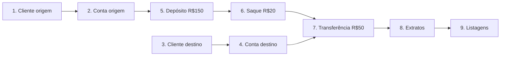

# RKF Bank — Roteiro de testes ponta a ponta (manual)

Roteiro para testar a API inteira na mão, com Postman, Insomnia ou curl. Serve para:

- conferir que tudo funciona antes de abrir um PR que mexe em regra de negócio;
- o **Fellipe (QA)** validar o MVP;
- quem está chegando entender o fluxo real do banco.

> Rotas e formatos oficiais: [README_CONTRATO_API.md](README_CONTRATO_API.md).
> Este roteiro chama o **backend direto** (`http://localhost:8080`, **sem** `/api`).
> Resultado da última execução completa (38/38 ✅): [CHECKLIST_TESTES_E2E.md](CHECKLIST_TESTES_E2E.md).

**Todas as respostas abaixo são reais e completas**, capturadas executando este roteiro na ordem, num banco vazio,
com Java 25. Ao repetir, só mudam os valores gerados: `id`s (UUID), `dataHora` e `timestamp`.

---

## 0. Preparação

1. Confira o JDK: `java -version` deve mostrar **25.x** (o Maven recusa outra versão).
2. Suba banco e API (seção "Como rodar" do [backend/README.md](README.md)).
   Sem Docker, dá para rodar com H2 em memória: `./mvnw spring-boot:run -Dspring-boot.run.profiles=test`
   (os dados somem ao parar a API; a seção 5 não se aplica).
3. Opcional, para começar do zero: `docker compose down -v && docker compose up -d` (**apaga todos os dados**).
4. No Postman/Insomnia, crie um ambiente com estas variáveis e use o header `Content-Type: application/json`:

| Variável | Valor inicial |
|---|---|
| `baseUrl` | `http://localhost:8080` |
| `clienteOrigemId` | (preenchido no passo 1) |
| `contaOrigemId` | (preenchido no passo 2) |
| `clienteDestinoId` | (preenchido no passo 3) |
| `contaDestinoId` | (preenchido no passo 4) |

**CPFs válidos para teste:** `52998224725`, `16899535009`, `39053344705`, `11144477735`.
**CEPs reais:** `01001000` (Praça da Sé – SP), `30140071` (Belo Horizonte – MG).

> Banco já com dados? CPF, e-mail e número de conta são únicos: se algum já existir, o passo devolve `409`.
> Use outro CPF válido (qualquer gerador de CPF serve), outro e-mail e outro `numeroConta` — ou comece do zero (item 3).

---

## 1. Caminho feliz



### Passo 1 — Criar cliente origem

`POST {{baseUrl}}/clientes`

```json
{
  "nomeCompleto": "Joao Silva",
  "cpf": "52998224725",
  "email": "joao.silva@rkfbank.com",
  "telefone": "11999998888",
  "cep": "01001000",
  "numero": "123",
  "complemento": "Apto 45"
}
```

✅ Response — CPF/telefone/CEP voltam formatados e o endereço vem do ViaCEP:

**`201 Created`**

```json
{
  "id": "0118cb9c-7e71-4f02-8fc3-ef513e1b9149",
  "nomeCompleto": "Joao Silva",
  "cpf": "529.982.247-25",
  "email": "joao.silva@rkfbank.com",
  "telefone": "(11) 99999-8888",
  "endereco": {
    "cep": "01001-000",
    "logradouro": "Praça da Sé",
    "bairro": "Sé",
    "cidade": "São Paulo",
    "uf": "SP",
    "ibge": "3550308",
    "numero": "123",
    "complemento": "Apto 45"
  }
}
```

➡️ Salve `id` em `clienteOrigemId`.

### Passo 2 — Abrir conta origem

`POST {{baseUrl}}/contas/clientes/{{clienteOrigemId}}`

```json
{ "agencia": "0001", "numeroConta": "12345678", "tipoContaEnum": "CORRENTE" }
```

✅ Response — `saldo` zerado, conta ativa e `clienteId` igual ao do passo 1:

**`201 Created`**

```json
{
  "id": "0a9a618b-f1a3-41ca-9ef7-a935eecf6b2d",
  "clienteId": "0118cb9c-7e71-4f02-8fc3-ef513e1b9149",
  "agencia": "0001",
  "numeroConta": "12345678",
  "tipoContaEnum": "CORRENTE",
  "saldo": 0.00,
  "ativa": true
}
```

➡️ Salve `id` em `contaOrigemId`.

### Passo 3 — Criar cliente destino

`POST {{baseUrl}}/clientes`

```json
{
  "nomeCompleto": "Maria Souza",
  "cpf": "16899535009",
  "email": "maria.souza@rkfbank.com",
  "telefone": "31999997777",
  "cep": "30140071",
  "numero": "500",
  "complemento": "Sala 10"
}
```

✅ Response:

**`201 Created`**

```json
{
  "id": "d974d93b-b9a7-4f18-bd49-73602380bbcf",
  "nomeCompleto": "Maria Souza",
  "cpf": "168.995.350-09",
  "email": "maria.souza@rkfbank.com",
  "telefone": "(31) 99999-7777",
  "endereco": {
    "cep": "30140-071",
    "logradouro": "Rua dos Aimorés",
    "bairro": "Boa Viagem",
    "cidade": "Belo Horizonte",
    "uf": "MG",
    "ibge": "3106200",
    "numero": "500",
    "complemento": "Sala 10"
  }
}
```

➡️ Salve `id` em `clienteDestinoId`.

### Passo 4 — Abrir conta destino

`POST {{baseUrl}}/contas/clientes/{{clienteDestinoId}}`

```json
{ "agencia": "0001", "numeroConta": "87654321", "tipoContaEnum": "POUPANCA" }
```

✅ Response:

**`201 Created`**

```json
{
  "id": "e8c54972-70ab-4c43-8dda-cd4a15d3944f",
  "clienteId": "d974d93b-b9a7-4f18-bd49-73602380bbcf",
  "agencia": "0001",
  "numeroConta": "87654321",
  "tipoContaEnum": "POUPANCA",
  "saldo": 0.00,
  "ativa": true
}
```

➡️ Salve `id` em `contaDestinoId`.

### Passo 5 — Depositar R$ 150,00 na origem

`POST {{baseUrl}}/contas/{{contaOrigemId}}/deposito`

```json
{ "valor": 150.00, "descricao": "Deposito inicial" }
```

✅ Response: **`204 No Content`** — sem corpo. Saldo da origem: **150.00**.

### Passo 6 — Sacar R$ 20,00 da origem

`POST {{baseUrl}}/contas/{{contaOrigemId}}/saque`

```json
{ "valor": 20.00, "descricao": "Saque teste" }
```

✅ Response: **`204 No Content`** — sem corpo. Saldo da origem: **130.00**.

### Passo 7 — Transferir R$ 50,00 da origem para o destino

`POST {{baseUrl}}/contas/transferencia`

```json
{
  "contaOrigemId": "{{contaOrigemId}}",
  "contaDestinoId": "{{contaDestinoId}}",
  "valor": 50.00,
  "descricao": "Transferencia aluguel"
}
```

✅ Response: **`204 No Content`** — sem corpo. Saldos: origem **80.00**, destino **50.00**.

### Passo 8 — Extratos

`GET {{baseUrl}}/contas/{{contaOrigemId}}/lancamentos`

✅ Response — 3 lançamentos, do mais novo para o mais antigo. Repare nos vínculos: a transferência tem origem e
destino; o saque só tem origem (saída); o depósito só tem destino (entrada):

**`200 OK`**

```json
[
  {
    "id": "8f03630d-c698-40a6-adf8-203732576df6",
    "tipoLancamento": "TRANSFERENCIA",
    "valor": 50.00,
    "contaOrigemId": "0a9a618b-f1a3-41ca-9ef7-a935eecf6b2d",
    "contaDestinoId": "e8c54972-70ab-4c43-8dda-cd4a15d3944f",
    "descricao": "Transferencia aluguel",
    "dataHora": "2026-10-14T01:57:45.263209Z"
  },
  {
    "id": "576c92eb-7c72-40a5-9950-567cb9d3ea56",
    "tipoLancamento": "SAQUE",
    "valor": 20.00,
    "contaOrigemId": "0a9a618b-f1a3-41ca-9ef7-a935eecf6b2d",
    "contaDestinoId": null,
    "descricao": "Saque teste",
    "dataHora": "2026-10-14T01:57:45.247471Z"
  },
  {
    "id": "f4025a27-00a4-4163-a48e-22144cb8915a",
    "tipoLancamento": "DEPOSITO",
    "valor": 150.00,
    "contaOrigemId": null,
    "contaDestinoId": "0a9a618b-f1a3-41ca-9ef7-a935eecf6b2d",
    "descricao": "Deposito inicial",
    "dataHora": "2026-10-14T01:57:45.224409Z"
  }
]
```

`GET {{baseUrl}}/contas/{{contaDestinoId}}/lancamentos`

✅ Response — 1 lançamento, a transferência recebida (`contaDestinoId` é a conta destino):

**`200 OK`**

```json
[
  {
    "id": "8f03630d-c698-40a6-adf8-203732576df6",
    "tipoLancamento": "TRANSFERENCIA",
    "valor": 50.00,
    "contaOrigemId": "0a9a618b-f1a3-41ca-9ef7-a935eecf6b2d",
    "contaDestinoId": "e8c54972-70ab-4c43-8dda-cd4a15d3944f",
    "descricao": "Transferencia aluguel",
    "dataHora": "2026-10-14T01:57:45.263209Z"
  }
]
```

### Passo 9 — Listagens

`GET {{baseUrl}}/clientes` (o mesmo que `?paginado=false`)

✅ Response — array com os 2 clientes:

**`200 OK`**

```json
[
  {
    "id": "0118cb9c-7e71-4f02-8fc3-ef513e1b9149",
    "nomeCompleto": "Joao Silva",
    "cpf": "529.982.247-25",
    "email": "joao.silva@rkfbank.com",
    "telefone": "(11) 99999-8888",
    "endereco": {
      "cep": "01001-000",
      "logradouro": "Praça da Sé",
      "bairro": "Sé",
      "cidade": "São Paulo",
      "uf": "SP",
      "ibge": "3550308",
      "numero": "123",
      "complemento": "Apto 45"
    }
  },
  {
    "id": "d974d93b-b9a7-4f18-bd49-73602380bbcf",
    "nomeCompleto": "Maria Souza",
    "cpf": "168.995.350-09",
    "email": "maria.souza@rkfbank.com",
    "telefone": "(31) 99999-7777",
    "endereco": {
      "cep": "30140-071",
      "logradouro": "Rua dos Aimorés",
      "bairro": "Boa Viagem",
      "cidade": "Belo Horizonte",
      "uf": "MG",
      "ibge": "3106200",
      "numero": "500",
      "complemento": "Sala 10"
    }
  }
]
```

`GET {{baseUrl}}/clientes?paginado=true&page=0&size=1`

✅ Response — página com 1 item, `totalElements: 2`, `totalPages: 2`:

**`200 OK`**

```json
{
  "content": [
    {
      "id": "0118cb9c-7e71-4f02-8fc3-ef513e1b9149",
      "nomeCompleto": "Joao Silva",
      "cpf": "529.982.247-25",
      "email": "joao.silva@rkfbank.com",
      "telefone": "(11) 99999-8888",
      "endereco": {
        "cep": "01001-000",
        "logradouro": "Praça da Sé",
        "bairro": "Sé",
        "cidade": "São Paulo",
        "uf": "SP",
        "ibge": "3550308",
        "numero": "123",
        "complemento": "Apto 45"
      }
    }
  ],
  "empty": false,
  "first": true,
  "last": false,
  "number": 0,
  "numberOfElements": 1,
  "pageable": {
    "offset": 0,
    "pageNumber": 0,
    "pageSize": 1,
    "paged": true,
    "sort": {
      "empty": true,
      "sorted": false,
      "unsorted": true
    },
    "unpaged": false
  },
  "size": 1,
  "sort": {
    "empty": true,
    "sorted": false,
    "unsorted": true
  },
  "totalElements": 2,
  "totalPages": 2
}
```

`GET {{baseUrl}}/contas` (o mesmo que `?paginado=false`)

✅ Response — array com as 2 contas (origem com `saldo: 80.00`, destino com `50.00`):

**`200 OK`**

```json
[
  {
    "id": "0a9a618b-f1a3-41ca-9ef7-a935eecf6b2d",
    "clienteId": "0118cb9c-7e71-4f02-8fc3-ef513e1b9149",
    "agencia": "0001",
    "numeroConta": "12345678",
    "tipoContaEnum": "CORRENTE",
    "saldo": 80.00,
    "ativa": true
  },
  {
    "id": "e8c54972-70ab-4c43-8dda-cd4a15d3944f",
    "clienteId": "d974d93b-b9a7-4f18-bd49-73602380bbcf",
    "agencia": "0001",
    "numeroConta": "87654321",
    "tipoContaEnum": "POUPANCA",
    "saldo": 50.00,
    "ativa": true
  }
]
```

`GET {{baseUrl}}/contas?paginado=true&page=0&size=10`

✅ Response — página com as 2 contas:

**`200 OK`**

```json
{
  "content": [
    {
      "id": "0a9a618b-f1a3-41ca-9ef7-a935eecf6b2d",
      "clienteId": "0118cb9c-7e71-4f02-8fc3-ef513e1b9149",
      "agencia": "0001",
      "numeroConta": "12345678",
      "tipoContaEnum": "CORRENTE",
      "saldo": 80.00,
      "ativa": true
    },
    {
      "id": "e8c54972-70ab-4c43-8dda-cd4a15d3944f",
      "clienteId": "d974d93b-b9a7-4f18-bd49-73602380bbcf",
      "agencia": "0001",
      "numeroConta": "87654321",
      "tipoContaEnum": "POUPANCA",
      "saldo": 50.00,
      "ativa": true
    }
  ],
  "empty": false,
  "first": true,
  "last": true,
  "number": 0,
  "numberOfElements": 2,
  "pageable": {
    "offset": 0,
    "pageNumber": 0,
    "pageSize": 10,
    "paged": true,
    "sort": {
      "empty": true,
      "sorted": false,
      "unsorted": true
    },
    "unpaged": false
  },
  "size": 10,
  "sort": {
    "empty": true,
    "sorted": false,
    "unsorted": true
  },
  "totalElements": 2,
  "totalPages": 1
}
```

---

## 2. Cenários de erro

Rode depois do caminho feliz (alguns dependem dos dados criados). Todo erro devolve o mesmo formato
(`timestamp`, `status`, `error`, `message`, `path`, `campos`) — ver [contrato, seção 6](README_CONTRATO_API.md#6-erros).

| # | Cenário | Esperado |
|---|---|---|
| E1 | CPF inválido | `400`, `campos[0].campo = "cpf"` |
| E2 | Campo obrigatório vazio | `400`, campo `nomeCompleto` |
| E3 | CPF repetido | `409` `CPF ja cadastrado` |
| E4 | E-mail repetido | `409` `Email ja cadastrado` |
| E5 | CEP inexistente | `422` `CEP não encontrado` |
| E6 | Cliente inexistente | `404` `Cliente não encontrado` |
| E7 | Número de conta repetido | `409` `Numero de conta ja existe` |
| E8 | Agência inválida | `400`, campo `agencia` |
| E9 | Tipo de conta inválido | `400` `JSON invalido ou tipo de campo incompativel` |
| E10 | Valor zero | `400`, campo `valor` |
| E11 | Três casas decimais | `400`, campo `valor` |
| E12 | Saldo insuficiente (saque) | `422` `Saldo insuficiente` |
| E13 | Saldo insuficiente (transferência) | `422` `Saldo insuficiente para transferencia` |
| E14 | Mesma conta | `422` `Conta de origem e destino nao podem ser iguais` |
| E15 | Conta inexistente | `404` `Conta nao encontrada` |
| E16 | ID inválido na URL | `400` `Parametro de URL invalido` |
| E17 | Paginação inválida | `400`, campo `size` |
| E18 | JSON quebrado | `400` `JSON invalido ou tipo de campo incompativel` |

Nenhum desses erros altera saldo: no fim, a origem continua com **80.00**.

### E1 — CPF inválido

`POST {{baseUrl}}/clientes`

```json
{
  "nomeCompleto": "Pedro Lima",
  "cpf": "11111111111",
  "email": "pedro.lima@rkfbank.com",
  "telefone": "11988887777",
  "cep": "01001000",
  "numero": "10"
}
```

**`400 Bad Request`**

```json
{
  "timestamp": "2026-10-14T01:57:45.366270600Z",
  "status": 400,
  "error": "Bad Request",
  "message": "Requisicao invalida",
  "path": "/clientes",
  "campos": [
    {
      "campo": "cpf",
      "mensagem": "cpf inválido"
    }
  ]
}
```

### E2 — Campo obrigatório vazio

`POST {{baseUrl}}/clientes` — mesmo corpo do E1, com CPF válido e nome vazio:

```json
{
  "nomeCompleto": "",
  "cpf": "39053344705",
  "email": "pedro.lima@rkfbank.com",
  "telefone": "11988887777",
  "cep": "01001000",
  "numero": "10"
}
```

**`400 Bad Request`**

```json
{
  "timestamp": "2026-10-14T01:57:45.376268400Z",
  "status": 400,
  "error": "Bad Request",
  "message": "Requisicao invalida",
  "path": "/clientes",
  "campos": [
    {
      "campo": "nomeCompleto",
      "mensagem": "nomeCompleto e obrigatório"
    }
  ]
}
```

### E3 — CPF repetido

`POST {{baseUrl}}/clientes` — repita o corpo do passo 1.

**`409 Conflict`**

```json
{
  "timestamp": "2026-10-14T01:57:45.384984800Z",
  "status": 409,
  "error": "Conflict",
  "message": "CPF ja cadastrado",
  "path": "/clientes",
  "campos": []
}
```

### E4 — E-mail repetido

`POST {{baseUrl}}/clientes` — CPF novo, e-mail do passo 1:

```json
{
  "nomeCompleto": "Pedro Lima",
  "cpf": "39053344705",
  "email": "joao.silva@rkfbank.com",
  "telefone": "11988887777",
  "cep": "01001000",
  "numero": "10"
}
```

**`409 Conflict`**

```json
{
  "timestamp": "2026-10-14T01:57:45.396567200Z",
  "status": 409,
  "error": "Conflict",
  "message": "Email ja cadastrado",
  "path": "/clientes",
  "campos": []
}
```

### E5 — CEP inexistente

`POST {{baseUrl}}/clientes` — CPF e e-mail novos, CEP que não existe:

```json
{
  "nomeCompleto": "Pedro Lima",
  "cpf": "39053344705",
  "email": "pedro.lima@rkfbank.com",
  "telefone": "11988887777",
  "cep": "99999999",
  "numero": "10"
}
```

**`422 Unprocessable Entity`**

```json
{
  "timestamp": "2026-10-14T01:57:45.555185300Z",
  "status": 422,
  "error": "Unprocessable Entity",
  "message": "CEP não encontrado",
  "path": "/clientes",
  "campos": []
}
```

### E6 — Cliente inexistente

`POST {{baseUrl}}/contas/clientes/00000000-0000-0000-0000-000000000000`

```json
{ "agencia": "0001", "numeroConta": "11112222", "tipoContaEnum": "CORRENTE" }
```

**`404 Not Found`**

```json
{
  "timestamp": "2026-10-14T01:57:45.561189100Z",
  "status": 404,
  "error": "Not Found",
  "message": "Cliente não encontrado",
  "path": "/contas/clientes/00000000-0000-0000-0000-000000000000",
  "campos": []
}
```

### E7 — Número de conta repetido

`POST {{baseUrl}}/contas/clientes/{{clienteOrigemId}}` — repita o corpo do passo 2.

**`409 Conflict`**

```json
{
  "timestamp": "2026-10-14T01:57:45.567751Z",
  "status": 409,
  "error": "Conflict",
  "message": "Numero de conta ja existe",
  "path": "/contas/clientes/0118cb9c-7e71-4f02-8fc3-ef513e1b9149",
  "campos": []
}
```

### E8 — Agência inválida

`POST {{baseUrl}}/contas/clientes/{{clienteOrigemId}}`

```json
{ "agencia": "1", "numeroConta": "11112222", "tipoContaEnum": "CORRENTE" }
```

**`400 Bad Request`**

```json
{
  "timestamp": "2026-10-14T01:57:45.572761Z",
  "status": 400,
  "error": "Bad Request",
  "message": "Requisicao invalida",
  "path": "/contas/clientes/0118cb9c-7e71-4f02-8fc3-ef513e1b9149",
  "campos": [
    {
      "campo": "agencia",
      "mensagem": "agencia deve ter 4 digitos"
    }
  ]
}
```

### E9 — Tipo de conta inválido

`POST {{baseUrl}}/contas/clientes/{{clienteOrigemId}}`

```json
{ "agencia": "0001", "numeroConta": "11112222", "tipoContaEnum": "SALARIO" }
```

**`400 Bad Request`**

```json
{
  "timestamp": "2026-10-14T01:57:45.576761900Z",
  "status": 400,
  "error": "Bad Request",
  "message": "JSON invalido ou tipo de campo incompativel",
  "path": "/contas/clientes/0118cb9c-7e71-4f02-8fc3-ef513e1b9149",
  "campos": []
}
```

### E10 — Valor zero

`POST {{baseUrl}}/contas/{{contaOrigemId}}/deposito`

```json
{ "valor": 0 }
```

**`400 Bad Request`**

```json
{
  "timestamp": "2026-10-14T01:57:45.581994400Z",
  "status": 400,
  "error": "Bad Request",
  "message": "Requisicao invalida",
  "path": "/contas/0a9a618b-f1a3-41ca-9ef7-a935eecf6b2d/deposito",
  "campos": [
    {
      "campo": "valor",
      "mensagem": "valor deve ser maior que zero"
    }
  ]
}
```

### E11 — Três casas decimais

`POST {{baseUrl}}/contas/{{contaOrigemId}}/deposito`

```json
{ "valor": 10.555 }
```

**`400 Bad Request`**

```json
{
  "timestamp": "2026-10-14T01:57:45.588995600Z",
  "status": 400,
  "error": "Bad Request",
  "message": "Requisicao invalida",
  "path": "/contas/0a9a618b-f1a3-41ca-9ef7-a935eecf6b2d/deposito",
  "campos": [
    {
      "campo": "valor",
      "mensagem": "valor deve ter no maximo 2 casas decimais"
    }
  ]
}
```

### E12 — Saldo insuficiente (saque)

`POST {{baseUrl}}/contas/{{contaOrigemId}}/saque`

```json
{ "valor": 999999.00 }
```

**`422 Unprocessable Entity`**

```json
{
  "timestamp": "2026-10-14T01:57:45.595615100Z",
  "status": 422,
  "error": "Unprocessable Entity",
  "message": "Saldo insuficiente",
  "path": "/contas/0a9a618b-f1a3-41ca-9ef7-a935eecf6b2d/saque",
  "campos": []
}
```

### E13 — Saldo insuficiente (transferência)

`POST {{baseUrl}}/contas/transferencia`

```json
{
  "contaOrigemId": "{{contaOrigemId}}",
  "contaDestinoId": "{{contaDestinoId}}",
  "valor": 999999.00
}
```

**`422 Unprocessable Entity`**

```json
{
  "timestamp": "2026-10-14T01:57:45.603542700Z",
  "status": 422,
  "error": "Unprocessable Entity",
  "message": "Saldo insuficiente para transferencia",
  "path": "/contas/transferencia",
  "campos": []
}
```

### E14 — Transferência para a mesma conta

`POST {{baseUrl}}/contas/transferencia`

```json
{
  "contaOrigemId": "{{contaOrigemId}}",
  "contaDestinoId": "{{contaOrigemId}}",
  "valor": 10.00
}
```

**`422 Unprocessable Entity`**

```json
{
  "timestamp": "2026-10-14T01:57:45.607062800Z",
  "status": 422,
  "error": "Unprocessable Entity",
  "message": "Conta de origem e destino nao podem ser iguais",
  "path": "/contas/transferencia",
  "campos": []
}
```

### E15 — Conta inexistente

`POST {{baseUrl}}/contas/00000000-0000-0000-0000-000000000000/deposito`

```json
{ "valor": 10.00 }
```

**`404 Not Found`**

```json
{
  "timestamp": "2026-10-14T01:57:45.612382600Z",
  "status": 404,
  "error": "Not Found",
  "message": "Conta nao encontrada",
  "path": "/contas/00000000-0000-0000-0000-000000000000/deposito",
  "campos": []
}
```

### E16 — ID inválido na URL

`GET {{baseUrl}}/contas/abc/lancamentos`

**`400 Bad Request`**

```json
{
  "timestamp": "2026-10-14T01:57:45.616381700Z",
  "status": 400,
  "error": "Bad Request",
  "message": "Parametro de URL invalido",
  "path": "/contas/abc/lancamentos",
  "campos": [
    {
      "campo": "contaId",
      "mensagem": "Tipo invalido para o parametro contaId"
    }
  ]
}
```

### E17 — Paginação inválida

`GET {{baseUrl}}/clientes?paginado=true&size=0`

**`400 Bad Request`**

```json
{
  "timestamp": "2026-10-14T01:57:45.620383800Z",
  "status": 400,
  "error": "Bad Request",
  "message": "Requisicao invalida",
  "path": "/clientes",
  "campos": [
    {
      "campo": "size",
      "mensagem": "deve estar entre 1 e 100"
    }
  ]
}
```

### E18 — JSON quebrado

`POST {{baseUrl}}/contas/{{contaOrigemId}}/deposito` com o corpo (propositalmente incompleto):

```text
{ "valor": 
```

**`400 Bad Request`**

```json
{
  "timestamp": "2026-10-14T01:57:45.626459800Z",
  "status": 400,
  "error": "Bad Request",
  "message": "JSON invalido ou tipo de campo incompativel",
  "path": "/contas/0a9a618b-f1a3-41ca-9ef7-a935eecf6b2d/deposito",
  "campos": []
}
```

---

## 3. Mesmo fluxo via curl (Git Bash)

```bash
API=http://localhost:8080
H='Content-Type: application/json'

CLIENTE_ID=$(curl -s -X POST $API/clientes -H "$H" -d '{
  "nomeCompleto":"Joao Silva","cpf":"39053344705","email":"joao.curl@rkfbank.com",
  "telefone":"11999998888","cep":"01001000","numero":"123"}' | sed -E 's/.*"id":"([^"]+)".*/\1/')

CONTA_ID=$(curl -s -X POST $API/contas/clientes/$CLIENTE_ID -H "$H" \
  -d '{"agencia":"0001","numeroConta":"55555555","tipoContaEnum":"CORRENTE"}' | sed -E 's/.*"id":"([^"]+)".*/\1/')

curl -i -X POST $API/contas/$CONTA_ID/deposito -H "$H" -d '{"valor":150.00}'
curl -i -X POST $API/contas/$CONTA_ID/saque    -H "$H" -d '{"valor":20.00}'
curl -s $API/contas/$CONTA_ID/lancamentos
```

> O `sed` extrai o campo `"id"` da resposta. Com `jq` instalado, prefira `| jq -r .id`.

---

## 4. Acompanhando pelos logs

Cada requisição recebe um id, devolvido no header `X-Request-Id` da resposta e impresso entre colchetes em
**todas** as linhas de log daquela chamada (inclusive o SQL do Hibernate). Para achar uma chamada específica no
console, envie o seu próprio id (letras, números e `-`, até 64 caracteres):

```bash
curl -i -X POST $API/contas/transferencia -H "$H" -H "X-Request-Id: e2e-transf-001" -d '{ ... }'
```

```text
INFO  [http-nio-8080-exec-1] [e2e-transf-001] c.b.r.s.ContaService : Transferencia de 50.00 da conta 672e4ddf-... para 83af15fb-...
INFO  [http-nio-8080-exec-1] [e2e-transf-001] c.b.r.c.FiltroLogRequisicao : POST /contas/transferencia -> 204 (15 ms)
```

O que conferir durante o roteiro:

- toda chamada gera uma linha `FiltroLogRequisicao` com método, rota, status e duração;
- operações concluídas (cadastro, abertura, depósito, saque, transferência) aparecem em `INFO`;
- recusas de regra de negócio (E3–E7, E12–E15) e erros de entrada (E1, E2, E8–E11, E16–E18) aparecem em `WARN`;
- **CPF e e-mail nunca aparecem no log.**

Configuração: [log4j2-spring.xml](src/main/resources/log4j2-spring.xml).

---

## 5. Conferindo no banco

Depois do caminho feliz, rode as consultas da seção **Banco de dados** do [backend/README.md](README.md)
e confira: 2 clientes, 2 endereços, 2 contas (80.00 e 50.00) e 4 lançamentos.

---

## 6. Checklist de validação do MVP (QA)

O checklist detalhado, item a item, com o resultado da última execução fica em
[CHECKLIST_TESTES_E2E.md](CHECKLIST_TESTES_E2E.md). Ao retestar, atualize a data e os resultados lá.
Resumo para a validação do MVP:

| ✔ | Item |
|:---:|---|
| ☐ | Passos 1 a 9 do caminho feliz com o resultado esperado |
| ☐ | Cenários E1 a E18 com o status esperado |
| ☐ | Saldos finais batem (origem 80.00, destino 50.00) |
| ☐ | Logs com `X-Request-Id` em cada linha e sem CPF/e-mail (seção 4) |
| ☐ | Mensagens de erro fazem sentido para um usuário final |
| ☐ | Cadastro pela tela (`http://localhost:3000/cadastro`) com sucesso e com erro de CPF repetido |
