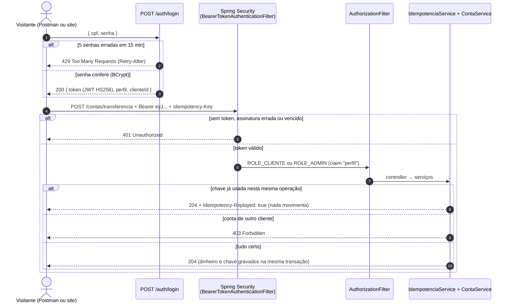
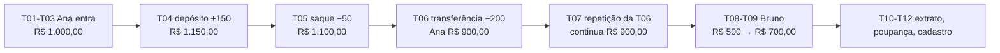

# RKF Bank — Guia de testes manuais, passo a passo

> **Para quem é:** qualquer pessoa que queira testar a API inteira na própria máquina, sem ajuda: visitantes,
> recrutadores, quem está chegando no projeto. Cada teste diz **o que fazer**, **o que deve aparecer** e **por quê**.
> Começo rápido em 5 minutos: [VISITANTES.md](../VISITANTES.md).
>
> 🔒 A equipe (Kevin, Renan e Felipe) tem um guia próprio, com as contas e os acessos internos, que **não** fica no
> repositório. Este aqui usa só as **contas de visitante**, que existem apenas no perfil `visitante`.

Todas as respostas são reais (capturadas em 20/10/2026, contrato 2.1). Ao repetir, só mudam `id`s gerados,
`dataHora`, `timestamp` e o `token`.

| Quero... | Vá para |
|---|---|
| subir a API | [1. Subir](#1-subir-a-aplicação-perfil-visitante) |
| saber com quem entrar | [2. Contas de visitante](#2-contas-de-visitante) |
| entender login, JWT, Spring Security e OAuth2 | [3. Segurança](#3-como-a-segurança-funciona-spring-security--oauth2--jwt) |
| entender por que toda movimentação pede uma chave | [3.6 Idempotência](#36-idempotência-por-que-toda-movimentação-pede-uma-chave) |
| testar | [5. Caminho feliz](#5-caminho-feliz-t01-a-t12) → [6. Segurança](#6-cenários-de-segurança-s01-a-s13) → [7. Erros](#7-cenários-de-erro-e01-a-e20) |

---

## 1. Subir a aplicação (perfil `visitante`)

Pré-requisito único: **JDK 25** (`java -version` → `25.x`). Na raiz do repositório:

```bash
./mvnw spring-boot:run -Dspring-boot.run.profiles=visitante
```

```powershell
.\mvnw.cmd spring-boot:run "-Dspring-boot.run.profiles=visitante"
```

| O perfil `visitante`... | Por quê |
|---|---|
| usa H2 em memória | sem Docker; **os dados somem ao parar a API** (cada subida começa limpa) |
| cria só as contas da Ana e do Bruno | dá para testar sem cadastrar nada |
| sorteia o segredo do JWT a cada subida | ninguém conhece a chave, então ninguém forja token |
| não cria admin e ignora o `.env` para segredos | nada de acesso privilegiado em um perfil público |
| dá token de 60 min | sobra tempo para seguir o guia |

No log, confira:

```text
The following 1 profile is active: "visitante"
Successfully applied 8 migrations to schema "PUBLIC", now at version v8
Executing SQL callback: afterMigrate - dados visitantes
Tomcat started on port 8080
```

E `curl -s http://localhost:8080/actuator/health` → `{"groups":["liveness","readiness"],"status":"UP"}`.

> Quer rodar com MySQL? Veja [backend/README.md → Como rodar](README.md). O perfil padrão (MySQL) não tem as contas
> de visitante; nele você cria as suas pelo cadastro (T11).

---

## 2. Contas de visitante

Criadas pelo Flyway (`db/seed/visitante/afterMigrate__dados_visitantes.sql`) a cada subida do perfil `visitante`.

| | 🟠 Conta de **origem** | 🔵 Conta de **destino** |
|---|---|---|
| Quem | **Ana Visitante** | **Bruno Visitante** |
| CPF (login) | `246.813.579-28` | `975.318.642-82` |
| Senha | `Visitante@2026` | `Visitante@2026` |
| `clienteId` | `a0000000-0000-4000-8000-000000000112` | `a0000000-0000-4000-8000-000000000122` |
| `contaId` | `a0000000-0000-4000-8000-000000000114` | `a0000000-0000-4000-8000-000000000124` |
| Agência / conta | `0001` / `900001` — corrente | `0001` / `900002` — corrente |
| Saldo ao nascer | **R$ 1.000,00** | **R$ 500,00** |

Nomes, CPFs (válidos pelos dígitos verificadores), e-mails e endereços são fictícios. A senha só existe neste
perfil, que só roda na sua máquina.

---

## 3. Como a segurança funciona (Spring Security + OAuth2 + JWT)

### 3.1 Os quatro conceitos

| Conceito | Pergunta que responde | No RKF Bank |
|---|---|---|
| **Autenticação** | *quem é você?* | CPF + senha em `POST /auth/login`, conferida contra o hash **BCrypt** em `tb_usuario` |
| **Token (JWT)** | *como provo quem sou nas próximas chamadas?* | o login devolve um **JWT** assinado (HS256), enviado em `Authorization: Bearer <token>` |
| **Autorização por perfil** | *o seu tipo de usuário pode usar esta rota?* | `ADMIN` lista clientes e vê todas as contas; `CLIENTE` não (`403`) |
| **Autorização por dono** | *este dado é seu?* | cliente só mexe nas **próprias** contas (`403`); o `clienteId` vem **do token**, nunca do corpo |

`401` = "não sei quem você é". `403` = "sei quem você é, mas você não pode". `429` = "você tentou demais".

### 3.2 Onde entra o OAuth2 (e onde não entra)

| Papel no OAuth2 | O que faz | No RKF Bank |
|---|---|---|
| *Resource Owner* | dono dos dados | o cliente (Ana, Bruno) |
| *Client* | app que pede acesso | o site Next.js (ou o seu Postman) |
| *Authorization Server* | confere a identidade e **emite** o token | a própria API, no `POST /auth/login` |
| *Resource Server* | **valida** o token e protege as rotas | a própria API, com `spring-boot-starter-security-oauth2-resource-server` |

Usamos a metade **Resource Server** do OAuth2 de verdade — a parte oficial do Spring Security que valida assinatura,
algoritmo, expiração e emissor do JWT — em vez de um filtro caseiro. A emissão é um login próprio com CPF + senha.
Fluxos completos do OAuth2 (*authorization code*, *refresh token*, login social) entram quando houver mais de um app
consumindo a API (3.7).

### 3.3 O caminho de uma requisição



### 3.4 O que vai dentro do token

`header.payload.assinatura`; as duas primeiras partes são **só Base64** (qualquer um lê). Por isso o payload não
leva CPF, nome nem senha. Exemplo real:

```json
{"iss":"rkfbank","sub":"<id do usuário>","clienteId":"<id do cliente>","exp":1792532005,"iat":1792531105,"perfil":"CLIENTE"}
```

`sub` é o id do **usuário** (não o CPF); `clienteId` é de onde sai a regra de dono; `perfil` vira `ROLE_CLIENTE` ou
`ROLE_ADMIN`; `exp - iat` é a validade. Quem garante que ninguém trocou `CLIENTE` por `ADMIN` é a **assinatura**
(HMAC-SHA256): mudou uma letra, não bate → `401`.

### 3.5 Quem é quem no código

| Arquivo | Papel |
|---|---|
| `config/ConfiguracaoSeguranca.java` | rotas públicas, rota de admin, *stateless*, Resource Server com JWT, BCrypt, chave HS256 |
| `services/AuthService.java` + `security/LimitadorTentativasLogin.java` | confere CPF + senha (mesma resposta para CPF inexistente e senha errada) e o limite de tentativas |
| `services/TokenService.java` | monta e assina o JWT |
| `services/IdempotenciaService.java` | garante que cada movimentação acontece uma vez só por `Idempotency-Key` |
| `security/ConversorTokenUsuario.java` | a cada requisição, confere se o usuário do token ainda existe, está ativo e tem o mesmo perfil (senão `401`): é o que faz desativar ou rebaixar alguém valer na hora |
| `config/RespostaErroSeguranca.java` | 401/403 do Spring no formato de erro da API |

Rotas públicas: `POST /clientes`, `POST /auth/login`, `GET /actuator/health`, `/error` e
`GET /.well-known/oauth-protected-resource` (metadado do RFC 9728). Todo o resto exige token.

### 3.6 Idempotência: por que toda movimentação pede uma chave

Em dinheiro, **repetir** uma chamada é perigoso: a rede cai depois do débito, o app tenta de novo, e sem proteção o
valor sai duas vezes. Por isso depósito, saque e transferência exigem o header `Idempotency-Key`:

| Situação | Resposta |
|---|---|
| chave nova | movimenta, `204` |
| mesma chave + mesmo corpo (repetição) | `204` + `Idempotency-Replayed: true`, **nada** movimenta |
| mesma chave + corpo diferente | `422` (a chave já foi usada para outra operação) |
| sem chave | `400` |

Regra para quem chama: gere um UUID novo **por operação** e reuse o mesmo **só** para repetir aquela operação.

### 3.7 Próximos passos de segurança

| Passo | Para quê |
|---|---|
| Refresh token | sessão longa sem token de acesso longo |
| RS256 + JWKS | quem só valida não precisa do segredo que assina |
| Authorization Server dedicado (Spring Authorization Server / Keycloak) | vários apps, login social, MFA |

---

## 4. Preparar a ferramenta

### 4.1 Postman / Insomnia

| Variável | Valor |
|---|---|
| `baseUrl` | `http://localhost:8080` |
| `contaAna` / `contaBruno` | `a0000000-0000-4000-8000-000000000114` / `a0000000-0000-4000-8000-000000000124` |
| `clienteAna` / `clienteBruno` | `a0000000-0000-4000-8000-000000000112` / `a0000000-0000-4000-8000-000000000122` |
| `tokenAna`, `tokenBruno`, `chave` | preenchidos pelos scripts abaixo |

Login → **Scripts → Post-response**: `pm.environment.set("tokenAna", pm.response.json().token);`
Movimentações → **Scripts → Pre-request**: `pm.environment.set("chave", crypto.randomUUID());` e header
`Idempotency-Key: {{chave}}`. Para testar a repetição, desligue o pre-request e envie de novo.

### 4.2 Git Bash (curl)

```bash
API=http://localhost:8080
H='Content-Type: application/json'
CA=a0000000-0000-4000-8000-000000000114   # conta da Ana
CB=a0000000-0000-4000-8000-000000000124   # conta do Bruno
login() { curl -s -X POST $API/auth/login -H "$H" -d "{\"cpf\":\"$1\",\"senha\":\"Visitante@2026\"}" | sed -E 's/.*"token":"([^"]+)".*/\1/'; }
TA=$(login 24681357928); AA="Authorization: Bearer $TA"
TB=$(login 97531864282); AB="Authorization: Bearer $TB"
chave() { echo "Idempotency-Key: $(node -e 'console.log(crypto.randomUUID())')"; }
```

### 4.3 PowerShell

```powershell
$API = "http://localhost:8080"; $CA = "a0000000-0000-4000-8000-000000000114"; $CB = "a0000000-0000-4000-8000-000000000124"
function Login($cpf) { (Invoke-RestMethod -Method Post "$API/auth/login" -ContentType "application/json" -Body (@{cpf=$cpf; senha="Visitante@2026"} | ConvertTo-Json)).token }
$TA = Login "24681357928"; $TB = Login "97531864282"
function Mov($token) { @{ Authorization = "Bearer $token"; "Idempotency-Key" = [guid]::NewGuid().ToString() } }
Invoke-RestMethod -Method Post "$API/contas/$CA/deposito" -Headers (Mov $TA) -ContentType "application/json" -Body '{"valor":150.00}'
```

---

## 5. Caminho feliz (T01 a T12)



| # | O que fazer | Request | Esperado |
|---|---|---|---|
| T01 | Login da Ana | `POST /auth/login` `{"cpf":"246.813.579-28","senha":"Visitante@2026"}` | `200` · `perfil CLIENTE` · `clienteId …112` · `expiraEmSegundos 3600` |
| T02 | Contas da Ana | `GET /contas` (token Ana) | `200`, **1** conta `900001`, `saldo 1000.00` |
| T03 | Extrato inicial | `GET /contas/{{contaAna}}/lancamentos` | `DEPOSITO 1000.00` "Saldo de boas-vindas do visitante" |
| T04 | Depósito R$ 150 | `POST /contas/{{contaAna}}/deposito` + chave nova · `{"valor":150.00,"descricao":"Freela"}` | `204`; saldo `1150.00` |
| T05 | Saque R$ 50 | `POST /contas/{{contaAna}}/saque` + chave nova · `{"valor":50.00,"descricao":"Pastel"}` | `204`; saldo `1100.00` |
| T06 | Transferir R$ 200 ao Bruno | `POST /contas/transferencia` + chave **K** · `{"contaOrigemId":"{{contaAna}}","contaDestinoId":"{{contaBruno}}","valor":200.00,"descricao":"Aluguel"}` | `204`, sem `Idempotency-Replayed`; Ana `900.00` |
| T07 | **Repetir a T06** com a mesma **K** | idem | `204` **com** `Idempotency-Replayed: true`; Ana continua `900.00` |
| T08 | Login do Bruno | `{"cpf":"97531864282","senha":"Visitante@2026"}` | `200` · `clienteId …122` |
| T09 | Bruno vê o dinheiro | `GET /contas` e extrato (token Bruno) | `saldo 700.00`; **um** `TRANSFERENCIA 200.00` |
| T10 | Extrato da Ana | `GET /contas/{{contaAna}}/lancamentos` | `TRANSFERENCIA 200` → `SAQUE 50` → `DEPOSITO 150` → `DEPOSITO 1000`; soma = **900** |
| T11 | Poupança com número gerado | `POST /contas/clientes/{{clienteAna}}` `{"tipoContaEnum":"POUPANCA"}` | `201` · agência `0001` · número de **8 dígitos** (o último é dígito verificador) · `saldo 0.00` |
| T12 | Cadastro de cliente novo (público, ViaCEP) | `POST /clientes` sem token (corpo abaixo) | `201`, CPF/telefone formatados, endereço do ViaCEP, **sem** senha na resposta |

Corpo da T12 (precisa de internet; outros CPFs válidos: `16899535009`, `39053344705`):

```json
{"nomeCompleto":"Joao Silva","cpf":"52998224725","email":"joao.silva@rkfbank.com","telefone":"11999998888","cep":"01001000","numero":"123","complemento":"Apto 45","senha":"senha-forte-1"}
```

Respostas reais de referência:

```text
T06 → HTTP/1.1 204
T07 → HTTP/1.1 204
      Idempotency-Replayed: true
```

```json
// T11
{"id":"4d7532a3-...","clienteId":"a0000000-0000-4000-8000-000000000112","agencia":"0001","numeroConta":"95143998","tipoContaEnum":"POUPANCA","saldo":0.00,"ativa":true}
```

No Git Bash (depois da 4.2):

```bash
curl -s -o /dev/null -w "%{http_code}\n" -X POST $API/contas/$CA/deposito -H "$H" -H "$AA" -H "$(chave)" -d '{"valor":150.00,"descricao":"Freela"}'
curl -s -o /dev/null -w "%{http_code}\n" -X POST $API/contas/$CA/saque    -H "$H" -H "$AA" -H "$(chave)" -d '{"valor":50.00,"descricao":"Pastel"}'
K="$(chave)"
curl -s -i -X POST $API/contas/transferencia -H "$H" -H "$AA" -H "$K" -d "{\"contaOrigemId\":\"$CA\",\"contaDestinoId\":\"$CB\",\"valor\":200.00,\"descricao\":\"Aluguel\"}" | grep -E "^HTTP|^Idempotency"
curl -s -i -X POST $API/contas/transferencia -H "$H" -H "$AA" -H "$K" -d "{\"contaOrigemId\":\"$CA\",\"contaDestinoId\":\"$CB\",\"valor\":200.00,\"descricao\":\"Aluguel\"}" | grep -E "^HTTP|^Idempotency"
curl -s $API/contas -H "$AA"; echo; curl -s $API/contas -H "$AB"; echo
```

---

## 6. Cenários de segurança (S01 a S13)

| # | Cenário | Como provocar | Esperado |
|---|---|---|---|
| S01 | Sem token | `curl -i $API/contas` | `401` · `Autenticacao necessaria: envie o token no header Authorization (Bearer)` |
| S02 | Senha errada | login da Ana com `"senha":"errada123"` | `401` · `CPF ou senha invalidos` |
| S03 | CPF sem cadastro | login com `39053344705` | `401` com a **mesma** mensagem do S02 |
| S04 | Token que não é JWT | `Authorization: Bearer isso-nao-e-um-jwt` | `401` · `Token invalido ou expirado; faca login novamente` |
| S05 | Token adulterado | troque uma letra do meio do token | `401` · mesma do S04 |
| S06 | Token de outra execução | faça login, **reinicie** a API e use o token antigo | `401`: o segredo foi sorteado de novo |
| S07 | Bruno saca da conta da Ana | `POST /contas/{{contaAna}}/saque` + chave, token Bruno | `403` · `Conta nao pertence ao usuario logado` |
| S08 | Bruno vê o extrato da Ana | `GET /contas/{{contaAna}}/lancamentos`, token Bruno | `403` |
| S09 | Bruno transfere saindo da Ana | transferência com origem = conta da Ana, token Bruno | `403` |
| S10 | Ana abre conta no cadastro do Bruno | `POST /contas/clientes/{{clienteBruno}}`, token Ana | `403` · `Voce so pode abrir conta no seu proprio cadastro` |
| S11 | Cliente lista clientes | `GET /clientes`, token Ana | `403` · `Acesso negado para o seu perfil` |
| S13 | Trocar a própria senha | `PATCH /auth/senha` (token da Ana) com `{"senhaAtual":"Visitante@2026","novaSenha":"senha-nova-da-ana"}`, depois use o token antigo | `204`; token antigo → `401` `Seu acesso foi alterado ou desativado; faca login novamente`; login com a nova → `200` (reinicie a API para voltar à senha pública) |
| S12 | Força bruta | 5 logins errados para o Bruno, depois a senha **certa** | 5 × `401`, depois `429` com `Retry-After` (≈900 s) **mesmo com a senha certa** |

Por que S02 e S03 respondem igual: senão daria para descobrir quem é cliente testando CPFs. Por que S07 é `403` e não
`404`: o dono é conferido antes de qualquer coisa que revele o estado da conta. Rode o S12 por último (ou reinicie a
API depois): o Bruno fica 15 min sem entrar.

---

## 7. Cenários de erro (E01 a E20)

Token da Ana e conta dela, salvo quando dito; toda movimentação com `Idempotency-Key` nova.

| # | Cenário | Request | Esperado (`status` · `message` · `campos`) |
|---|---|---|---|
| E01 | CPF inválido | T12 com `"cpf":"12345678900"` | `400` · `cpf: cpf inválido` |
| E02 | Campo vazio | T12 com CPF novo e `"nomeCompleto":""` | `400` · `nomeCompleto: nomeCompleto e obrigatório` |
| E03 | CPF repetido | T12 com `"cpf":"24681357928"` | `409` · `CPF ja cadastrado` |
| E04 | E-mail repetido | CPF novo, `"email":"ana.visitante@exemplo.test"` | `409` · `Email ja cadastrado` |
| E05 | CEP inexistente | `"cep":"99999999"` | `422` · `CEP não encontrado` |
| E06 | Cliente inexistente | `POST /contas/clientes/00000000-0000-0000-0000-000000000000` | `403` (regra de dono antes do `404`) |
| E07 | Número de conta repetido | T11 com `"numeroConta":"900002"` | `409` · `Numero de conta ja existe` |
| E08 | Agência inválida | T11 com `"agencia":"1"` | `400` · `agencia: agencia deve ter 4 digitos` |
| E09 | Tipo inválido | `{"tipoContaEnum":"SALARIO"}` | `400` · `JSON invalido ou tipo de campo incompativel` |
| E10 | Valor zero | depósito `{"valor":0}` | `400` · `valor: valor deve ser maior que zero` |
| E11 | Três casas | depósito `{"valor":10.555}` | `400` · `valor: valor deve ter no maximo 2 casas decimais` |
| E12 | Saldo insuficiente (saque) | `{"valor":999999.00}` | `422` · `Saldo insuficiente` |
| E13 | Saldo insuficiente (transferência) | T06 com `999999.00` | `422` · `Saldo insuficiente para transferencia` |
| E14 | Mesma conta | T06 com destino = conta da Ana | `422` · `Conta de origem e destino nao podem ser iguais` |
| E15 | Conta inexistente | depósito em `00000000-0000-0000-0000-000000000000` | `404` · `Conta nao encontrada` |
| E16 | Id inválido | `GET /contas/abc/lancamentos` | `400` · `contaId: Tipo invalido para o parametro contaId` |
| E17 | Paginação inválida | `GET /contas?paginado=true&size=0` | `400` · `size: deve estar entre 1 e 100` |
| E18 | JSON quebrado | corpo `{ "valor": ` | `400` · `JSON invalido ou tipo de campo incompativel` |
| E19 | Sem `Idempotency-Key` | depósito sem o header | `400` · `Idempotency-Key: header Idempotency-Key e obrigatorio nas movimentacoes (gere um UUID novo por operacao)` |
| E20 | Chave reaproveitada com outro valor | repita a chave da T06 com `"valor":999.00` | `422` · `Idempotency-Key ja usada em outra requisicao; gere uma chave nova para esta operacao` |

Depois de E10–E20, o saldo da Ana **não muda**. Mapa de status: `400` entrada · `401` identidade · `403` permissão ·
`404` não existe · `409` conflito · `422` regra · `429` tentativas demais · `503` ViaCEP fora.

---

## 8. Conferindo nos logs

Cada requisição ganha um `X-Request-Id` (devolvido no header e impresso em todas as linhas de log dela). Mande o seu
(`-H "X-Request-Id: meu-teste-001"`) e procure no console. Operações concluídas saem em `INFO`, recusas em `WARN`, e
**nunca** aparece CPF, e-mail, senha, hash ou token.

---

## 9. Checklist

| ✔ | Item | Seção |
|:-:|---|---|
| ☐ | API subiu com 8 migrações e o callback dos visitantes | 1 |
| ☐ | Ana e Bruno entram e cada um vê só a própria conta | T01–T09 |
| ☐ | Movimentações `204`; saldos finais Ana 900.00 / Bruno 700.00 | T04–T09 |
| ☐ | Repetir a transferência **não** debita duas vezes | T07 |
| ☐ | Extrato soma igual ao saldo | T10 |
| ☐ | Conta nova com número gerado | T11 |
| ☐ | S01–S13 e E01–E20 com o status esperado | 6, 7 |

---

## 10. O que roda sozinho

| Comando | O que prova |
|---|---|
| `scripts/validar.sh backend` | 237 testes (regras, segurança, idempotência, repositórios, seeds) |
| `node scripts/smoke-e2e.mjs` | o fluxo inteiro contra a API no ar (no perfil `visitante`: 32 verificações) |

---

## 11. Problemas comuns

| Sintoma | Causa | Solução |
|---|---|---|
| `RequireJavaVersion failed` | JDK diferente do 25 | instale o JDK 25 |
| Login da Ana dá `401` | a API não está no perfil `visitante` | suba com `-Dspring-boot.run.profiles=visitante` |
| `400` em toda movimentação | faltou `Idempotency-Key` | 3.6 |
| `429` no login | 5 senhas erradas seguidas | espere 15 min ou reinicie a API |
| `401` depois de reiniciar | o segredo do JWT é sorteado a cada subida | faça login de novo |
| `Port 8080 was already in use` | outra API rodando | feche a outra ou use `--server.port=8081` |
| Cadastro `503` | ViaCEP fora ou sem internet | os testes com Ana e Bruno não dependem dele |
| Acento vira `JSON invalido` no curl | Git Bash quebra UTF-8 no `-d` | `--data-binary @corpo.json` |
