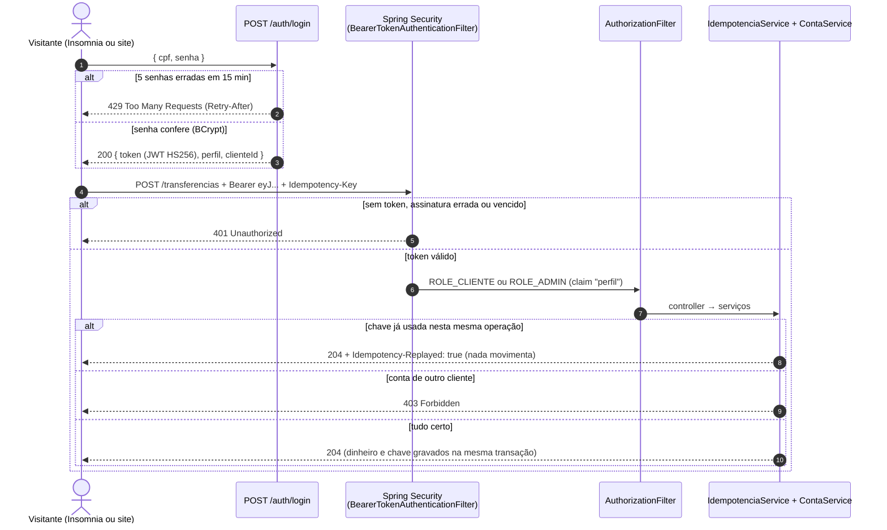
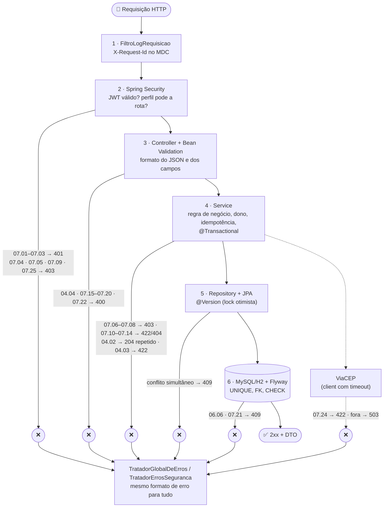

# 🧪 Como testar o RKF Bank (API) — do zero, com pedido e resposta de cada passo

| | |
|---|---|
| 🎯 **Para que serve** | **referência completa** da API como cliente: as 83 requisições da coleção pública, com cada conceito explicado |
| 👥 **Área responsável** | 🟦 **Backend** (a API) · público |
| ⏰ **Quando usar** | depois do [VISITANTES.md](../VISITANTES.md), para ir além ou entender um resultado |
| 🧰 **Como** | Insomnia + coleção pública, perfil `visitante` |
| 🚫 **Não cobre** | o ADMIN (só a equipe testa) · as telas → [frontend/README_TESTES_E2E.md](../frontend/README_TESTES_E2E.md) |


> 👉 **Primeira vez? Comece pelo [VISITANTES.md](../VISITANTES.md):** 13 passos, 15 minutos, só o essencial (login,
> depósito, saque, transferência, extrato e três proteções). Este guia é a **referência completa**: todas as 83
> requisições da coleção, com cada conceito explicado. Use quando quiser ir além ou entender um resultado.

> Para **qualquer pessoa** que clonou o repositório (recrutador, colega, curioso) testar a API na própria máquina,
> **como cliente do banco**: cadastro, contas, depósito, saque, transferência, extrato, dados pessoais, sessão e os
> erros que o banco tem que dar. Contrato **3.1**. Nunca testou uma API? Comece pela Parte 0: cada palavra nova é
> explicada antes de aparecer, e cada passo tem um **💡 Em palavras simples**, o pedido completo e a resposta que a
> API devolveu de verdade. Tudo usa só **contas públicas** (Ana e Bruno) ou contas que **você** cria na sua máquina.
> Prefere clicar no site? [Roteiro do frontend](../frontend/README_TESTES_E2E.md). Só 5 minutos? [Visitantes](../VISITANTES.md).

| Parte | O que tem | Tempo |
|---|---|:-:|
| [0 · Entenda antes de testar](#parte-0--entenda-antes-de-testar) | o que é uma API, como ler um pedido e uma resposta, quem é quem | 10 min |
| [1 · Prepare o ambiente pelo IntelliJ](#parte-1--prepare-o-ambiente-pelo-intellij) | JDK 25, rodar a API (VM options), ver o banco, importar a coleção | 15 min (1ª vez) |
| [2 · Teste como cliente](#parte-2--teste-como-cliente) | Ana e Bruno, cliente novo do cadastro ao extrato, idempotência, LGPD, erros e sessão | 20 min |
| [3 · Por dentro e problemas comuns](#parte-3--por-dentro-e-problemas-comuns) | logs, como a segurança funciona, cada camada, problemas comuns | consulta |

> ⚡ **Pressa?** Parte 1.3 (▶️ **API · Visitante (H2)**) → importe a coleção (1.6) → mande as pastas de cima para
> baixo. Ou, pelo terminal, com a API no ar: `node scripts/rodar-colecao-insomnia.mjs` → `83/83`.

> 🛡️ **E o administrador?** O banco tem um perfil `ADMIN` (gestão de usuários e auditoria), mas ele **não existe** no
> perfil `visitante`, de propósito: a senha dos visitantes é pública, e um ADMIN com senha pública seria um ADMIN de
> qualquer um. Os testes de ADMIN ficam no roteiro privado da equipe. Daqui, você vê o outro lado: o cliente tentando
> entrar onde só o ADMIN pode, e recebendo `403` (pasta `07`). Por isso a coleção pula da pasta `04` para a `06`.

---

## Parte 0 — Entenda antes de testar

### O que é uma API, em uma frase

O app e o site do banco não guardam dinheiro nem dados: eles **pedem** tudo para a API ("me mostra as contas da
Ana", "transfere R$ 25 para o Bruno"), e a API responde. Testar a API é fazer esses pedidos na mão, sem tela, e
conferir se cada resposta está certa. O **Insomnia** é o programa que manda os pedidos por você.

### Como ler um pedido (requisição)

```http
POST /transferencias                          ← o MÉTODO (o que fazer) e o CAMINHO (com o quê)
Authorization: Bearer eyJhbGci...             ← HEADERS: informações extras. Este é o "crachá" de quem pede
Idempotency-Key: 3f1c...                      ← o "número do pedido", para não repetir a operação
Content-Type: application/json                ← avisa que o corpo está em JSON

{ "contaOrigemId": "...", "contaDestinoId": "...", "valor": 25.00 }      ← o CORPO: os dados do pedido
```

| Método | Quer dizer | Exemplo no banco |
|---|---|---|
| `GET` | **ler**, sem mudar nada | ver as contas, ver o extrato |
| `POST` | **criar** ou **fazer** algo | cadastrar, abrir conta, depositar, transferir, entrar (login) |
| `PATCH` | **corrigir** uma parte | mudar o telefone, trocar a senha |
| `OPTIONS` | o navegador **pergunta se pode** antes de chamar | só na pasta `08` (CORS) |

**JSON** é o formato dos dados: pares `"campo": valor` entre chaves, como `{ "valor": 25.00 }`. Lista vem entre
colchetes: `[ {...}, {...} ]`.

### Como ler uma resposta: o número (status) diz quase tudo

| Status | Em palavras simples | Quando aparece aqui |
|:-:|---|---|
| ✅ `200` | "aqui está" | leituras e logins |
| ✅ `201` | "criei" | cadastro e conta nova |
| ✅ `204` | "feito, e não tenho nada para mostrar" | depósito, saque, transferência, troca de senha. A resposta vem **vazia de propósito** |
| ⛔ `400` | "o pedido está mal escrito" | campo faltando, formato errado, valor com 3 casas |
| ⛔ `401` | "não sei quem você é" | sem crachá, crachá vencido ou falso, senha errada |
| ⛔ `403` | "sei quem você é, mas você não pode" | mexer na conta de outra pessoa, cliente em rota de ADMIN |
| ⛔ `404` | "não achei" | conta que não existe |
| ⛔ `409` | "isso já existe" | CPF ou e-mail já cadastrado |
| ⛔ `422` | "entendi, mas a regra do banco não deixa" | saldo insuficiente, encerrar com dinheiro na conta |

> ⭐ **Um erro esperado é um teste que PASSOU.** A pasta `07` inteira manda pedidos errados de propósito: receber o
> `403` certo é a prova de que a proteção funciona. Errado seria um `200` ali.

Todo erro vem no mesmo formato, e o campo que importa é o `codigo` (o `message` é só para ler e pode mudar):

```json
{ "status": 422, "error": "Unprocessable Entity", "codigo": "SALDO_INSUFICIENTE",
  "message": "Saldo insuficiente", "path": "/contas/.../saques", "campos": [] }
```

### Palavras que aparecem nas respostas

| Palavra | Em palavras simples |
|---|---|
| `token` | o **crachá de acesso**, que o login devolve. Vai no header `Authorization: Bearer <token>` de todo pedido protegido. Vence em 60 min no perfil `visitante` (`expiraEmSegundos`) |
| `refreshToken` | um **segundo crachá**, de 7 dias, que troca o primeiro por um novo sem pedir a senha (é assim que o app te mantém logado). Só pode ser usado **uma vez** |
| `Idempotency-Key` | o **número do pedido** em depósito, saque e transferência. Se o mesmo número chegar duas vezes (a internet caiu e o app tentou de novo), o dinheiro **não** se move duas vezes |
| `codigo` | o nome fixo do erro (ex.: `SALDO_INSUFICIENTE`). É o que a tela usa para decidir o que mostrar |
| `***.982.247-**` | CPF **mascarado**: as respostas nunca devolvem o CPF inteiro (LGPD) |
| ORIGEM e DESTINO | quem **manda** e quem **recebe** o dinheiro nos testes |
| LGPD | a lei de proteção de dados: o banco só pede o que precisa e a pessoa pode ver, corrigir e apagar os próprios dados |

### Quem é quem

| Pessoa | Papel no teste | CPF (login) | Senha | Conta |
|---|---|---|---|---|
| **Ana Visitante** | cliente ORIGEM (manda dinheiro) | `246.813.579-28` | `Visitante@2026` | corrente `900001` · id `a0000000-0000-4000-8000-000000000114` · R$ 1.000,00 |
| **Bruno Visitante** | cliente DESTINO (recebe) | `975.318.642-82` | `Visitante@2026` | corrente `900002` · id `a0000000-0000-4000-8000-000000000124` · R$ 500,00 |
| **Cliente Novo** | o cliente que **você** cadastra (pasta `02`) | sorteado pela coleção a cada envio | sorteada | as que ele abrir |

Todos os CPFs, nomes e endereços são fictícios (os CPFs são válidos só pelos dígitos verificadores). Cada vez que a
API sobe no perfil `visitante`, o banco **recomeça do zero**: Ana com R$ 1.000,00 e Bruno com R$ 500,00.

### Os cenários que este roteiro cobre

| Cenário | Pasta da coleção | O que prova |
|---|:-:|---|
| A API está no ar | `00` | o primeiro "você está aí?" |
| Login | `01` | CPF e senha viram um crachá (token) |
| Cliente novo do cadastro ao extrato | `02` | aceite dos termos, endereço pelo ViaCEP, contas, depósito, saque, transferência e extrato, centavo a centavo |
| Dinheiro entre duas pessoas | `03` | Ana manda, Bruno recebe; cada um vê só o que é seu |
| Pedido repetido | `04` | a mesma operação mandada duas vezes não se repete |
| Meus dados (LGPD) e senha | `06` | ver, corrigir, trocar a senha e encerrar o cadastro |
| Erros que devem acontecer | `07` | `400`, `401`, `403`, `404`, `409` e `422`, cada um com o `codigo` certo |
| CORS | `08` | só o site do banco chama a API de dentro do navegador |
| Sessão | `09` | ficar logado sem a senha, crachá roubado derrubando tudo, sair de verdade |

Contrato completo (todas as rotas, campos e códigos de erro): [README_CONTRATO_API.md](README_CONTRATO_API.md).

---

## Parte 1 — Prepare o ambiente pelo IntelliJ

### 1.1 Instalar (uma vez)

| Ferramenta | Para quê | Como conferir |
|---|---|---|
| **Git** (no Windows, já traz o Git Bash) | baixar o projeto e rodar os comandos | `git --version` |
| **IntelliJ IDEA** (Community serve) | abrir o projeto, rodar a API e ver o banco | — |
| **JDK 25** | a API é Java 25 (o IntelliJ baixa para você no 1.2) | `java -version` → `25.x` |
| **Insomnia** (10 ou mais novo) | mandar os pedidos da coleção | — |
| **Node 20+** | só para os scripts de teste pelo terminal | `node -v` |

Não precisa de Docker nem de banco instalado: o perfil `visitante` traz um banco em memória (H2) dentro da própria API.

```bash
git clone https://github.com/k3vinrich4rd/rkf_bank.git
```

### 1.2 Abrir o projeto (uma vez)

1. **File → Open…** → escolha a pasta **raiz** `rkf_bank` (a que tem `pom.xml` e `docker-compose.yml`, **não** a
   `backend/`) → **Trust Project**. O IntelliJ reconhece o Maven sozinho: espere a barra de baixo terminar
   ("Indexing", "Resolving dependencies"). Erro na aba **Maven** (à direita)? 🔄 **Reload All Maven Projects**.
2. **JDK 25:** **File → Project Structure… → Project → SDK → Add SDK → Download JDK…** → Version **25** (qualquer
   vendor; o time usa Microsoft OpenJDK) → **OK**. Na mesma tela, **Language level: 25**. Sem isso, o ▶️ falha com
   `invalid source release: 25` ou `RequireJavaVersion failed`.

### 1.3 Rodar a API como visitante

No alto da janela, ao lado do ▶️, abra a lista de configurações (vêm prontas na pasta `.run/` do repositório) e
escolha **API · Visitante (H2)** → ▶️. Na aba **Run** (embaixo):

```text
The following 1 profile is active: "visitante"
Successfully applied 15 migrations to schema "PUBLIC", now at version v15
Started RkfbankApplication in 9.5 seconds
```

✅ Abra http://localhost:8080/actuator/health → `{"groups":["liveness","readiness"],"status":"UP"}`.
🐞 Quer ver o código rodando por dentro? Use **Debug** no lugar do ▶️ e ponha um breakpoint (um ponto de parada,
clicando ao lado do número da linha) em `ContaService.transferir`: a próxima transferência para ali.

Pelo terminal (sem IntelliJ), o mesmo: `./mvnw spring-boot:run -Dspring-boot.run.profiles=visitante`.

#### A configuração não apareceu? Crie na mão (VM options)

O que a configuração pronta faz é só isto: rodar a classe principal da API dizendo **qual perfil** usar. O perfil vai
numa **VM option** (uma opção passada para o Java na hora de ligar). Para criar a sua:

1. **Run → Edit Configurations… → + → Application**.
2. **Name:** `API · Visitante (H2)` · **JDK:** 25 · **Main class:** `com.br.rkfbank.RkfbankApplication`
   (o módulo é `rkfbank`).
3. **Modify options → Add VM options** (o campo fica escondido por padrão) e escreva:

```text
-Dspring.profiles.active=visitante
```

   Porta 8080 ocupada por outro programa? Use `-Dspring.profiles.active=visitante -Dserver.port=8081` e troque o
   `base_url` do ambiente no Insomnia para `http://localhost:8081`.
4. **Working directory:** a pasta **raiz** do repositório (`$PROJECT_DIR$`).
5. **OK** → ▶️. A primeira linha útil do log diz qual perfil subiu: `The following 1 profile is active: "visitante"`.
   Se aparecer `No active profile set`, a VM option não pegou (confira se ela está no campo **VM options**, e não em
   **Program arguments**).

> **VM option × variável de ambiente × argumento:** `-Dspring.profiles.active=visitante` (VM options),
> `SPRING_PROFILES_ACTIVE=visitante` (**Environment variables**) e `--spring.profiles.active=visitante`
> (**Program arguments**) fazem a mesma coisa; use **um** deles. Se dois existirem, o argumento vence a VM option.

### 1.4 Ver o banco por dentro (opcional)

O banco do perfil `visitante` vive **dentro** da API, então ele se abre pelo navegador:
http://localhost:8080/h2-console → JDBC URL `jdbc:h2:mem:rkfbank-visitante` (⚠️ ele sugere `testdb`, que é vazio),
usuário `sa`, senha vazia → **Connect**. Experimente, antes e depois de uma transferência:

```sql
SELECT numero_conta, saldo FROM tb_conta;
SELECT tipo_lancamento, valor, descricao FROM tb_lancamento ORDER BY data_hora DESC;
```

Repare que a tabela `tb_usuario` guarda só o **hash** da senha (um embaralhamento que não dá para desfazer), nunca a
senha em si.

### 1.5 📖 Swagger: a lista de todas as rotas, no navegador

Com a API no ar, abra http://localhost:8080/swagger-ui.html. É o "cardápio" da API: cada rota com os campos que ela
recebe e devolve, gerado a partir do próprio código (então nunca fica desatualizado). Para testar por ali:

1. Abra **Autenticação → `POST /auth/login`** → **Try it out** → troque o corpo por
   `{ "cpf": "24681357928", "senha": "Visitante@2026" }` → **Execute**.
2. Copie o valor de `token` da resposta (sem as aspas).
3. Clique em **Authorize** 🔓 (no alto, à direita), cole o token e **Authorize** → **Close**.
4. Agora qualquer rota protegida funciona: **`GET /contas`** → **Try it out** → **Execute** → as contas da Ana.

O mesmo cardápio em formato de máquina (o **OpenAPI**, em JSON) está em http://localhost:8080/v3/api-docs: é o
arquivo que ferramentas como o Insomnia e o Postman importam para montar requisições sozinhas.

### 1.6 Importar a coleção no Insomnia

A coleção tem **83 requisições** em pastas numeradas, na ordem em que um cliente usaria o banco. Cada login guarda o
crachá sozinho (nada de copiar e colar), e cada requisição tem, na aba **Docs**, o **💡 Em palavras simples** do passo:
[`insomnia/rkfbank.insomnia.yaml`](insomnia/rkfbank.insomnia.yaml) (Insomnia 10+) ou
[`insomnia/rkfbank.insomnia.json`](insomnia/rkfbank.insomnia.json) (Insomnia 9).

1. Insomnia → **Import** → **File** → `backend/insomnia/rkfbank.insomnia.yaml` → **Import**.
2. Abra a coleção **RKF Bank API** e, no canto superior, escolha o ambiente **Visitante (H2, Ana e Bruno)**. O
   ambiente guarda os dados de teste (CPFs, ids das contas) e os crachás que os logins vão salvando.
3. Mande de cima para baixo, pasta por pasta (**Send** ou `Ctrl+Enter`). Em cada resposta, a aba **Tests** mostra ✅
   ou ❌ para cada conferência automática (status, saldo, campos). A Parte 2 traz o pedido e a resposta esperada de
   cada requisição com o mesmo número (`02.07` = pasta 02, 7ª requisição).

> 💡 Deu `401` do nada? O crachá venceu (60 min): mande de novo o login da pasta `01`, ou renove pela pasta `09`.

**A ordem importa:** a pasta `01` guarda os crachás que todas as outras usam, e a `06` encerra o cliente novo que a
`02` criou (por isso vem depois). Mande as pastas na ordem dos números.

**Rodar tudo de uma vez:** nos **⋯** da coleção → **Run** (ou **Run Folder** numa pasta) → ambiente **Visitante** →
**Run**. O Insomnia manda as 83 requisições em segundos e mostra um ✅/❌ por conferência. Uma por uma é para
**entender** cada passo (aba **Docs** com o 💡 e a resposta); o Runner é para conferir se está tudo funcionando.

A coleção inteira também roda pelo terminal, com a API no ar:

```bash
node scripts/rodar-colecao-insomnia.mjs                       # ambiente Visitante → 83/83
```

### 1.7 Terminal com `curl` (para os passos V)

Os passos V01 a V11 da Parte 2 também saem pelo terminal (Git Bash no Windows). Cole **uma vez** por terminal:

```bash
API=http://localhost:8080
H='Content-Type: application/json'
login() { curl -s -X POST $API/auth/login -H "$H" -d "{\"cpf\":\"$1\",\"senha\":\"$2\"}"; }
token() { sed -E 's/.*"token":"([^"]+)".*/\1/'; }
chave() { echo "Idempotency-Key: $(node -e 'console.log(crypto.randomUUID())')"; }
```

> No Git Bash, JSON de `curl -d` vai **sem acento**: o terminal estraga o UTF-8 no caminho (no Insomnia não há esse problema).

### 1.8 Rodar os testes automáticos

Além dos testes "de fora" (a coleção), a API tem **307 testes automáticos** "de dentro", que conferem cada regra sem
precisar da API no ar. Botão direito em `backend/src/test/java` → **Run 'All Tests'** (os 7 de `mysql/` sobem um
MySQL de verdade com Testcontainers e são pulados sem Docker). Pelo terminal: `scripts/validar.sh backend`.

---

## Parte 2 — Teste como cliente

Tudo do lado de quem usa o banco: primeiro **Ana e Bruno** pelo terminal (V01 a V11), para ver um pedido de cada tipo
sem ferramenta nenhuma, depois a coleção inteira do cliente (pastas `00` a `04` e `06` a `09`, ambiente **Visitante**).

### Pelo terminal: Ana e Bruno (perfil `visitante`)

> Pré-requisito: **API · Visitante (H2)** no ar (1.3) e as variáveis do 1.7. Cada subida do perfil `visitante`
> recomeça do zero: Ana com R$ 1.000,00 e Bruno com R$ 500,00.

**V01 · Login da Ana** (e do Bruno, para conferir o outro lado)

```bash
AA="Authorization: Bearer $(login 246.813.579-28 Visitante@2026 | token)"
AB="Authorization: Bearer $(login 97531864282 Visitante@2026 | token)"
CA=a0000000-0000-4000-8000-000000000114; CB=a0000000-0000-4000-8000-000000000124
echo "${AA:22:3} ${AB:22:3}"     # imprime eyJ eyJ
```

```http
POST /auth/login
Content-Type: application/json

{ "cpf": "246.813.579-28", "senha": "Visitante@2026" }
```

✅ **200** (o CPF pode ir com ou sem máscara)

```json
{
  "token": "eyJhbGciOiJIUzI1NiJ9...",
  "tipo": "Bearer",
  "expiraEmSegundos": 3600,
  "clienteId": "a0000000-0000-4000-8000-000000000112",
  "perfil": "CLIENTE",
  "deveTrocarSenha": false,
  "refreshToken": "q3Jd0kX4...",
  "refreshExpiraEmSegundos": 604800
}
```

**V02 · Contas da Ana** — `GET /contas` (o `CLIENTE` vê só as dele)

```bash
curl -s $API/contas -H "$AA"; echo
```

✅ **200**

```json
[ { "id": "a0000000-0000-4000-8000-000000000114", "clienteId": "a0000000-0000-4000-8000-000000000112", "agencia": "0001", "numeroConta": "900001", "tipoConta": "CORRENTE", "saldo": 1000.00, "ativa": true } ]
```

(o Bruno vê só a dele: `900002`, `"saldo": 500.00`).

**V03 · Extrato inicial** — `GET /contas/{contaId}/lancamentos`

```bash
curl -s $API/contas/$CA/lancamentos -H "$AA"; echo
```

✅ **200**

```json
[ { "id": "a0000000-0000-4000-8000-000000000115", "tipoLancamento": "DEPOSITO", "valor": 1000.00, "contaOrigemId": null, "contaDestinoId": "a0000000-0000-4000-8000-000000000114", "descricao": "Saldo de boas-vindas do visitante", "dataHora": "2026-09-25T12:00:00Z" } ]
```

**V04 a V07 · Dinheiro, com idempotência** — a Ana deposita 150, saca 50 e transfere 200 para o Bruno **duas vezes
com a mesma chave** (como se a rede caísse e o app repetisse).

```bash
curl -s -o /dev/null -w "%{http_code}\n" -X POST $API/contas/$CA/depositos -H "$H" -H "$AA" -H "$(chave)" -d '{"valor":150.00,"descricao":"Freela"}'
curl -s -o /dev/null -w "%{http_code}\n" -X POST $API/contas/$CA/saques -H "$H" -H "$AA" -H "$(chave)" -d '{"valor":50.00,"descricao":"Mercado"}'
K="$(chave)"
curl -s -i -X POST $API/transferencias -H "$H" -H "$AA" -H "$K" -d "{\"contaOrigemId\":\"$CA\",\"contaDestinoId\":\"$CB\",\"valor\":200.00,\"descricao\":\"Aluguel\"}" | grep -E "^HTTP|^Idempotency"
curl -s -i -X POST $API/transferencias -H "$H" -H "$AA" -H "$K" -d "{\"contaOrigemId\":\"$CA\",\"contaDestinoId\":\"$CB\",\"valor\":200.00,\"descricao\":\"Aluguel\"}" | grep -E "^HTTP|^Idempotency"
```

| # | Pedido | Headers | Corpo | ✅ Resposta |
|---|---|---|---|---|
| V04 | `POST /contas/{conta da Ana}/depositos` | `Authorization`, `Idempotency-Key: <UUID novo>` | `{"valor":150.00,"descricao":"Freela"}` | **204**, sem corpo |
| V05 | `POST /contas/{conta da Ana}/saques` | idem | `{"valor":50.00,"descricao":"Mercado"}` | **204** |
| V06 | `POST /transferencias` | idem, chave `K` | `{"contaOrigemId":"a0000000-…0114","contaDestinoId":"a0000000-…0124","valor":200.00,"descricao":"Aluguel"}` | **204** |
| V07 | o mesmo pedido, **mesma chave `K`** | idem | idem | **204** com o header `Idempotency-Replayed: true`: **nada** foi movimentado de novo |

**V08 · Saldos** — `GET /contas/{contaId}` (uma conta só)

```bash
curl -s $API/contas/$CA -H "$AA"; echo
curl -s $API/contas/$CB -H "$AB"; echo
```

✅ **200** nas duas: Ana `"saldo": 900.00` (1000 + 150 − 50 − 200, a transferência saiu **uma** vez) e Bruno
`"saldo": 700.00` (500 + 200).

```json
{ "id": "a0000000-0000-4000-8000-000000000114", "clienteId": "a0000000-0000-4000-8000-000000000112", "agencia": "0001", "numeroConta": "900001", "tipoConta": "CORRENTE", "saldo": 900.00, "ativa": true }
```

**V09 · Extrato do Bruno** — do mais recente para o mais antigo.

```bash
curl -s $API/contas/$CB/lancamentos -H "$AB"; echo
```

✅ **200**

```json
[
  { "id": "65692dcf-3667-4688-ba34-02450555d95b", "tipoLancamento": "TRANSFERENCIA", "valor": 200.00, "contaOrigemId": "a0000000-0000-4000-8000-000000000114", "contaDestinoId": "a0000000-0000-4000-8000-000000000124", "descricao": "Aluguel", "dataHora": "2026-10-23T17:46:32.176819Z" },
  { "id": "a0000000-0000-4000-8000-000000000125", "tipoLancamento": "DEPOSITO", "valor": 500.00, "contaOrigemId": null, "contaDestinoId": "a0000000-0000-4000-8000-000000000124", "descricao": "Saldo de boas-vindas do visitante", "dataHora": "2026-09-25T12:00:00Z" }
]
```

`valor` é sempre positivo: se `contaDestinoId` é a conta que você está olhando, é **entrada**; senão, **saída**.

**V10 · Regra de dono** — o Bruno tenta ver a conta da Ana.

```bash
curl -s $API/contas/$CA -H "$AB"; echo
```

✅ **403**

```json
{ "timestamp": "2026-10-23T17:46:32.415126200Z", "status": 403, "error": "Forbidden", "codigo": "CONTA_DE_OUTRO_CLIENTE", "message": "Conta não pertence ao usuário logado", "path": "/contas/a0000000-0000-4000-8000-000000000114", "campos": [] }
```

**V11 · Cliente na rota do ADMIN**

```bash
curl -s $API/admin/usuarios -H "$AA"; echo
```

✅ **403** `{"codigo":"PERFIL_SEM_PERMISSAO","message":"Acesso negado para o seu perfil",...}`.

O cadastro do **Cliente Novo**, abrir conta, renovar a sessão, "meus dados" e todos os erros estão logo abaixo, na coleção.

### Pela coleção: tudo o que o cliente faz (e o que não pode)

<!-- roteiro-gerado:cliente:inicio -->
> 🤖 Gerado por `scripts/gerar-roteiro-e2e.mjs` a partir da coleção do Insomnia e de uma execução real dela (ambiente **visitante**, 83 requisições, todas com o resultado esperado). Ids, números de conta, datas e CPFs sorteados mudam a cada execução; status, campos e `codigo` não. Tokens aparecem cortados.

| Pasta da coleção | Passos | O que prova |
|---|:-:|---|
| [00 · Comece aqui](#00--comece-aqui) | 00.01–00.02 | a API está no ar e qual versão dos termos o cadastro aceita |
| [01 · Login (guarda o token sozinho)](#01--login-guarda-o-token-sozinho) | 01.01–01.02 | login dos clientes ORIGEM e DESTINO (e, na coleção da equipe, do ADMIN); tokens de acesso e de renovação guardados |
| [02 · Fluxo E2E: cliente novo, do cadastro ao extrato](#02--fluxo-e2e-cliente-novo-do-cadastro-ao-extrato) | 02.01–02.12 | cliente novo do zero: cadastro com aceite e ViaCEP, contas ORIGEM e DESTINO, depósito, saque, transferência, saldo e extrato |
| [03 · Dinheiro entre clientes (contas prontas do seed)](#03--dinheiro-entre-clientes-contas-prontas-do-seed) | 03.01–03.07 | dinheiro entre dois clientes diferentes, com as contas prontas do seed |
| [04 · Idempotência (o mesmo pedido não movimenta duas vezes)](#04--idempotência-o-mesmo-pedido-não-movimenta-duas-vezes) | 04.01–04.04 | a mesma movimentação repetida não sai duas vezes (`Idempotency-Key`) |
| [06 · Meus dados (LGPD) e senha](#06--meus-dados-lgpd-e-senha) | 06.01–06.18 | direitos do titular (LGPD): ver, corrigir e encerrar o cadastro; troca de senha |
| [07 · Erros que DEVEM acontecer](#07--erros-que-devem-acontecer) | 07.01–07.25 | as proteções: 401, 403, 404, 409, 422 e 400, cada uma com o `codigo` do contrato |
| [08 · CORS (navegador chamando a API direto)](#08--cors-navegador-chamando-a-api-direto) | 08.01–08.02 | CORS para um navegador que chama a API direto |
| [09 · Sessão: renovar e sair (refresh token)](#09--sessão-renovar-e-sair-refresh-token) | 09.01–09.11 | sessão: renovar sem senha, reuso derrubando tudo, logout |

### 00 · Comece aqui

💡 Antes de testar qualquer coisa, confira se a API está ligada. É como ver se a luz da maquininha acendeu.

Escolha o **ambiente** no canto superior esquerdo (Visitante ou Equipe) e mande a primeira requisição. `{"status":"UP"}` = a API está no ar. Sem resposta? Ela não subiu: veja o guia `backend/README_TESTES_E2E.md`.

#### 00.01 · Saúde da API

💡 **Em palavras simples:** A primeira pergunta: "você está aí?". Resposta `UP` = a API está ligada e pronta. Sem resposta, nada mais vai funcionar: suba a API antes.

Pública. Usada pelo Docker e pelo deploy para saber se a API respondeu.

**Pedido**

```http
GET /actuator/health
```

**Resposta esperada**

✅ **200**

```json
{
  "groups": [
    "liveness",
    "readiness"
  ],
  "status": "UP"
}
```

🔎 A coleção confere: *status 200* · *UP*

#### 00.02 · Versão dos termos (pública)

💡 **Em palavras simples:** Mostra qual versão dos Termos de Uso está valendo. O cadastro precisa dizer que a pessoa aceitou esses termos, igual ao "li e aceito" de qualquer app.

Versão vigente dos Termos de Uso e da Política de Privacidade (contrato 3.1). A tela de cadastro mostra estes textos e manda a versão aceita em `termosVersao`.

📤 guarda: `termos_versao`

**Pedido**

```http
GET /termos
```

**Resposta esperada**

✅ **200**

```json
{
  "versao": "2026-10-23"
}
```

🔎 A coleção confere: *status 200*

### 01 · Login (guarda o token sozinho)

💡 Entrar no banco, como no app: CPF e senha. A API devolve um "crachá" (o token) que as próximas requisições mostram para provar quem você é. O Insomnia guarda esse crachá sozinho.

Cada login roda um script que salva no ambiente o token de acesso (`token_origem`, `token_destino`...) e o de renovação (`refresh_origem`...). As outras pastas já usam essas variáveis na aba **Auth → Bearer**. O token de acesso vence (15 min no MySQL, 60 min no H2): deu `401 Token inválido ou expirado`? Mande o login de novo, ou renove pela pasta **09 · Sessão**.

#### 01.01 · Login · cliente ORIGEM (Ana / Fellipe)

💡 **Em palavras simples:** Entra como o cliente que vai MANDAR dinheiro. Na resposta, o `token` é o crachá de acesso; o Insomnia guarda ele em `token_origem` e as próximas requisições usam sozinhas.

📥 usa: `cpf_origem`, `senha_clientes` · 📤 guarda: `token_origem`, `refresh_origem`, `cliente_origem_id`, `usuario_origem_id`

**Pedido**

```http
POST /auth/login
Content-Type: application/json

{
  "cpf": "24681357928",
  "senha": "Visitante@2026"
}
```

**Resposta esperada**

✅ **200**

```json
{
  "token": "eyJhbGciOiJIUzI1NiJ9...",
  "tipo": "Bearer",
  "expiraEmSegundos": 3600,
  "clienteId": "a0000000-0000-4000-8000-000000000112",
  "perfil": "CLIENTE",
  "deveTrocarSenha": false,
  "refreshToken": "q3Jd0kX4...",
  "refreshExpiraEmSegundos": 604800
}
```

🔎 A coleção confere: *status 200*

#### 01.02 · Login · cliente DESTINO (Bruno / Renan)

💡 **Em palavras simples:** Entra como o cliente que vai RECEBER dinheiro. Ter dois clientes logados permite provar que um não enxerga a conta do outro.

📥 usa: `cpf_destino`, `senha_clientes` · 📤 guarda: `token_destino`, `refresh_destino`, `cliente_destino_id`

**Pedido**

```http
POST /auth/login
Content-Type: application/json

{
  "cpf": "97531864282",
  "senha": "Visitante@2026"
}
```

**Resposta esperada**

✅ **200**

```json
{
  "token": "eyJhbGciOiJIUzI1NiJ9...",
  "tipo": "Bearer",
  "expiraEmSegundos": 3600,
  "clienteId": "a0000000-0000-4000-8000-000000000122",
  "perfil": "CLIENTE",
  "deveTrocarSenha": false,
  "refreshToken": "q3Jd0kX4...",
  "refreshExpiraEmSegundos": 604800
}
```

🔎 A coleção confere: *status 200*

### 02 · Fluxo E2E: cliente novo, do cadastro ao extrato

💡 A vida inteira de um cliente novo, na ordem em que acontece de verdade: criar o cadastro, entrar, abrir duas contas, colocar dinheiro, tirar, transferir e conferir o extrato centavo a centavo.

O roteiro E2E principal, na ordem: cadastro (CPF, CEP e telefone com máscara, endereço pelo ViaCEP) → login → contas ORIGEM e DESTINO → depósito, saque e transferência → extratos. O cadastro sorteia CPF e e-mail novos a cada envio, então pode repetir à vontade. Precisa de internet: o endereço vem do ViaCEP.

#### 02.01 · Cadastrar cliente (público)

💡 **Em palavras simples:** Cria um cliente do zero, sem precisar estar logado (como abrir conta pelo app). O CPF é sorteado a cada envio, então dá para repetir. Repare: a resposta devolve o CPF escondido (`***.982.247-**`) e o endereço que a API buscou sozinha pelo CEP.

`aceiteTermos: true` é obrigatório (LGPD, contrato 3.1). Manda CPF, CEP e telefone **com máscara**, como a pessoa digita: a API higieniza (fica só com os dígitos), valida o CPF pelos dígitos verificadores e busca o endereço no **ViaCEP** (Osasco/SP). `201` com o cliente. A resposta traz o CPF **mascarado** e a versão dos termos aceita. O cadastro **não** devolve token: faça o login.

🎲 sorteia antes: `novo_cpf`, `novo_cpf_mascara`, `novo_email`, `novo_senha` · 📥 usa: `novo_cpf_mascara`, `novo_email`, `novo_senha` · 📤 guarda: `novo_cliente_id`

**Pedido**

```http
POST /clientes
Content-Type: application/json

{
  "nomeCompleto": "Cliente Novo do Insomnia",
  "cpf": "570.268.705-13",
  "email": "cliente.novo.mvpc43j3@exemplo.test",
  "telefone": "(11) 99999-8888",
  "cep": "06020-010",
  "numero": "123",
  "complemento": "Apto 45",
  "senha": "senha-do-novo-mvpc43j3",
  "aceiteTermos": true
}
```

**Resposta esperada**

✅ **201**

```json
{
  "id": "3dbe11aa-98bf-479e-96bc-d81bc32d11aa",
  "nomeCompleto": "Cliente Novo do Insomnia",
  "cpf": "***.268.705-**",
  "email": "cliente.novo.mvpc43j3@exemplo.test",
  "telefone": "(11) 99999-8888",
  "endereco": {
    "cep": "06020-010",
    "logradouro": "Avenida dos Autonomistas",
    "bairro": "Vila Yara",
    "cidade": "Osasco",
    "uf": "SP",
    "ibge": "3534401",
    "numero": "123",
    "complemento": "Apto 45"
  },
  "termosVersao": "2026-10-23",
  "termosAceitosEm": "2026-10-26T14:11:04.176097600Z"
}
```

🔎 A coleção confere: *status 201* · *ViaCEP preencheu a cidade* · *CEP higienizado* · *CPF mascarado na resposta* · *aceite gravado*

#### 02.02 · Login · cliente novo

💡 **Em palavras simples:** O cadastro não faz login automático: agora o cliente novo entra com o CPF e a senha que acabou de criar.

📥 usa: `novo_cpf`, `novo_senha` · 📤 guarda: `token_novo`, `refresh_novo`

**Pedido**

```http
POST /auth/login
Content-Type: application/json

{
  "cpf": "57026870513",
  "senha": "senha-do-novo-mvpc43j3"
}
```

**Resposta esperada**

✅ **200**

```json
{
  "token": "eyJhbGciOiJIUzI1NiJ9...",
  "tipo": "Bearer",
  "expiraEmSegundos": 3600,
  "clienteId": "3dbe11aa-98bf-479e-96bc-d81bc32d11aa",
  "perfil": "CLIENTE",
  "deveTrocarSenha": false,
  "refreshToken": "q3Jd0kX4...",
  "refreshExpiraEmSegundos": 604800
}
```

🔎 A coleção confere: *status 200*

#### 02.03 · Abrir conta ORIGEM: corrente

💡 **Em palavras simples:** Abre uma conta corrente. Você só diz o tipo: o banco sabe de quem é pelo token e gera o número da conta sozinho. Status `201` = criado.

Corpo só com `tipoConta`: o dono vem do **token**, a agência é `0001` e o número (com dígito verificador) é gerado pelo banco.

📥 usa: `token_novo` · 📤 guarda: `conta_nova_id`

**Pedido**

```http
POST /contas
Authorization: Bearer {{ token_novo }}
Content-Type: application/json

{
  "tipoConta": "CORRENTE"
}
```

**Resposta esperada**

✅ **201**

```json
{
  "id": "51938e99-d26b-4a37-9882-9f278035d216",
  "clienteId": "3dbe11aa-98bf-479e-96bc-d81bc32d11aa",
  "agencia": "0001",
  "numeroConta": "57320187",
  "tipoConta": "CORRENTE",
  "saldo": 0.00,
  "ativa": true
}
```

🔎 A coleção confere: *status 201*

#### 02.04 · Abrir conta DESTINO: poupança

💡 **Em palavras simples:** Abre uma segunda conta, poupança, para o mesmo cliente. Ela vai receber a transferência mais adiante.

Um cliente pode ter mais de uma conta. Esta recebe a transferência logo abaixo.

📥 usa: `token_novo` · 📤 guarda: `conta_nova_destino_id`

**Pedido**

```http
POST /contas
Authorization: Bearer {{ token_novo }}
Content-Type: application/json

{
  "tipoConta": "POUPANCA"
}
```

**Resposta esperada**

✅ **201**

```json
{
  "id": "347408d4-0f49-44c0-b3b3-4d7e04641a9a",
  "clienteId": "3dbe11aa-98bf-479e-96bc-d81bc32d11aa",
  "agencia": "0001",
  "numeroConta": "87041332",
  "tipoConta": "POUPANCA",
  "saldo": 0.00,
  "ativa": true
}
```

🔎 A coleção confere: *status 201*

#### 02.05 · Minhas contas (as duas com saldo 0,00)

💡 **Em palavras simples:** Lista as contas do cliente logado. As duas acabaram de nascer, então os saldos são zero.

📥 usa: `token_novo`

**Pedido**

```http
GET /contas
Authorization: Bearer {{ token_novo }}
```

**Resposta esperada**

✅ **200**

```json
[
  {
    "id": "51938e99-d26b-4a37-9882-9f278035d216",
    "clienteId": "3dbe11aa-98bf-479e-96bc-d81bc32d11aa",
    "agencia": "0001",
    "numeroConta": "57320187",
    "tipoConta": "CORRENTE",
    "saldo": 0.00,
    "ativa": true
  },
  {
    "id": "347408d4-0f49-44c0-b3b3-4d7e04641a9a",
    "clienteId": "3dbe11aa-98bf-479e-96bc-d81bc32d11aa",
    "agencia": "0001",
    "numeroConta": "87041332",
    "tipoConta": "POUPANCA",
    "saldo": 0.00,
    "ativa": true
  }
]
```

🔎 A coleção confere: *status 200* · *duas contas*

#### 02.06 · Depositar R$ 150,00 na ORIGEM

💡 **Em palavras simples:** Coloca dinheiro na conta. A resposta `204` vem vazia de propósito: quer dizer "deu certo, não tenho nada para mostrar". O saldo novo aparece em "Minhas contas".

`204` sem corpo. O header `Idempotency-Key` (aba Headers) gera um UUID novo a cada envio.

📥 usa: `conta_nova_id`, `token_novo`

**Pedido**

```http
POST /contas/51938e99-d26b-4a37-9882-9f278035d216/depositos
Authorization: Bearer {{ token_novo }}
Content-Type: application/json
Idempotency-Key: <UUID novo a cada envio>

{
  "valor": 150,
  "descricao": "Deposito pelo Insomnia"
}
```

**Resposta esperada**

✅ **204** · sem corpo

🔎 A coleção confere: *status 204*

#### 02.07 · Sacar R$ 50,00 da ORIGEM

💡 **Em palavras simples:** Tira dinheiro da conta. Também responde `204`, vazio. Sobram R$ 100,00.

📥 usa: `conta_nova_id`, `token_novo`

**Pedido**

```http
POST /contas/51938e99-d26b-4a37-9882-9f278035d216/saques
Authorization: Bearer {{ token_novo }}
Content-Type: application/json
Idempotency-Key: <UUID novo a cada envio>

{
  "valor": 50,
  "descricao": "Saque pelo Insomnia"
}
```

**Resposta esperada**

✅ **204** · sem corpo

🔎 A coleção confere: *status 204*

#### 02.08 · Transferir R$ 25,00 ORIGEM → DESTINO

💡 **Em palavras simples:** Move dinheiro de uma conta para a outra. O banco garante que o débito e o crédito acontecem juntos: nunca sai de um lado sem chegar no outro.

Débito e crédito na mesma transação: ou os dois acontecem, ou nenhum.

📥 usa: `conta_nova_id`, `conta_nova_destino_id`, `token_novo`

**Pedido**

```http
POST /transferencias
Authorization: Bearer {{ token_novo }}
Content-Type: application/json
Idempotency-Key: <UUID novo a cada envio>

{
  "contaOrigemId": "51938e99-d26b-4a37-9882-9f278035d216",
  "contaDestinoId": "347408d4-0f49-44c0-b3b3-4d7e04641a9a",
  "valor": 25.00,
  "descricao": "Transferencia pelo Insomnia"
}
```

**Resposta esperada**

✅ **204** · sem corpo

🔎 A coleção confere: *status 204*

#### 02.09 · Saldos: ORIGEM 75,00 · DESTINO 25,00

💡 **Em palavras simples:** A conferência: 150 − 50 − 25 = 75 na ORIGEM e 25 na DESTINO. Se os números baterem, o dinheiro andou certinho.

📥 usa: `token_novo`

**Pedido**

```http
GET /contas
Authorization: Bearer {{ token_novo }}
```

**Resposta esperada**

✅ **200**

```json
[
  {
    "id": "51938e99-d26b-4a37-9882-9f278035d216",
    "clienteId": "3dbe11aa-98bf-479e-96bc-d81bc32d11aa",
    "agencia": "0001",
    "numeroConta": "57320187",
    "tipoConta": "CORRENTE",
    "saldo": 75.00,
    "ativa": true
  },
  {
    "id": "347408d4-0f49-44c0-b3b3-4d7e04641a9a",
    "clienteId": "3dbe11aa-98bf-479e-96bc-d81bc32d11aa",
    "agencia": "0001",
    "numeroConta": "87041332",
    "tipoConta": "POUPANCA",
    "saldo": 25.00,
    "ativa": true
  }
]
```

🔎 A coleção confere: *status 200* · *origem 75* · *destino 25*

#### 02.10 · Ver só a conta ORIGEM

💡 **Em palavras simples:** Busca uma conta só, pelo id. É o que a tela usa para atualizar o saldo sem pedir a lista inteira.

`GET /contas/{contaId}` (contrato 3.1): uma conta só, para atualizar o saldo sem buscar a lista inteira.

📥 usa: `conta_nova_id`, `token_novo`

**Pedido**

```http
GET /contas/51938e99-d26b-4a37-9882-9f278035d216
Authorization: Bearer {{ token_novo }}
```

**Resposta esperada**

✅ **200**

```json
{
  "id": "51938e99-d26b-4a37-9882-9f278035d216",
  "clienteId": "3dbe11aa-98bf-479e-96bc-d81bc32d11aa",
  "agencia": "0001",
  "numeroConta": "57320187",
  "tipoConta": "CORRENTE",
  "saldo": 75.00,
  "ativa": true
}
```

🔎 A coleção confere: *status 200* · *saldo 75*

#### 02.11 · Extrato da ORIGEM (3 lançamentos)

💡 **Em palavras simples:** O extrato: cada movimento da conta, do mais novo para o mais antigo. Aqui são três (depósito, saque e transferência).

Do mais recente para o mais antigo. `valor` sempre positivo: se `contaDestinoId` é esta conta, é entrada.

📥 usa: `conta_nova_id`, `token_novo`

**Pedido**

```http
GET /contas/51938e99-d26b-4a37-9882-9f278035d216/lancamentos
Authorization: Bearer {{ token_novo }}
```

**Resposta esperada**

✅ **200**

```json
[
  {
    "id": "470cf309-109c-4bc6-bb94-90e38c4bf479",
    "tipoLancamento": "TRANSFERENCIA",
    "valor": 25.00,
    "contaOrigemId": "51938e99-d26b-4a37-9882-9f278035d216",
    "contaDestinoId": "347408d4-0f49-44c0-b3b3-4d7e04641a9a",
    "descricao": "Transferencia pelo Insomnia",
    "dataHora": "2026-10-26T14:11:04.546494Z"
  },
  {
    "id": "21aaa7a6-4938-4d79-9e55-414d53c1d49a",
    "tipoLancamento": "SAQUE",
    "valor": 50.00,
    "contaOrigemId": "51938e99-d26b-4a37-9882-9f278035d216",
    "contaDestinoId": null,
    "descricao": "Saque pelo Insomnia",
    "dataHora": "2026-10-26T14:11:04.518843Z"
  },
  "… mais 1 item no mesmo formato"
]
```

🔎 A coleção confere: *status 200* · *transferência, saque e depósito*

#### 02.12 · Extrato do DESTINO (1 lançamento)

💡 **Em palavras simples:** O extrato do outro lado mostra a transferência chegando. É a prova de que a transferência é um lançamento só, visto pelas duas contas.

📥 usa: `conta_nova_destino_id`, `token_novo`

**Pedido**

```http
GET /contas/347408d4-0f49-44c0-b3b3-4d7e04641a9a/lancamentos
Authorization: Bearer {{ token_novo }}
```

**Resposta esperada**

✅ **200**

```json
[
  {
    "id": "470cf309-109c-4bc6-bb94-90e38c4bf479",
    "tipoLancamento": "TRANSFERENCIA",
    "valor": 25.00,
    "contaOrigemId": "51938e99-d26b-4a37-9882-9f278035d216",
    "contaDestinoId": "347408d4-0f49-44c0-b3b3-4d7e04641a9a",
    "descricao": "Transferencia pelo Insomnia",
    "dataHora": "2026-10-26T14:11:04.546494Z"
  }
]
```

🔎 A coleção confere: *status 200* · *recebeu a transferência*

### 03 · Dinheiro entre clientes (contas prontas do seed)

💡 O mesmo dinheiro, agora entre duas pessoas diferentes (Ana manda para o Bruno), com as contas que já vêm prontas no banco de teste.

Tudo com o token da ORIGEM. Depósito, saque e transferência levam `Idempotency-Key` (aba Headers): o `` gera uma chave nova a cada envio. Resposta `204` não tem corpo: veja o saldo em **Minhas contas**.

#### 03.01 · Minhas contas (ORIGEM)

💡 **Em palavras simples:** Lista as contas da Ana (ou do Fellipe, na equipe), que já vêm com dinheiro do banco de teste. O Insomnia guarda o id da primeira conta para os próximos passos.

`CLIENTE` vê só as dele; `ADMIN` vê todas. O script guarda a primeira conta em `conta_origem_id`.

📥 usa: `token_origem` · 📤 guarda: `conta_origem_id`

**Pedido**

```http
GET /contas
Authorization: Bearer {{ token_origem }}
```

**Resposta esperada**

✅ **200**

```json
[
  {
    "id": "a0000000-0000-4000-8000-000000000114",
    "clienteId": "a0000000-0000-4000-8000-000000000112",
    "agencia": "0001",
    "numeroConta": "900001",
    "tipoConta": "CORRENTE",
    "saldo": 1000.00,
    "ativa": true
  }
]
```

🔎 A coleção confere: *status 200*

#### 03.02 · Minhas contas paginadas

💡 **Em palavras simples:** A mesma lista, em páginas (`page=0&size=10`). Com muitas contas, a tela pede de 10 em 10 em vez de tudo de uma vez.

Basta `page` **ou** `size` para vir a página: `content`, `totalElements`, `totalPages`, `number`, `size`, `first`, `last`.

📥 usa: `token_origem`

**Pedido**

```http
GET /contas?page=0&size=10
Authorization: Bearer {{ token_origem }}
```

**Resposta esperada**

✅ **200**

```json
{
  "content": [
    {
      "id": "a0000000-0000-4000-8000-000000000114",
      "clienteId": "a0000000-0000-4000-8000-000000000112",
      "agencia": "0001",
      "numeroConta": "900001",
      "tipoConta": "CORRENTE",
      "saldo": 1000.00,
      "ativa": true
    }
  ],
  "totalElements": 1,
  "totalPages": 1,
  "number": 0,
  "size": 10,
  "first": true,
  "last": true
}
```

🔎 A coleção confere: *status 200* · *é página*

#### 03.03 · Depositar R$ 150,00

💡 **Em palavras simples:** Depósito na conta da ORIGEM. `204`, sem corpo, é sucesso.

📥 usa: `conta_origem_id`, `token_origem`

**Pedido**

```http
POST /contas/a0000000-0000-4000-8000-000000000114/depositos
Authorization: Bearer {{ token_origem }}
Content-Type: application/json
Idempotency-Key: <UUID novo a cada envio>

{
  "valor": 150,
  "descricao": "Deposito pelo Insomnia"
}
```

**Resposta esperada**

✅ **204** · sem corpo

🔎 A coleção confere: *status 204*

#### 03.04 · Sacar R$ 50,00

💡 **Em palavras simples:** Saque da conta da ORIGEM. `204` de novo.

📥 usa: `conta_origem_id`, `token_origem`

**Pedido**

```http
POST /contas/a0000000-0000-4000-8000-000000000114/saques
Authorization: Bearer {{ token_origem }}
Content-Type: application/json
Idempotency-Key: <UUID novo a cada envio>

{
  "valor": 50,
  "descricao": "Saque pelo Insomnia"
}
```

**Resposta esperada**

✅ **204** · sem corpo

🔎 A coleção confere: *status 204*

#### 03.05 · Transferir R$ 25,00 ORIGEM → DESTINO

💡 **Em palavras simples:** Agora de uma PESSOA para OUTRA: Ana manda para o Bruno. Só o dono da conta de origem pode mandar.

Débito e crédito na mesma transação: ou os dois acontecem, ou nenhum.

📥 usa: `conta_origem_id`, `conta_destino_id`, `token_origem`

**Pedido**

```http
POST /transferencias
Authorization: Bearer {{ token_origem }}
Content-Type: application/json
Idempotency-Key: <UUID novo a cada envio>

{
  "contaOrigemId": "a0000000-0000-4000-8000-000000000114",
  "contaDestinoId": "a0000000-0000-4000-8000-000000000124",
  "valor": 25.00,
  "descricao": "Transferencia pelo Insomnia"
}
```

**Resposta esperada**

✅ **204** · sem corpo

🔎 A coleção confere: *status 204*

#### 03.06 · Extrato da ORIGEM

💡 **Em palavras simples:** O extrato da Ana mostra o depósito, o saque e a transferência que saiu.

Do mais recente para o mais antigo. `valor` sempre positivo.

📥 usa: `conta_origem_id`, `token_origem`

**Pedido**

```http
GET /contas/a0000000-0000-4000-8000-000000000114/lancamentos
Authorization: Bearer {{ token_origem }}
```

**Resposta esperada**

✅ **200**

```json
[
  {
    "id": "741ab800-cd83-42db-910e-fc6c054c136d",
    "tipoLancamento": "TRANSFERENCIA",
    "valor": 25.00,
    "contaOrigemId": "a0000000-0000-4000-8000-000000000114",
    "contaDestinoId": "a0000000-0000-4000-8000-000000000124",
    "descricao": "Transferencia pelo Insomnia",
    "dataHora": "2026-10-26T14:11:04.682891Z"
  },
  {
    "id": "2283a605-5832-4f64-bca7-d565437a56da",
    "tipoLancamento": "SAQUE",
    "valor": 50.00,
    "contaOrigemId": "a0000000-0000-4000-8000-000000000114",
    "contaDestinoId": null,
    "descricao": "Saque pelo Insomnia",
    "dataHora": "2026-10-26T14:11:04.669891Z"
  },
  "… mais 2 itens no mesmo formato"
]
```

🔎 A coleção confere: *status 200*

#### 03.07 · Extrato do DESTINO (token do destino)

💡 **Em palavras simples:** O Bruno entra com o crachá DELE e vê a transferência que chegou. Com o crachá da Ana, este mesmo pedido daria `403` (proibido).

📥 usa: `conta_destino_id`, `token_destino`

**Pedido**

```http
GET /contas/a0000000-0000-4000-8000-000000000124/lancamentos
Authorization: Bearer {{ token_destino }}
```

**Resposta esperada**

✅ **200**

```json
[
  {
    "id": "741ab800-cd83-42db-910e-fc6c054c136d",
    "tipoLancamento": "TRANSFERENCIA",
    "valor": 25.00,
    "contaOrigemId": "a0000000-0000-4000-8000-000000000114",
    "contaDestinoId": "a0000000-0000-4000-8000-000000000124",
    "descricao": "Transferencia pelo Insomnia",
    "dataHora": "2026-10-26T14:11:04.682891Z"
  },
  {
    "id": "a0000000-0000-4000-8000-000000000125",
    "tipoLancamento": "DEPOSITO",
    "valor": 500.00,
    "contaOrigemId": null,
    "contaDestinoId": "a0000000-0000-4000-8000-000000000124",
    "descricao": "Saldo de boas-vindas do visitante",
    "dataHora": "2026-09-25T12:00:00Z"
  }
]
```

🔎 A coleção confere: *status 200* · *recebeu a transferência*

### 04 · Idempotência (o mesmo pedido não movimenta duas vezes)

💡 Proteção contra o "cliquei duas vezes": se a internet cair e o app mandar o mesmo depósito de novo, o dinheiro não pode entrar duas vezes.

Mande na ordem. A 1ª sorteia uma chave e guarda em `chave_fixa`; a 2ª repete a MESMA chave com o MESMO corpo (como se a rede tivesse caído): `204` com o header `Idempotency-Replayed: true` e o saldo **não** muda.

#### 04.01 · 1ª vez: depósito com chave fixa

💡 **Em palavras simples:** Um depósito com uma "senha de pedido" (`Idempotency-Key`) que fica guardada. É como o número do pedido de uma compra.

🎲 sorteia antes: `chave_fixa` · 📥 usa: `conta_origem_id`, `chave_fixa`, `token_origem`

**Pedido**

```http
POST /contas/a0000000-0000-4000-8000-000000000114/depositos
Authorization: Bearer {{ token_origem }}
Content-Type: application/json
Idempotency-Key: {{ chave_fixa }}

{
  "valor": 10,
  "descricao": "Idempotencia"
}
```

**Resposta esperada**

✅ **204** · sem corpo

🔎 A coleção confere: *status 204*

#### 04.02 · 2ª vez: mesma chave, mesmo corpo → repetição

💡 **Em palavras simples:** Manda o MESMO pedido de novo, como se a internet tivesse caído e o app tentasse outra vez. O banco reconhece o número, responde igual e NÃO deposita de novo. Repare no header `Idempotency-Replayed: true`.

📥 usa: `conta_origem_id`, `chave_fixa`, `token_origem`

**Pedido**

```http
POST /contas/a0000000-0000-4000-8000-000000000114/depositos
Authorization: Bearer {{ token_origem }}
Content-Type: application/json
Idempotency-Key: {{ chave_fixa }}

{
  "valor": 10,
  "descricao": "Idempotencia"
}
```

**Resposta esperada**

✅ **204** · sem corpo · header `Idempotency-Replayed: true`

🔎 A coleção confere: *status 204* · *Idempotency-Replayed*

#### 04.03 · Mesma chave, outro valor → 422

💡 **Em palavras simples:** Mesmo número de pedido, mas outro valor: isso não é repetição, é engano. O banco recusa (`422`) em vez de adivinhar.

📥 usa: `conta_origem_id`, `chave_fixa`, `token_origem`

**Pedido**

```http
POST /contas/a0000000-0000-4000-8000-000000000114/depositos
Authorization: Bearer {{ token_origem }}
Content-Type: application/json
Idempotency-Key: {{ chave_fixa }}

{
  "valor": 99,
  "descricao": "Idempotencia"
}
```

**Resposta esperada**

✅ **422**

```json
{
  "timestamp": "2026-10-26T14:11:04.741267Z",
  "status": 422,
  "error": "Unprocessable Entity",
  "codigo": "IDEMPOTENCIA_CHAVE_REUSADA",
  "message": "Idempotency-Key já usada em outra requisição; gere uma chave nova para esta operação",
  "path": "/contas/a0000000-0000-4000-8000-000000000114/depositos",
  "campos": []
}
```

🔎 A coleção confere: *status 422* · *codigo IDEMPOTENCIA_CHAVE_REUSADA*

#### 04.04 · Sem a chave → 400

💡 **Em palavras simples:** Movimentar dinheiro sem o número do pedido é recusado (`400`). Assim nenhum app esquece essa proteção.

📥 usa: `conta_origem_id`, `token_origem`

**Pedido**

```http
POST /contas/a0000000-0000-4000-8000-000000000114/depositos
Authorization: Bearer {{ token_origem }}
Content-Type: application/json

{
  "valor": 10
}
```

**Resposta esperada**

✅ **400**

```json
{
  "timestamp": "2026-10-26T14:11:04.754852800Z",
  "status": 400,
  "error": "Bad Request",
  "codigo": "CAMPOS_INVALIDOS",
  "message": "Requisição inválida",
  "path": "/contas/a0000000-0000-4000-8000-000000000114/depositos",
  "campos": [
    {
      "campo": "Idempotency-Key",
      "mensagem": "header Idempotency-Key é obrigatório nas movimentações (gere um UUID novo por operação)"
    }
  ]
}
```

🔎 A coleção confere: *status 400*

### 06 · Meus dados (LGPD) e senha

💡 Os direitos da pessoa sobre os próprios dados (LGPD): ver o que o banco guarda, corrigir, trocar a senha e encerrar o cadastro.

O titular vê, corrige e encerra o próprio cadastro (`/clientes/me`: o `me` é sempre o dono do token). Troca de senha e encerramento são feitos no **cliente novo**, para as contas fixas continuarem entrando.

#### 06.01 · Ver meus dados (ORIGEM)

💡 **Em palavras simples:** O cliente vê tudo o que o banco guarda sobre ele. É um direito da LGPD.

📥 usa: `token_origem`

**Pedido**

```http
GET /clientes/me
Authorization: Bearer {{ token_origem }}
```

**Resposta esperada**

✅ **200**

```json
{
  "id": "a0000000-0000-4000-8000-000000000112",
  "nomeCompleto": "Ana Visitante (Origem)",
  "cpf": "***.813.579-**",
  "email": "ana.visitante@exemplo.test",
  "telefone": "(11) 90000-0001",
  "endereco": {
    "cep": "01001-000",
    "logradouro": "Praça da Sé",
    "bairro": "Sé",
    "cidade": "São Paulo",
    "uf": "SP",
    "ibge": "3550308",
    "numero": "100",
    "complemento": null
  },
  "termosVersao": null,
  "termosAceitosEm": null
}
```

🔎 A coleção confere: *status 200*

#### 06.02 · Corrigir meu telefone (ORIGEM)

💡 **Em palavras simples:** Corrige um dado. Só o campo enviado muda; os outros ficam como estavam.

Só muda o que vier no corpo. CPF não muda.

📥 usa: `token_origem`

**Pedido**

```http
PATCH /clientes/me
Authorization: Bearer {{ token_origem }}
Content-Type: application/json

{
  "telefone": "11912345678"
}
```

**Resposta esperada**

✅ **200**

```json
{
  "id": "a0000000-0000-4000-8000-000000000112",
  "nomeCompleto": "Ana Visitante (Origem)",
  "cpf": "***.813.579-**",
  "email": "ana.visitante@exemplo.test",
  "telefone": "(11) 91234-5678",
  "endereco": {
    "cep": "01001-000",
    "logradouro": "Praça da Sé",
    "bairro": "Sé",
    "cidade": "São Paulo",
    "uf": "SP",
    "ibge": "3550308",
    "numero": "100",
    "complemento": null
  },
  "termosVersao": null,
  "termosAceitosEm": null
}
```

🔎 A coleção confere: *status 200*

#### 06.03 · Mudar de endereço: CEP + número (ORIGEM)

💡 **Em palavras simples:** Muda o endereço: com o CEP novo, a API busca a rua e a cidade sozinha. O número da casa é obrigatório junto.

O endereço vem do ViaCEP de novo (precisa de internet). CEP novo exige `numero`.

📥 usa: `token_origem`

**Pedido**

```http
PATCH /clientes/me
Authorization: Bearer {{ token_origem }}
Content-Type: application/json

{
  "cep": "01001000",
  "numero": "10"
}
```

**Resposta esperada**

✅ **200**

```json
{
  "id": "a0000000-0000-4000-8000-000000000112",
  "nomeCompleto": "Ana Visitante (Origem)",
  "cpf": "***.813.579-**",
  "email": "ana.visitante@exemplo.test",
  "telefone": "(11) 91234-5678",
  "endereco": {
    "cep": "01001-000",
    "logradouro": "Praça da Sé",
    "bairro": "Sé",
    "cidade": "São Paulo",
    "uf": "SP",
    "ibge": "3550308",
    "numero": "10",
    "complemento": null
  },
  "termosVersao": null,
  "termosAceitosEm": null
}
```

🔎 A coleção confere: *status 200* · *endereço do ViaCEP*

#### 06.04 · CEP sem número → 400

💡 **Em palavras simples:** CEP novo sem o número da casa não dá para montar o endereço: `400`.

📥 usa: `token_origem`

**Pedido**

```http
PATCH /clientes/me
Authorization: Bearer {{ token_origem }}
Content-Type: application/json

{
  "cep": "01001000"
}
```

**Resposta esperada**

✅ **400**

```json
{
  "timestamp": "2026-10-26T14:11:04.960195400Z",
  "status": 400,
  "error": "Bad Request",
  "codigo": "CAMPOS_INVALIDOS",
  "message": "Requisição inválida",
  "path": "/clientes/me",
  "campos": [
    {
      "campo": "numero",
      "mensagem": "numero é obrigatório quando o cep muda"
    }
  ]
}
```

🔎 A coleção confere: *status 400*

#### 06.05 · Corpo vazio → 400

💡 **Em palavras simples:** Pedir para corrigir sem mandar nada é recusado: não há o que mudar.

📥 usa: `token_origem`

**Pedido**

```http
PATCH /clientes/me
Authorization: Bearer {{ token_origem }}
Content-Type: application/json

{}
```

**Resposta esperada**

✅ **400**

```json
{
  "timestamp": "2026-10-26T14:11:04.969038500Z",
  "status": 400,
  "error": "Bad Request",
  "codigo": "CAMPOS_INVALIDOS",
  "message": "Requisição inválida",
  "path": "/clientes/me",
  "campos": [
    {
      "campo": "corpo",
      "mensagem": "envie pelo menos um campo para corrigir"
    }
  ]
}
```

🔎 A coleção confere: *status 400*

#### 06.06 · E-mail de outra pessoa → 409

💡 **Em palavras simples:** Um e-mail que já é de outro cliente dá `409` (conflito): cada e-mail é de uma pessoa só.

📥 usa: `email_destino`, `token_origem`

**Pedido**

```http
PATCH /clientes/me
Authorization: Bearer {{ token_origem }}
Content-Type: application/json

{
  "email": "bruno.visitante@exemplo.test"
}
```

**Resposta esperada**

✅ **409**

```json
{
  "timestamp": "2026-10-26T14:11:04.981156700Z",
  "status": 409,
  "error": "Conflict",
  "codigo": "EMAIL_JA_CADASTRADO",
  "message": "E-mail já cadastrado",
  "path": "/clientes/me",
  "campos": []
}
```

🔎 A coleção confere: *status 409* · *codigo EMAIL_JA_CADASTRADO*

#### 06.07 · Trocar senha com a atual errada → 422

💡 **Em palavras simples:** Para trocar a senha, é preciso saber a atual. Se alguém pegar o celular desbloqueado, não troca a senha sem saber a antiga.

📥 usa: `token_novo`

**Pedido**

```http
PATCH /usuarios/me/senha
Authorization: Bearer {{ token_novo }}
Content-Type: application/json

{
  "senhaAtual": "chute-errado-1",
  "novaSenha": "outra-senha-123"
}
```

**Resposta esperada**

✅ **422**

```json
{
  "timestamp": "2026-10-26T14:11:05.064232800Z",
  "status": 422,
  "error": "Unprocessable Entity",
  "codigo": "SENHA_ATUAL_INCORRETA",
  "message": "Senha atual incorreta",
  "path": "/usuarios/me/senha",
  "campos": []
}
```

🔎 A coleção confere: *status 422* · *codigo SENHA_ATUAL_INCORRETA*

#### 06.08 · Nova senha igual à atual → 422

💡 **Em palavras simples:** Trocar a senha pela mesma não é troca: recusado.

📥 usa: `novo_senha`, `token_novo`

**Pedido**

```http
PATCH /usuarios/me/senha
Authorization: Bearer {{ token_novo }}
Content-Type: application/json

{
  "senhaAtual": "senha-do-novo-mvpc43j3",
  "novaSenha": "senha-do-novo-mvpc43j3"
}
```

**Resposta esperada**

✅ **422**

```json
{
  "timestamp": "2026-10-26T14:11:05.204793400Z",
  "status": 422,
  "error": "Unprocessable Entity",
  "codigo": "SENHA_REPETIDA",
  "message": "A nova senha precisa ser diferente da atual",
  "path": "/usuarios/me/senha",
  "campos": []
}
```

🔎 A coleção confere: *status 422* · *codigo SENHA_REPETIDA*

#### 06.09 · Trocar a própria senha (cliente novo)

💡 **Em palavras simples:** A troca certa: senha atual + senha nova. `204` = trocou.

Depois do `204`, todo token antigo (inclusive este) dá `401`. O script já guarda a senha nova.

🎲 sorteia antes: `senha_trocada` · 📥 usa: `novo_senha`, `senha_trocada`, `token_novo` · 📤 guarda: `novo_senha`

**Pedido**

```http
PATCH /usuarios/me/senha
Authorization: Bearer {{ token_novo }}
Content-Type: application/json

{
  "senhaAtual": "senha-do-novo-mvpc43j3",
  "novaSenha": "trocada-mvpc44ty"
}
```

**Resposta esperada**

✅ **204** · sem corpo

🔎 A coleção confere: *status 204*

#### 06.10 · Token antigo depois da troca → 401

💡 **Em palavras simples:** Trocou a senha, todos os crachás antigos caem. Se alguém estava logado com a senha velha, foi desconectado.

📥 usa: `token_novo`

**Pedido**

```http
GET /contas
Authorization: Bearer {{ token_novo }}
```

**Resposta esperada**

✅ **401**

```json
{
  "timestamp": "2026-10-26T14:11:05.418136400Z",
  "status": 401,
  "error": "Unauthorized",
  "codigo": "ACESSO_ALTERADO",
  "message": "Seu acesso foi alterado ou desativado; faça login novamente",
  "path": "/contas",
  "campos": []
}
```

🔎 A coleção confere: *status 401* · *codigo ACESSO_ALTERADO*

#### 06.11 · Login · cliente novo com a senha nova

💡 **Em palavras simples:** Entra de novo, agora com a senha nova.

📥 usa: `novo_cpf`, `novo_senha` · 📤 guarda: `token_novo`, `refresh_novo`

**Pedido**

```http
POST /auth/login
Content-Type: application/json

{
  "cpf": "57026870513",
  "senha": "trocada-mvpc44ty"
}
```

**Resposta esperada**

✅ **200**

```json
{
  "token": "eyJhbGciOiJIUzI1NiJ9...",
  "tipo": "Bearer",
  "expiraEmSegundos": 3600,
  "clienteId": "3dbe11aa-98bf-479e-96bc-d81bc32d11aa",
  "perfil": "CLIENTE",
  "deveTrocarSenha": false,
  "refreshToken": "q3Jd0kX4...",
  "refreshExpiraEmSegundos": 604800
}
```

🔎 A coleção confere: *status 200*

#### 06.12 · Encerrar com a senha errada → 422

💡 **Em palavras simples:** Encerrar o cadastro pede a senha, para ninguém encerrar a conta de outra pessoa por engano.

📥 usa: `token_novo`

**Pedido**

```http
POST /clientes/me/encerramento
Authorization: Bearer {{ token_novo }}
Content-Type: application/json

{
  "senha": "chute-errado-2"
}
```

**Resposta esperada**

✅ **422**

```json
{
  "timestamp": "2026-10-26T14:11:05.568058400Z",
  "status": 422,
  "error": "Unprocessable Entity",
  "codigo": "SENHA_INCORRETA",
  "message": "Senha incorreta",
  "path": "/clientes/me/encerramento",
  "campos": []
}
```

🔎 A coleção confere: *status 422* · *codigo SENHA_INCORRETA*

#### 06.13 · Encerrar com saldo (ORIGEM) → 422

💡 **Em palavras simples:** Não dá para encerrar com dinheiro na conta: primeiro a pessoa saca ou transfere tudo.

Dinheiro não some: com saldo, o encerramento é recusado (e nada muda na conta de origem).

📥 usa: `senha_clientes`, `token_origem`

**Pedido**

```http
POST /clientes/me/encerramento
Authorization: Bearer {{ token_origem }}
Content-Type: application/json

{
  "senha": "Visitante@2026"
}
```

**Resposta esperada**

✅ **422**

```json
{
  "timestamp": "2026-10-26T14:11:05.647231900Z",
  "status": 422,
  "error": "Unprocessable Entity",
  "codigo": "SALDO_NAO_ZERADO",
  "message": "Transfira o saldo das suas contas antes de encerrar o cadastro",
  "path": "/clientes/me/encerramento",
  "campos": []
}
```

🔎 A coleção confere: *status 422* · *codigo SALDO_NAO_ZERADO*

#### 06.14 · Zerar a ORIGEM (saque de R$ 75,00)

💡 **Em palavras simples:** Saca o que sobrou na conta ORIGEM do cliente novo, para poder encerrar.

Dinheiro não some: antes de encerrar, o titular tira o saldo das contas (as da pasta 02).

📥 usa: `conta_nova_id`, `token_novo`

**Pedido**

```http
POST /contas/51938e99-d26b-4a37-9882-9f278035d216/saques
Authorization: Bearer {{ token_novo }}
Content-Type: application/json
Idempotency-Key: <UUID novo a cada envio>

{
  "valor": 75,
  "descricao": "Saque antes de encerrar"
}
```

**Resposta esperada**

✅ **204** · sem corpo

🔎 A coleção confere: *status 204*

#### 06.15 · Zerar o DESTINO (saque de R$ 25,00)

💡 **Em palavras simples:** Saca o que sobrou na conta DESTINO. As duas ficam com zero.

📥 usa: `conta_nova_destino_id`, `token_novo`

**Pedido**

```http
POST /contas/347408d4-0f49-44c0-b3b3-4d7e04641a9a/saques
Authorization: Bearer {{ token_novo }}
Content-Type: application/json
Idempotency-Key: <UUID novo a cada envio>

{
  "valor": 25,
  "descricao": "Saque antes de encerrar"
}
```

**Resposta esperada**

✅ **204** · sem corpo

🔎 A coleção confere: *status 204*

#### 06.16 · ⚠️ Encerrar o cadastro (cliente novo)

💡 **Em palavras simples:** Encerra o cadastro: o login para de funcionar na hora. Os dados ficam guardados só pelo prazo que a lei exige de um banco (repare em `anonimizacaoPrevistaPara`, 5 anos depois) e então são anonimizados, sem que ninguém precise lembrar.

Exige saldo zero em todas as contas (as do cliente novo estão zeradas). Contas ficam inativas, o login é desativado e os dados são anonimizados depois de 5 anos. Para repetir, cadastre outro cliente novo (pasta 02).

📥 usa: `novo_senha`, `token_novo`

**Pedido**

```http
POST /clientes/me/encerramento
Authorization: Bearer {{ token_novo }}
Content-Type: application/json

{
  "senha": "trocada-mvpc44ty"
}
```

**Resposta esperada**

✅ **200**

```json
{
  "encerradoEm": "2026-10-26T14:11:05.746382300Z",
  "anonimizacaoPrevistaPara": "2031-10-26",
  "motivoDaRetencao": "Lei 9.613/1998, art. 10: cadastro e operacoes guardados pelo prazo legal depois do fim do relacionamento; em seguida, os dados pessoais sao anonimizados"
}
```

🔎 A coleção confere: *status 200* · *prazo de anonimização*

#### 06.17 · Token do encerrado → 401

💡 **Em palavras simples:** Depois de encerrar, o crachá para de funcionar na hora.

📥 usa: `token_novo`

**Pedido**

```http
GET /clientes/me
Authorization: Bearer {{ token_novo }}
```

**Resposta esperada**

✅ **401**

```json
{
  "timestamp": "2026-10-26T14:11:05.757393700Z",
  "status": 401,
  "error": "Unauthorized",
  "codigo": "ACESSO_ALTERADO",
  "message": "Seu acesso foi alterado ou desativado; faça login novamente",
  "path": "/clientes/me",
  "campos": []
}
```

🔎 A coleção confere: *status 401*

#### 06.18 · Login do encerrado → 401

💡 **Em palavras simples:** E não dá mais para entrar, nem com a senha certa.

📥 usa: `novo_cpf`, `novo_senha`

**Pedido**

```http
POST /auth/login
Content-Type: application/json

{
  "cpf": "57026870513",
  "senha": "trocada-mvpc44ty"
}
```

**Resposta esperada**

✅ **401**

```json
{
  "timestamp": "2026-10-26T14:11:05.829087500Z",
  "status": 401,
  "error": "Unauthorized",
  "codigo": "CREDENCIAIS_INVALIDAS",
  "message": "CPF ou senha inválidos",
  "path": "/auth/login",
  "campos": []
}
```

🔎 A coleção confere: *status 401*

### 07 · Erros que DEVEM acontecer

💡 Os erros que o banco TEM que dar. Um teste que espera um erro e recebe o erro certo está passando: é a prova de que a proteção funciona.

Cada uma testa uma proteção. Se alguma passar com 2xx, achamos um bug.

#### 07.01 · Sem token → 401

💡 **Em palavras simples:** Pedir as contas sem o crachá: `401` ("quem é você?").

**Pedido**

```http
GET /contas
```

**Resposta esperada**

✅ **401**

```json
{
  "timestamp": "2026-10-26T14:11:05.834688900Z",
  "status": 401,
  "error": "Unauthorized",
  "codigo": "AUTENTICACAO_NECESSARIA",
  "message": "Autenticação necessária: envie o token no header Authorization (Bearer)",
  "path": "/contas",
  "campos": []
}
```

🔎 A coleção confere: *status 401* · *codigo AUTENTICACAO_NECESSARIA*

#### 07.02 · Token adulterado → 401

💡 **Em palavras simples:** Um crachá falsificado, que diz ser ADMIN. A assinatura não bate e o banco recusa: não dá para inventar o próprio crachá.

Um JWT com payload trocado e assinatura que não bate: o Resource Server recusa.

📥 usa: `token_falso`

**Pedido**

```http
GET /contas
Authorization: Bearer {{ token_falso }}
```

**Resposta esperada**

✅ **401**

```json
{
  "timestamp": "2026-10-26T14:11:05.837685800Z",
  "status": 401,
  "error": "Unauthorized",
  "codigo": "TOKEN_INVALIDO",
  "message": "Token inválido ou expirado; faça login novamente",
  "path": "/contas",
  "campos": []
}
```

🔎 A coleção confere: *status 401* · *codigo TOKEN_INVALIDO*

#### 07.03 · Senha errada no login → 401

💡 **Em palavras simples:** Senha errada não entra. A mensagem não diz se o erro foi o CPF ou a senha, para não ajudar quem tenta adivinhar.

CPF sem cadastro e senha errada dão a MESMA resposta: não dá para descobrir quem é cliente. 5 erros seguidos no mesmo CPF → `429` (mande esta 6 vezes para ver; o CPF fica 15 min bloqueado).

**Pedido**

```http
POST /auth/login
Content-Type: application/json

{
  "cpf": "39053344705",
  "senha": "errada-123"
}
```

**Resposta esperada**

✅ **401**

```json
{
  "timestamp": "2026-10-26T14:11:05.908826500Z",
  "status": 401,
  "error": "Unauthorized",
  "codigo": "CREDENCIAIS_INVALIDAS",
  "message": "CPF ou senha inválidos",
  "path": "/auth/login",
  "campos": []
}
```

🔎 A coleção confere: *status 401* · *codigo CREDENCIAIS_INVALIDAS*

#### 07.04 · CLIENTE em rota de ADMIN → 403

💡 **Em palavras simples:** Um cliente comum tentando ver a lista de todos os clientes: `403` ("sei quem você é, mas você não pode").

📥 usa: `token_origem`

**Pedido**

```http
GET /clientes
Authorization: Bearer {{ token_origem }}
```

**Resposta esperada**

✅ **403**

```json
{
  "timestamp": "2026-10-26T14:11:05.917828500Z",
  "status": 403,
  "error": "Forbidden",
  "codigo": "PERFIL_SEM_PERMISSAO",
  "message": "Acesso negado para o seu perfil",
  "path": "/clientes",
  "campos": []
}
```

🔎 A coleção confere: *status 403* · *codigo PERFIL_SEM_PERMISSAO*

#### 07.05 · CLIENTE na gestão de usuários → 403

💡 **Em palavras simples:** Um cliente tentando entrar na gestão de usuários do ADMIN: `403`.

📥 usa: `token_origem`

**Pedido**

```http
GET /admin/usuarios
Authorization: Bearer {{ token_origem }}
```

**Resposta esperada**

✅ **403**

```json
{
  "timestamp": "2026-10-26T14:11:05.922827500Z",
  "status": 403,
  "error": "Forbidden",
  "codigo": "PERFIL_SEM_PERMISSAO",
  "message": "Acesso negado para o seu perfil",
  "path": "/admin/usuarios",
  "campos": []
}
```

🔎 A coleção confere: *status 403* · *codigo PERFIL_SEM_PERMISSAO*

#### 07.06 · Depositar na conta de outro cliente → 403

💡 **Em palavras simples:** O Bruno tentando mexer na conta da Ana: `403`. Só o dono movimenta a própria conta.

📥 usa: `conta_origem_id`, `token_destino`

**Pedido**

```http
POST /contas/a0000000-0000-4000-8000-000000000114/depositos
Authorization: Bearer {{ token_destino }}
Content-Type: application/json
Idempotency-Key: <UUID novo a cada envio>

{
  "valor": 1
}
```

**Resposta esperada**

✅ **403**

```json
{
  "timestamp": "2026-10-26T14:11:05.931827200Z",
  "status": 403,
  "error": "Forbidden",
  "codigo": "CONTA_DE_OUTRO_CLIENTE",
  "message": "Conta não pertence ao usuário logado",
  "path": "/contas/a0000000-0000-4000-8000-000000000114/depositos",
  "campos": []
}
```

🔎 A coleção confere: *status 403* · *codigo CONTA_DE_OUTRO_CLIENTE*

#### 07.07 · Ver o extrato de outro cliente → 403

💡 **Em palavras simples:** O Bruno tentando ver o extrato da Ana: `403`.

📥 usa: `conta_origem_id`, `token_destino`

**Pedido**

```http
GET /contas/a0000000-0000-4000-8000-000000000114/lancamentos
Authorization: Bearer {{ token_destino }}
```

**Resposta esperada**

✅ **403**

```json
{
  "timestamp": "2026-10-26T14:11:05.940460400Z",
  "status": 403,
  "error": "Forbidden",
  "codigo": "CONTA_DE_OUTRO_CLIENTE",
  "message": "Conta não pertence ao usuário logado",
  "path": "/contas/a0000000-0000-4000-8000-000000000114/lancamentos",
  "campos": []
}
```

🔎 A coleção confere: *status 403* · *codigo CONTA_DE_OUTRO_CLIENTE*

#### 07.08 · Ver a conta de outro cliente → 403

💡 **Em palavras simples:** O Bruno tentando ver o saldo da Ana: `403`.

📥 usa: `conta_origem_id`, `token_destino`

**Pedido**

```http
GET /contas/a0000000-0000-4000-8000-000000000114
Authorization: Bearer {{ token_destino }}
```

**Resposta esperada**

✅ **403**

```json
{
  "timestamp": "2026-10-26T14:11:05.949464800Z",
  "status": 403,
  "error": "Forbidden",
  "codigo": "CONTA_DE_OUTRO_CLIENTE",
  "message": "Conta não pertence ao usuário logado",
  "path": "/contas/a0000000-0000-4000-8000-000000000114",
  "campos": []
}
```

🔎 A coleção confere: *status 403* · *codigo CONTA_DE_OUTRO_CLIENTE*

#### 07.09 · CLIENTE na conciliação → 403

💡 **Em palavras simples:** A auditoria do banco é só do ADMIN: `403` para cliente.

📥 usa: `token_origem`

**Pedido**

```http
GET /admin/conciliacao
Authorization: Bearer {{ token_origem }}
```

**Resposta esperada**

✅ **403**

```json
{
  "timestamp": "2026-10-26T14:11:05.954988900Z",
  "status": 403,
  "error": "Forbidden",
  "codigo": "PERFIL_SEM_PERMISSAO",
  "message": "Acesso negado para o seu perfil",
  "path": "/admin/conciliacao",
  "campos": []
}
```

🔎 A coleção confere: *status 403* · *codigo PERFIL_SEM_PERMISSAO*

#### 07.10 · Sacar mais que o saldo → 422

💡 **Em palavras simples:** Sacar mais do que tem: recusado com o `codigo` `SALDO_INSUFICIENTE`. Nenhum centavo sai.

📥 usa: `conta_origem_id`, `token_origem`

**Pedido**

```http
POST /contas/a0000000-0000-4000-8000-000000000114/saques
Authorization: Bearer {{ token_origem }}
Content-Type: application/json
Idempotency-Key: <UUID novo a cada envio>

{
  "valor": 999999
}
```

**Resposta esperada**

✅ **422**

```json
{
  "timestamp": "2026-10-26T14:11:05.964058300Z",
  "status": 422,
  "error": "Unprocessable Entity",
  "codigo": "SALDO_INSUFICIENTE",
  "message": "Saldo insuficiente",
  "path": "/contas/a0000000-0000-4000-8000-000000000114/saques",
  "campos": []
}
```

🔎 A coleção confere: *status 422* · *codigo SALDO_INSUFICIENTE*

#### 07.11 · Transferir mais que o saldo → 422

💡 **Em palavras simples:** Transferir mais do que tem: recusado, e nada muda em nenhuma das duas contas.

📥 usa: `conta_origem_id`, `conta_destino_id`, `token_origem`

**Pedido**

```http
POST /transferencias
Authorization: Bearer {{ token_origem }}
Content-Type: application/json
Idempotency-Key: <UUID novo a cada envio>

{
  "contaOrigemId": "a0000000-0000-4000-8000-000000000114",
  "contaDestinoId": "a0000000-0000-4000-8000-000000000124",
  "valor": 999999.00
}
```

**Resposta esperada**

✅ **422**

```json
{
  "timestamp": "2026-10-26T14:11:05.976060500Z",
  "status": 422,
  "error": "Unprocessable Entity",
  "codigo": "SALDO_INSUFICIENTE",
  "message": "Saldo insuficiente",
  "path": "/transferencias",
  "campos": []
}
```

🔎 A coleção confere: *status 422* · *codigo SALDO_INSUFICIENTE*

#### 07.12 · Transferir para a mesma conta → 422

💡 **Em palavras simples:** Transferir de uma conta para ela mesma não faz sentido: recusado.

📥 usa: `conta_origem_id`, `token_origem`

**Pedido**

```http
POST /transferencias
Authorization: Bearer {{ token_origem }}
Content-Type: application/json
Idempotency-Key: <UUID novo a cada envio>

{
  "contaOrigemId": "a0000000-0000-4000-8000-000000000114",
  "contaDestinoId": "a0000000-0000-4000-8000-000000000114",
  "valor": 1.00
}
```

**Resposta esperada**

✅ **422**

```json
{
  "timestamp": "2026-10-26T14:11:05.986070500Z",
  "status": 422,
  "error": "Unprocessable Entity",
  "codigo": "MESMA_CONTA",
  "message": "Conta de origem e destino não podem ser iguais",
  "path": "/transferencias",
  "campos": []
}
```

🔎 A coleção confere: *status 422* · *codigo MESMA_CONTA*

#### 07.13 · Conta que não existe → 404

💡 **Em palavras simples:** O extrato de uma conta que não existe: `404` (não encontrado).

📥 usa: `token_origem`

**Pedido**

```http
GET /contas/00000000-0000-4000-8000-000000000000/lancamentos
Authorization: Bearer {{ token_origem }}
```

**Resposta esperada**

✅ **404**

```json
{
  "timestamp": "2026-10-26T14:11:05.994172600Z",
  "status": 404,
  "error": "Not Found",
  "codigo": "CONTA_NAO_ENCONTRADA",
  "message": "Conta não encontrada",
  "path": "/contas/00000000-0000-4000-8000-000000000000/lancamentos",
  "campos": []
}
```

🔎 A coleção confere: *status 404* · *codigo CONTA_NAO_ENCONTRADA*

#### 07.14 · Ver conta que não existe → 404

💡 **Em palavras simples:** Uma conta que não existe: `404`.

📥 usa: `token_origem`

**Pedido**

```http
GET /contas/00000000-0000-4000-8000-000000000000
Authorization: Bearer {{ token_origem }}
```

**Resposta esperada**

✅ **404**

```json
{
  "timestamp": "2026-10-26T14:11:06.003363700Z",
  "status": 404,
  "error": "Not Found",
  "codigo": "CONTA_NAO_ENCONTRADA",
  "message": "Conta não encontrada",
  "path": "/contas/00000000-0000-4000-8000-000000000000",
  "campos": []
}
```

🔎 A coleção confere: *status 404* · *codigo CONTA_NAO_ENCONTRADA*

#### 07.15 · Id que não é UUID → 400

💡 **Em palavras simples:** O id das contas tem um formato fixo (UUID). `abc` nem chega a ser procurado: `400`.

📥 usa: `token_origem`

**Pedido**

```http
GET /contas/abc/lancamentos
Authorization: Bearer {{ token_origem }}
```

**Resposta esperada**

✅ **400**

```json
{
  "timestamp": "2026-10-26T14:11:06.011987100Z",
  "status": 400,
  "error": "Bad Request",
  "codigo": "PARAMETRO_INVALIDO",
  "message": "Parâmetro de URL inválido",
  "path": "/contas/abc/lancamentos",
  "campos": [
    {
      "campo": "contaId",
      "mensagem": "Tipo inválido para o parâmetro contaId"
    }
  ]
}
```

🔎 A coleção confere: *status 400* · *codigo PARAMETRO_INVALIDO*

#### 07.16 · Paginação inválida → 400

💡 **Em palavras simples:** Pedir páginas de tamanho zero: `400`.

📥 usa: `token_origem`

**Pedido**

```http
GET /contas?size=0
Authorization: Bearer {{ token_origem }}
```

**Resposta esperada**

✅ **400**

```json
{
  "timestamp": "2026-10-26T14:11:06.019989200Z",
  "status": 400,
  "error": "Bad Request",
  "codigo": "CAMPOS_INVALIDOS",
  "message": "Requisição inválida",
  "path": "/contas",
  "campos": [
    {
      "campo": "size",
      "mensagem": "deve estar entre 1 e 100"
    }
  ]
}
```

🔎 A coleção confere: *status 400* · *codigo CAMPOS_INVALIDOS*

#### 07.17 · Tipo de conta inválido → 400

💡 **Em palavras simples:** Só existem conta CORRENTE e POUPANCA. Outro tipo: `400`.

📥 usa: `token_origem`

**Pedido**

```http
POST /contas
Authorization: Bearer {{ token_origem }}
Content-Type: application/json

{
  "tipoConta": "SALARIO"
}
```

**Resposta esperada**

✅ **400**

```json
{
  "timestamp": "2026-10-26T14:11:06.028986200Z",
  "status": 400,
  "error": "Bad Request",
  "codigo": "JSON_INVALIDO",
  "message": "JSON inválido ou tipo de campo incompatível",
  "path": "/contas",
  "campos": []
}
```

🔎 A coleção confere: *status 400* · *codigo JSON_INVALIDO*

#### 07.18 · JSON quebrado → 400

💡 **Em palavras simples:** O corpo do pedido com erro de digitação (JSON inválido): `400`, sem quebrar a API.

📥 usa: `conta_origem_id`, `token_origem`

**Pedido**

```http
POST /contas/a0000000-0000-4000-8000-000000000114/depositos
Authorization: Bearer {{ token_origem }}
Content-Type: application/json
Idempotency-Key: <UUID novo a cada envio>

{ "valor": 
```

**Resposta esperada**

✅ **400**

```json
{
  "timestamp": "2026-10-26T14:11:06.037988500Z",
  "status": 400,
  "error": "Bad Request",
  "codigo": "JSON_INVALIDO",
  "message": "JSON inválido ou tipo de campo incompatível",
  "path": "/contas/a0000000-0000-4000-8000-000000000114/depositos",
  "campos": []
}
```

🔎 A coleção confere: *status 400* · *codigo JSON_INVALIDO*

#### 07.19 · Valor com 3 casas → 400

💡 **Em palavras simples:** Dinheiro tem duas casas depois da vírgula. R$ 10,999 não existe: `400`.

📥 usa: `conta_origem_id`, `token_origem`

**Pedido**

```http
POST /contas/a0000000-0000-4000-8000-000000000114/depositos
Authorization: Bearer {{ token_origem }}
Content-Type: application/json
Idempotency-Key: <UUID novo a cada envio>

{
  "valor": 10.001
}
```

**Resposta esperada**

✅ **400**

```json
{
  "timestamp": "2026-10-26T14:11:06.051986700Z",
  "status": 400,
  "error": "Bad Request",
  "codigo": "CAMPOS_INVALIDOS",
  "message": "Requisição inválida",
  "path": "/contas/a0000000-0000-4000-8000-000000000114/depositos",
  "campos": [
    {
      "campo": "valor",
      "mensagem": "valor deve ter no máximo 2 casas decimais"
    }
  ]
}
```

🔎 A coleção confere: *status 400* · *codigo CAMPOS_INVALIDOS*

#### 07.20 · Cadastro inválido → 400 com os campos

💡 **Em palavras simples:** Um cadastro todo errado. Repare em `campos`: a resposta diz o que está errado em CADA campo, para a tela mostrar embaixo de cada um.

**Pedido**

```http
POST /clientes
Content-Type: application/json

{
  "nomeCompleto": "",
  "cpf": "11111111111",
  "email": "nao-e-email",
  "telefone": "",
  "cep": "",
  "numero": "",
  "senha": "curta",
  "aceiteTermos": true
}
```

**Resposta esperada**

✅ **400**

```json
{
  "timestamp": "2026-10-26T14:11:06.059986200Z",
  "status": 400,
  "error": "Bad Request",
  "codigo": "CAMPOS_INVALIDOS",
  "message": "Requisição inválida",
  "path": "/clientes",
  "campos": [
    {
      "campo": "email",
      "mensagem": "email inválido"
    },
    {
      "campo": "nomeCompleto",
      "mensagem": "nomeCompleto é obrigatório"
    },
    "… mais 5 itens no mesmo formato"
  ]
}
```

🔎 A coleção confere: *status 400* · *codigo CAMPOS_INVALIDOS* · *lista os campos*

#### 07.21 · CPF já cadastrado → 409

💡 **Em palavras simples:** Um CPF que já tem cadastro: `409` (conflito). Cada CPF é um cliente só.

📥 usa: `cpf_origem`

**Pedido**

```http
POST /clientes
Content-Type: application/json

{
  "nomeCompleto": "CPF Repetido",
  "cpf": "24681357928",
  "email": "repetido.7c5a1242-deaa-4f08-b42b-9adbc982c8dd@exemplo.test",
  "telefone": "11999998888",
  "cep": "01001000",
  "numero": "1",
  "senha": "senha-forte-1",
  "aceiteTermos": true
}
```

**Resposta esperada**

✅ **409**

```json
{
  "timestamp": "2026-10-26T14:11:06.068988Z",
  "status": 409,
  "error": "Conflict",
  "codigo": "CPF_JA_CADASTRADO",
  "message": "CPF já cadastrado",
  "path": "/clientes",
  "campos": []
}
```

🔎 A coleção confere: *status 409* · *codigo CPF_JA_CADASTRADO*

#### 07.22 · Cadastro sem aceitar os termos → 400

💡 **Em palavras simples:** Sem aceitar os termos, não tem cadastro (LGPD).

LGPD (contrato 3.1): sem o aceite dos Termos de Uso e da Política de Privacidade, o cadastro nem chega ao banco.

🎲 sorteia antes: `cpf_extra` · 📥 usa: `cpf_extra`

**Pedido**

```http
POST /clientes
Content-Type: application/json

{
  "nomeCompleto": "Sem Aceite",
  "cpf": "83534213130",
  "email": "aceite.912b83f9-2377-4cb4-b55e-c3630fbea8e6@exemplo.test",
  "telefone": "11999998888",
  "cep": "01001000",
  "numero": "1",
  "senha": "senha-forte-1",
  "aceiteTermos": false
}
```

**Resposta esperada**

✅ **400**

```json
{
  "timestamp": "2026-10-26T14:11:06.075986800Z",
  "status": 400,
  "error": "Bad Request",
  "codigo": "CAMPOS_INVALIDOS",
  "message": "Requisição inválida",
  "path": "/clientes",
  "campos": [
    {
      "campo": "aceiteTermos",
      "mensagem": "aceite os Termos de Uso e a Política de Privacidade para criar a conta"
    }
  ]
}
```

🔎 A coleção confere: *status 400* · *codigo CAMPOS_INVALIDOS* · *campo aceiteTermos*

#### 07.23 · Cadastro com termos antigos → 422

💡 **Em palavras simples:** Aceitar uma versão velha dos termos não vale: a pessoa precisa aceitar a versão atual.

A pessoa aceitou uma versão dos termos que não vale mais (página aberta antes de eles mudarem): recarregar e aceitar de novo.

🎲 sorteia antes: `cpf_extra` · 📥 usa: `cpf_extra`

**Pedido**

```http
POST /clientes
Content-Type: application/json

{
  "nomeCompleto": "Termos Antigos",
  "cpf": "42425713131",
  "email": "termos.32025fdc-d581-4f28-8c77-7312045071cd@exemplo.test",
  "telefone": "11999998888",
  "cep": "01001000",
  "numero": "1",
  "senha": "senha-forte-1",
  "aceiteTermos": true,
  "termosVersao": "2000-01-01"
}
```

**Resposta esperada**

✅ **422**

```json
{
  "timestamp": "2026-10-26T14:11:06.084988Z",
  "status": 422,
  "error": "Unprocessable Entity",
  "codigo": "TERMOS_DESATUALIZADOS",
  "message": "Os termos de uso mudaram: recarregue a página e aceite a versão atual",
  "path": "/clientes",
  "campos": []
}
```

🔎 A coleção confere: *status 422* · *codigo TERMOS_DESATUALIZADOS*

#### 07.24 · CEP que não existe → 422

💡 **Em palavras simples:** Um CEP que o ViaCEP não conhece: o cadastro é recusado em vez de salvar um endereço vazio.

O endereço vem do ViaCEP: CEP inexistente → `422`; ViaCEP fora do ar → `503`.

🎲 sorteia antes: `cpf_extra` · 📥 usa: `cpf_extra`

**Pedido**

```http
POST /clientes
Content-Type: application/json

{
  "nomeCompleto": "CEP Inexistente",
  "cpf": "43357980754",
  "email": "cep.ac8e3db6-5ef4-48cf-b867-8199dcb2ea5f@exemplo.test",
  "telefone": "11999998888",
  "cep": "99999999",
  "numero": "1",
  "senha": "senha-forte-1",
  "aceiteTermos": true
}
```

**Resposta esperada**

✅ **422**

```json
{
  "timestamp": "2026-10-26T14:11:06.229086200Z",
  "status": 422,
  "error": "Unprocessable Entity",
  "codigo": "CEP_NAO_ENCONTRADO",
  "message": "CEP não encontrado",
  "path": "/clientes",
  "campos": []
}
```

🔎 A coleção confere: *status 422* · *codigo CEP_NAO_ENCONTRADO*

#### 07.25 · CLIENTE tenta se promover a ADMIN → 403

💡 **Em palavras simples:** O ataque mais óbvio: a Ana usa o próprio id na rota que promove a ADMIN. `403`: só um ADMIN muda perfis, e ninguém se promove sozinho.

O próprio id (o `sub` do token, guardado no login 01.01) na rota do ADMIN: o perfil `CLIENTE` não passa nem da porta.

📥 usa: `usuario_origem_id`, `token_origem`

**Pedido**

```http
PATCH /admin/usuarios/a0000000-0000-4000-8000-000000000113/perfil
Authorization: Bearer {{ token_origem }}
Content-Type: application/json

{
  "perfil": "ADMIN"
}
```

**Resposta esperada**

✅ **403**

```json
{
  "timestamp": "2026-10-26T14:11:06.236086Z",
  "status": 403,
  "error": "Forbidden",
  "codigo": "PERFIL_SEM_PERMISSAO",
  "message": "Acesso negado para o seu perfil",
  "path": "/admin/usuarios/a0000000-0000-4000-8000-000000000113/perfil",
  "campos": []
}
```

🔎 A coleção confere: *status 403* · *codigo PERFIL_SEM_PERMISSAO*

### 08 · CORS (navegador chamando a API direto)

💡 Uma regra do navegador (CORS): só o site do RKF Bank pode chamar a API de dentro de uma página. Um site estranho é barrado.

O site de hoje passa pelo proxy do Next e não usa CORS. Isto vale para um navegador chamando a API direto. As origens permitidas vêm de `CORS_ORIGENS` (padrão `http://localhost:3000`).

#### 08.01 · Preflight de origem permitida → 200

💡 **Em palavras simples:** Antes de chamar a API, o navegador pergunta "posso?" (o preflight). Vindo do site do RKF Bank (`localhost:3000`), a resposta é sim.

**Pedido**

```http
OPTIONS /transferencias
Origin: http://localhost:3000
Access-Control-Request-Method: POST
Access-Control-Request-Headers: authorization,content-type,idempotency-key
```

**Resposta esperada**

✅ **200** · sem corpo

🔎 A coleção confere: *status 200* · *Allow-Origin*

#### 08.02 · Preflight de origem estranha → 403

💡 **Em palavras simples:** A mesma pergunta vinda de um site desconhecido: não (`403`). Assim um site malicioso não usa a sua sessão para mexer na sua conta.

**Pedido**

```http
OPTIONS /transferencias
Origin: https://site-estranho.example
Access-Control-Request-Method: POST
```

**Resposta esperada**

✅ **403**

```json
Invalid CORS request
```

🔎 A coleção confere: *status 403*

### 09 · Sessão: renovar e sair (refresh token)

💡 Ficar logado sem digitar a senha de novo, e sair de verdade. O crachá curto (token) é renovado com um segundo crachá, mais longo (refresh token).

Contrato 3.1. O login devolve, além do token de acesso (15 min), um **token de renovação** (7 dias) que troca o par sem pedir a senha. Ele é de **uso único**: usar de novo um já trocado é sinal de roubo e derruba todas as sessões da pessoa. Mande na ordem; usa o cliente DESTINO, e no fim ele entra de novo para as outras pastas continuarem.

#### 09.01 · Login · cliente DESTINO

💡 **Em palavras simples:** Entra de novo para ter um par novinho de crachás: o de acesso (curto) e o de renovação (7 dias).

📥 usa: `cpf_destino`, `senha_clientes` · 📤 guarda: `token_destino`, `refresh_destino`, `refresh_usado`

**Pedido**

```http
POST /auth/login
Content-Type: application/json

{
  "cpf": "97531864282",
  "senha": "Visitante@2026"
}
```

**Resposta esperada**

✅ **200**

```json
{
  "token": "eyJhbGciOiJIUzI1NiJ9...",
  "tipo": "Bearer",
  "expiraEmSegundos": 3600,
  "clienteId": "a0000000-0000-4000-8000-000000000122",
  "perfil": "CLIENTE",
  "deveTrocarSenha": false,
  "refreshToken": "q3Jd0kX4...",
  "refreshExpiraEmSegundos": 604800
}
```

🔎 A coleção confere: *status 200*

#### 09.02 · Renovar: troca o par

💡 **Em palavras simples:** Troca o crachá de renovação por um par novo, sem digitar a senha. É assim que o app te mantém logado. O de renovação antigo deixa de valer.

Público: o token de renovação vai no corpo (o de acesso pode já ter vencido). Mesmo formato do login.

📥 usa: `refresh_destino` · 📤 guarda: `token_destino`, `refresh_destino`

**Pedido**

```http
POST /auth/refresh
Content-Type: application/json

{
  "refreshToken": "q3Jd0kX4..."
}
```

**Resposta esperada**

✅ **200**

```json
{
  "token": "eyJhbGciOiJIUzI1NiJ9...",
  "tipo": "Bearer",
  "expiraEmSegundos": 3600,
  "clienteId": "a0000000-0000-4000-8000-000000000122",
  "perfil": "CLIENTE",
  "deveTrocarSenha": false,
  "refreshToken": "q3Jd0kX4...",
  "refreshExpiraEmSegundos": 604800
}
```

🔎 A coleção confere: *status 200* · *token de renovação novo*

#### 09.03 · O token novo funciona

💡 **Em palavras simples:** O crachá novo abre as contas normalmente.

📥 usa: `token_destino`

**Pedido**

```http
GET /contas
Authorization: Bearer {{ token_destino }}
```

**Resposta esperada**

✅ **200**

```json
[
  {
    "id": "a0000000-0000-4000-8000-000000000124",
    "clienteId": "a0000000-0000-4000-8000-000000000122",
    "agencia": "0001",
    "numeroConta": "900002",
    "tipoConta": "CORRENTE",
    "saldo": 525.00,
    "ativa": true
  }
]
```

🔎 A coleção confere: *status 200*

#### 09.04 · Reusar o token já trocado → 401

💡 **Em palavras simples:** Usar de novo um crachá de renovação que já foi trocado é sinal de roubo: o banco recusa E derruba todas as sessões da pessoa.

Reuso = alguém copiou o token. A API derruba **todas** as renovações da pessoa, inclusive a legítima.

📥 usa: `refresh_usado`

**Pedido**

```http
POST /auth/refresh
Content-Type: application/json

{
  "refreshToken": "q3Jd0kX4..."
}
```

**Resposta esperada**

✅ **401**

```json
{
  "timestamp": "2026-10-26T14:11:06.349568300Z",
  "status": 401,
  "error": "Unauthorized",
  "codigo": "SESSAO_EXPIRADA",
  "message": "Sua sessão expirou; entre de novo com CPF e senha",
  "path": "/auth/refresh",
  "campos": []
}
```

🔎 A coleção confere: *status 401* · *codigo SESSAO_EXPIRADA*

#### 09.05 · Depois do reuso, a renovação legítima também caiu → 401

💡 **Em palavras simples:** Prova do passo anterior: até o crachá novo, que era legítimo, foi derrubado. Quem roubou fica sem acesso; o dono só precisa entrar de novo.

📥 usa: `refresh_destino`

**Pedido**

```http
POST /auth/refresh
Content-Type: application/json

{
  "refreshToken": "q3Jd0kX4..."
}
```

**Resposta esperada**

✅ **401**

```json
{
  "timestamp": "2026-10-26T14:11:06.357577700Z",
  "status": 401,
  "error": "Unauthorized",
  "codigo": "SESSAO_EXPIRADA",
  "message": "Sua sessão expirou; entre de novo com CPF e senha",
  "path": "/auth/refresh",
  "campos": []
}
```

🔎 A coleção confere: *status 401* · *codigo SESSAO_EXPIRADA*

#### 09.06 · Login · cliente DESTINO (de novo)

💡 **Em palavras simples:** Entra de novo depois da derrubada.

📥 usa: `cpf_destino`, `senha_clientes` · 📤 guarda: `token_destino`, `refresh_destino`, `refresh_usado`

**Pedido**

```http
POST /auth/login
Content-Type: application/json

{
  "cpf": "97531864282",
  "senha": "Visitante@2026"
}
```

**Resposta esperada**

✅ **200**

```json
{
  "token": "eyJhbGciOiJIUzI1NiJ9...",
  "tipo": "Bearer",
  "expiraEmSegundos": 3600,
  "clienteId": "a0000000-0000-4000-8000-000000000122",
  "perfil": "CLIENTE",
  "deveTrocarSenha": false,
  "refreshToken": "q3Jd0kX4...",
  "refreshExpiraEmSegundos": 604800
}
```

🔎 A coleção confere: *status 200*

#### 09.07 · Sair (logout)

💡 **Em palavras simples:** Sair de verdade: o crachá de renovação é cancelado no banco, não só apagado do aparelho.

Revoga o token de renovação. O de acesso continua valendo até vencer (no máximo 15 min): o front o apaga.

📥 usa: `refresh_usado`

**Pedido**

```http
POST /auth/logout
Content-Type: application/json

{
  "refreshToken": "q3Jd0kX4..."
}
```

**Resposta esperada**

✅ **204** · sem corpo

🔎 A coleção confere: *status 204*

#### 09.08 · Renovar depois de sair → 401

💡 **Em palavras simples:** Depois de sair, o crachá de renovação não serve mais para nada.

📥 usa: `refresh_usado`

**Pedido**

```http
POST /auth/refresh
Content-Type: application/json

{
  "refreshToken": "q3Jd0kX4..."
}
```

**Resposta esperada**

✅ **401**

```json
{
  "timestamp": "2026-10-26T14:11:06.444322400Z",
  "status": 401,
  "error": "Unauthorized",
  "codigo": "SESSAO_EXPIRADA",
  "message": "Sua sessão expirou; entre de novo com CPF e senha",
  "path": "/auth/refresh",
  "campos": []
}
```

🔎 A coleção confere: *status 401* · *codigo SESSAO_EXPIRADA*

#### 09.09 · Sair com token desconhecido → 204

💡 **Em palavras simples:** Sair com um crachá que o banco não conhece também responde `204`: a API não revela se o crachá existia.

Sair nunca falha (nem revela se o token existia).

**Pedido**

```http
POST /auth/logout
Content-Type: application/json

{
  "refreshToken": "q3Jd0kX4..."
}
```

**Resposta esperada**

✅ **204** · sem corpo

🔎 A coleção confere: *status 204*

#### 09.10 · Renovar sem o token → 400

💡 **Em palavras simples:** Pedir renovação sem mandar o crachá: `400`.

**Pedido**

```http
POST /auth/refresh
Content-Type: application/json

{}
```

**Resposta esperada**

✅ **400**

```json
{
  "timestamp": "2026-10-26T14:11:06.453321300Z",
  "status": 400,
  "error": "Bad Request",
  "codigo": "CAMPOS_INVALIDOS",
  "message": "Requisição inválida",
  "path": "/auth/refresh",
  "campos": [
    {
      "campo": "refreshToken",
      "mensagem": "refreshToken é obrigatório"
    }
  ]
}
```

🔎 A coleção confere: *status 400*

#### 09.11 · Login · cliente DESTINO (para as outras pastas)

💡 **Em palavras simples:** Deixa o Bruno logado no fim, para você poder mandar as outras pastas de novo sem refazer o login.

📥 usa: `cpf_destino`, `senha_clientes` · 📤 guarda: `token_destino`, `refresh_destino`, `cliente_destino_id`

**Pedido**

```http
POST /auth/login
Content-Type: application/json

{
  "cpf": "97531864282",
  "senha": "Visitante@2026"
}
```

**Resposta esperada**

✅ **200**

```json
{
  "token": "eyJhbGciOiJIUzI1NiJ9...",
  "tipo": "Bearer",
  "expiraEmSegundos": 3600,
  "clienteId": "a0000000-0000-4000-8000-000000000122",
  "perfil": "CLIENTE",
  "deveTrocarSenha": false,
  "refreshToken": "q3Jd0kX4...",
  "refreshExpiraEmSegundos": 604800
}
```

🔎 A coleção confere: *status 200*

<!-- roteiro-gerado:cliente:fim -->

---

## Parte 3 — Por dentro e problemas comuns

### Conferindo nos logs

Cada requisição ganha um `X-Request-Id` (devolvido no header e impresso em todas as linhas de log dela). Mande o seu
(`-H "X-Request-Id: meu-teste-001"`) e procure no console. Operações concluídas saem em `INFO`, recusas em `WARN`, e
**nunca** aparece CPF, e-mail, senha, hash ou token.

**Tentativa de forjar uma linha de log (injeção de log):** uma URL com quebra de linha codificada tenta escrever uma
linha falsa no console.

```bash
curl -s -o /dev/null -w "%{http_code}\n" "$API/contas%0d%0a2026-10-22%20INFO%20Login%20concluido" -H "$AA"
```

✅ `400`, e o log mostra **uma** linha só, com o texto ainda codificado (`GET /contas%0d%0a2026-10-22%20INFO...`):
nenhuma linha falsa "Login concluido" aparece. Quem protege: o `LogSeguro` (troca quebra de linha por `_` em tudo que
vem da requisição) e o `%enc{%m}{CRLF}` do `log4j2-spring.xml`.


### O que roda sozinho

| Comando | O que confere |
|---|---|
| `scripts/validar.sh backend` | 307 testes (unitários, `@WebMvcTest`, integração em H2 e 7 no MySQL real com Testcontainers) + cobertura |
| `node scripts/rodar-colecao-insomnia.mjs` | a coleção inteira contra a API no ar (ambiente Visitante: `83/83`) |
| `node scripts/smoke-e2e.mjs` | o fluxo resumido (cadastro → extrato + erros) contra a API no ar |

---

## 18. Como a segurança funciona (Spring Security + OAuth2 + JWT)

### 18.1 Os quatro conceitos

| Conceito | Pergunta que responde | No RKF Bank |
|---|---|---|
| **Autenticação** | *quem é você?* | CPF + senha em `POST /auth/login`, conferida contra o hash **BCrypt** em `tb_usuario` |
| **Token (JWT)** | *como provo quem sou nas próximas chamadas?* | o login devolve um **JWT** assinado (HS256), enviado em `Authorization: Bearer <token>` |
| **Autorização por perfil** | *o seu tipo de usuário pode usar esta rota?* | `ADMIN` lista clientes e vê todas as contas; `CLIENTE` não (`403`) |
| **Autorização por dono** | *este dado é seu?* | cliente só mexe nas **próprias** contas (`403`); o `clienteId` vem **do token**, nunca do corpo |

### 18.2 Onde entra o OAuth2 (e onde não entra)

| Papel no OAuth2 | O que faz | No RKF Bank |
|---|---|---|
| *Resource Owner* | dono dos dados | o cliente (Ana, Bruno) |
| *Client* | app que pede acesso | o site Next.js (ou o seu Insomnia) |
| *Authorization Server* | confere a identidade e **emite** o token | a própria API, no `POST /auth/login` |
| *Resource Server* | **valida** o token e protege as rotas | a própria API, com `spring-boot-starter-security-oauth2-resource-server` |

Usamos a metade **Resource Server** do OAuth2 de verdade — a parte oficial do Spring Security que valida assinatura,
algoritmo, expiração e emissor do JWT — em vez de um filtro caseiro. A emissão é um login próprio com CPF + senha.
O *refresh token* também é próprio (contrato 3.1): aleatório, de uso único, guardado só como hash SHA-256 e com
detecção de reuso. Fluxos completos do OAuth2 (*authorization code*, login social) entram quando houver mais de um
app consumindo a API (18.7). Explicação completa: [README_SEGURANCA.md](README_SEGURANCA.md).

### 18.3 O caminho de uma requisição



### 18.4 O que vai dentro do token

`header.payload.assinatura`; as duas primeiras partes são **só Base64** (qualquer um lê). Por isso o payload não
leva CPF, nome nem senha. Exemplo real:

```json
{"iss":"rkfbank","sub":"<id do usuário>","clienteId":"<id do cliente>","exp":1792532005,"iat":1792531105,"perfil":"CLIENTE"}
```

`sub` é o id do **usuário** (não o CPF); `clienteId` é de onde sai a regra de dono; `perfil` vira `ROLE_CLIENTE` ou
`ROLE_ADMIN`; `exp - iat` é a validade. Quem garante que ninguém trocou `CLIENTE` por `ADMIN` é a **assinatura**
(HMAC-SHA256): mudou uma letra, não bate → `401`.

### 18.5 Quem é quem no código

| Arquivo | Papel |
|---|---|
| `config/ConfiguracaoSeguranca.java` | rotas públicas, rota de admin, *stateless*, Resource Server com JWT, BCrypt, chave HS256 |
| `config/ConfiguracaoConsoleH2.java` | uma **segunda** cadeia de filtros, só para `/h2-console/**` e só nos perfis H2: libera o console e permite os *frames* dele (`X-Frame-Options: SAMEORIGIN`), sem afrouxar a API |
| `services/AutenticacaoService.java` + `security/LimitadorTentativasLogin.java` | confere CPF + senha (mesma resposta para CPF inexistente e senha errada) e o limite de tentativas |
| `services/TokenService.java` | monta e assina o JWT |
| `services/IdempotenciaService.java` | garante que cada movimentação acontece uma vez só por `Idempotency-Key` |
| `security/ConversorTokenUsuario.java` | a cada requisição, confere se o usuário do token ainda existe, está ativo e tem o mesmo perfil (senão `401`): é o que faz desativar ou rebaixar alguém valer na hora |
| `config/TratadorErrosSeguranca.java` | 401/403 do Spring no formato de erro da API |

Rotas públicas: `POST /clientes`, `POST /auth/login`, `GET /actuator/health`, `/error` e
`GET /.well-known/oauth-protected-resource` (metadado do RFC 9728). Todo o resto exige token.

### 18.6 Idempotência: por que toda movimentação pede uma chave

Em dinheiro, **repetir** uma chamada é perigoso: a rede cai depois do débito, o app tenta de novo, e sem proteção o
valor sai duas vezes. Por isso depósito, saque e transferência exigem o header `Idempotency-Key`:

| Situação | Resposta |
|---|---|
| chave nova | movimenta, `204` |
| mesma chave + mesmo corpo (repetição) | `204` + `Idempotency-Replayed: true`, **nada** movimenta |
| mesma chave + corpo diferente | `422` (a chave já foi usada para outra operação) |
| sem chave | `400` |

Regra para quem chama: gere um UUID novo **por operação** e reuse o mesmo **só** para repetir aquela operação.

### 18.7 Próximos passos de segurança

| Passo | Para quê |
|---|---|
| RS256 + JWKS | quem só valida não precisa do segredo que assina |
| Authorization Server dedicado (Spring Authorization Server / Keycloak) | vários apps, login social, MFA |


## 19. Cada camada, o que faz e por que é assim

Uma requisição atravessa as camadas sempre na mesma ordem. Cada uma tem **um** trabalho; quando ela recusa, as de
baixo nem ficam sabendo. É por isso que cada cenário deste guia "morre" num lugar previsível:



| # | Camada (onde fica) | O que faz | Por que foi feita assim | Sem ela... | Cenários |
|:-:|---|---|---|---|---|
| 1 | **Filtro de log** (`config/FiltroLogRequisicao`) | dá um `X-Request-Id` a cada requisição, põe no MDC e devolve no header; loga método, rota, status e tempo | filtro roda **antes de tudo**, até de uma requisição recusada pela segurança; o id liga todas as linhas de log da mesma chamada | um erro em produção vira "agulha no palheiro": mil linhas sem saber quais são da mesma chamada | seção 16 |
| 2 | **Segurança** (`config/ConfiguracaoSeguranca`, `security/*`) | valida o JWT (assinatura HS256, validade), confere o usuário no banco e o perfil exigido pela rota | Resource Server oficial do Spring em vez de filtro caseiro; **stateless** (sem sessão), então a API escala; conferir `tb_usuario` a cada chamada faz desativação valer na hora | qualquer um movimenta qualquer conta; token roubado ou de rebaixado vale até expirar | 07.01–07.05, 07.09, 07.25, 09.04, 09.05 |
| 3 | **Controller** (`controllers/*`) + **Bean Validation** (`dto/request/*`, `validation/@CpfValido`) | traduz HTTP ↔ Java: lê o JSON, valida o **formato** (`@Valid`), chama o service, escolhe o status (`201`, `204`) | controller fino: **não tem regra de negócio**, então a regra pode ser testada sem HTTP; validação de formato declarada no DTO, num lugar só | regra espalhada entre controllers; dado inválido chegando ao banco | 04.04, 07.15–07.20, 07.22 |
| 4 | **Service** (`services/*`) | as regras do banco: saldo, conta ativa, **dono da conta**, uma movimentação por chave (`IdempotenciaService`), débito + crédito + lançamento numa **transação** | é o "cérebro": não sabe nada de HTTP; o `@Transactional` garante tudo-ou-nada; a regra de dono usa o `clienteId` **do token**, nunca do corpo | transferência pela metade, saque duplicado quando a rede falha, cliente mexendo na conta do outro | 02.06–02.12, 03.03–03.07, 04.01–04.03, 07.06–07.14 |
| 5 | **Repository + JPA** (`repositories/*`, `entities/*`) | lê e grava; `@Version` na `Conta` detecta duas escritas simultâneas | Spring Data gera o SQL a partir do nome do método; o lock otimista não trava a tabela (bom para conflito raro) | SQL à mão em todo lugar; duas transferências ao mesmo tempo apagando uma à outra (*lost update*) | conflito → `409` (teste `ContaRepositoryTest`) |
| 6 | **Banco + Flyway** (`db/migration/V1…V15`) | `UNIQUE`, `FK`, `CHECK`, índices do extrato; schema versionado | o banco é a **última linha de defesa**: mesmo com bug no Java, ele recusa CPF repetido; o Flyway deixa o banco igual em toda máquina (seção 5.3) | bancos diferentes em cada máquina; dado duplicado quando duas chamadas passam juntas pela checagem do service | 06.06, 07.21 |
| ↗ | **Client ViaCEP** (`clients/viacep`) | busca o endereço com timeout de 3 s; "CEP não existe" vira `422`, "ViaCEP fora" vira `503` | integração isolada num client: dá para trocar de fornecedor ou mockar no teste sem mexer no service | uma API externa lenta trava as threads da nossa; endereço `null` gravado | 02.01, 07.24 |
| ⤴ | **Tratamento de erros** (`controllers/handlers/TratadorGlobalDeErros`, `config/TratadorErrosSeguranca`) | toda exceção vira o **mesmo JSON** (`status`, `message`, `campos`...) com o status certo e log no nível certo | o front decide pelo `status` e mostra o `message`; nenhum stack trace ou SQL vaza para fora | cada erro num formato, `500` para regra de negócio, nome de classe e SQL expostos | todos os cenários de erro |
| ⇄ | **DTOs** (`dto/*`, `record`) | contrato de entrada e saída, separado das entidades | a entidade pode mudar sem quebrar o front; resposta leva só o necessário (LGPD: nada de senha, CPF mascarado) | a API devolveria a entidade inteira (hash de senha, relações, *lazy loading*) | 02.01, 06.01 |

> 💡 **Para entrevista:** "cada camada tem uma responsabilidade e um tipo de erro". Formato errado é `400` no controller;
> sem identidade é `401` na segurança; sem permissão é `403` (perfil na segurança, dono no service); regra é `422` no
> service; conflito é `409` (banco ou `@Version`); dependência fora é `503` no client.


## Problemas comuns

| Sintoma | Causa | Solução |
|---|---|---|
| `RequireJavaVersion failed` ou `invalid source release: 25` | JDK diferente do 25 | instale o JDK 25 e escolha-o na IDE (1.2) |
| No log, `No active profile set` e a API pede `JWT_SEGREDO` | a VM option do perfil não pegou | confira `-Dspring.profiles.active=visitante` no campo **VM options** (1.3) |
| Console do H2 conecta, mas não há tabelas | ficou a URL sugerida `jdbc:h2:mem:testdb` | use `jdbc:h2:mem:rkfbank-visitante` (1.4) |
| Login da Ana dá `401` | a API não está no perfil `visitante` | suba com **API · Visitante (H2)** ou `-Dspring-boot.run.profiles=visitante` |
| `health` dá `OUT_OF_SERVICE` | a API ainda está subindo | espere alguns segundos |
| Insomnia: tudo dá `401` depois de um tempo | o crachá (token) venceu (60 min) | mande de novo o login da pasta `01` |
| Insomnia: `{{ _.token_origem }}` vazio | nenhum ambiente escolhido, ou o login não rodou | escolha o ambiente **Visitante** (1.6) e rode a pasta `01` |
| `400` em toda movimentação | faltou o header `Idempotency-Key` | 18.6 |
| Cadastro `400` com o campo `aceiteTermos` | faltou `"aceiteTermos": true` (LGPD) | mande o aceite |
| `401 SESSAO_EXPIRADA` no `/auth/refresh` | crachá de renovação já usado, logout, troca de senha ou 7 dias | faça login de novo |
| `429` no login | 5 senhas erradas seguidas | espere 15 min ou reinicie a API |
| `401` depois de reiniciar a API | no perfil `visitante`, o segredo que assina os crachás é sorteado a cada subida | faça login de novo |
| `Port 8080 was already in use` | outro programa usando a porta | feche o outro ou suba com `-Dserver.port=8081` (1.3) e use `--base-url http://localhost:8081` no script |
| Cadastro `503` | ViaCEP fora do ar ou sem internet | os testes com as contas prontas (Ana e Bruno) não dependem dele |
| Acento vira `JSON invalido` no curl | o Git Bash quebra o UTF-8 no `-d` | `--data-binary @corpo.json` (ou use o Insomnia) |

---

### Atualizar a Parte 2 depois de mudar o contrato

Os blocos "Pela coleção" são gerados da coleção e de uma execução real dela (`scripts/gerar-roteiro-e2e.mjs`):

```bash
node scripts/gerar-colecao-insomnia.mjs
# com a API no perfil visitante
node scripts/rodar-colecao-insomnia.mjs --registrar /tmp/registro-visitante.json
node scripts/gerar-roteiro-e2e.mjs --registro /tmp/registro-visitante.json --bloco cliente --pastas 00,01,02,03,04,06,07,08,09 --saida backend/README_TESTES_E2E.md
```
