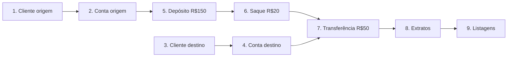

# RKF Bank — Roteiro de testes ponta a ponta (manual)

Roteiro para testar a API inteira na mão, com Postman, Insomnia ou curl. Serve para:

- conferir que tudo funciona antes de abrir um PR que mexe em regra de negócio;
- o **Fellipe (QA)** validar o MVP;
- quem está chegando entender o fluxo real do banco.

> Rotas e formatos oficiais: [README_CONTRATO_API.md](README_CONTRATO_API.md).
> Este roteiro chama o **backend direto** (`http://localhost:8080`, **sem** `/api`).

---

## 0. Preparação

1. Suba banco e API (seção "Como rodar" do [backend/README.md](README.md)).
2. Opcional, para começar do zero: `docker compose down -v && docker compose up -d` (**apaga todos os dados**).
3. No Postman/Insomnia, crie um ambiente com estas variáveis:

| Variável | Valor inicial |
|---|---|
| `baseUrl` | `http://localhost:8080` |
| `clienteOrigemId` | (preenchido no passo 1) |
| `contaOrigemId` | (preenchido no passo 2) |
| `clienteDestinoId` | (preenchido no passo 3) |
| `contaDestinoId` | (preenchido no passo 4) |

**CPFs válidos para teste:** `52998224725`, `16899535009`, `39053344705`, `11144477735`.
**CEPs reais:** `01001000` (Praça da Sé – SP), `30140071` (Belo Horizonte – MG).

---

## 1. Caminho feliz



### Passo 1 — Criar cliente origem

`POST {{baseUrl}}/clientes`

```json
{
  "nomeCompleto": "Joao Silva",
  "cpf": "52998224725",
  "email": "joao.silva@rkfbank.com",
  "telefone": "11999998888",
  "cep": "01001000",
  "numero": "123",
  "complemento": "Apto 45"
}
```

✅ Esperado: **`201`**, com CPF/telefone/CEP formatados e endereço preenchido pelo ViaCEP:

```json
{
  "id": "d0ca7cf7-3ec4-4d3a-8f77-79d89cf45f9e",
  "nomeCompleto": "Joao Silva",
  "cpf": "529.982.247-25",
  "email": "joao.silva@rkfbank.com",
  "telefone": "(11) 99999-8888",
  "endereco": {
    "cep": "01001-000",
    "logradouro": "Praça da Sé",
    "bairro": "Sé",
    "cidade": "São Paulo",
    "uf": "SP",
    "ibge": "3550308",
    "numero": "123",
    "complemento": "Apto 45"
  }
}
```

➡️ Salve `id` em `clienteOrigemId`.

### Passo 2 — Abrir conta origem

`POST {{baseUrl}}/contas/clientes/{{clienteOrigemId}}`

```json
{ "agencia": "0001", "numeroConta": "12345678", "tipoContaEnum": "CORRENTE" }
```

✅ Esperado: **`201`**, `saldo: 0.00`, `ativa: true`, `clienteId` igual ao do passo 1.

➡️ Salve `id` em `contaOrigemId`.

### Passo 3 — Criar cliente destino

`POST {{baseUrl}}/clientes`

```json
{
  "nomeCompleto": "Maria Souza",
  "cpf": "16899535009",
  "email": "maria.souza@rkfbank.com",
  "telefone": "31999997777",
  "cep": "30140071",
  "numero": "500",
  "complemento": "Sala 10"
}
```

✅ Esperado: **`201`**. ➡️ Salve `id` em `clienteDestinoId`.

### Passo 4 — Abrir conta destino

`POST {{baseUrl}}/contas/clientes/{{clienteDestinoId}}`

```json
{ "agencia": "0001", "numeroConta": "87654321", "tipoContaEnum": "POUPANCA" }
```

✅ Esperado: **`201`**. ➡️ Salve `id` em `contaDestinoId`.

### Passo 5 — Depositar R$ 150,00 na origem

`POST {{baseUrl}}/contas/{{contaOrigemId}}/deposito`

```json
{ "valor": 150.00, "descricao": "Deposito inicial" }
```

✅ Esperado: **`204`** sem corpo. Saldo da origem: **150.00**.

### Passo 6 — Sacar R$ 20,00 da origem

`POST {{baseUrl}}/contas/{{contaOrigemId}}/saque`

```json
{ "valor": 20.00, "descricao": "Saque teste" }
```

✅ Esperado: **`204`**. Saldo da origem: **130.00**.

### Passo 7 — Transferir R$ 50,00 da origem para o destino

`POST {{baseUrl}}/contas/transferencia`

```json
{
  "contaOrigemId": "{{contaOrigemId}}",
  "contaDestinoId": "{{contaDestinoId}}",
  "valor": 50.00,
  "descricao": "Transferencia aluguel"
}
```

✅ Esperado: **`204`**. Saldos: origem **80.00**, destino **50.00**.

### Passo 8 — Extratos

`GET {{baseUrl}}/contas/{{contaOrigemId}}/lancamentos`

✅ Esperado: **`200`** com 3 lançamentos, do mais novo para o mais antigo:
`TRANSFERENCIA` (50.00) → `SAQUE` (20.00) → `DEPOSITO` (150.00).

`GET {{baseUrl}}/contas/{{contaDestinoId}}/lancamentos`

✅ Esperado: **`200`** com 1 lançamento `TRANSFERENCIA`, em que `contaDestinoId` é a conta destino (entrada).

### Passo 9 — Listagens

| Requisição | Esperado |
|---|---|
| `GET {{baseUrl}}/clientes` | `200`, array com 2 clientes |
| `GET {{baseUrl}}/clientes?paginado=true&page=0&size=1` | `200`, página com 1 item, `totalElements: 2`, `totalPages: 2` |
| `GET {{baseUrl}}/contas` | `200`, array com 2 contas (origem com `saldo: 80.00`) |
| `GET {{baseUrl}}/contas?paginado=true&page=0&size=10` | `200`, página com 2 itens |

---

## 2. Cenários de erro

Rode depois do caminho feliz (alguns dependem dos dados criados).

| # | Cenário | Requisição | Esperado |
|---|---|---|---|
| E1 | CPF inválido | `POST /clientes` com `"cpf": "11111111111"` | `400`, `campos[0].campo = "cpf"` |
| E2 | Campo obrigatório vazio | `POST /clientes` com `"nomeCompleto": ""` | `400`, campo `nomeCompleto` |
| E3 | CPF repetido | repetir o passo 1 | `409` `CPF ja cadastrado` |
| E4 | E-mail repetido | passo 1 com outro CPF válido e o mesmo e-mail | `409` `Email ja cadastrado` |
| E5 | CEP inexistente | `POST /clientes` com `"cep": "99999999"` e CPF/e-mail novos | `422` `CEP não encontrado` |
| E6 | Cliente inexistente | `POST /contas/clientes/00000000-0000-0000-0000-000000000000` | `404` |
| E7 | Número de conta repetido | repetir o passo 2 | `409` `Numero de conta ja existe` |
| E8 | Agência inválida | passo 2 com `"agencia": "1"` | `400`, campo `agencia` |
| E9 | Tipo de conta inválido | passo 2 com `"tipoContaEnum": "SALARIO"` | `400` `JSON invalido ou tipo de campo incompativel` |
| E10 | Valor zero | depósito com `"valor": 0` | `400`, campo `valor` |
| E11 | Três casas decimais | depósito com `"valor": 10.555` | `400`, campo `valor` |
| E12 | Saldo insuficiente (saque) | saque de `999999.00` na origem | `422` `Saldo insuficiente` |
| E13 | Saldo insuficiente (transferência) | transferência de `999999.00` | `422` `Saldo insuficiente para transferencia` |
| E14 | Mesma conta | transferência com origem = destino | `422` `Conta de origem e destino nao podem ser iguais` |
| E15 | Conta inexistente | depósito em `/contas/00000000-0000-0000-0000-000000000000/deposito` | `404` `Conta nao encontrada` |
| E16 | ID inválido na URL | `GET /contas/abc/lancamentos` | `400` `Parametro de URL invalido` |
| E17 | Paginação inválida | `GET /clientes?paginado=true&size=0` | `400`, campo `size` |
| E18 | JSON quebrado | depósito com corpo `{ "valor": ` | `400` |

Formato de todo erro: ver [contrato, seção 6](README_CONTRATO_API.md#6-erros).

---

## 3. Mesmo fluxo via curl (Git Bash)

```bash
API=http://localhost:8080
H='Content-Type: application/json'

CLIENTE_ID=$(curl -s -X POST $API/clientes -H "$H" -d '{
  "nomeCompleto":"Joao Silva","cpf":"39053344705","email":"joao.curl@rkfbank.com",
  "telefone":"11999998888","cep":"01001000","numero":"123"}' | sed -E 's/.*"id":"([^"]+)".*/\1/')

CONTA_ID=$(curl -s -X POST $API/contas/clientes/$CLIENTE_ID -H "$H" \
  -d '{"agencia":"0001","numeroConta":"55555555","tipoContaEnum":"CORRENTE"}' | sed -E 's/.*"id":"([^"]+)".*/\1/')

curl -i -X POST $API/contas/$CONTA_ID/deposito -H "$H" -d '{"valor":150.00}'
curl -i -X POST $API/contas/$CONTA_ID/saque    -H "$H" -d '{"valor":20.00}'
curl -s $API/contas/$CONTA_ID/lancamentos
```

> O `sed` extrai o campo `"id"` da resposta. Com `jq` instalado, prefira `| jq -r .id`.

---

## 4. Conferindo no banco

Depois do caminho feliz, rode as consultas da seção **Banco de dados** do [backend/README.md](README.md)
e confira: 2 clientes, 2 endereços, 2 contas (80.00 e 50.00) e 4 lançamentos.

---

## 5. Checklist de validação do MVP (QA)

| ✔ | Item |
|:---:|---|
| ☐ | Passos 1 a 9 do caminho feliz com o resultado esperado |
| ☐ | Cenários E1 a E18 com o status esperado |
| ☐ | Saldos finais batem (origem 80.00, destino 50.00) |
| ☐ | Mensagens de erro fazem sentido para um usuário final |
| ☐ | Cadastro pela tela (`http://localhost:3000/cadastro`) com sucesso e com erro de CPF repetido |
