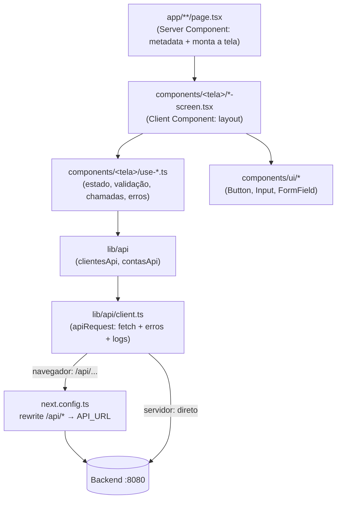

# RKF Bank — Frontend

Site do RKF Bank: landing page institucional e as telas do banco digital (cadastro, conta, movimentações).

| | |
|---|---|
| **Responsável** | Renan ([@renanbarrostech-cmd](https://github.com/renanbarrostech-cmd)) |
| **Stack** | Next.js 16 (App Router) · React 19 · TypeScript 5 (strict) · Tailwind CSS 4 · shadcn/ui (Radix) · lucide-react |
| **Gerenciador** | pnpm 10 |
| **Porta** | `3000` |

> ⚠️ **Next.js 16 é recente** e muda APIs em relação a tutoriais antigos (ex.: `LayoutProps` gerado por
> `next typegen`). Na dúvida, consulte a doc instalada em `node_modules/next/dist/docs/` ou
> <https://nextjs.org/docs>, não respostas antigas da internet.

---

## ▶ Como rodar

Pré-requisitos: Node 20+, pnpm 10 (`corepack enable`) e o **backend rodando** na porta 8080
(ver [README da raiz](../README.md#-rodando-o-projeto-do-zero)).

```bash
cd frontend
cp .env.example .env.local
pnpm install
pnpm dev                 # http://localhost:3000
```

| Script | O que faz | Quando rodar |
|---|---|---|
| `pnpm dev` | servidor de desenvolvimento com hot reload | sempre que estiver codando |
| `pnpm lint` | ESLint (regras do Next + TypeScript) | antes de todo PR |
| `pnpm typecheck` | gera os tipos de rota e roda `tsc --noEmit` | antes de todo PR |
| `pnpm build` | build de produção (pega erros que o `dev` deixa passar) | antes de todo PR |
| `pnpm start` | sobe o build de produção | para testar o build |

### Variáveis de ambiente

| Variável | Padrão | Para quê |
|---|---|---|
| `API_URL` | `http://localhost:8080` | endereço do backend. Lida **só no servidor** (proxy e Server Components) |
| `NEXT_PUBLIC_LOG_LEVEL` | `debug` em dev, `warn` em produção | nível mínimo dos logs (`debug`, `info`, `warn`, `error`) |

Todas são lidas em um único lugar: [`lib/env.ts`](lib/env.ts). Não use `process.env` espalhado pelo código.

> `NEXT_PUBLIC_*` é embutida no JavaScript do navegador **no build** — nunca coloque segredo numa variável
> com esse prefixo.

---

## 🗺️ Telas

| Rota | Arquivo | Status |
|---|---|---|
| `/` | [`app/page.tsx`](app/page.tsx) | ✅ landing page (estática) |
| `/cadastro` | [`app/cadastro/page.tsx`](app/cadastro/page.tsx) | ✅ cadastro de cliente integrado à API |
| `/login` | [`app/login/page.tsx`](app/login/page.tsx) | ✅ login com CPF e senha (volta para a tela de origem com `?voltar=`) |
| `/conta/abrir` | [`app/conta/abrir/page.tsx`](app/conta/abrir/page.tsx) | ✅ abertura de conta (passo seguinte ao cadastro) |
| `/conta` | [`app/conta/page.tsx`](app/conta/page.tsx) | ✅ saldo, dados da conta e ID para receber transferências |
| `/conta/depositar` | [`app/conta/depositar/page.tsx`](app/conta/depositar/page.tsx) | ✅ depósito |
| `/conta/sacar` | [`app/conta/sacar/page.tsx`](app/conta/sacar/page.tsx) | ✅ saque (valida o saldo antes de enviar) |
| `/conta/transferir` | [`app/conta/transferir/page.tsx`](app/conta/transferir/page.tsx) | ✅ transferência pelo ID da conta de destino |
| `/conta/extrato` | [`app/conta/extrato/page.tsx`](app/conta/extrato/page.tsx) | ✅ extrato agrupado por dia, entradas em verde |
| `/conta/senha` | [`app/conta/senha/page.tsx`](app/conta/senha/page.tsx) | ✅ trocar a própria senha (contrato 2.3); a sessão cai e o login mostra "senha trocada" |

As três movimentações são **uma tela só** (`components/movimentacao`), configurada por tipo em `movimentacoes.ts`:
o contrato é o mesmo (`valor` + `descricao`) e a transferência só acrescenta o destino. As telas da conta
reaproveitam o `useConta` e o `ContaEstado` (`components/conta`), que tratam carregando, sem cadastro, sem conta e erro.

Rotas ficam centralizadas em [`lib/routes.ts`](lib/routes.ts) (`ROUTES.signUp`, `ROUTES.login`…). Ao criar uma
tela nova, **adicione a rota lá** e use a constante nos links.

---

## 🏗️ Arquitetura



### As 4 regras da casa

1. **Componente não chama `fetch`.** Toda chamada passa por `clientesApi` / `contasApi` (em `lib/api`).
2. **Lógica fora do JSX.** Cada tela tem um hook (`use-cadastro-form.ts`) com estado, envio e tratamento de
   erro. O componente só desenha o que o hook devolve.
3. **Tipos espelham o contrato.** [`lib/api/types.ts`](lib/api/types.ts) é a versão TypeScript do
   [contrato de API](../backend/README_CONTRATO_API.md). Mudou o contrato? Mude o tipo primeiro — o
   TypeScript aponta tudo que quebrou.
4. **Server Component por padrão.** Só use `"use client"` quando precisar de estado, efeito ou evento
   (formulários, botões interativos). A landing page inteira é estática.

### Por que existe um proxy `/api`?

O navegador chama `http://localhost:3000/api/clientes`; o Next repassa para `http://localhost:8080/clientes`.

- **Sem CORS:** para o navegador, é a mesma origem.
- **URL do backend escondida:** `API_URL` não vai para o bundle do cliente.
- **Troca de ambiente sem mudar código:** em produção, só muda `API_URL`.

### Tratamento de erros da API

`apiRequest` transforma qualquer resposta de erro em `ApiError`:

```ts
try {
  await contasApi.sacar(contaId, { valor: 50 });
} catch (error) {
  if (error instanceof ApiError) {
    error.status;       // 400, 404, 409, 422, 503...
    error.message;      // mensagem do backend
    error.fieldErrors;  // { valor: "valor deve ser maior que zero" } → direto no formulário
  } else {
    // sem resposta: backend fora do ar ou rede caiu
  }
}
```

**Decida pelo `status`, nunca pelo texto da mensagem.** Exemplo real: `mensagemDeErro` em
[`components/cadastro/use-cadastro-form.ts`](components/cadastro/use-cadastro-form.ts).

### Login e sessão (JWT em cookie `httpOnly`)

O token **nunca chega ao JavaScript da página**. O servidor do Next fica no meio (padrão BFF):

```text
Login:   navegador ─POST /api/auth/login─► app/api/auth/login (Next) ─► API /auth/login
                   ◄─ Set-Cookie rkf_token (httpOnly) + { clienteId, perfil, expiraEm }
Demais:  navegador ─/api/contas (cookie vai sozinho)─► proxy.ts põe "Authorization: Bearer" ─► API
```

| Peça | Papel |
|---|---|
| [`app/api/auth/*`](app/api/auth) | `login` grava os cookies, `logout` apaga, `sessao` diz quem está logado |
| [`proxy.ts`](proxy.ts) | põe o `Bearer` nas chamadas `/api/*` e manda `/conta/*` sem sessão para o login |
| [`lib/api/auth.ts`](lib/api/auth.ts) | `authApi.login`, `authApi.sair`, `authApi.sessao` |
| [`lib/api/client.ts`](lib/api/client.ts) | `401` em qualquer chamada → login com `?expirou=1&voltar=<tela atual>` |
| [`lib/auth/cookies.ts`](lib/auth/cookies.ts) | nomes e opções dos cookies (`httpOnly`, `SameSite=Lax`, `Secure` em produção) |

- Nas telas, **não trate 401**: o `apiRequest` já leva ao login.
- Precisa do `clienteId` (ex.: abrir conta)? `await authApi.sessao()`.
- As contas do usuário vêm de `contasApi.minhas()` (`GET /contas` com o token devolve só as dele).
- Senha, confirmação e token são mascarados pelo logger (`lib/logger/mascara.ts`).

Por que cookie e não `localStorage`: ver "Onde o frontend guarda o token" em [planing/decisoes.md](../planing/decisoes.md).

### Dinheiro

A API envia valores como número decimal em reais (`150.00`). Para **fazer conta** no front, converta para
centavos com `decimalToCents` e formate com `formatCurrency` (ambos em [`lib/format.ts`](lib/format.ts)).
Nunca some `number` em reais direto (`0.1 + 0.2 = 0.30000000000000004`).

> Decisão pendente: a API passar a usar centavos? Ver [planing/decisoes.md](../planing/decisoes.md).

---

## 📁 Estrutura de pastas

```text
frontend/
├── app/                        # rotas (App Router): cada pasta com page.tsx vira uma URL
│   ├── layout.tsx              # HTML base, fonte, metadata global, tema escuro
│   ├── globals.css             # Tailwind 4 + tokens de cor da marca
│   ├── page.tsx                # landing page
│   ├── api/auth/              # Route Handlers do login, logout e sessão (cookies httpOnly)
│   ├── cadastro/page.tsx
│   ├── conta/                  # conta, abrir, depositar, sacar, transferir, extrato
│   └── login/page.tsx
├── components/
│   ├── ui/                     # peças genéricas (Button, Input, FormField) — base shadcn
│   ├── brand/                  # logo
│   ├── marketing/              # seções da landing page
│   ├── cadastro/               # tela de cadastro: screen, form, showcase, sucesso e o hook
│   ├── abrir-conta/            # tela de abertura de conta: screen, form, aviso, sucesso e o hook
│   ├── conta/                  # tela da conta + peças compartilhadas (useConta, ContaEstado, ContaShell, BotaoSair)
│   ├── movimentacao/           # depósito, saque e transferência (uma tela configurada por tipo)
│   ├── extrato/                # tela de extrato
│   ├── login/                  # tela de login e o hook
│   └── logs/                   # useLogDeTela e <LogDeTela />
├── config/
│   ├── site.ts                 # nome, slogan, descrição, menu
│   └── marketing.ts            # textos e dados da landing page
├── lib/
│   ├── api/                    # client HTTP, tipos do contrato, authApi, clientesApi, contasApi
│   ├── auth/cookies.ts         # cookies da sessão (só o servidor usa)
│   ├── logger/                 # logger com mascaramento LGPD (ver README próprio)
│   ├── env.ts                  # variáveis de ambiente
│   ├── format.ts               # moeda (formatCurrency, decimalToCents) e tipo de conta
│   ├── masks.ts                # máscaras de CPF, CEP, telefone + onlyDigits
│   ├── routes.ts               # rotas e âncoras da landing
│   └── utils.ts                # cn() para juntar classes
├── types/index.ts              # tipos do front que não vêm da API (Cents)
├── proxy.ts                    # Bearer nas chamadas /api e proteção das telas /conta
└── next.config.ts              # rewrite /api → backend
```

**Convenções de nomes**

| Coisa | Padrão | Exemplo |
|---|---|---|
| Arquivo de componente/hook | `kebab-case` | `cadastro-form.tsx`, `use-cadastro-form.ts` |
| Componente | `PascalCase` | `CadastroForm` |
| Hook | `useAlgo` | `useCadastroForm` |
| Constante de módulo | `UPPER_SNAKE_CASE` | `CAMPOS_OBRIGATORIOS` |
| Import interno | alias `@/` | `import { ROUTES } from "@/lib/routes"` |

---

## 🧱 Passo a passo: criando uma tela nova

Exemplo do roadmap: **extrato** (`GET /contas/{contaId}/lancamentos`, já disponível em `contasApi.extrato`).

1. **Rota** — adicione em `lib/routes.ts`: `extrato: "/conta/extrato"`.
2. **Página** — `app/conta/extrato/page.tsx` (Server Component), com `metadata` e renderizando a tela:

   ```tsx
   export const metadata: Metadata = { title: "Extrato" };

   export default function ExtratoPage() {
     return <ExtratoScreen />;
   }
   ```

3. **Hook** — `components/extrato/use-extrato.ts`: chama `contasApi.extrato(contaId)`, guarda
   `lancamentos`, `carregando` e `erro`, e registra os logs com `useLogDeTela("extrato")`.
4. **Tela** — `components/extrato/extrato-screen.tsx` (`"use client"`): usa o hook e desenha os
   **três estados**: carregando (skeleton), erro (mensagem + "tentar de novo") e sucesso (lista; lista vazia
   tem mensagem própria).
5. **Regras de exibição** — entrada/saída pelo `contaDestinoId` (ver contrato 4.5), valor com
   `formatCurrency(decimalToCents(valor))`, data com `Intl.DateTimeFormat("pt-BR")`.
6. **Acessibilidade** — `label` em todo input, foco visível, botão com texto (não só ícone), contraste ok.
7. **Checklist** — `pnpm lint && pnpm typecheck && pnpm build` e teste manual com o backend rodando.

> Endpoint ainda não existe (ex.: `GET /contas/{id}`)? Combine o formato no contrato, adicione a função em
> `lib/api/contas.ts` e o tipo em `types.ts`. Você já consegue construir a tela enquanto o backend implementa.

---

## 🎨 Estilo e design

- **Tailwind 4** configurado direto no CSS ([`app/globals.css`](app/globals.css)) — não existe `tailwind.config.js`.
- **Tokens da marca:** `brand-blue`, `brand-cyan`, `surface` e os gradientes `bg-gradient-brand` /
  `text-gradient-brand`. Use os tokens (`bg-brand-blue`), não cores soltas (`bg-[#3b82f6]`).
- **Tema escuro** fixo (classe `dark` no `<html>`).
- **Componentes base** vêm do shadcn/ui (`components.json`). Para adicionar um novo:
  `pnpm dlx shadcn@latest add <componente>` — ele cai em `components/ui/`.
- **Classes condicionais:** use `cn()` de `lib/utils.ts`.

---

## 📝 Logs

Todo log sai como `[rkf][escopo] mensagem { contexto }`, com CPF, e-mail, telefone e nome **mascarados
automaticamente**. Guia completo: [lib/logger/README.md](lib/logger/README.md).

---

## 🧯 Problemas comuns

| Sintoma | Causa provável | Solução |
|---|---|---|
| Cadastro mostra "Não foi possível conectar ao servidor" | backend não está rodando | suba o backend e teste `curl http://localhost:8080/clientes` |
| Console mostra `[rkf][api:http] ... falhou sem resposta` | idem, ou `API_URL` errada | confira `.env.local` e **reinicie** o `pnpm dev` |
| Mudei `.env.local` e nada mudou | variáveis são lidas na inicialização | reinicie o `pnpm dev` (e refaça o build em produção) |
| "Tela aberta" aparece duas vezes no console | React StrictMode em desenvolvimento | normal; em produção aparece uma vez |
| Erro de tipo em `LayoutProps` / `PageProps` | tipos de rota não gerados | rode `pnpm typecheck` (ele executa `next typegen`) |
| `pnpm: command not found` | pnpm não instalado | `corepack enable` |
