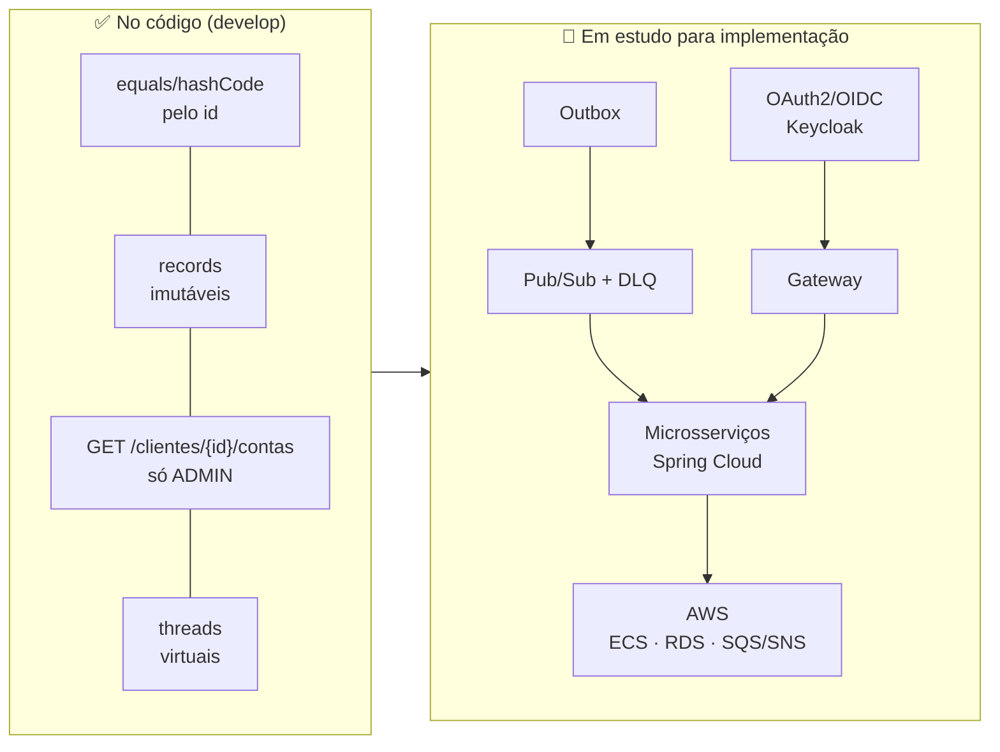
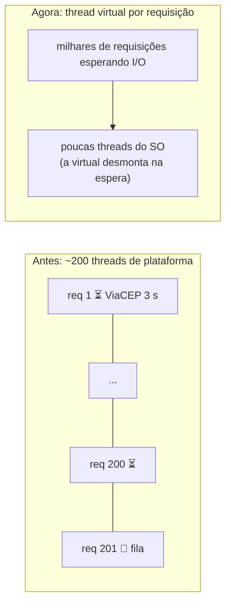
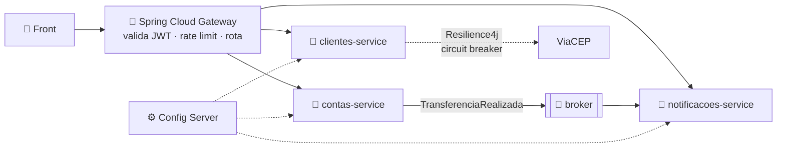
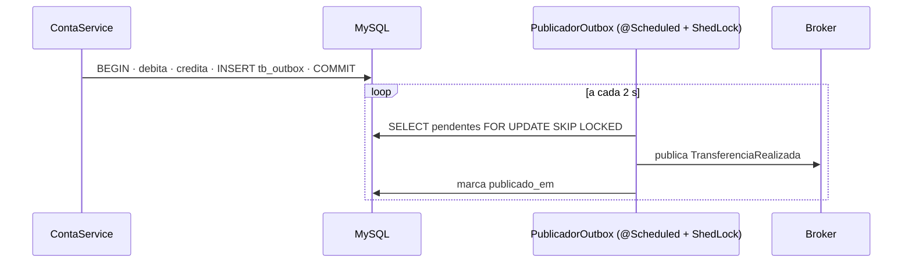
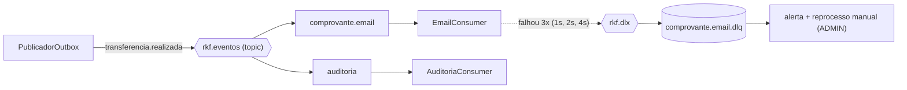
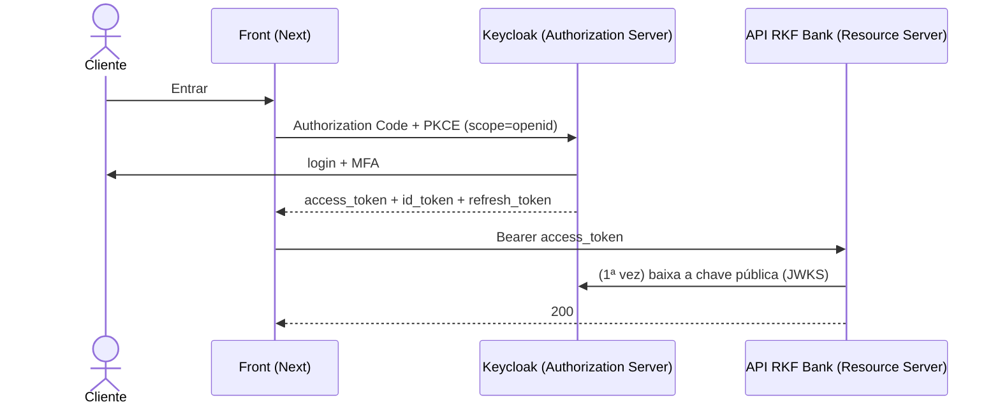

# Estudos de arquitetura — RKF Bank

O que já entrou no código e o que está **em estudo para implementação**: cada tema em estudo tem o problema que
resolveria aqui, uma ideia viável, código Spring de exemplo e o **gatilho** (o que precisa acontecer para valer a pena).
Nada desta página "em estudo" entra antes do MVP de 31/10/2026 — ver [decisoes.md](decisoes.md#arquitetura-distribuída-fica-em-estudo).

| Tema | Status | Onde |
|---|:-:|---|
| `equals`/`hashCode` das entidades | ✅ implementado | [§1](#1-equals-e-hashcode-das-entidades-) |
| Imutabilidade das respostas (records com lista) | ✅ implementado | [§2](#2-imutabilidade-dos-records-) |
| `GET /clientes/{clienteId}/contas` só para o ADMIN | ✅ implementado | [§3](#3-get-clientesclienteidcontas-só-admin-) |
| Threads virtuais | ✅ implementado | [§4](#4-threads-virtuais-) |
| Spring Cloud e microsserviços | 🔬 em estudo para implementação | [§5](#5-spring-cloud-e-microsserviços-) |
| Mensageria e Transactional Outbox | 🔬 em estudo para implementação | [§6](#6-mensageria-e-transactional-outbox-) |
| Pub/Sub e Dead Letter Queue (DLQ) | 🔬 em estudo para implementação | [§7](#7-pubsub-e-dead-letter-queue-dlq-) |
| Serviços AWS | 🔬 em estudo para implementação | [§8](#8-serviços-aws-) |
| OAuth2 e OpenID Connect (OIDC) com provedor externo | 🔬 em estudo para implementação | [§9](#9-oauth2-e-oidc-com-provedor-externo-) |



---

## 1. `equals` e `hashCode` das entidades ✅

As 7 entidades (`Conta`, `Cliente`, `Endereco`, `Lancamento`, `RefreshToken`, `RegistroIdempotencia`, `Usuario`) têm
identidade pelo **id do banco** e `hashCode` **fixo por classe**:

```java
@Override
public boolean equals(Object o) {
    if (this == o) return true;
    if (!(o instanceof Conta outro)) return false;          // instanceof aceita o proxy lazy do Hibernate
    return getId() != null && getId().equals(outro.getId()); // getter: o proxy só responde por ele
}

@Override
public int hashCode() {
    return Conta.class.hashCode(); // o id muda de null para UUID no persist; o hash não pode mudar junto
}
```

| Sem | Com |
|---|---|
| duas instâncias da mesma linha (carregadas em consultas diferentes) eram "diferentes" | iguais pelo id |
| `hashCode` pelo id → a entidade "some" do `HashSet` depois do `persist` | hash estável antes e depois |
| `equals` com todos os campos → carrega relacionamentos lazy e muda a cada `setSaldo` | só o id, que nunca muda |

Prova: `IdentidadeEntidadesTest` (21 casos: as 7 entidades × sem id, mesmo id, `HashSet` depois do persist).

## 2. Imutabilidade dos records ✅

Todo DTO já é `record` (campos `final`, sem setter). O furo era a **lista dentro do record**: quem montou a resposta
continuava com a referência e podia mudar o conteúdo. `ErroResponse` e `PaginaResponse` fazem cópia defensiva no
construtor compacto:

```java
public record ErroResponse(..., List<ErroCampoResponse> campos) {
    public ErroResponse {
        campos = campos == null ? List.of() : List.copyOf(campos); // cópia + lista que recusa add/remove
    }
}
```

Prova: `ImutabilidadeRespostasTest`. Ainda mutável de propósito: as entidades JPA (o Hibernate precisa de construtor
vazio e setters) — a regra continua sendo nunca expor entidade fora do service.

## 3. `GET /clientes/{clienteId}/contas` (só ADMIN) ✅

| Regra | Como |
|---|---|
| Só `ADMIN` | `requestMatchers(GET, "/clientes/*/contas").hasRole("ADMIN")` na `ConfiguracaoSeguranca` |
| Defesa em profundidade | `ContaService.clienteParaAdmin` confere de novo: se a regra da rota mudar por engano, o cliente segue barrado |
| **403 antes do 404** | quem não é ADMIN não descobre se o id de cliente existe (nem consulta o banco) |
| `404 CLIENTE_NAO_ENCONTRADO` | só o ADMIN chega a ver |
| Lista ou página | igual ao `GET /contas`: sem `page`/`size` → array; com → `PaginaResponse` (teto de 100) |
| Cliente comum | continua no `GET /contas`, que tira o dono do token (por isso a rota de cliente foi descartada na 2.6) |

Prova: `ContaServiceTest` (4), `ContaControllerTest` (4: 200, página, 403, 401) e `RotasContratoIntegracaoTest`
(com o seed: ADMIN 200, id inexistente 404, Fellipe 403). Contrato 3.2.

## 4. Threads virtuais ✅

```properties
spring.threads.virtual.enabled=true
```



- O Java continua no **25** (threads virtuais são do 21; o `maven-enforcer-plugin` segue exigindo 25).
- Vale para Tomcat, `@Scheduled` (rotinas de LGPD e limpeza) e `@Async`. Prova: `ThreadsVirtuaisTest`.
- **Pinning** (a virtual presa à thread do SO): o código não tem `synchronized` em volta de I/O e, desde o Java 24
  (JEP 491), nem `synchronized` prende mais. O limite real vira o **pool do Hikari** (10 conexões por padrão): mais
  threads não criam mais conexões com o banco.

---

## 5. Spring Cloud e microsserviços 🔬

> **Status: em estudo para implementação.** O RKF Bank é um monólito bem dividido em camadas; microsserviço resolve
> problema de times e de escala independentes, que ainda não temos.

**Gatilho:** um segundo time, ou uma parte com carga muito diferente (ex.: Pix ou notificações), ou deploy de uma parte
travando a outra. Antes disso, o passo seguro é o **monólito modular** (pacotes `cliente`, `conta`, `auth`, `pix`) já
proposto em [README_IMPLEMENTACAO.md §8](../backend/README_IMPLEMENTACAO.md#8-revisão-de-arquitetura-20102026).



| Peça do Spring Cloud | Para quê | Primeiro uso viável aqui |
|---|---|---|
| **Circuit Breaker** (Resilience4j) | parar de chamar quem está caindo | `ViaCepClient`: 5 falhas seguidas → abre por 30 s e devolve 503 na hora |
| **Gateway** | porta única, autenticação e rate limit | quando houver 2+ serviços |
| **Config Server** | configuração central por ambiente | quando houver 2+ serviços |
| **OpenFeign** | cliente HTTP declarativo | chamadas entre serviços |

Exemplo do primeiro passo (circuit breaker no ViaCEP):

```java
// pom: spring-cloud-starter-circuitbreaker-resilience4j (versão do BOM do Spring Cloud compatível com o Boot 4.1)
@Service
public class EnderecoService {

    private final ViaCepClient viaCep;
    private final CircuitBreakerFactory<?, ?> disjuntores;

    public ViaCepResponseDto buscar(String cep) {
        return disjuntores.create("viacep").run(
                () -> viaCep.buscarPorCep(cep),
                falha -> { throw new ServicoExternoIndisponivelException(falha); }); // 503 sem esperar o timeout
    }
}
```

```properties
resilience4j.circuitbreaker.instances.viacep.sliding-window-size=10
resilience4j.circuitbreaker.instances.viacep.failure-rate-threshold=50
resilience4j.circuitbreaker.instances.viacep.wait-duration-in-open-state=30s
```

## 6. Mensageria e Transactional Outbox 🔬

> **Status: em estudo para implementação** (feature 6 do [checklist](checklist-features.md)).

**Problema que resolveria:** comprovante por e-mail e notificação depois da transferência. Publicar o evento direto
no broker dentro do `transferir()` cria dois erros possíveis: o banco grava e o evento se perde (broker fora), ou o
evento sai e a transação dá *rollback* (o cliente recebe comprovante de algo que não aconteceu).

**Ideia viável:** gravar o evento numa tabela `tb_outbox` **na mesma transação** do dinheiro; um `@Scheduled` (já
temos ShedLock para rodar em uma instância só) publica o que estiver pendente.



```java
public record TransferenciaRealizada(UUID id, UUID contaOrigem, UUID contaDestino, BigDecimal valor, Instant em) {}

@Transactional
public void transferir(TransferenciaRequestDto request, UsuarioLogado usuario) {
    // ... débito, crédito e lançamentos como hoje ...
    outboxRepository.save(EventoOutbox.de("TransferenciaRealizada", evento)); // mesma transação do dinheiro
}

@Scheduled(fixedDelay = 2000)
@SchedulerLock(name = "publicar-outbox")
public void publicarPendentes() {
    for (EventoOutbox e : outboxRepository.findTop100ByPublicadoEmIsNullOrderByCriadoEm()) {
        rabbit.convertAndSend("rkf.eventos", e.getTipo(), e.getPayload());
        e.marcarPublicado(Instant.now());
    }
}
```

Migração prevista (`V<n>__outbox.sql`): `id BINARY(16)`, `tipo`, `payload JSON`, `criado_em`, `publicado_em NULL`,
índice em `publicado_em`. **Garantia:** *at-least-once* → o consumidor precisa ser idempotente (o `id` do evento).

## 7. Pub/Sub e Dead Letter Queue (DLQ) 🔬

> **Status: em estudo para implementação.** Depende do §6.

**Ideia viável:** um *exchange* `topic` (RabbitMQ) com uma fila por interessado. Cada fila tem DLQ: depois de 3
tentativas com espera crescente, a mensagem sai do caminho para não travar as outras (*poison message*).



```java
@Bean
Queue comprovanteEmail() {
    return QueueBuilder.durable("comprovante.email")
            .deadLetterExchange("rkf.dlx")
            .deadLetterRoutingKey("comprovante.email.dlq")
            .build();
}

@RabbitListener(queues = "comprovante.email")
public void aoTransferir(TransferenciaRealizada evento) {
    if (processados.existsById(evento.id())) return; // at-least-once: a mesma mensagem pode chegar 2x
    email.enviarComprovante(evento);
    processados.save(new EventoProcessado(evento.id()));
}
```

```properties
spring.rabbitmq.listener.simple.retry.enabled=true
spring.rabbitmq.listener.simple.retry.max-attempts=3
spring.rabbitmq.listener.simple.retry.initial-interval=1s
spring.rabbitmq.listener.simple.retry.multiplier=2
spring.rabbitmq.listener.simple.default-requeue-rejected=false
```

**Como testar:** `RabbitMQContainer` do Testcontainers (já usamos o de MySQL) + Awaitility esperando a mensagem na DLQ.

## 8. Serviços AWS 🔬

> **Status: em estudo para implementação** (feature 5 do [checklist](checklist-features.md)). A imagem Docker do perfil
> `prod` já existe e é publicada no ghcr.io pelo `backend-docker.yml`.

| Necessidade | Serviço AWS | Por quê |
|---|---|---|
| rodar a imagem da API | **ECS Fargate** (ou App Runner) | contêiner sem administrar servidor; usa o `/actuator/health` |
| MySQL gerenciado | **RDS for MySQL 8.4** | backup, patch e failover; o Flyway roda igual |
| segredos (`JWT_SEGREDO`, `DB_*`) | **Secrets Manager** | nada de segredo em variável de texto |
| filas do §6/§7 | **SNS** (tópico) + **SQS** (fila com DLQ nativa) | Pub/Sub gerenciado, sem broker para cuidar |
| logs e alarmes | **CloudWatch** | logs do Log4j2 com `X-Request-Id`; alarme na DLQ > 0 |
| front | **Amplify** ou S3 + CloudFront | Next.js estático/SSR |

```java
// spring-cloud-aws-starter-sqs (Spring Cloud AWS): mesma ideia do @RabbitListener
@SqsListener("comprovante-email")
public void aoTransferir(TransferenciaRealizada evento) { ... }
```

```properties
# segredos lidos do Secrets Manager na subida (spring-cloud-aws-starter-secrets-manager)
spring.config.import=optional:aws-secretsmanager:/rkfbank/prod
```

**Primeiro passo viável:** só **ECS Fargate + RDS + Secrets Manager** com a imagem atual (sem mudar código). SNS/SQS
entram junto com o §6. Estudo: curso *AWS na Prática* (Udemy).

## 9. OAuth2 e OIDC com provedor externo 🔬

> **Status: em estudo para implementação.** Parte já existe: a API **é um OAuth2 Resource Server**
> (`oauth2ResourceServer` + `NimbusJwtDecoder` na `ConfiguracaoSeguranca`). O que falta é **quem emite** o token.

**Hoje:** a própria API faz login (CPF + senha, BCrypt) e emite o JWT (`TokenService`, HS256).
**Ideia viável:** um **Authorization Server** (Keycloak no `docker compose`) faz o login, o MFA e emite o token
(RS256); a API só **valida** pela chave pública. O **OIDC** traz o *ID token* com quem é a pessoa (`sub`, `email`).



```properties
# troca a chave HMAC própria pela validação do emissor externo
spring.security.oauth2.resourceserver.jwt.issuer-uri=http://localhost:8180/realms/rkfbank
```

```java
// Os papéis do Keycloak viram ROLE_CLIENTE / ROLE_ADMIN; o resto da ConfiguracaoSeguranca não muda.
@Bean
JwtAuthenticationConverter conversorKeycloak() {
    var papeis = new JwtGrantedAuthoritiesConverter();
    papeis.setAuthoritiesClaimName("roles");
    papeis.setAuthorityPrefix("ROLE_");
    var conversor = new JwtAuthenticationConverter();
    conversor.setJwtGrantedAuthoritiesConverter(papeis);
    return conversor;
}
```

**O que muda e o que fica:** regra de dono, `UsuarioLogado`, `@AuthenticationPrincipal Jwt` e os testes com `jwt()`
continuam iguais; saem `AuthController`, `TokenService`, refresh token próprio e o limitador de login (o provedor faz).
**Gatilho:** login social, MFA, ou um segundo sistema usando o mesmo login.
