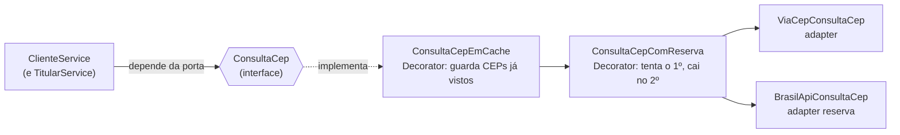

# Padrões de projeto no RKF Bank (22/10/2026)

> Estudo sobre o código da `develop` em 22/10/2026 (backend Spring Boot 4.1 / Java 25).
> **Nada aqui foi implementado ainda**: cada recomendação vira uma feature própria, com branch a partir da `develop`
> depois que os PRs abertos entrarem (CLAUDE.md: nunca empilhar branch em cima de outra sem merge).
> A skill `/sugerir-evolucao` usa este arquivo como catálogo.

## 1. Vale usar `interface` + `XxxServiceImpl`?

**Para os services de hoje: não.**

| Argumento a favor do `Impl` | No RKF Bank |
|---|---|
| "Facilita mockar nos testes" | o Mockito moca classe direto (`@Mock ContaService`); os 237 testes já fazem isso |
| "O Spring precisa de interface para o proxy do `@Transactional`" | precisava no Spring antigo (proxy JDK); desde o Boot 2 o padrão é proxy de **classe** (CGLIB) |
| "Permite trocar a implementação" | cada service tem **uma** implementação e não há segunda à vista: seria uma interface que só repete a classe |
| "É o padrão de mercado" | é comum em código legado; o guia do próprio Spring e projetos modernos usam a classe direto |

Custo de adotar: o dobro de arquivos, navegação mais lenta na IDE ("Go to implementation") e nomes que não dizem
nada (`ContaServiceImpl`).

**Onde a interface vale (e com nome de verdade, não `Impl`):** na **fronteira com o mundo de fora**, onde já existe
ou vai existir mais de uma implementação. É o padrão **Ports & Adapters** (arquitetura hexagonal) aplicado só onde
paga o preço:

| Porta (interface, o que o domínio precisa) | Adaptadores (implementações) | Quando |
|---|---|---|
| `ConsultaCep` | `ViaCepConsultaCep`, `BrasilApiConsultaCep` (reserva), `ConsultaCepEmCache` | logo depois do MVP |
| `NotificadorDeMovimentacao` | `NotificadorPorEmail`, `NotificadorNoLog` (dev) | junto da mensageria (feature 6) |
| `RelogioDoBanco` (ou `java.time.Clock`) | relógio real, relógio fixo nos testes | já existe no `LimitadorTentativasLogin`; estender quando surgir regra de horário (Pix noturno) |

## 2. Padrões que o projeto já usa (e onde)

Bom para entrevista: saber **nomear** o que já foi feito.

| Padrão | Onde | O que resolve |
|---|---|---|
| **Arquitetura em camadas** | `controllers` → `services` → `repositories` | cada camada com uma responsabilidade (guia de testes, seção 9) |
| **DTO** | `dto/request`, `dto/response` (`record`) | contrato da API separado da entidade |
| **Repository** | `repositories/*` (Spring Data) | acesso a dados atrás de uma interface; SQL gerado pelo nome do método |
| **Chain of Responsibility** | cadeia de filtros: `FiltroLogRequisicao` → Spring Security → controller | cada filtro decide se passa adiante ou responde |
| **Adapter** | `ConversorTokenUsuario` (JWT → autenticação do Spring), `ViaCepClient` (JSON do ViaCEP → `ViaCepResponseDto`) | traduz um formato de fora para o nosso |
| **Execute Around** (parente do *Template Method*) | `IdempotenciaService.executarUmaVez(..., Runnable movimentacao)` | o "antes" (checar a chave) e o "depois" (gravar a chave) ficam num lugar; cada operação só passa o miolo |
| **Exception Translation** | `TratadorGlobalDeErros`, `TratadorErrosSeguranca` | exceção de domínio vira status HTTP num ponto só |
| **Static Factory** | `PaginaResponse.de(page)`, `UsuarioLogado.de(jwt)` | construção com nome, escondendo a conversão |
| **Builder** | `JwtClaimsSet.builder()` no `TokenService` | objeto com muitos campos opcionais montado passo a passo |
| **Optimistic Locking** | `@Version` em `Conta` | concorrência sem travar a linha |
| **Idempotent Receiver** | `tb_idempotencia` + `Idempotency-Key` | repetir a mensagem não repete o efeito |

## 3. Recomendados para o RKF Bank (priorizados)

Critério: resolve um problema **real** do código de hoje, cabe no tamanho do projeto e mostra maturidade no
portfólio. Padrão "porque é bonito" fica de fora.

| # | Padrão | Problema que resolve hoje | Esforço | Valor no portfólio | Quando |
|:-:|---|---|:-:|:-:|---|
| 1 | **Modelo de domínio rico** (*Tell, don't ask*) | a regra de saldo mora no `ContaService` (`getSaldo` + `setSaldo` em cada movimentação: 5 `setSaldo` no service); a `Conta` é só um saco de dados (*modelo anêmico*) | 🟢 baixo | ⭐⭐⭐ | **antes do MVP** (31/10): pouco código, menos bug |
| 2 | **Value Object `Dinheiro`** | `BigDecimal` solto: escala 2, arredondamento e "maior que zero" repetidos | 🟡 médio | ⭐⭐⭐ | depois do 1 |
| 3 | **Ports & Adapters no CEP** + **Decorator** de cache e reserva | ViaCEP fora = cadastro fora (`503`); CEP consultado de novo a cada cadastro | 🟡 médio | ⭐⭐⭐ | logo depois do MVP |
| 4 | **Mapper** dedicado | conversão entidade → DTO espalhada (`toResponse`, `paraContaResponse`, `paraResponse`) | 🟢 baixo | ⭐⭐ | quando os services crescerem (hoje os `paraResponse` são poucos e locais) |
| 5 | **Domain Events** (*Observer*) + **Outbox** | nada avisa "transferência feita" (comprovante, notificação, auditoria) | 🔴 alto | ⭐⭐⭐⭐ | feature 6 (mensageria) |
| 6 | **Test Data Builder** | testes montam `Cliente`/`Conta` campo a campo; ruído esconde o que o teste prova | 🟢 baixo | ⭐⭐ | qualquer hora (só testes) |
| 7 | **Specification** | — (ainda não há busca com filtros) | — | ⭐ | só quando o extrato ganhar filtro |

### 3.1 Modelo de domínio rico — sem × com

**Sem (hoje):**
```java
// ContaService: o service pergunta o estado e decide pela conta
if (origem.getSaldo().compareTo(valor) < 0) throw new RegraNegocioException("Saldo insuficiente para transferencia");
origem.setSaldo(origem.getSaldo().subtract(valor));
destino.setSaldo(destino.getSaldo().add(valor));
```
**Com:**
```java
// Conta: a regra mora com o dado. Ninguem consegue deixar o saldo negativo, nem por engano.
public void debitar(BigDecimal valor) {
    garantirAtiva();
    if (saldo.compareTo(valor) < 0) throw new RegraNegocioException("Saldo insuficiente");
    saldo = saldo.subtract(valor);
}
public void creditar(BigDecimal valor) { garantirAtiva(); saldo = saldo.add(valor); }

// ContaService fica com a orquestracao: buscar, conferir o dono, chamar a regra, registrar o lancamento.
origem.debitar(valor);
destino.creditar(valor);
```
Ganho: o `setSaldo` público some (ninguém escreve saldo sem passar pela regra) e a regra é testada sem Spring,
com `new Conta()`.

### 3.2 Ports & Adapters + Decorator no CEP — sem × com



O service só conhece `ConsultaCep.buscar(cep)`. Cache e reserva são **decorators**: cada um envolve outro
`ConsultaCep` e acrescenta um comportamento, sem mudar quem chama. Nos testes, um `ConsultaCep` falso de duas linhas
substitui o `@MockitoBean`.

### 3.3 Domain Events — sem × com

**Sem:** para mandar comprovante, o `ContaService.transferir` teria que chamar e-mail, auditoria e o que mais vier:
cada nova reação mexe na regra do dinheiro.
**Com:** o service publica `TransferenciaRealizada` (`ApplicationEventPublisher`); quem se interessa escuta com
`@TransactionalEventListener(phase = AFTER_COMMIT)` (só depois que o dinheiro foi gravado). Com o **Outbox**, o evento é
gravado na mesma transação e enviado depois para a fila, sem risco de "movimentou e não avisou".

## 4. O que **não** usar agora (e por quê)

| Padrão | Por que não |
|---|---|
| `Impl` em todo service | seção 1 |
| CQRS (modelos separados de leitura e escrita) | o volume e as consultas de hoje não pedem; o custo de manter dois modelos é alto |
| Microsserviços | um time de três e um domínio pequeno: monolito modular é o certo (ver Spring Modulith quando crescer) |
| Abstract Factory / Visitor | nenhum problema do projeto tem a forma que eles resolvem |
| Saga | só existe com várias bases/serviços; aqui uma transação local resolve |
